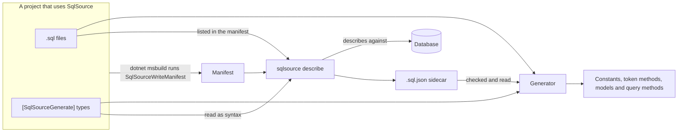

# Architecture

These pages explain how SqlSource's code works and how its parts hand work to each other, for a developer who needs to understand a component before changing it.  What a user writes and sees is in [the manual](../manual/README.md), and the rules for editing a folder's code are in the `AGENTS.md` beside it.

## Components

SqlSource ships two packages.

- **`SqlSource`** is the generator.  Its assembly, built from `src/SqlSource`, targets `netstandard2.0` because the C# compiler loads it.  It holds `SqlSourceGenerator`, an `IIncrementalGenerator`, and the package's one suppressor, `AttributeConflictSuppressor`.  The package also carries `src/SqlSource/build/SqlSource.props` and `src/SqlSource/build/SqlSource.targets`, which NuGet imports into every project that references it: they hand the project's `.sql` files and settings to the compiler, and hold the target `SqlSourceWriteManifest`, which writes the manifest.
- **`SqlSource.Tool`** is the `sqlsource` command, packed as a .NET tool.  Its assembly, built from `src/SqlSource.Tool`, targets `net8.0` and has one command, `describe`, which asks a database about each query and writes the query's sidecar.  The tool's package carries the generator assembly too, since the tool runs the generator's code.

## How a query flows

In a build, the compiler gives the generator the project's `.sql` files and their sidecars as additional files, its settings as MSBuild properties and item metadata, and the types that carry `[SqlSourceGenerate]`, an attribute the generator itself adds to the compilation.  The generator parses each file that a type claims and writes the type's file: a constant for each query whose output is `Sql` or `Models`, or a method for such a query that has tokens.  It also reads the sidecar of each claimed file, and reports a query that needs an entry and has no current one, as [sidecars](generator.md#sidecars) describes.  From each entry that passed the checks it gives the query's parameters and columns their C# types, and writes the query's models, once for each full name across the project, as [models](generator.md#models) describes.  For each query whose output is `CodeGen` and that has what it needs, it writes a method that runs the query, in place of its constant, in a file of the type's methods, as [query methods](generator.md#query-methods) describes.

Outside a build, `sqlsource describe` finds the run unit and evaluates its projects with `dotnet msbuild`, which runs `SqlSourceWriteManifest`.  It finds `[SqlSourceGenerate]` in a manifest's `Compile` files by syntax, with `AttributeReader`, and reads the manifest's `.sql` files that a type claims.  From those it plans the run with the generator's own code, asks each query's database through a describer, and writes a sidecar beside each `.sql` file.

The models and the query methods are the parts of the generated code that a sidecar decides: a type's own file, its constants and token methods, is the same with a sidecar or without one.

## Shared code

Code that both the generator and the tool use lives in the generator assembly.  The tool references `src/SqlSource/SqlSource.csproj` by a plain `ProjectReference`, and the generator's project lists `SqlSource.Tool` under `InternalsVisibleTo`, so the tool calls the generator's internal types directly and copies none of them.

The tool plans a run with the generator's path resolver, settings readers, parser and hash, among them `PathResolver`, `SqlFileReader`, `QuerySettings` and `SqlQueryHash`, so that it claims the same files and computes the same hashes as a build.  [`GeneratorParityTests`](../../tests/SqlSource.Tool.Tests/Planning/GeneratorParityTests.cs) holds the two to the same claims, to the same `SQLSRC209` and `SQLSRC210`, and to the same order of `SQLSRC011` and `SQLSRC014`, which both report.  The tool also reads, compares and writes sidecars with the generator assembly's `SidecarReader`, `SidecarComparer` and `SidecarWriter`, the generator reads them with the same `SidecarReader`, and the tool reports its errors with the descriptors of `ToolDiagnostics`.

## Glossary

Each page uses these terms in the sense given here.  The words a user meets are defined in [the manual's glossary](../manual/concepts.md#glossary).

### Capture

A `DescribeCapture`: every call a describer made to an engine that answered, with each request and answer, in the order it made them.  `CapturingExchange` records one, and `ReplayingExchange` answers from one without asking the engine.

### Claim

A type claims the `.sql` files that the `Path` of its `[SqlSourceGenerate]` resolves to, through `PathResolver`.  A file that no type claims is never parsed by the generator or read by the tool.

### Describer

An `IQueryDescriber`: the code that asks the databases of one dialect what a query's parameters and columns are, through a session it opens with each database.  `DescriberRegistry` holds one for each dialect, and which the released tool registers is [the host](tool.md#the-host).

### Dialect

A `SqlDialect`: the rules by which the parser reads a `.sql` file, resolved for each file before the parse.  The tool also chooses a database's describer by its dialect.

### Gated query

A statement with rows in whose SQL the PostgreSQL describer's `OuterJoinGate.IsGated` finds a word that can make a `NOT NULL` column of a table come back `NULL`, such as `LEFT` or `ROLLUP`.  A statement without rows is never gated.  A gated query's columns of a table are nullable by a heuristic until the [plan walk](#plan-walk) proves otherwise.

### Hint name

The name of a generated file, which `HintName` builds from identifier values: `<namespace>.<type>.g.cs` for a type's file, from its namespace and names, and `<full name>-Model.g.cs` for a model's, from its namespace and name.  The compiler compares hint names ignoring case and throws on a clash, so a name that would clash gets a hash added.

### Manifest

What the compiler is given for one project, which the target `SqlSourceWriteManifest` writes to a file for the tool: the project's `.sql` files with their metadata, the package's properties, the `Compile` files and a few properties of the SDK.  The tool reads it with `ManifestReader` into a `ProjectManifest`.

### Origin

The column of a table or view that a column of a result comes from, which the table match reads: the PostgreSQL describer's `ColumnOrigin`, from the row description and the catalog, and the SQL Server describer's, from the source columns of `sys.dm_exec_describe_first_result_set` (`SqlServerColumns.OriginOf`).  An expression, a column of a set operation and a system column have none.

### Plan walk

The PostgreSQL describer's reading of a query's `EXPLAIN` plan, in `NullabilityWalk`, to prove a column not nullable where the catalog alone cannot.  Whatever the walk cannot read keeps the answer it had before the walk, and is never a wrong `false`.

### Run unit

The one solution or project that a `describe` run is on, a `RunUnit`.  `RunUnitFinder` finds it from the path on the command line, the way `dotnet build` finds what to build.

### Settings level

A `SettingsLevel`: what one source says about the settings, whether the markers of a query and its file, a type's attribute, the metadata of a file's item or the project's properties.  `QuerySettings.Resolve` puts the levels together, the most specific first.

### Sidecar

The `<file>.sql.json` file that `sqlsource describe` writes beside a `.sql` file, with what the database said of each of its queries.  Its model is `Sidecar`, and its format is recorded in the [sidecar format design](../superpowers/specs/2026-10-07-sidecar-format-design.md).

## Reading guide

- [The generator](generator.md): the incremental pipeline and its steps, how the settings are read and resolved in two stages, how a `.sql` file is parsed, how each claimed file's sidecar is read and checked, the C# types and the models of a query, what is written for a type and for a model, how diagnostics travel, and the sidecar model the assembly holds.
- [The MSBuild files and the manifest](msbuild-and-manifest.md): what the props and targets hand the compiler, how they trim each value, and the manifest, whose format is the contract between the package and the tool, with its known limits.
- [The tool](tool.md): how `sqlsource` reads a command line and ends a run, the steps of a `describe` run from the run unit to the sidecars, what each folder does and uses of the generator, and how a run reports and logs.
- [The PostgreSQL describer](postgres-describer.md): the contract every describer implements, the exchange its calls go through and how a capture is recorded and replayed, then how the PostgreSQL describer describes one query, builds its parameters and columns, matches a table and chooses each error, and why no query can make it run a statement.
- [PostgreSQL nullability](postgres-nullability.md): how the describer decides whether a column can be null, from the catalog, the outer-join gate and the generic plan, and how the plan walk reads a plan's joins, outputs, expressions and set operations.
- [The SQL Server describer](sqlserver-describer.md): how the SQL Server describer opens a session and types a query's parameters: the server's reading of a declared type, the copies of a reused parameter and the probe that decides which copies count, the check of its parameters against the lexer's; how it describes the columns of the first result set in browse mode 2, with their origins and the server's nullability, narrowed where the query's text proves a column cannot be `NULL`, and matches a table; how it chooses each error, why no query can make it run a statement, which of SqlClient's events reach the log, and the realistic corpus that proves its nullability.
