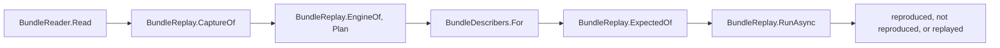

# Bundles and replay

How `src/SqlSource.Tool/Bundles/` reads and writes a bug-report [bundle](README.md#bundle), how `sqlsource replay` runs the pipeline from one with no database, and how `Bundles/Renaming/` renames a raw bundle so that it may be posted: the steps that are the same for every engine, the contract that an engine's part of the renaming implements, and PostgreSQL's part.  What a user runs and sees is in the manual's [checking a bundle with `replay`](../manual/tool.md#replay), and the errors in [`SQLSRC288`](../manual/diagnostics.md#sqlsrc288) to [`SQLSRC291`](../manual/diagnostics.md#sqlsrc291).  The decisions behind it are the [phase 10 design](../superpowers/specs/2026-11-04-query-generation-phase-10-bug-reports-design.md) and its [spike](../superpowers/specs/2026-11-05-query-generation-phase-10-spike.md).

## The bundle

A bundle is a zip, or a folder of the same files, which an unzipped bundle and a describer's fixture both are.  [`BundleFiles`](../../src/SqlSource.Tool/Bundles/BundleFiles.cs) names the files, and [`Bundle`](../../src/SqlSource.Tool/Bundles/Bundle.cs) holds them as text.

| File | What it holds | In a zip | In a folder |
|----|----|----|----|
| `bundle.json` | What made the bundle and what describing its query gave | Required | Optional, so that a recorded fixture reads |
| `query.sql` | The one query, as a complete SqlSource file | Required | Required |
| `capture.json` | The [capture](README.md#capture) of describing it, as `CaptureJson` writes one | Required | Required |
| `expected.json` | A sidecar of the one entry, when the query was described | Optional | Optional |
| `explain-settings.txt` | The planner's settings a PostgreSQL fixture was recorded with, one `name=value` a line | Optional | Optional |

A zip holds each file at its root.  The mapping file of a renamed bundle, `<bundle>.mapping.json` (`BundleFiles.MappingSuffix`), is never inside it, and neither is a log: a bundle holds no event, and `replay` makes the describer's events again from the capture.  Each text file is UTF-8 and is kept as it was read, so `query.sql` keeps its line ends.

### `bundle.json`

[`BundleInfo`](../../src/SqlSource.Tool/Bundles/BundleInfo.cs) is the file: `bundleVersion`, whether the bundle is `renamed`, the tool's version and the sidecar format's, the engine, the server's version and the driver's, the runtime, the system, and the `outcome`.  The outcome ([`BundleOutcome`](../../src/SqlSource.Tool/Bundles/BundleOutcome.cs)) is `{"kind": "entry"}`, or `{"kind": "failure", "id": ..., "step": ...}` with the diagnostic's id and the step as `DescribeStepName.Of` names it, null for a failure to open the session.

[`BundleJson.Write`](../../src/SqlSource.Tool/Bundles/BundleJson.cs) writes it as a capture is written: indented, with the relaxed encoder, `\n` line ends and a final line break, the keys in the order of the record.  `BundleJson.Read` reads `bundleVersion` before any other member, since a newer form may have changed them: one above `BundleJson.Version`, `1`, is `SQLSRC289`.  The sidecar format is versioned apart from the bundle's form, so once the file reads, a `formatVersion` above `SidecarFormat.Version` is `SQLSRC289` too, naming `formatVersion`.  A version below `1`, a member missing or of another type, text that is not a JSON object, and an outcome of an unknown kind are `SQLSRC288`, naming the member.  `driverVersion` and `step` must be present, and may be null.

### Reading and writing

[`BundleReader.Read`](../../src/SqlSource.Tool/Bundles/BundleReader.cs) takes the full path and the host's `OpenReadFile` and `ReadTextFile` ([the host](tool.md#the-host)).  When `OpenReadFile` gives a stream the path is a zip; when it gives null, a folder or nothing, the files are read through `ReadTextFile` of each name under the path.  `bundle.json` is read first when it is there, so that a bundle of a newer form is `SQLSRC289` even when its files changed, then `query.sql` and `capture.json`, and a zip without `bundle.json` is refused last.

Every error is `SQLSRC288` or `SQLSRC289` at the path, built by [`BundleErrors`](../../src/SqlSource.Tool/Bundles/BundleErrors.cs), which builds `SQLSRC290` and `SQLSRC291` too.  The reason names what is wrong: `there is no query.sql at the root of the zip`, `there is no capture.json in the folder`, `it is neither a zip nor a folder that holds query.sql and capture.json`, `it is not a zip that can be read: <reason>`.  An `IOException` or an `UnauthorizedAccessException` gives the system's message as the reason.  Every reason, and every other argument of these errors that a bundle gives, is written through [`BundleText`](../../src/SqlSource.Tool/Bundles/BundleText.cs) ([what it prints](#what-it-prints)).  The lines of `explain-settings.txt` are trimmed and the blank ones dropped.

[`BundleWriter.Write`](../../src/SqlSource.Tool/Bundles/BundleWriter.cs) writes a bundle into a stream as a zip that the reader reads, and leaves the stream open: `bundle.json`, `query.sql`, `capture.json`, then `expected.json` and `explain-settings.txt` when there are any, each UTF-8 with no byte order mark and dated 1980-01-01, the earliest time a zip holds, so that two writes of one bundle are the same bytes.  A bundle with no `bundle.json` throws `ArgumentException`, since the reader refuses a zip without one.  No command writes a bundle; the tests zip a fixture with it.

## `replay`

[`ReplayCommand`](../../src/SqlSource.Tool/ReplayCommand.cs) is the command, beside `DescribeCommand` at the tool's root, and how `Cli` reads its command line, opens its log and gives it its reporter is in [the tool's page](tool.md#the-steps-of-a-run).  [`BundleReplay`](../../src/SqlSource.Tool/Bundles/BundleReplay.cs) is the one replay of a bundle, whose steps are apart so that a caller reports what each gives; `replay` and the renaming's proof share them.

### The steps

1. **Read.**  The path is made full against `ToolHost.WorkingDirectory` and read by `BundleReader.Read`.  When `bundle.json` says the bundle is not renamed, `replay` prints `sqlsource: this bundle is not renamed, and must not be posted`.
2. **The capture.**  `CaptureOf` reads `captureVersion` first: one above `DescribeCapture.Version` is `SQLSRC289`.  Any other failure of `CaptureJson.Read` is `SQLSRC288`, its sentence made a reason, and so is an engine of `bundle.json` other than the capture's.
3. **The query.**  `EngineOf` gives `bundle.json`'s engine, or a folder's capture's.  `Plan` reads `query.sql` in that dialect as `FixtureReplay.Plan` does: through `SqlFileReader`, with the database of its `-- database:` or else the dialect's name, and the hash of `SqlQueryHash`.  An engine that is no describable dialect is `SQLSRC291`; a file that does not parse, that holds other than one query, or whose `-- dialect:` names another dialect is `SQLSRC288`.
4. **The describer.**  [`BundleDescribers.For`](../../src/SqlSource.Tool/Bundles/BundleDescribers.cs) gives the host's describer of the dialect, or `SQLSRC291` when the registry has none.  With `explain-settings.txt` it switches over the engine: PostgreSQL checks each line against `PlannerSettings`' closed list, `SQLSRC288` for one that is none, and makes `new PostgresDescriber(settings)`, the one place a describer is made with a bundle's settings ([the settings of the planner](postgres-nullability.md#the-settings-of-the-planner)); SQL Server's bundle has no such file, and is `SQLSRC288`.
5. **The expected answer**, before the run, so that a bundle whose answer cannot be read is not replayed for nothing.  `ExpectedOf` gives the one entry of `expected.json`, read by `SidecarReader`, with its `NameSpan` reset so that it equals a replayed entry; else the failure of `bundle.json`; else null, for no expected answer.  An `expected.json` of a format version above `SidecarFormat.Version` is `SQLSRC289`, naming `formatVersion`, since a folder may have no `bundle.json` to say it.  One that is no sidecar this tool reads, of an older format version, or of other than one entry is `SQLSRC288`.  `expected.json` wins over a failure that `bundle.json` names.
6. **The run.**  `RunAsync` opens the describer with an `OpenRequest` of the database, the connection `BundleReplay.Connection` (`replay`, since nothing opens) and a `ReplayingExchange` of the capture, describes the query as a run does, and builds the entry with `EntryBuilder.Build`.  A failure to open or describe is `ReplayOutcome.Refused` with its id and step.  A `CaptureMissException` of opening, describing or closing is `ReplayOutcome.Missed`, with its method, or `BundleReplay.UnknownQuestion` when it names none, so that a question the capture does not answer is never `SQLSRC200`; `replay` reports it as `SQLSRC290`, naming the call and the version that made the bundle.  Any other exception is a bug, and is let through to `Cli`.

### What it prints

The describer writes its events to a [`ReplayLines`](../../src/SqlSource.Tool/Bundles/ReplayLines.cs), through a log that puts the engine before each name, as a run's `SessionRunLog` does.  `ReplayLines` passes each event to the run's log, the file of `--log`, and prints `sqlsource: <name>: <member>=<JSON value> ...` on one line for each decision, a `walk.node`, `walk.column` or `table-match` event after its engine's prefix, and under `--verbose` for every event.  Nothing is removed from a line, since a bundle holds no connection.  So the lines are built from the events, and no describer writes a line of its own for `replay`.

Then the outcome, compared by `ReplayCommand`:

- **No expected answer**: `sqlsource: replayed: <answer>`, the entry as a sidecar of it alone writes its key and its object, on one line, or the refusal's id and step.  Exit code `0`.
- **The same answer**: `sqlsource: reproduced: the pipeline gives this answer`.  Exit code `0`.
- **Another answer**: `sqlsource: not reproduced`, a line for each difference, and, when the bundle has a `bundle.json`, the line that names the tool and sidecar format that made it beside this tool's.  Exit code `2`.

Two entries are the same when [`EntryDifferences.Of`](../../src/SqlSource.Tool/Bundles/EntryDifferences.cs) finds no difference: each is written by `SidecarWriter` as a sidecar of one entry and compared member by member, so every member counts, the server's version and the provenance among them, unlike `describe --check`'s `SidecarComparer`.  A difference is `<path>: <expected> -> <replayed>`, such as `columns[2].nullable: false -> true`, `(none)` for a member one side lacks, and `(key)` for a query of another name.  Two refusals are the same when their ids and steps are; an entry against a refusal is `expected an entry, replayed SQLSRC226 at describe parameters`.

A bundle may come from anyone, as one attached to a public issue does, and a control character in a text of it, such as the escape that starts a terminal's sequence, could move the cursor, rewrite what `replay` printed or reach the clipboard.  So every text `replay` prints from a bundle goes through `BundleText.Of`, which writes each control character but the tab, C0's, DEL and C1's, as `\uXXXX` in upper case: the `toolVersion` of `bundle.json` on the last line, each difference, whose refusal and path may come from the bundle, and every argument of `BundleErrors` but this tool's version and the numbers.  A line break is one of them, so the text stays on its line.  The lines of `ReplayLines` and the entry of `replayed:` are written by a JSON writer, which escapes each control character itself, `\b`, `\t`, `\n`, `\f` and `\r` in their short form, so `BundleText` would change nothing in them, and `OneLine` keeps them on their line.

Every error goes through the reporter, and the action returns `0`, so `Cli.ExitCodeOf` gives `1`; the action returns `2` itself for an answer that is not the bundle's, which `Cli.ExitCodeOf` passes on when no error was reported.  An error is at the bundle's full path.  When the path's token holds `=` or `;`, the error is at no file, its arguments have the path, as written and as `BundleText` writes it, replaced by `The path at position <n>`, and a line labelled `bundle` names it so.

### The bundle fixtures

`tests/SqlSource.Tool.Tests/Fixtures/Bundles/<engine>/<case>/` holds bundles as they unzip, each with the report's `bundle.json` kept whole (the committed cases, which no user's run made, have `fixture` for its tool, runtime and system).  [`BundleCases`](../../tests/SqlSource.Tool.Tests/BundleCases.cs) finds them, and [`BundleCasesTests`](../../tests/SqlSource.Tool.Tests/Fixtures/BundleCasesTests.cs) replays each through `BundleReplay` and compares it with its `expected.json`, or with the id and step of its `bundle.json`.  No container test describes them, and `tools/record-fixtures.sh` does not record them again: their tables are in no `schema.sql`.  [`ReplayTests`](../../tests/SqlSource.Tool.Tests/Commands/ReplayTests.cs) runs `replay` on every describer fixture's folder, which has no `bundle.json`, and on these.  How a bundle becomes a case is in [`tests/README.md`](../../tests/README.md#bundle-fixtures).

## Renaming

[`BundleRenamer.RenameAsync`](../../src/SqlSource.Tool/Bundles/Renaming/BundleRenamer.cs) takes a raw bundle, the engine's part of the renaming, the bundle's describer as `BundleDescribers.For` makes it, and a [`RenamingKey`](../../src/SqlSource.Tool/Bundles/Renaming/RenamingKey.cs), and gives a [`RenamedBundle`](../../src/SqlSource.Tool/Bundles/Renaming/RenamedBundle.cs), the bundle and its mapping, or the [`RenamingRefusal`](../../src/SqlSource.Tool/Bundles/Renaming/RenamingRefusal.cs) that says why it cannot be renamed safely.  It reads no file: the caller reads the raw bundle and writes what it gives, `MappingFile.Write` writing the mapping.  It throws `ArgumentException` for a bundle with no `bundle.json`, one renamed already, one whose capture does not read or is of another engine than the part's, and one whose `expected.json` is no sidecar of one entry, which a caller has replayed first.  No command calls it; its tests do, with [`FakeEngineRenaming`](../../tests/SqlSource.Tool.Tests/FakeEngineRenaming.cs) and the raw bundle of [`RenamingBundles`](../../tests/SqlSource.Tool.Tests/RenamingBundles.cs), and [PostgreSQL's](#the-tests-of-postgresqls-part) with its part.

Everything an engine decides is behind [`IEngineRenaming`](../../src/SqlSource.Tool/Bundles/Renaming/IEngineRenaming.cs), which [`EngineRenamings.For`](../../src/SqlSource.Tool/Bundles/Renaming/EngineRenamings.cs) gives for a `DatabaseEngine`.  The neutral part never names an engine.

### The steps

The steps run in this order, and the first refusal ends the run after its step.  The design's step numbers are in brackets.

1. **Drop** [1].  [`CaptureRenamer.Drop`](../../src/SqlSource.Tool/Bundles/Renaming/CaptureRenamer.cs) removes every member of each call, at any depth, whose `RuleOf` is `FieldRule.Drop`, and empties an array whose elements' rule is.  Neutral walk; the engine's rules.
2. **Register** [2 to 5].  `CaptureRenamer.Register` walks the answers of every call, then the requests, and registers each `Name` member: kept from the engine's row (`NameMapping.KeepFromEngineRow`) when `IsEngineRow` says its row is the engine's, else given its replacement, so that a name takes its class from the first catalog field that holds it.  Then the engine's `Register` for each call, in order, for the names only it finds, such as a plan's name keys.  Then the query's parameters, in the order of the file.
3. **`query.sql`** [5 to 8].  [`SqlRenamer.RenameQueryFile`](../../src/SqlSource.Tool/Bundles/Renaming/SqlRenamer.cs) renames the file lexeme by lexeme, with the engine's word rule and words: each marker kept with its value renamed (a marker that a bundle's `query.sql` never holds, or one that does not read, is refused), each token placeholder's name renamed as a token, comments emptied, hints' words renamed, numbers kept.  Neutral.
4. **Every string of each call** [6, 8 to 10].  `CaptureRenamer.Rename` renames each string by its member's rule through `RenamingRun.Field`, a string with no rule being refused at its place, and an `Own` member by the engine's `RenameOwn`.  Then the engine's `Derive` for each call.
5. **The entry** [11].  [`EntryRenamer.Rename`](../../src/SqlSource.Tool/Bundles/Renaming/EntryRenamer.cs) renames `expected.json` by a table of the sidecar's members, the same for every engine, and asks the engine's `RuleOf` for a member of a type record.  The entry's key is a query's name, its `database` is renamed as `-- database:` is, and its `hash` is the renamed query's, as `BundleReplay.Plan` computes it.  The file keeps the raw one's format and tool versions.  Neutral.
6. **The token check** [12].  [`TokenCheck.Check`](../../src/SqlSource.Tool/Bundles/Renaming/TokenCheck.cs) checks every string of the capture by its rule, then `query.sql`, then the entry's.  In `query.sql` a marker's value is checked by its kind: the shape after `-- name:`'s arrow and the value of `-- dialect:` must read as the generator reads them (`SettingValue.TryReadChoice<ResultShape>`, `SqlDialectMarker.TryRead`), whatever the renamer kept.  Neutral; an `Own` member's words come from the engine's `WordsOf`.
7. **The proof** [13, and the check of 8].  [`RenamingProof.ProveAsync`](../../src/SqlSource.Tool/Bundles/Renaming/RenamingProof.cs) replays the renamed bundle through `BundleReplay`, which must give its renamed entry, or the raw failure's id and step, whole.  A bundle with no expected answer passes with any outcome that misses nothing.  Neutral.
8. **The bundle.**  `bundle.json` is the raw one with `renamed` true, `capture.json` is written by `CaptureJson.Write`, and `explain-settings.txt` is kept, since its settings are the planner's words.

[`RenamingRun`](../../src/SqlSource.Tool/Bundles/Renaming/RenamingRun.cs) is one run: its mapping, its SQL renamer over the query's parameters, and its first refusal.  It gives a scope of each place, which is what an engine's part is given.  [`JsonStrings`](../../src/SqlSource.Tool/Bundles/Renaming/JsonStrings.cs) is the one walk over a tree's strings with their paths, which the capture's steps, the entry's and the token check share.  Only string values are visited: a member's name is fixed by the capture's records, and a number or a boolean is kept, unless step 1 drops it.

### The mapping

[`NameMapping`](../../src/SqlSource.Tool/Bundles/Renaming/NameMapping.cs) gives one spelling one replacement throughout a bundle, whatever class it is found in, its class being that of the first place it is found.  A spelling is compared as the engine's `Fold` gives it.  A replacement is the class's prefix (`NameClasses.PrefixOf`, `t_` for a table) and the HMAC-SHA256 of the class's word and the folded spelling, keyed by the run's 32 random bytes and cut to eight lower-case hex digits; a replacement already given lengthens by two digits until it is free.  The key is never written and prints as its type's name.  A literal's replacement is keyed by its content, apart from the names.

A spelling that `Keep` stores maps to itself, wins over a later `Name` and carries no class; a spelling that already has a replacement keeps it.  `KeepFromEngineRow` keeps a name of a row that `IsEngineRow` said is the engine's in the same way, and also in a set of its own, which alone answers `IsKeptFromEngineRow`, by the same fold: a spelling kept by `Keep` alone, as an engine's part keeps one through the scope, maps to itself but is not kept for the token check.  `Names` lists the names made, in their order, and leaves the kept ones out; [`MappingFile`](../../src/SqlSource.Tool/Bundles/Renaming/MappingFile.cs) writes them, each with its class and original.

### The SQL renamer

`SqlRenamer` renames SQL by the generator's lexer and the engine's word rule.  A `Text` lexeme is split into numbers, words and punctuation: an ASCII digit starts a run before the engine's `IsWordStart` is asked, of the engine's word parts, `.`, and a sign after `e` or `E` that a digit follows (`SqlRenamer.NumberRunEnd`).  The run is kept when it is a number, by the one rule the token check shares, `SqlRenamer.IsNumber`: ASCII digits, then optionally `.` and digits, then optionally `e` or `E`, an optional sign and digits, each group of digits taking one `_` between two digits, as PostgreSQL 16 reads `1_000`.  Any other run is refused whole, since an engine may read its rest as a name, as PostgreSQL 14 reads `1users` as `1 AS users`, or as a value, as SQL Server's `0x…` and PostgreSQL 16's `0x1F` hold one.  A word is the engine's when `IsEngineWord` says so, a function when `(` follows it, unless the new words are types, and else of the class given; punctuation is the closed ASCII set `SqlRenamer.Punctuation`; any other character is refused.  A `Quoted` lexeme is a literal or a name by its opener and the prefix before it, `E`, `N`, `B`, `X` or `U&`: a literal keeps its form with its content's replacement, a dollar-quoted one its tag, and a quoted name its delimiters, and a nullability mark after its stem.  PostgreSQL's `?column?` is kept whole.  A parameter is renamed through `ParameterName`, a copy of one of the query's through the parameter it copies.  A comment becomes an empty one of its kind, with its line breaks.

Each refusal of a text is reported and the pass goes on; the run keeps the first.  [`RenamedText`](../../src/SqlSource.Tool/Bundles/Renaming/RenamedText.cs) holds where each code point went, and `MapPosition` maps a position of the original, counted in code points from one, as PostgreSQL's position of an error is.

## The engine's contract

`IEngineRenaming`'s shape is fixed: PostgreSQL's part and SQL Server's are built against it, and it changes only by the agreement of both.  Of every member: it never reads a database, the host or a file; it holds nothing of one bundle once that bundle is renamed; and it never writes a name of its own making, since every replacement comes from the scope's mapping.  An engine refuses what it cannot rename safely, and never guesses or leaves a value blank.

| Member | It must | It must never |
|----|----|----|
| `Dialect` | Be the engine's describable dialect, whose `SqlDialectRules` the lexer reads its quoted regions, comments, hints and parameters by.  The raw capture's engine must be its canonical name | |
| `IsWordStart`, `IsWordPart` | Be the engine's own rule of a word in plain text, as the engine's lexer reads one | Count on its answer for an ASCII digit, which starts a number first |
| `Fold` | Give one text for each spelling and quoting, and the same text for two spellings the engine takes for one name: PostgreSQL lower-cases an unquoted name and keeps a quoted one, and SQL Server ignores case | Fold apart two spellings the engine merges, or merge two it keeps apart |
| `IsEngineWord` | Keep a keyword, a word of the engine's committed vocabulary, its own schema or database, and a name the planner or the tool makes, such as the `1` of SQL Server's `AS [1]`, compared after `Fold`.  A user's name spelled as such a word is kept too | Answer by what the mapping holds |
| `RuleOf` | Give a rule for every string member the pipeline reads, and `FieldRule.Drop` for every other, by the call's method and the member's path from the call, such as `answer.rows[].name`.  For the entry, the method is `expected.json` and the path runs from the entry through the type record, such as `columns[].type.element.name`, at any depth of nesting | Leave a member with no rule, which is a refusal; give `Drop` for a path of the entry, whose members are never dropped |
| `IsEngineRow` | Say whether a row of an answer is the engine's, a type or relation of `pg_catalog` or `information_schema`, a row of `sys` or of a system database, by the row alone.  It is asked of each `Name` member's row, with the row's path, such as `answer.rows[]` | Change the row |
| `CopyOf` | Give the parameter a pipeline's copy was made of, which is one of the query's, and the suffix after it, such as SQL Server's `before_1`; or null.  It is asked for every parameter name that is not the query's | Give a suffix that holds anything of the user's |
| `Register` | Register, through `IRenamingScope.Name` or `Keep`, the names only the engine finds, such as a plan's name keys.  A spelling it keeps passes the token check only where `IsEngineWord` keeps it.  It is called once for each call, in order, after the catalog's names and before the query's parameters and the query | Write into the call; keep through the scope a name that `IsEngineWord` does not keep |
| `RenameOwn` | Rename an `Own` member, such as a plan, an error's message or a setting's value: every name through the scope, every literal through `IRenamingScope.Literal`.  What it cannot read safely, it refuses through the scope, a plan's string the walk reads as `RefusalStep.PlanString` | Keep anything of the user's |
| `WordsOf` | Give every word, quoted name and literal of a renamed `Own` member for the token check, a quoted name as `"..."` and a literal as `'...'`, each with its quotes doubled within, which is how the check tells them apart | Omit a token but the engine's fixed texts, which then go unchecked |
| `Derive` | Make, once every string of every call is renamed, what the engine's pipeline makes by its own rule: a list asked in name order sorted again, a position mapped through `RenamedText.MapPosition`.  It reads `RenamingCall.Original` and writes `RenamingCall.Renamed`, and refuses what it cannot derive | Write into `Original` |

A member is given a [`RenamingCall`](../../src/SqlSource.Tool/Bundles/Renaming/RenamingCall.cs), a call as captured, `Original`, and as it is being renamed, `Renamed`, each with its `request` and `answer`, or a [`RenamingField`](../../src/SqlSource.Tool/Bundles/Renaming/RenamingField.cs), one string member with its call's index, `RenamingField.NoCall` for the entry, its method, its path, its original value and the object that holds it.  [`IRenamingScope`](../../src/SqlSource.Tool/Bundles/Renaming/IRenamingScope.cs) is what a member is given at its place.  `Name` gives a name's replacement, made in the class given if the spelling has none, or the spelling itself when it is kept or `IsEngineWord` keeps it.  `Keep` keeps a spelling from then on, which maps to itself, but which the token check does not trust: it passes only where `IsEngineWord` keeps it.  `IsMapped` says whether it has a replacement or is kept, `Literal` gives a literal's, `Sql` renames SQL with new words of a class and refuses at the member, `Parameter` renames a parameter's name, and `Refuse` records a refusal.  The scope gives no renamed query: a member that needs the renamed text of a request's SQL renames it with `Sql`, and the mapping gives it the query's names.

### Field rules

A [`FieldRule`](../../src/SqlSource.Tool/Bundles/Renaming/FieldRule.cs) is a kind and, for the kinds that make names, a `NameClass`.

| Kind | What the renaming does | What the token check asks |
|----|----|----|
| `Drop` | Removes the member in step 1 | That it is not there |
| `Fixed` | Keeps a text of the tool or the engine, such as a statement's name or a version | Nothing |
| `Closed` | Keeps a code of a closed set, such as `relkind` | Nothing |
| `Sql` | Renames SQL lexeme by lexeme; a new word is an alias, or of the rule's class | Each lexeme, as for `query.sql` |
| `TypeSpelling` | Renames a type's spelling as SQL whose new words are types | Each lexeme |
| `Label` | Renames an enum's label as the literal of the same spelling | That it is a replacement |
| `Parameter` | Renames a parameter's name, after the dialect's prefix when it has one, as the query's or as a copy of one | That it is a replacement, an engine's word, kept from an engine's row, or a copy of one that is |
| `Name` | Renames one name of the class, keeping a nullability mark after its stem and `?column?` whole, and keeping a name of an engine's row that the mapping does not hold | That its stem is a replacement, an engine's word or kept from an engine's row |
| `WholeName` | Renames the whole string as one name of the class, compared as quoted, such as the assembly-qualified name of a user's CLR type; kept when it is the engine's word | That it is a replacement, an engine's word or kept from an engine's row |
| `Own` | `RenameOwn` renames it | Each of `WordsOf` |

A number, by `SqlRenamer.IsNumber`, passes the check wherever it is, and so does one character of punctuation among an `Own` member's words.  A run from a digit that is no number is refused.

### Refusals

A refusal has its step, its place and its token, the user's own text, or null when the step names none.  Its place is `query.sql`, a call, `capture.json call <n> '<method>'`, a member of one, `capture.json call <n> '<method>' <path>`, a call the replay asked and the capture lacks, `capture.json call '<method>'`, or a member of the entry, `expected.json <path>`.

| `RefusalStep` | Design step | Who refuses |
|----|----|----|
| `RequestSql` | 8 | The proof, for a call the renamed capture does not answer |
| `PlanString` | 9 | The engine's `RenameOwn`, for a plan's string the walk reads and that does not read |
| `Token` | 12 | The SQL renamer, for SQL that does not lex, a character that is no word, number or punctuation, a run from a digit that is no number, and a marker that does not read or that a bundle never holds; the capture's and the entry's steps, for a string with no rule; the token check |
| `Replay` | 13 | The proof, for a renamed file that does not read, an entry that differs, at its first difference, and an outcome of the other kind |

### Why step 8 is the proof's capture miss

The design asks that the SQL of each request made from the renamed query equal the request renamed token by token.  `ReplayingExchange` finds a call by its whole request, so a renamed request that the pipeline does not make from the renamed query is exactly a question the renamed capture does not answer, a miss in the proof's replay.  The proof reports such a miss as `RequestSql` at that call, and no engine re-implements the pipeline's SQL.  What the pipeline makes by its own rule and the renaming would not make token by token, the engine's part derives: SQL Server's `AS [n]`, which `IsEngineWord` keeps, a copy of a reused parameter, through `CopyOf`, and a list asked in name order, through `Derive`.

### Rules found while building

- **Quoted or not, by class.**  A `Name` member of a catalog's class, schema, table, column, alias, function, type or index, is folded as quoted, since a catalog holds a name as the engine keeps it.  One of a query, a parameter, a token or a database is folded as unquoted, as `query.sql` reads it (`RenamingRun.IsQuoted`).  Without this, PostgreSQL's describe request's `GetUsers` and the file's `-- name: GetUsers`, which folds to `getusers`, became two names.  So a database that SQL Server's `open` answers is a `Database` name, folded unquoted.
- **The entry's paths are written in full.**  `RuleOf(BundleFiles.Expected, …)` is given the path from the entry with every nested type written out, such as `columns[].type.element.name` or `parameters[].type.base.name`, and only for paths under `parameters[].type.` and `columns[].type.`; an engine matches any depth.
- **What an engine keeps must pass the token check.**  The check trusts nothing the renaming kept but what `IsEngineWord` says and what the mapping kept from a row that `IsEngineRow` said is the engine's, which `NameMapping.KeepFromEngineRow` records in a set of its own that alone answers `IsKeptFromEngineRow`.  A name an engine keeps any other way, through `IRenamingScope.Keep` or as `pg_catalog`, `sys` or a built-in type a catalog answers outside such a row, still maps to itself, but passes the check only if `IsEngineWord` keeps it, so it must be in `IsEngineWord`.
- **A name spelled as an engine's word stays,** as the design's step 2 decided, wherever it stands: a parameter, a query's or a token's name, a quoted name's stem, through the one `SqlRenamer.NameOf`.  The entry's parameters follow it.
- **The logical database** of `-- database:` and of the entry is kept when it is the dialect's name, the tool's word, and is otherwise a `Database` name with no engine-word check (`RenamingRun.Database`).  The token check takes the dialect's name for a `Database` name.
- **PostgreSQL's word rule takes every character above `\u007F` into a word**, as its lexer does, so under PostgreSQL a non-ASCII character is renamed as part of a word, and the refusal of a character that is no word, number or punctuation applies where the engine's rule leaves one out.
- **A literal's key is its content**: `''` is read as one quote, and the backslash escapes of an `E''` string stay in the key.

### `EngineRenamings.For`

`EngineRenamings.For` is a switch over `DatabaseEngine`, each arm on a line of its own, and the one place that names an engine's part.  The arm of `PostgreSql` gives `PostgresRenaming.Instance`, and that of `SqlServer` gives null, marked `// Built by 10.3.`: null means a bundle of that engine cannot be renamed.

## Renaming for PostgreSQL

[`PostgresRenaming`](../../src/SqlSource.Tool/Bundles/Renaming/Postgres/PostgresRenaming.cs) is PostgreSQL's part, one instance that holds nothing of a bundle.  It decides nothing itself: it gives each member to the file of its concern in [`Bundles/Renaming/Postgres/`](../../src/SqlSource.Tool/Bundles/Renaming/Postgres/), and an `Own` member by its method and path.  What each call asks and what its records hold is [the calls and their records](postgres-describer.md#the-calls-and-their-records); which members the pipeline reads, and why each is safe to rename as it is, are the [spike](../superpowers/specs/2026-11-05-query-generation-phase-10-spike.md)'s findings 1 and 5.

| Member | PostgreSQL's answer | In |
|----|----|----|
| `Dialect` | `SqlDialect.PostgreSql` | `PostgresRenaming` |
| `IsWordStart`, `IsWordPart`, `Fold`, `IsEngineWord` | [The words](#postgresqls-words) | `PostgresWords`, `PostgresPlannerNames` |
| `RuleOf`, `IsEngineRow` | [The members and the engine's rows](#postgresqls-members-and-rows) | `PostgresFieldRules` |
| `CopyOf` | Always null: the pipeline makes no copy of a parameter, so a parameter's name that is not the query's is renamed as a name of its own | `PostgresRenaming` |
| `Register` | The name keys of an `explain` call's plan ([the plan](#postgresqls-plans)); nothing for any other call | `PostgresPlanRenamer` |
| `RenameOwn`, `WordsOf` | `open`'s setting values and every error's message ([settings and messages](#postgresqls-settings-and-messages)), and `explain`'s plan ([the plan](#postgresqls-plans)) | `PostgresOwnStrings`, `PostgresPlanRenamer` |
| `Derive` | The order of `relations` and `partitions`, and the position of `prepare`'s error ([what the pipeline makes](#what-postgresqls-pipeline-makes)) | `PostgresDerivations` |

### PostgreSQL's words

[`PostgresWords`](../../src/SqlSource.Tool/Bundles/Renaming/Postgres/PostgresWords.cs) gives the word rule of `PostgresIdentifiers`, the describer's and the server's lexer's: a word starts with an ASCII letter, `_` or any character above `\u007F`, and goes on with those, an ASCII digit and `$`.  `Fold` keeps a quoted spelling as it is and lower-cases `A` to `Z` alone in an unquoted one, as the server folds an identifier in a UTF-8 database, so a letter outside ASCII keeps its case.

`IsEngineWord` folds the spelling and keeps it when it is a word of the vocabulary, one of the schemas `pg_catalog`, `information_schema`, `pg_toast` and `public`, or a name the planner makes.  A user's name spelled as one of them is kept too, as the contract asks: a table named `tables` or `columns`, both types of `information_schema`, stays as it is.

The vocabulary is [`postgres-vocabulary.txt`](../../src/SqlSource.Tool/Bundles/Renaming/Postgres/postgres-vocabulary.txt), embedded in the tool and read once into `PostgresWords.Vocabulary`: one word a line, after a header whose lines start with `# `, `PostgresWords.HeaderMark`, since an operator such as `#>>` starts with `#` alone.  It holds the words of `pg_get_keywords()`, folded as a user writes one, and the names of `pg_catalog`'s functions, operators and types, of `information_schema`'s types and of `pg_class`'s system columns, each as the catalog holds it, as a quoted name folds.  So `RI_FKey_check_ins` keeps its case, and the unquoted spelling of it, which the server folds to a name that is no function, is renamed.  A relation of `pg_catalog`, such as `pg_class`, is in it as the name of its row type.  The list is the union of the words of the floor image, `postgres:14.24`, and of the default image, since a word that only one of them knows is still the engine's word in a bundle from its server.  `VocabularyTests` of `tests/DatabaseTests/Postgres` makes it and checks it, never a hand, as [the renaming's vocabulary](../../tests/DatabaseTests/Postgres/README.md#the-renamings-vocabulary) explains; it is the one thing recorded on a floor image, as root `AGENTS.md` rule 5 says.

[`PostgresPlannerNames`](../../src/SqlSource.Tool/Bundles/Renaming/Postgres/PostgresPlannerNames.cs) holds the names the parser and the planner make up and a plan prints, which the spike found in the source of 14 to 18 and in their plans: whole forms, such as `*SELECT*`, `*VALUES*`, `subplan`, `unnamed_subquery`, `excluded`, `old` and `new`, and a text and a number, `*SELECT* <n>`, `*VALUES*_<n>`, `column<n>`, `col<n>` and `w<n>`.  A form in upper case is compared as printed, since a plan quotes it.  They are no name of the user's, so they are kept; a user's `w1` or `column1` differs from the planner's only by its place, and is kept as any engine word is.

### PostgreSQL's members and rows

[`PostgresFieldRules`](../../src/SqlSource.Tool/Bundles/Renaming/Postgres/PostgresFieldRules.cs) is the table of `RuleOf`, read from its `Build`: each line is a call's name from `PostgresCallNames`, a member's path from the call as `CaptureJson.Options` names it, and the member's rule.  A loop over several calls gives the members they share, the tables of `tables` and `relations` and the error of every call.  The members of the entry's PostgreSQL type, `TypeMembers`, are found under `parameters[].type.` and `columns[].type.`, at any depth of `element.`, `base.` and `subtype.`.  Every string member the pipeline reads has a rule; what is dropped is what nothing reads: an error's `detail` and `hint`, its `position` but for `prepare`'s, and the whole error of `deallocate`, `partitions` and `relations`.  A number or a boolean with no rule is kept, as for every engine.

`IsEngineRow` reads the row's `nspname`, or its `schema` when it has none, and says the row is the engine's when that is `pg_catalog` or `information_schema`, whatever the call or path.  So a type of `pg_catalog` in `types`, or a table of `information_schema` that `tables` answers, keeps its name.  A row of `public` is the user's, and the name `public` is kept by `IsEngineWord` alone.  A column's row in `tables` holds no schema, so a column of a relation of `pg_catalog` is renamed, unless it is a word of the vocabulary: the name is not the user's and is renamed alike wherever it is, so no decision changes.

### PostgreSQL's settings and messages

[`PostgresOwnStrings`](../../src/SqlSource.Tool/Bundles/Renaming/Postgres/PostgresOwnStrings.cs) renames the two kinds of the engine's own text that are no SQL.

- **A setting of `open`**, by the `name` beside its value.  `search_path` is read by `PostgresSearchPath` and written again with `, ` between its schemas, each renamed as a `Schema` name but `$user`, `public`, `pg_catalog` and an empty one, a quoted one written back quoted.  The value of every other setting that `PostgresLive.SettingNames` lists, `plan_cache_mode` and `standard_conforming_strings`, is the server's closed word and kept.  A setting of any other name, and a `search_path` that does not read, are refused, `RefusalStep.Token` at the value.
- **An error's message**, of any call, and `check`'s `driverError.message`.  The describer matches an error by its SQLSTATE alone and reads a message only as one of the four texts the tool itself writes into an answer, `ConnectionErrors.MultiplexingRefused` and `UnreadableTypes`, `PostgresLive.StatementNotListed` and `TransactionRefused`, and for the parameter that a `42P18` or `42P08` names by its first `$n`.  So a message is written back as the tool's text alone: one of the four kept, `parameter $<n>` for such an error, and else the empty string, which `driverError.message` always is.  None of the server's text is kept, since it may quote the user's names and values.

`WordsOf` gives the token check a renamed schema of `search_path` but the engine's, nothing of a kept setting's value or of a message the tool wrote, and the value whole for anything else, which the check then refuses.

### PostgreSQL's plans

[`PostgresPlanRenamer`](../../src/SqlSource.Tool/Bundles/Renaming/Postgres/PostgresPlanRenamer.cs) renames `answer.plan`, the text of `EXPLAIN (VERBOSE, FORMAT JSON)`, key by key, and writes it again indented with `\n` line ends.  The keys it keeps are the keys the walk reads, the constants of `PlanKeys`, each with its kind in `Kinds`; every other key is dropped at any depth, so that a key no corpus held is dropped too.

| Kind | Keys | What it keeps |
|----|----|----|
| Structure | `Plan`, `Plans` | The nodes, each renamed |
| Fixed | `Node Type`, `Join Type`, `Parent Relationship`, `Strategy`, `Command` | The planner's closed word |
| Count | `Subplans Removed` | The number; a string is refused |
| Presence | `Grouping Sets` | One empty object for each element, since the walk reads only that it is there |
| Name | `Alias`, `Relation Name`, `Schema`, `CTE Name` | One raw name, renamed as a catalog holds it, quoted, so that the same spelling quoted in `Output` has the same replacement: an `Alias` or a `CTE Name` an `Alias` name, a `Relation Name` a `Table` and a `Schema` a `Schema` |
| Subplan | `Subplan Name` | `CTE <name>`, its name renamed as an `Alias`; any other as an expression |
| Expression | `Output`, `Filter`, `Group Key` | Each string read by the walk's `PlanTokens`: a word or a quoted name renamed as a name, a function's where `(` follows, a string as the mapping's literal, a number and punctuation kept, and any other token kept only when it holds no letter, digit or `_` |

A plan that is no JSON array of objects with a `Plan`, a node that is no object, an object or an array where a key holds a text, a string of an expression key that `PlanTokens` cannot read and a token of no kind it renames are refused, `RefusalStep.PlanString`, at the plan's place.  `Register` registers each name key in its class before the query is renamed, so that a name a plan is the first to hold takes its key's class.

The planner prints a partition's scan, or a child's of an inherited table, under its parent's alias and a number, `orders_1`, which the query does not hold, and `PlanPartitions` finds the members of an `Append` by that alias; renamed as a name of its own, the members would lose their alias and the entry would change.  So an `Alias` of the form `<alias>_<n>` is not registered, and is decided when the plan is renamed, by which time the query and the catalog have mapped their names.  The members of an `Append` or a `Merge Append` that `PlanPartitions.ShapeOf` reads as one prefix are decided by that structure, since a partition may be named as its scan, `orders_1` of `orders`, which the catalog's answers and the member's `Relation Name` map as a table: a member's `Alias`, and the same spelling wherever it qualifies a column in the plan's expressions, a word or a quoted name that a `.` directly follows and none directly precedes, as `PlanPartitions.WithoutAlias` reads one, is the stem's replacement and the planner's `_<n>`, `t_1234abcd_1`, when the mapping holds the stem or the stem is the engine's word, whatever the mapping holds of the spelling.  The `Relation Name` keeps the table's own replacement, and the members of the renamed plan share one prefix again.  Every name a plan prints is unique within it, so the spelling names that member wherever it qualifies a column; each plan of an answer is read on its own.  Any other `<alias>_<n>`, outside such an `Append`, keeps the mapping's own replacement when the mapping holds it, and is the stem's replacement and `_<n>` when the mapping holds its stem or the stem is the engine's word.  The token check is given the stem of `<stem>_<n>` when the stem is shaped as a replacement, a lower-case letter, `_` and eight or more lower-case hex digits, and the planner's `_<n>` is then its fixed text.  The stem of a child of an engine's word stays as it is, so `name_1` reaches the check whole, and is refused, since neither the renaming nor the check can tell the planner's suffix from a user's name.

`WordsOf` gives nothing of a fixed key or a count, a name as `"<name>"`, a CTE's `Subplan Name` as its name so, and an expression's tokens, a word, a quoted name and a string as written and every other a character at a time, and gives every string of a key it does not read whole, the key too.

### What PostgreSQL's pipeline makes

[`PostgresDerivations`](../../src/SqlSource.Tool/Bundles/Renaming/Postgres/PostgresDerivations.cs) makes again two things the pipeline makes by its own rule, which a renaming token by token would not.

- **The order of `relations` and `partitions`.**  The describer asks its relations in schema and name order, `PlanRelations.InOrder`, which renamed names change, and the replay finds an answer by its request, so each request's relations are sorted again by their renamed names.
- **The position of `prepare`'s error**, a count of code points into `PREPARE <statement> (<types>) AS <sql>`, which moves with each renamed name and declared type.  The describer reads a position only as in the query's SQL or in an item of the type list, whose declared parameter it names, so a position is mapped within its part: in the SQL through `RenamedText.MapPosition`, after the renamed head; in an item of the list through the item's renamed type, a position in the separator after an item, or after the last, being clamped to the item's last code point so that it stays in the same item; in `PREPARE <statement> (`, which the renaming does not change, kept.  The renamed SQL and types are made again through `IRenamingScope.Sql` from the originals, and a position is refused, `RefusalStep.Token` at `answer.error.position` with no token, when that text is not the renamed member or the position is outside it.

A request or an answer that does not read as its record is left alone, and the proof's replay then refuses it.

### The tests of PostgreSQL's part

Each file of the folder has its tests in `tests/SqlSource.Tool.Tests/Bundles/Renaming/Postgres/`, which test a member alone with `FakeRenamingScope` of `tests/SqlSource.Tool.Tests`.  `PostgresFieldRulesTests` fails when a string member of a record of `PostgresCalls.cs` has no rule, or a rule names no member, and `PostgresPlanRenamerTests` when a key of `PlanKeys.All` has no kind.  The rest rename whole bundles, through `PostgresRenamings.cs` and the helpers of `tests/SqlSource.Tool.Testing/Bundles/` ([the libraries](../../tests/README.md#the-projects)):

- `PostgresFixtureRenamingTests` renames every case of the describer's fixtures with no database: each replays with the original's provenance, `BundleLeaks` finds no name or literal of the fixtures' `schema.sql` or of the case's query in it, and two keys give no replacement in common.  Its list of the cases that must be refused is empty.
- `PostgresRefusalTests` builds bundles by hand from the fixtures: what is refused and at what place, and the server's errors renamed, whose bundle replays to the original's failure and holds none of the server's text.
- `PostgresClassificationTests` finds, without asking the renaming, each word of a fixture's plans that neither the query, the schema nor a catalog answer holds, which is the engine's or the planner's, and fails when the renamed plan does not keep it.
- On a container, `Renaming/RealisticRenamingTests` of `tests/DatabaseTests/Postgres` renames the realistic corpus as captured live, which CI runs on the floor and default images, and `Renaming/VocabularyTests` checks the vocabulary: [the realistic corpus renamed](../../tests/DatabaseTests/Postgres/README.md#the-realistic-corpus-renamed).

`BundleLeaks` lexes the sources as PostgreSQL, and seeks a name as a whole word, an unquoted one ignoring case and a quoted one as written, so that `"Order"` is sought though its fold is a keyword and `ORDER BY` is not it, and a literal of four characters or more as a substring, or as a whole word when it is one; it does not seek the engine's words, asked of a name with whether the source quotes it, or a shorter literal, and does not seek in the names of members, a call's `method`, the sidecar's header or a string of one character outside a plan, such as a `relkind`, which a one-letter alias would match.

## Not built yet

### Renaming for SQL Server

> **Not built yet.**  How SQL Server's part of the renaming answers each member of `IEngineRenaming`.  Delivered by sub-phase 10.3 of phase 10 of the [query generation epic](../superpowers/specs/2026-10-07-query-generation-epic-design.md).
