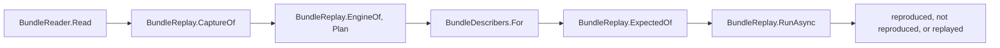

# Bundles and replay

How `src/SqlSource.Tool/Bundles/` reads and writes a bug-report [bundle](README.md#bundle), how `sqlsource replay` runs the pipeline from one with no database, and how `Bundles/Renaming/` renames a raw bundle so that it may be posted: the steps that are the same for every engine, and the contract that an engine's part of the renaming implements.  What a user runs and sees is in the manual's [checking a bundle with `replay`](../manual/tool.md#replay), and the errors in [`SQLSRC288`](../manual/diagnostics.md#sqlsrc288) to [`SQLSRC291`](../manual/diagnostics.md#sqlsrc291).  The decisions behind it are the [phase 10 design](../superpowers/specs/2026-11-04-query-generation-phase-10-bug-reports-design.md) and its [spike](../superpowers/specs/2026-11-05-query-generation-phase-10-spike.md).

## The bundle

A bundle is a zip, or a folder of the same files, which an unzipped bundle and a describer's fixture both are.  [`BundleFiles`](../../src/SqlSource.Tool/Bundles/BundleFiles.cs) names the files, and [`Bundle`](../../src/SqlSource.Tool/Bundles/Bundle.cs) holds them as text.

| File | What it holds | In a zip | In a folder |
|----|----|----|----|
| `bundle.json` | What made the bundle and what describing its query gave | Required | Optional, so that a recorded fixture reads |
| `query.sql` | The one query, as a complete SqlSource file | Required | Required |
| `capture.json` | The [capture](README.md#capture) of describing it, as `CaptureJson` writes one | Required | Required |
| `expected.json` | A sidecar of the one entry, when the query was described | Optional | Optional |
| `explain-settings.txt` | The planner's settings a PostgreSQL fixture was recorded with, one `name=value` a line | Optional | Optional |

A zip holds each file at its root.  The mapping file of a renamed bundle, `<bundle>.mapping.json` (`BundleFiles.MappingSuffix`), is never inside it, and neither is a log: a bundle holds no event, and `replay` makes the describer's events again from the capture.  Each text file is UTF-8 and is kept as it was read, so `query.sql` keeps its line ends.

### `bundle.json`

[`BundleInfo`](../../src/SqlSource.Tool/Bundles/BundleInfo.cs) is the file: `bundleVersion`, whether the bundle is `renamed`, the tool's version and the sidecar format's, the engine, the server's version and the driver's, the runtime, the system, and the `outcome`.  The outcome ([`BundleOutcome`](../../src/SqlSource.Tool/Bundles/BundleOutcome.cs)) is `{"kind": "entry"}`, or `{"kind": "failure", "id": ..., "step": ...}` with the diagnostic's id and the step as `DescribeStepName.Of` names it, null for a failure to open the session.

[`BundleJson.Write`](../../src/SqlSource.Tool/Bundles/BundleJson.cs) writes it as a capture is written: indented, with the relaxed encoder, `\n` line ends and a final line break, the keys in the order of the record.  `BundleJson.Read` reads `bundleVersion` before any other member, since a newer form may have changed them: one above `BundleJson.Version`, `1`, is `SQLSRC289`.  The sidecar format is versioned apart from the bundle's form, so once the file reads, a `formatVersion` above `SidecarFormat.Version` is `SQLSRC289` too, naming `formatVersion`.  A version below `1`, a member missing or of another type, text that is not a JSON object, and an outcome of an unknown kind are `SQLSRC288`, naming the member.  `driverVersion` and `step` must be present, and may be null.

### Reading and writing

[`BundleReader.Read`](../../src/SqlSource.Tool/Bundles/BundleReader.cs) takes the full path and the host's `OpenReadFile` and `ReadTextFile` ([the host](tool.md#the-host)).  When `OpenReadFile` gives a stream the path is a zip; when it gives null, a folder or nothing, the files are read through `ReadTextFile` of each name under the path.  `bundle.json` is read first when it is there, so that a bundle of a newer form is `SQLSRC289` even when its files changed, then `query.sql` and `capture.json`, and a zip without `bundle.json` is refused last.

Every error is `SQLSRC288` or `SQLSRC289` at the path, built by [`BundleErrors`](../../src/SqlSource.Tool/Bundles/BundleErrors.cs), which builds `SQLSRC290` and `SQLSRC291` too.  The reason names what is wrong: `there is no query.sql at the root of the zip`, `there is no capture.json in the folder`, `it is neither a zip nor a folder that holds query.sql and capture.json`, `it is not a zip that can be read: <reason>`.  An `IOException` or an `UnauthorizedAccessException` gives the system's message as the reason.  Every reason, and every other argument of these errors that a bundle gives, is written through [`BundleText`](../../src/SqlSource.Tool/Bundles/BundleText.cs) ([what it prints](#what-it-prints)).  The lines of `explain-settings.txt` are trimmed and the blank ones dropped.

[`BundleWriter.Write`](../../src/SqlSource.Tool/Bundles/BundleWriter.cs) writes a bundle into a stream as a zip that the reader reads, and leaves the stream open: `bundle.json`, `query.sql`, `capture.json`, then `expected.json` and `explain-settings.txt` when there are any, each UTF-8 with no byte order mark and dated 1980-01-01, the earliest time a zip holds, so that two writes of one bundle are the same bytes.  A bundle with no `bundle.json` throws `ArgumentException`, since the reader refuses a zip without one.  No command writes a bundle; the tests zip a fixture with it.

## `replay`

[`ReplayCommand`](../../src/SqlSource.Tool/ReplayCommand.cs) is the command, beside `DescribeCommand` at the tool's root, and how `Cli` reads its command line, opens its log and gives it its reporter is in [the tool's page](tool.md#the-steps-of-a-run).  [`BundleReplay`](../../src/SqlSource.Tool/Bundles/BundleReplay.cs) is the one replay of a bundle, whose steps are apart so that a caller reports what each gives; `replay` and the renaming's proof share them.

### The steps

1. **Read.**  The path is made full against `ToolHost.WorkingDirectory` and read by `BundleReader.Read`.  When `bundle.json` says the bundle is not renamed, `replay` prints `sqlsource: this bundle is not renamed, and must not be posted`.
2. **The capture.**  `CaptureOf` reads `captureVersion` first: one above `DescribeCapture.Version` is `SQLSRC289`.  Any other failure of `CaptureJson.Read` is `SQLSRC288`, its sentence made a reason, and so is an engine of `bundle.json` other than the capture's.
3. **The query.**  `EngineOf` gives `bundle.json`'s engine, or a folder's capture's.  `Plan` reads `query.sql` in that dialect as `FixtureReplay.Plan` does: through `SqlFileReader`, with the database of its `-- database:` or else the dialect's name, and the hash of `SqlQueryHash`.  An engine that is no describable dialect is `SQLSRC291`; a file that does not parse, that holds other than one query, or whose `-- dialect:` names another dialect is `SQLSRC288`.
4. **The describer.**  [`BundleDescribers.For`](../../src/SqlSource.Tool/Bundles/BundleDescribers.cs) gives the host's describer of the dialect, or `SQLSRC291` when the registry has none.  With `explain-settings.txt` it switches over the engine: PostgreSQL checks each line against `PlannerSettings`' closed list, `SQLSRC288` for one that is none, and makes `new PostgresDescriber(settings)`, the one place a describer is made with a bundle's settings ([the settings of the planner](postgres-nullability.md#the-settings-of-the-planner)); SQL Server's bundle has no such file, and is `SQLSRC288`.
5. **The expected answer**, before the run, so that a bundle whose answer cannot be read is not replayed for nothing.  `ExpectedOf` gives the one entry of `expected.json`, read by `SidecarReader`, with its `NameSpan` reset so that it equals a replayed entry; else the failure of `bundle.json`; else null, for no expected answer.  An `expected.json` of a format version above `SidecarFormat.Version` is `SQLSRC289`, naming `formatVersion`, since a folder may have no `bundle.json` to say it.  One that is no sidecar this tool reads, of an older format version, or of other than one entry is `SQLSRC288`.  `expected.json` wins over a failure that `bundle.json` names.
6. **The run.**  `RunAsync` opens the describer with an `OpenRequest` of the database, the connection `BundleReplay.Connection` (`replay`, since nothing opens) and a `ReplayingExchange` of the capture, describes the query as a run does, and builds the entry with `EntryBuilder.Build`.  A failure to open or describe is `ReplayOutcome.Refused` with its id and step.  A `CaptureMissException` of opening, describing or closing is `ReplayOutcome.Missed`, with its method, or `BundleReplay.UnknownQuestion` when it names none, so that a question the capture does not answer is never `SQLSRC200`; `replay` reports it as `SQLSRC290`, naming the call and the version that made the bundle.  Any other exception is a bug, and is let through to `Cli`.

### What it prints

The describer writes its events to a [`ReplayLines`](../../src/SqlSource.Tool/Bundles/ReplayLines.cs), through a log that puts the engine before each name, as a run's `SessionRunLog` does.  `ReplayLines` passes each event to the run's log, the file of `--log`, and prints `sqlsource: <name>: <member>=<JSON value> ...` on one line for each decision, a `walk.node`, `walk.column` or `table-match` event after its engine's prefix, and under `--verbose` for every event.  Nothing is removed from a line, since a bundle holds no connection.  So the lines are built from the events, and no describer writes a line of its own for `replay`.

Then the outcome, compared by `ReplayCommand`:

- **No expected answer**: `sqlsource: replayed: <answer>`, the entry as a sidecar of it alone writes its key and its object, on one line, or the refusal's id and step.  Exit code `0`.
- **The same answer**: `sqlsource: reproduced: the pipeline gives this answer`.  Exit code `0`.
- **Another answer**: `sqlsource: not reproduced`, a line for each difference, and, when the bundle has a `bundle.json`, the line that names the tool and sidecar format that made it beside this tool's.  Exit code `2`.

Two entries are the same when [`EntryDifferences.Of`](../../src/SqlSource.Tool/Bundles/EntryDifferences.cs) finds no difference: each is written by `SidecarWriter` as a sidecar of one entry and compared member by member, so every member counts, the server's version and the provenance among them, unlike `describe --check`'s `SidecarComparer`.  A difference is `<path>: <expected> -> <replayed>`, such as `columns[2].nullable: false -> true`, `(none)` for a member one side lacks, and `(key)` for a query of another name.  Two refusals are the same when their ids and steps are; an entry against a refusal is `expected an entry, replayed SQLSRC226 at describe parameters`.

A bundle may come from anyone, as one attached to a public issue does, and a control character in a text of it, such as the escape that starts a terminal's sequence, could move the cursor, rewrite what `replay` printed or reach the clipboard.  So every text `replay` prints from a bundle goes through `BundleText.Of`, which writes each control character but the tab, C0's, DEL and C1's, as `\uXXXX` in upper case: the `toolVersion` of `bundle.json` on the last line, each difference, whose refusal and path may come from the bundle, and every argument of `BundleErrors` but this tool's version and the numbers.  A line break is one of them, so the text stays on its line.  The lines of `ReplayLines` and the entry of `replayed:` are written by a JSON writer, which escapes each control character itself, `\b`, `\t`, `\n`, `\f` and `\r` in their short form, so `BundleText` would change nothing in them, and `OneLine` keeps them on their line.

Every error goes through the reporter, and the action returns `0`, so `Cli.ExitCodeOf` gives `1`; the action returns `2` itself for an answer that is not the bundle's, which `Cli.ExitCodeOf` passes on when no error was reported.  An error is at the bundle's full path.  When the path's token holds `=` or `;`, the error is at no file, its arguments have the path, as written and as `BundleText` writes it, replaced by `The path at position <n>`, and a line labelled `bundle` names it so.

### The bundle fixtures

`tests/SqlSource.Tool.Tests/Fixtures/Bundles/<engine>/<case>/` holds bundles as they unzip, each with the report's `bundle.json` kept whole (the committed cases, which no user's run made, have `fixture` for its tool, runtime and system).  [`BundleCases`](../../tests/SqlSource.Tool.Tests/BundleCases.cs) finds them, and [`BundleCasesTests`](../../tests/SqlSource.Tool.Tests/Fixtures/BundleCasesTests.cs) replays each through `BundleReplay` and compares it with its `expected.json`, or with the id and step of its `bundle.json`.  No container test describes them, and `tools/record-fixtures.sh` does not record them again: their tables are in no `schema.sql`.  [`ReplayTests`](../../tests/SqlSource.Tool.Tests/Commands/ReplayTests.cs) runs `replay` on every describer fixture's folder, which has no `bundle.json`, and on these.  How a bundle becomes a case is in [`tests/README.md`](../../tests/README.md#bundle-fixtures).

## Renaming

[`BundleRenamer.RenameAsync`](../../src/SqlSource.Tool/Bundles/Renaming/BundleRenamer.cs) takes a raw bundle, the engine's part of the renaming, the bundle's describer as `BundleDescribers.For` makes it, and a [`RenamingKey`](../../src/SqlSource.Tool/Bundles/Renaming/RenamingKey.cs), and gives a [`RenamedBundle`](../../src/SqlSource.Tool/Bundles/Renaming/RenamedBundle.cs), the bundle and its mapping, or the [`RenamingRefusal`](../../src/SqlSource.Tool/Bundles/Renaming/RenamingRefusal.cs) that says why it cannot be renamed safely.  It reads no file: the caller reads the raw bundle and writes what it gives, `MappingFile.Write` writing the mapping.  It throws `ArgumentException` for a bundle with no `bundle.json`, one renamed already, one whose capture does not read or is of another engine than the part's, and one whose `expected.json` is no sidecar of one entry, which a caller has replayed first.  No command calls it; its tests do: those of the neutral steps with [`FakeEngineRenaming`](../../tests/SqlSource.Tool.Tests/FakeEngineRenaming.cs) and the raw bundle of [`RenamingBundles`](../../tests/SqlSource.Tool.Tests/RenamingBundles.cs), and those of SQL Server's part with the raw bundles of [`RawBundles`](../../tests/SqlSource.Tool.Testing/Bundles/RawBundles.cs) and the search of [`BundleLeaks`](../../tests/SqlSource.Tool.Testing/Bundles/BundleLeaks.cs), as [SQL Server's tests](#sql-servers-tests) say.

Everything an engine decides is behind [`IEngineRenaming`](../../src/SqlSource.Tool/Bundles/Renaming/IEngineRenaming.cs), which [`EngineRenamings.For`](../../src/SqlSource.Tool/Bundles/Renaming/EngineRenamings.cs) gives for a `DatabaseEngine`.  The neutral part never names an engine.

### The steps

The steps run in this order, and the first refusal ends the run after its step.  The design's step numbers are in brackets.

1. **Drop** [1].  [`CaptureRenamer.Drop`](../../src/SqlSource.Tool/Bundles/Renaming/CaptureRenamer.cs) removes every member of each call, at any depth, whose `RuleOf` is `FieldRule.Drop`, and empties an array whose elements' rule is.  Neutral walk; the engine's rules.
2. **Register** [2 to 5].  `CaptureRenamer.Register` walks the answers of every call, then the requests, and registers each `Name` member: kept from the engine's row (`NameMapping.KeepFromEngineRow`) when `IsEngineRow` says its row is the engine's, else given its replacement, so that a name takes its class from the first catalog field that holds it.  Then the engine's `Register` for each call, in order, for the names only it finds, such as a plan's name keys.  Then the query's parameters, in the order of the file.
3. **`query.sql`** [5 to 8].  [`SqlRenamer.RenameQueryFile`](../../src/SqlSource.Tool/Bundles/Renaming/SqlRenamer.cs) renames the file lexeme by lexeme, with the engine's word rule and words: each marker kept with its value renamed (a marker that a bundle's `query.sql` never holds, or one that does not read, is refused), each token placeholder's name renamed as a token, comments emptied, hints' words renamed, numbers kept.  Neutral.
4. **Every string of each call** [6, 8 to 10].  `CaptureRenamer.Rename` renames each string by its member's rule through `RenamingRun.Field`, a string with no rule being refused at its place, and an `Own` member by the engine's `RenameOwn`.  Then the engine's `Derive` for each call.
5. **The entry** [11].  [`EntryRenamer.Rename`](../../src/SqlSource.Tool/Bundles/Renaming/EntryRenamer.cs) renames `expected.json` by a table of the sidecar's members, the same for every engine, and asks the engine's `RuleOf` for a member of a type record.  The entry's key is a query's name, its `database` is renamed as `-- database:` is, and its `hash` is the renamed query's, as `BundleReplay.Plan` computes it.  The file keeps the raw one's format and tool versions.  Neutral.
6. **The token check** [12].  [`TokenCheck.Check`](../../src/SqlSource.Tool/Bundles/Renaming/TokenCheck.cs) checks every string of the capture by its rule, then `query.sql`, then the entry's.  In `query.sql` a marker's value is checked by its kind: the shape after `-- name:`'s arrow and the value of `-- dialect:` must read as the generator reads them (`SettingValue.TryReadChoice<ResultShape>`, `SqlDialectMarker.TryRead`), whatever the renamer kept.  Neutral; an `Own` member's words come from the engine's `WordsOf`.
7. **The proof** [13, and the check of 8].  [`RenamingProof.ProveAsync`](../../src/SqlSource.Tool/Bundles/Renaming/RenamingProof.cs) replays the renamed bundle through `BundleReplay`, which must give its renamed entry, or the raw failure's id and step, whole.  A bundle with no expected answer passes with any outcome that misses nothing.  Neutral.
8. **The bundle.**  `bundle.json` is the raw one with `renamed` true, `capture.json` is written by `CaptureJson.Write`, and `explain-settings.txt` is kept, since its settings are the planner's words.

[`RenamingRun`](../../src/SqlSource.Tool/Bundles/Renaming/RenamingRun.cs) is one run: its mapping, its SQL renamer over the query's parameters, and its first refusal.  It gives a scope of each place, which is what an engine's part is given.  [`JsonStrings`](../../src/SqlSource.Tool/Bundles/Renaming/JsonStrings.cs) is the one walk over a tree's strings with their paths, which the capture's steps, the entry's and the token check share.  Only string values are visited: a member's name is fixed by the capture's records, and a number or a boolean is kept, unless step 1 drops it.

### The mapping

[`NameMapping`](../../src/SqlSource.Tool/Bundles/Renaming/NameMapping.cs) gives one spelling one replacement throughout a bundle, whatever class it is found in, its class being that of the first place it is found.  A spelling is compared as the engine's `Fold` gives it.  A replacement is the class's prefix (`NameClasses.PrefixOf`, `t_` for a table) and the HMAC-SHA256 of the class's word and the folded spelling, keyed by the run's 32 random bytes and cut to eight lower-case hex digits; a replacement already given lengthens by two digits until it is free.  The key is never written and prints as its type's name.  A literal's replacement is keyed by its content, apart from the names.

A spelling that `Keep` stores maps to itself, wins over a later `Name` and carries no class; a spelling that already has a replacement keeps it.  `KeepFromEngineRow` keeps a name of a row that `IsEngineRow` said is the engine's in the same way, and also in a set of its own, which alone answers `IsKeptFromEngineRow`, by the same fold: a spelling kept by `Keep` alone, as an engine's part keeps one through the scope, maps to itself but is not kept for the token check.  `Names` lists the names made, in their order, and leaves the kept ones out; [`MappingFile`](../../src/SqlSource.Tool/Bundles/Renaming/MappingFile.cs) writes them, each with its class and original.

### The SQL renamer

`SqlRenamer` renames SQL by the generator's lexer and the engine's word rule.  A `Text` lexeme is split into numbers, words and punctuation: an ASCII digit starts a run before the engine's `IsWordStart` is asked, of the engine's word parts, `.`, and a sign after `e` or `E` that a digit follows (`SqlRenamer.NumberRunEnd`).  The run is kept when it is a number, by the one rule the token check shares, `SqlRenamer.IsNumber`: ASCII digits, then optionally `.` and digits, then optionally `e` or `E`, an optional sign and digits, each group of digits taking one `_` between two digits, as PostgreSQL 16 reads `1_000`.  Any other run is refused whole, since an engine may read its rest as a name, as PostgreSQL 14 reads `1users` as `1 AS users`, or as a value, as SQL Server's `0x…` and PostgreSQL 16's `0x1F` hold one.  A word is the engine's when `IsEngineWord` says so, a function when `(` follows it, unless the new words are types, and else of the class given; punctuation is the closed ASCII set `SqlRenamer.Punctuation`; any other character is refused.  A `Quoted` lexeme is a literal or a name by its opener and the prefix before it, `E`, `N`, `B`, `X` or `U&`: a literal keeps its form with its content's replacement, a dollar-quoted one its tag, and a quoted name its delimiters, and a nullability mark after its stem.  PostgreSQL's `?column?` is kept whole.  A parameter is renamed through `ParameterName`, a copy of one of the query's through the parameter it copies.  A comment becomes an empty one of its kind, with its line breaks.

Each refusal of a text is reported and the pass goes on; the run keeps the first.  [`RenamedText`](../../src/SqlSource.Tool/Bundles/Renaming/RenamedText.cs) holds where each code point went, and `MapPosition` maps a position of the original, counted in code points from one, as PostgreSQL's position of an error is.

## The engine's contract

`IEngineRenaming`'s shape is fixed: PostgreSQL's part and SQL Server's are built against it, and it changes only by the agreement of both.  Of every member: it never reads a database, the host or a file; it holds nothing of one bundle once that bundle is renamed; and it never writes a name of its own making, since every replacement comes from the scope's mapping.  An engine refuses what it cannot rename safely, and never guesses or leaves a value blank.

| Member | It must | It must never |
|----|----|----|
| `Dialect` | Be the engine's describable dialect, whose `SqlDialectRules` the lexer reads its quoted regions, comments, hints and parameters by.  The raw capture's engine must be its canonical name | |
| `IsWordStart`, `IsWordPart` | Be the engine's own rule of a word in plain text, as the engine's lexer reads one | Count on its answer for an ASCII digit, which starts a number first |
| `Fold` | Give one text for each spelling and quoting, and the same text for two spellings the engine takes for one name: PostgreSQL lower-cases an unquoted name and keeps a quoted one, and SQL Server ignores case | Fold apart two spellings the engine merges, or merge two it keeps apart |
| `IsEngineWord` | Keep a keyword, a word of the engine's committed vocabulary, its own schema or database, and a name the planner or the tool makes, such as the `1` of SQL Server's `AS [1]`, compared after `Fold`.  A user's name spelled as such a word is kept too | Answer by what the mapping holds |
| `RuleOf` | Give a rule for every string member the pipeline reads, and `FieldRule.Drop` for every other, by the call's method and the member's path from the call, such as `answer.rows[].name`.  For the entry, the method is `expected.json` and the path runs from the entry through the type record, such as `columns[].type.element.name`, at any depth of nesting | Leave a member with no rule, which is a refusal; give `Drop` for a path of the entry, whose members are never dropped |
| `IsEngineRow` | Say whether a row of an answer is the engine's, a type or relation of `pg_catalog` or `information_schema`, a row of `sys` or of a system database, by the row alone.  It is asked of each `Name` member's row, with the row's path, such as `answer.rows[]` | Change the row |
| `CopyOf` | Give the parameter a pipeline's copy was made of, which is one of the query's, and the suffix after it, such as SQL Server's `before_1`; or null.  It is asked for every parameter name that is not the query's | Give a suffix that holds anything of the user's |
| `Register` | Register, through `IRenamingScope.Name` or `Keep`, the names only the engine finds, such as a plan's name keys.  A spelling it keeps passes the token check only where `IsEngineWord` keeps it.  It is called once for each call, in order, after the catalog's names and before the query's parameters and the query | Write into the call; keep through the scope a name that `IsEngineWord` does not keep |
| `RenameOwn` | Rename an `Own` member, such as a plan, an error's message or a setting's value: every name through the scope, every literal through `IRenamingScope.Literal`.  What it cannot read safely, it refuses through the scope, a plan's string the walk reads as `RefusalStep.PlanString` | Keep anything of the user's |
| `WordsOf` | Give every word, quoted name and literal of a renamed `Own` member for the token check, a quoted name as `"..."` and a literal as `'...'`, each with its quotes doubled within, which is how the check tells them apart | Omit a token but the engine's fixed texts, which then go unchecked |
| `Derive` | Make, once every string of every call is renamed, what the engine's pipeline makes by its own rule: a list asked in name order sorted again, a position mapped through `RenamedText.MapPosition`.  It reads `RenamingCall.Original` and writes `RenamingCall.Renamed`, and refuses what it cannot derive | Write into `Original` |

A member is given a [`RenamingCall`](../../src/SqlSource.Tool/Bundles/Renaming/RenamingCall.cs), a call as captured, `Original`, and as it is being renamed, `Renamed`, each with its `request` and `answer`, or a [`RenamingField`](../../src/SqlSource.Tool/Bundles/Renaming/RenamingField.cs), one string member with its call's index, `RenamingField.NoCall` for the entry, its method, its path, its original value and the object that holds it.  [`IRenamingScope`](../../src/SqlSource.Tool/Bundles/Renaming/IRenamingScope.cs) is what a member is given at its place.  `Name` gives a name's replacement, made in the class given if the spelling has none, or the spelling itself when it is kept or `IsEngineWord` keeps it.  `Keep` keeps a spelling from then on, which maps to itself, but which the token check does not trust: it passes only where `IsEngineWord` keeps it.  `IsMapped` says whether it has a replacement or is kept, `Literal` gives a literal's, `Sql` renames SQL with new words of a class and refuses at the member, `Parameter` renames a parameter's name, and `Refuse` records a refusal.  The scope gives no renamed query: a member that needs the renamed text of a request's SQL renames it with `Sql`, and the mapping gives it the query's names.

### Field rules

A [`FieldRule`](../../src/SqlSource.Tool/Bundles/Renaming/FieldRule.cs) is a kind and, for the kinds that make names, a `NameClass`.

| Kind | What the renaming does | What the token check asks |
|----|----|----|
| `Drop` | Removes the member in step 1 | That it is not there |
| `Fixed` | Keeps a text of the tool or the engine, such as a statement's name or a version | Nothing |
| `Closed` | Keeps a code of a closed set, such as `relkind` | Nothing |
| `Sql` | Renames SQL lexeme by lexeme; a new word is an alias, or of the rule's class | Each lexeme, as for `query.sql` |
| `TypeSpelling` | Renames a type's spelling as SQL whose new words are types | Each lexeme |
| `Label` | Renames an enum's label as the literal of the same spelling | That it is a replacement |
| `Parameter` | Renames a parameter's name, after the dialect's prefix when it has one, as the query's or as a copy of one | That it is a replacement, an engine's word, kept from an engine's row, or a copy of one that is |
| `Name` | Renames one name of the class, keeping a nullability mark after its stem and `?column?` whole, and keeping a name of an engine's row that the mapping does not hold | That its stem is a replacement, an engine's word or kept from an engine's row |
| `WholeName` | Renames the whole string as one name of the class, compared as quoted, such as the assembly-qualified name of a user's CLR type; kept when it is the engine's word | That it is a replacement, an engine's word or kept from an engine's row |
| `Own` | `RenameOwn` renames it | Each of `WordsOf` |

A number, by `SqlRenamer.IsNumber`, passes the check wherever it is, and so does one character of punctuation among an `Own` member's words.  A run from a digit that is no number is refused.

### Refusals

A refusal has its step, its place and its token, the user's own text, or null when the step names none.  Its place is `query.sql`, a call, `capture.json call <n> '<method>'`, a member of one, `capture.json call <n> '<method>' <path>`, a call the replay asked and the capture lacks, `capture.json call '<method>'`, or a member of the entry, `expected.json <path>`.

| `RefusalStep` | Design step | Who refuses |
|----|----|----|
| `RequestSql` | 8 | The proof, for a call the renamed capture does not answer |
| `PlanString` | 9 | The engine's `RenameOwn`, for a plan's string the walk reads and that does not read |
| `Token` | 12 | The SQL renamer, for SQL that does not lex, a character that is no word, number or punctuation, a run from a digit that is no number, and a marker that does not read or that a bundle never holds; the capture's and the entry's steps, for a string with no rule; the token check |
| `Replay` | 13 | The proof, for a renamed file that does not read, an entry that differs, at its first difference, and an outcome of the other kind |

### Why step 8 is the proof's capture miss

The design asks that the SQL of each request made from the renamed query equal the request renamed token by token.  `ReplayingExchange` finds a call by its whole request, so a renamed request that the pipeline does not make from the renamed query is exactly a question the renamed capture does not answer, a miss in the proof's replay.  The proof reports such a miss as `RequestSql` at that call, and no engine re-implements the pipeline's SQL.  What the pipeline makes by its own rule and the renaming would not make token by token, the engine's part derives: SQL Server's `AS [n]`, which `IsEngineWord` keeps, a copy of a reused parameter, through `CopyOf`, and a list asked in name order, through `Derive`.

### Rules found while building

- **Quoted or not, by class.**  A `Name` member of a catalog's class, schema, table, column, alias, function, type or index, is folded as quoted, since a catalog holds a name as the engine keeps it.  One of a query, a parameter, a token or a database is folded as unquoted, as `query.sql` reads it (`RenamingRun.IsQuoted`).  Without this, PostgreSQL's describe request's `GetUsers` and the file's `-- name: GetUsers`, which folds to `getusers`, became two names.  So a database that SQL Server's `open` answers is a `Database` name, folded unquoted.
- **The entry's paths are written in full.**  `RuleOf(BundleFiles.Expected, …)` is given the path from the entry with every nested type written out, such as `columns[].type.element.name` or `parameters[].type.base.name`, and only for paths under `parameters[].type.` and `columns[].type.`; an engine matches any depth.
- **What an engine keeps must pass the token check.**  The check trusts nothing the renaming kept but what `IsEngineWord` says and what the mapping kept from a row that `IsEngineRow` said is the engine's, which `NameMapping.KeepFromEngineRow` records in a set of its own that alone answers `IsKeptFromEngineRow`.  A name an engine keeps any other way, through `IRenamingScope.Keep` or as `pg_catalog`, `sys` or a built-in type a catalog answers outside such a row, still maps to itself, but passes the check only if `IsEngineWord` keeps it, so it must be in `IsEngineWord`.
- **A name spelled as an engine's word stays,** as the design's step 2 decided, wherever it stands: a parameter, a query's or a token's name, a quoted name's stem, through the one `SqlRenamer.NameOf`.  The entry's parameters follow it.
- **The logical database** of `-- database:` and of the entry is kept when it is the dialect's name, the tool's word, and is otherwise a `Database` name with no engine-word check (`RenamingRun.Database`).  The token check takes the dialect's name for a `Database` name.
- **PostgreSQL's word rule takes every character above `\u007F` into a word**, as its lexer does, so under PostgreSQL a non-ASCII character is renamed as part of a word, and the refusal of a character that is no word, number or punctuation applies where the engine's rule leaves one out.
- **A literal's key is its content**: `''` is read as one quote, and the backslash escapes of an `E''` string stay in the key.

### `EngineRenamings.For`

`EngineRenamings.For` is a switch over `DatabaseEngine`, each arm on a line of its own, and the one place that names an engine's part.  The arm of `SqlServer` gives `SqlServerRenaming.Instance`, [SQL Server's part](#renaming-for-sql-server).  The arm of `PostgreSql` gives null, marked `// Built by 10.2.`, and null means a bundle of that engine cannot be renamed.

### Renaming for SQL Server

[`SqlServerRenaming`](../../src/SqlSource.Tool/Bundles/Renaming/SqlServer/SqlServerRenaming.cs) is SQL Server's part, one instance that holds nothing.  Beside it, [`SqlServerFields`](../../src/SqlSource.Tool/Bundles/Renaming/SqlServer/SqlServerFields.cs) is the table of rules, [`SqlServerVocabulary`](../../src/SqlSource.Tool/Bundles/Renaming/SqlServer/SqlServerVocabulary.cs) the engine's words, and [`SqlServerMessages`](../../src/SqlSource.Tool/Bundles/Renaming/SqlServer/SqlServerMessages.cs) the renaming of a message.

| Member | SQL Server's answer |
|----|----|
| `Dialect` | `SqlDialect.SqlServer` |
| `IsWordStart`, `IsWordPart` | Both `QuoteReader.IsNameCharacterOfSqlServer`, the describer's rule: a letter or a digit of any script, `_`, `@`, `#` or `$` |
| `Fold` | `SqlServerVocabulary.Fold`, each character upper-cased by the invariant culture, so that a fold never changes a spelling's length, quoted or not ([the fold](#sql-servers-fold)) |
| `IsEngineWord` | A word of the vocabulary; ASCII digits alone, the alias of the tool's `SELECT @p AS [1]` of `declared` and of each `AS [n]` of `operands`; or the assembly-qualified name of a system CLR type, `geometry`, `geography` or `hierarchyid`, of any version, compared folded.  Quoting does not change the answer: `[1]` is the tool's, and `[1a]` and `[2 x]` are the user's |
| `RuleOf` | `SqlServerFields.RuleOf` ([the fields](#sql-servers-fields)) |
| `IsEngineRow` | A row at `answer.rows[]` of `columns`, `operands` or `table` whose `sourceSchema` folds to `SYS` or `INFORMATION_SCHEMA`, or whose `sourceDatabase` is a system database, such as `msdb` of `msdb.dbo.sysjobs`; and the request of `table` whose `schema` is one of the two.  Any other row, every row of `parameters` among them, is the user's |
| `CopyOf` | The parameter and `_` with the copy's number ([the copies](#the-copies-of-a-reused-parameter)) |
| `Register`, `Derive` | Nothing.  SQL Server has no plan, and the describer asks no list in name order, so no name is found only by the engine and nothing is sorted again; the tool's `AS [n]` is kept by `IsEngineWord`, a copy comes through `CopyOf`, and no answer holds a position |
| `RenameOwn` | `SqlServerMessages.Rename`, for every `Own` member, which is always a message ([the messages](#sql-servers-messages)) |
| `WordsOf` | `SqlServerMessages.WordsOf`: the `@` and the name of each piece of the renamed message, and a piece with no `@`, which the renaming never writes, whole, so that the check sees it |

#### SQL Server's fields

`SqlServerFields` gives a rule to every string member of the records of [`SqlServerCalls.cs`](../../src/SqlSource.Tool/Describing/SqlServer/SqlServerCalls.cs), by the call's method and the member's path, and to every string member of the entry's SQL Server type, under `parameters[].type.` and `columns[].type.`.  It gives no `Drop`: the pipeline reads every member of SQL Server's calls ([the spike's finding 1](../superpowers/specs/2026-11-05-query-generation-phase-10-spike.md#1-the-fields-the-pipeline-reads)).  The kinds it gives:

- **`Fixed`**: the versions and the settings, each name and value, of `open`.
- **`Sql`** and **`TypeSpelling`**: the `sql` of the requests of `parameters`, `probe`, `declared`, `columns` and `operands` is SQL, and their `params`, each row's `systemTypeName` or `suggestedSystemTypeName`, and the entry's type `name` and `bindName` are type spellings.
- **`Name`**: `open`'s `database`, and a row's `sourceServer` and `sourceDatabase`, are `Database` names; a row's `name` and `sourceColumn` are `Column` names, its `sourceSchema` a `Schema` and its `sourceTable` a `Table`; `table`'s request is a `Schema` and a `Table`, and a user type's schema and name a `Schema` and a `Type`.
- **`Parameter`**: the `name` of a row of `parameters`.
- **`WholeName`**: each assembly-qualified name of a CLR type, a type's whole name, kept when it is a system type's.
- **`Closed`**: the tool's `sourceType`.
- **`Own`**: every message, of an `error` of any call and of the error rows of `declared`, `columns`, `operands` and `table`.

A number or a boolean is kept, an error's number, class and state among them.  A member with no rule is refused at its place, so a member added to a record, or newly read, is given its rule in the change that adds it; `SqlServerFieldsTests` fails when a string of a committed fixture's capture has no rule, and [the describer's page](sqlserver-describer.md#the-calls-and-their-records) says so.

#### SQL Server's vocabulary

`SqlServerVocabulary` holds each list in its natural spelling, sorted, and looks a spelling up folded in one ordinal set of them all.  It is the union of what the floor image, `mcr.microsoft.com/mssql/server:2017-CU31-GDR19-ubuntu-18.04`, and the default image, `DefaultImages.SqlServer`, know, and each list's comment says where and when it was taken:

- the reserved, ODBC and future keywords of Microsoft's list, 185, 235 and 273 with `REGR_R2`, which a fetch of the page lost;
- the words that are not reserved and that a statement reads, such as `APPLY`, `INSERTED` and `OPENJSON`;
- the words of the table hints, the query hints, a window's frame, `FOR XML`, `FOR JSON` and `FOR SYSTEM_TIME` that no keyword list holds, such as `NOLOCK`, `MAXDOP`, `FOLLOWING` and `INCLUDE_NULL_VALUES`, from the syntax of their pages;
- the pseudo-columns with their `$`, such as `$action`, and the global variables with their `@@`, such as `@@ROWCOUNT`;
- the documented functions either image knows, those of the documentation's table of contents with `STRING_SPLIT` and `GENERATE_SERIES`, which it lacks, and `CHANGETABLE` and `PREDICT`, which the server reads only with their own syntax and so `VocabularyTests` cannot find; and the system types of either image's `sys.types`;
- the schemas `dbo`, `sys` and `INFORMATION_SCHEMA`, and the system databases;
- `sp_executesql`, the one system procedure kept ([what building it found](#what-building-sql-servers-part-found));
- `ROWSTAT\u0000`, the name of browse mode 2's hidden row with its NUL, which `columns` and `table` capture with the rest ([browse mode 2](sqlserver-describer.md#browse-mode-2)).  `ROWSTAT` without it is not the engine's, so a user's column of that name is renamed.

The proof cannot find a word the vocabulary lacks, since a renamed engine word still replays when the capture is renamed alike: a function the list lacks is renamed in the bundle, and a user's word the list held would be kept.  So three tests hold it.  `SqlServerVocabularyTests` holds the keyword lists' counts and that no list holds a word twice.  `VocabularyTests` of `tests/DatabaseTests/SqlServer/Renaming/` asks the server for every system type of `sys.types` and every documented function of `DocumentedFunctions` it knows, and fails for each the vocabulary lacks.  SQL Server has no catalog of its intrinsic functions, so a name is known when `SELECT F()` under `sys.dm_exec_describe_first_result_set` gives no error `195`, or `SELECT * FROM F()` no `208`.  `CorpusWordsTests` beside it needs no server: every word of the queries of the describer's fixtures and of the realistic cases must be the engine's or be listed in `CorpusUserWords`, as the user's or as the name of a system object a query uses, and no word of the user's may be the engine's.  How to answer their failures is in [the images of the SQL Server tests](../../tests/DatabaseTests/SqlServer/README.md#the-images).

#### SQL Server's fold

The fold ignores case whatever the database's collation: `Fold` is given no bundle, so it cannot read the `collation` that `open`'s settings hold.  The pipeline compares parameters' names ignoring case (`SqlParameterName.Comparer`), so `@Id` and `@id` are one parameter and fold to one.  It compares a column's name with the name the server gives its origin, or the query's with the server's, by ordinal, in [`SqlServerTableMatcher`](../../src/SqlSource.Tool/Describing/SqlServer/Columns/SqlServerTableMatcher.cs) and `ColumnProofs.AreTheColumns`, and every replacement is lower case.  So a query that spells a column as `EMAIL` where the catalog holds `email` has a table match of `names-differ` raw and `matched` renamed, and the proof refuses it at `expected.json`, which `RenameAsync_ANameThatDiffersFromTheCatalogsByCaseAlone_IsRefusedByTheProof` of `SqlServerErrorRenamingTests` holds.  A database whose collation is case-sensitive folds the same way, so two names it keeps apart become one.  This is [TD-0102](../tech-debt/TD-0102-sql-server-renaming-folds-ignoring-case.md).

#### The copies of a reused parameter

[`ParameterCopies`](../../src/SqlSource.Tool/Describing/SqlServer/Statements/ParameterCopies.cs) makes a copy of a reused parameter as its name, one or more `_` and the use's number, with as many `_` as keep it apart from the names the text holds ([the copies and the probe](sqlserver-describer.md#the-copies-and-the-probe)).  `CopyOf` reads a name back so: trailing ASCII digits, one or more `_` before them, and before those a parameter of the query, found as the set given finds it, ignoring case.  It tries the shortest first, with every `_` taken off, so `before___3` is a copy of `before_` when the query has no `before`.  The suffix it gives is always `_` and the number, since that is what the pipeline makes from the renamed query: a replacement is its class's prefix and hex digits, so no name of the renamed query is spelled as a copy of another, and one `_` keeps every copy apart.  A wrong choice, of `before` for a copy of `before_` when the query holds both, or a copy whose parameter's part `ParameterCopies` cut to fit 127 characters, gives a request the renamed capture does not answer, which the proof refuses as `RequestSql`.  This is [TD-0104](../tech-debt/TD-0104-sql-server-renaming-cannot-read-back-some-copies.md).

#### SQL Server's messages

No decision of the pipeline compares a message's text: [`SqlServerErrors`](../../src/SqlSource.Tool/Describing/SqlServer/SqlServerErrors.cs) chooses an id by the error's number, or by a row's `error_type`, and reads a message only for the parameter that `SQLSRC226` names, through `NamedIn`, which takes each `@name` as a whole word and a copy back to its parameter.  So `SqlServerMessages.Rename` replaces a message with the `@name`s it holds, read as `NamedIn` reads them, each written as `@` and its name renamed through `IRenamingScope.Parameter`, joined by one space.  A name the mapping does not hold and that is no engine word, but whose stem before `_` and a number is, is a copy, and is written as its parameter.  A global variable, `@@ROWCOUNT`, and an `@` that no name follows are left out.  A message that names no parameter becomes empty, as a fixed text of [`ConnectionErrors`](../../src/SqlSource.Tool/Describing/SqlServer/ConnectionErrors.cs) does.  `SqlServerMessagesTests` holds each case, and `SqlServerErrorRenamingTests` the errors no fixture holds: an `11502` that names a copy, whose renamed bundle's `SQLSRC226` names the renamed parameter, error rows and an error of `open` that keep their numbers and lose their text.

#### What building SQL Server's part found

- **A money literal is a word.**  `$12` is a literal of `money` to the server, but `$` starts a word by SQL Server's word rule, so the SQL renamer reads `$12` as a name and renames it.  The capture's requests are renamed alike, so the proof passes, and the bundle holds a name where the query held the amount.  This is [TD-0103](../tech-debt/TD-0103-sql-server-renaming-reads-a-money-literal-as-a-name.md).
- **`sp_executesql` is kept.**  A query calls it by name, as the realistic case `report-dynamic-exec` does, so it is in the vocabulary's `SystemProcedures`.  Any other system procedure a query names is renamed, which is safe.
- **A parameter spelled as an engine word is kept, and so are its copies.**  The fixture `update-copies-agree`'s `@before` is a keyword, so its copies are `@before_1` and `@before_2` in the renamed bundle too, and a message that names `@before_1` is renamed to `@before`.
- **A temporary table's name is renamed after its `#` or `##`, and `$action` is kept** as the vocabulary's pseudo-column.

#### SQL Server's tests

- In `tests/SqlSource.Tool.Tests/Bundles/Renaming/SqlServer/`, with no server: `SqlServerRenamingTests`, `SqlServerVocabularyTests`, `SqlServerFieldsTests` and `SqlServerMessagesTests` hold each member.  [`SqlServerFixtureRenamingTests`](../../tests/SqlSource.Tool.Tests/Bundles/Renaming/SqlServer/SqlServerFixtureRenamingTests.cs) renames each of the describer's fixtures as a raw bundle of `RawBundles.OfFixture`: the proof replays it to its renamed entry, the entry keeps the original's provenance, `BundleLeaks.Find` finds no name or literal of `schema.sql` and the query in it, and two keys give other names and the same provenance.  [`SqlServerErrorRenamingTests`](../../tests/SqlSource.Tool.Tests/Bundles/Renaming/SqlServer/SqlServerErrorRenamingTests.cs) edits one answer of a fixture's raw bundle by hand, replays it raw for its outcome and renames it, for the errors and refusals no fixture holds.
- In `tests/DatabaseTests/SqlServer/Renaming/`: [`RealisticRenamingTests`](../../tests/DatabaseTests/SqlServer/Renaming/RealisticRenamingTests.cs) captures each realistic case on the server through `RawBundles.CaptureAsync`, as a bundle captures one, and renames it: the proof replays it, a described case keeps its provenance and a refused one its id and step, and `BundleLeaks.Find` finds nothing of the corpus's `schema.sql`, its `seed.sql` or the case's query.  `VocabularyTests` and `CorpusWordsTests` hold [the vocabulary](#sql-servers-vocabulary).
- `RawBundles` and `BundleLeaks`, in `tests/SqlSource.Tool.Testing/Bundles/`, name no engine.  `BundleLeaks.Find` lexes the user's SQL by the engine's word rule and searches every string of the renamed bundle that the renaming renames, with nothing of the renaming's own, and `BundleLeaksTests` runs it on raw bundles, so that a search that finds nothing is known to look.

## Not built yet

### Renaming for PostgreSQL

> **Not built yet.**  How PostgreSQL's part of the renaming answers each member of `IEngineRenaming`.  Delivered by sub-phase 10.2 of phase 10 of the [query generation epic](../superpowers/specs/2026-10-07-query-generation-epic-design.md).
