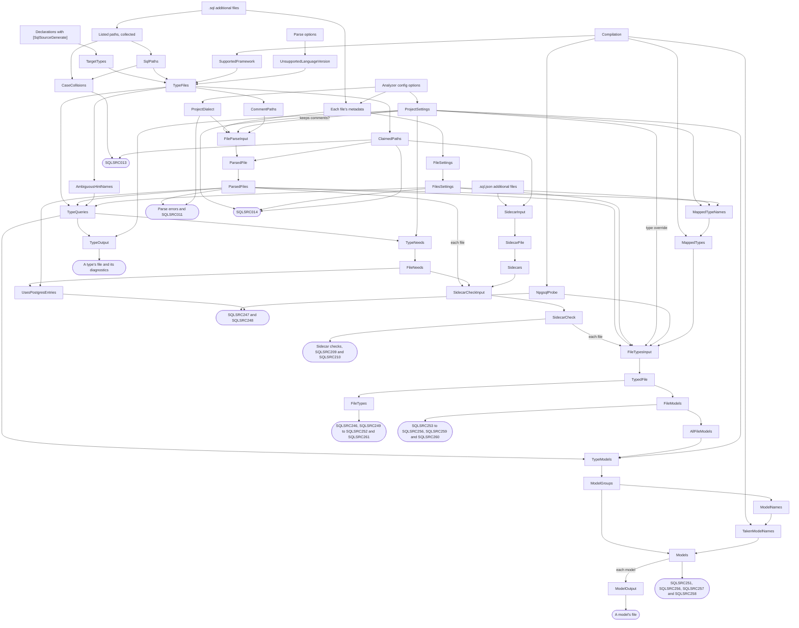
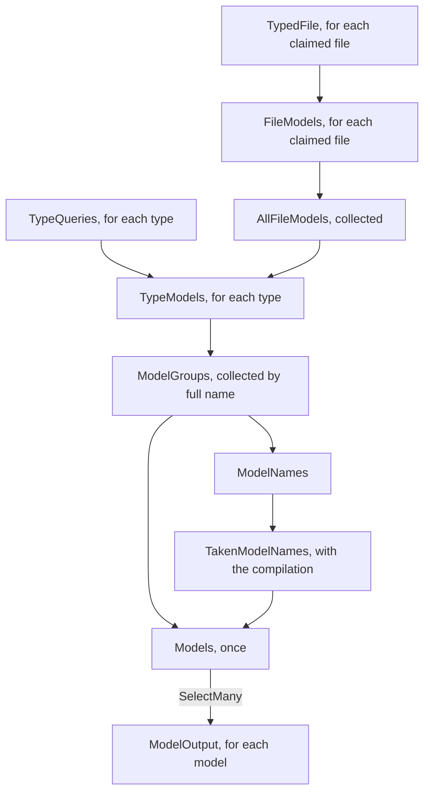

# The generator

How `src/SqlSource` turns a project's `.sql` files into C#: the incremental pipeline, how the settings are read and resolved, how a file is parsed, how a file's sidecar is read and checked, how each column and parameter of a usable entry gets its C# type, how the models of the queries are gathered and decided, what is written for a type and for a model, how problems travel to the compiler, and the model of a sidecar that the assembly holds.  What a user writes and gets is in the manual's [generator page](../manual/generator.md) and [`.sql` files page](../manual/sql-files.md).  The terms are the [glossary's](README.md#glossary).

## The pipeline

[`SqlSourceGenerator`](../../src/SqlSource/SqlSourceGenerator.cs) is an `IIncrementalGenerator`, and its `Initialize` only wires the steps.  Beyond the wiring it holds a few helpers, which sort, join and search collected values.  The steps and their records are at the root of [`Generation/`](../../src/SqlSource/Generation), the path rules in `Paths/`, the readers of MSBuild properties and metadata in `MSBuild/`, the reading and checking of sidecars in `Sidecars/`, the C# types of a query in `Types/`, the models in `Models/`, and what writes a type's file and a model's in `Emitting/`.

Before any step runs, a post-initialization output adds `AttributeSource.Text` to the compilation as `SqlSourceGenerateAttribute.g.cs`.  It holds `[SqlSourceGenerate]` and the enums its properties take.

The compiler hands the pipeline five inputs: the declarations that carry the attribute, the additional files, the compilation, the parse options, and the analyzer config options, which hold the project's properties and each file's metadata.  The additional files are filtered twice, into the `.sql` files, by `SqlPath.IsSqlFile`, and the [sidecars](README.md#sidecar), whose path ends in `.sql.json` ignoring case, by `SqlPath.IsSidecarFile`, so that each kind is an input of its own.  Each named step below is a constant of [`TrackingNames`](../../src/SqlSource/Generation/TrackingNames.cs).  The unnamed boxes are a `Select` or a `Collect` between two named steps.

What each step gives:

- **`TargetTypes`**: a `TargetType` for each attributed declaration, read by [`TargetTypeReader`](../../src/SqlSource/Generation/TargetTypeReader.cs).  Only the declaration that carries a type's first attribute gives one, so a type with the attribute on two partial declarations gets one file.
- **`SqlPaths`**: the normalised paths of the project's `.sql` files, distinct ignoring case and sorted, from `SqlPath.ToSortedSet`.
- **`CaseCollisions`**: the files whose path differs only by case from an earlier one, from `PathCollision.Find`.
- **`SupportedFramework`**: whether the compilation has `System.ArgumentException.ThrowIfNullOrWhiteSpace`, which first appeared in .NET 8 and which a generated method calls.  **`UnsupportedLanguageVersion`**: the project's language version when it is older than C# 12, from `LanguageSupport.FindUnsupportedVersion`.
- **`TypeFiles`**: each type with the files its `Path` resolves to, from `PathResolver.Resolve`, and the type's problems so far.  The framework and language problems are added here, so a type that has one gets no file.
- **`ClaimedPaths`**: every file some type claims.  **`CommentPaths`**: the files of the types whose attribute asks for `keep-comments`.
- **`ProjectDialect`** and **`ProjectSettings`**: what the project's properties say, read once for the compilation.
- **`FileParseInput`**: each file with everything outside it that its parse depends on.  This is stage one of the settings, described [below](#the-settings-have-two-stages).
- **`ParsedFile`**: a `ParsedSqlFile` for each claimed file, from `SqlFileReader.Read`.  An unclaimed file gives nothing and is never read.  **`ParsedFiles`**: those, collected and sorted.
- **`FileSettings`** and **`FilesSettings`**: what the metadata of each file's item says, for the files that have any.
- **`AmbiguousHintNames`**: the [hint names](README.md#hint-name) that would clash ignoring case.
- **`TypeQueries`**: a type with its own parsed files, the metadata of each and its unique hint name, from `SelectFiles`.  It compares equal until the type, one of its files or the metadata of one changes.
- **`TypeOutput`**: the type's file, or none, with its diagnostics, from `TypeEmitter.Emit`.
- **`SidecarInput`**: a `SidecarInput` for each sidecar whose `.sql` file a type claims, from `SidecarInput.Create`: the file and the path of its `.sql` file as `ClaimedPaths` spells it.  Any other sidecar gives null and is never read.
- **`SidecarFile`**: the sidecar read, a `SidecarFile`, from `SidecarFileReader.Read`.  **`Sidecars`**: those, collected and sorted by the path of their `.sql` file.
- **`TypeNeeds`**: what a type needs of each of its files, from `SidecarNeeds.OfType`.  **`FileNeeds`**: the needs of every type merged, one `FileNeeds` for each file, from `SidecarNeeds.Merge`.
- **`SidecarCheckInput`**: each parsed file with its sidecar and its needs, from `SidecarCheckInput.Gather`.  **`SidecarCheck`**: what the checks of the file's sidecar gave, a `SidecarCheckResult`, from `SidecarChecker.Check`.  [Sidecars](#sidecars) describes these steps.
- **`NpgsqlProbe`**: what the project references of Npgsql, an `NpgsqlProbe`, from `NpgsqlProbe.Read`.  **`UsesPostgresEntries`**: whether a file with needs is read as `postgres`, from `UsesPostgresEntries` in `SqlSourceGenerator`.
- **`MappedTypeNames`**: the C# types that the type override names at any level, from `MappedTypeNames.Collect`.  **`MappedTypes`**: each of them resolved against the compilation, a `MappedType`, from `MappedTypeResolver.Resolve`.
- **`FileTypesInput`**: each claimed file's check with what its types read, from `FileTypesInput.Gather`.  **`TypedFile`**: that input beside the C# types of the file's usable entries and the errors of its queries, a `FileTypes` from `QueryTyper.Type`, as a [`TypedFile`](../../src/SqlSource/Generation/Types/TypedFile.cs).  **`FileTypes`**: the `FileTypes` alone.  [Types](#types) describes these steps.
- **`FileModels`**: the properties of each claimed file's models and the errors of their names, a `FileModels`, from `ModelReader.Read`.  **`AllFileModels`**: those, collected and sorted by path.
- **`TypeModels`**: what a type asks for of its queries' models, a `ModelRequest` for each, from `TypeModels.Of`.  **`ModelGroups`**: every type's requests, collected and grouped by the model's full name, from `ModelCollector.Group`.  **`ModelNames`**: the full names alone.  **`TakenModelNames`**: the full names that the project has already, from `ModelNameChecker.FindTaken`.
- **`Models`**: the models to emit and the problems of the requests, a `ModelSet`, from `ModelCollector.Resolve`.  **`ModelOutput`**: each model's hint name and source, from `ModelEmitter.Emit`.  [Models](#models) describes these steps.

There are ten source outputs.  `TypeOutput` gives each type's file and its diagnostics, and `ModelOutput` each model's file.  The other eight report what belongs to no one type: `CaseCollisions` with `ClaimedPaths` gives `SQLSRC013`, `ParsedFiles` with `ProjectDialect` gives each file's parse errors and `SQLSRC011`, `ProjectSettings` with `FilesSettings` and `ClaimedPaths` gives `SQLSRC014`, `SidecarCheck` gives what the checks of each claimed file's sidecar found, `SQLSRC209` and `SQLSRC210` among them, `NpgsqlProbe` with `UsesPostgresEntries` gives `SQLSRC247` and `SQLSRC248`, `FileTypes` gives the errors of each claimed file's types, `FileModels` the errors of the names of its models, and a `Select` of `Models` the problems of the models.  A file's errors are reported from the collected files, and its sidecar's, its types' and its models' names' each from one node for the file, so a file the project lists twice, or two types claim, is reported once.

### Records between the steps

The pipeline caches a step's output and compares it with the last run's, so every value that flows between steps has value equality.  Each is a record, and holds its collections in [`EquatableArray<T>`](../../src/SqlSource/EquatableArray.cs), because `ImmutableArray<T>` compares by reference.  Roslyn's own objects have no value equality, and they keep a compilation alive, so none of them flows between steps, with one exception: `FileMetadata`, `FileParseInput` and `SidecarInput` each carry the file's `AdditionalText`, on to the step that reads it.  That object compares by reference, and the compiler hands out the same one until the file changes, so it caches as well as a value, and no step after the read holds it.  A position travels as a `LocationInfo` and a problem as a `DiagnosticInfo`, and an output step turns them into Roslyn objects.

Five steps look at the compilation.  `TargetTypes` reads the symbol and syntax of each declaration, `SupportedFramework` reads one `bool`, `NpgsqlProbe` three type lookups and the identities of the references, `MappedTypes` the types the type override names, and `TakenModelNames` the models' full names in the project's own assembly.  Everything after them works on records.  The last four are a `Select` over `CompilationProvider`, which the driver gives a new compilation on every run, a `.sql` edit's included, so each of them runs on every run.  Each gives a value equal to the last run's until what it reads changes, so nothing after it runs again.

A `Collect()` gives an `ImmutableArray<T>`, so each `Collect()` in `SqlSourceGenerator` has a `Select` after it that gives an `EquatableArray<T>`: `SqlPath.ToSortedSet` for paths, `HintName.FindAmbiguous` for hint names, the `ToSorted` helper for parsed files, file settings and the files' models, `ToSortedSidecars` for sidecars, `SidecarNeeds.Merge` for what the types need, and `ModelCollector.Group` for what they ask of the models.  Without it the step after would run on every edit.  Only `CaseCollisions` takes a collected value as it is, the listed paths.  That step is cheap, and its answer is almost always "none", so the steps after it are taken from the last run.

Some values are kept apart because they change less often than their inputs.  `CommentPaths` and `AmbiguousHintNames` are almost always empty, and whether the property's list has `keep-comments` is a value of its own, so that an edit to another part of the list parses no file.  `TypeNeeds` is a step of its own beside `TypeOutput`, so that a change to a type, or to a property, that leaves what it needs alone gives an equal value and checks no file again.  The property's type override is a level of its own, `FileTypesInput.TypeOverridesOf`, and so is each file's in its `FileTypesInput`, so that a change to another setting types no file again.

### Paths

A type's `Path` is resolved by `PathResolver.Resolve` from the list of paths alone, never from the text of a file, so an edit to one `.sql` file resolves no type again.  `PathResolver.FindFiles` gives the files of the attribute's folder when there is no `Path`, the files of the folder it names, or the one file it names.  What a `Path` can name is in the manual, [Path](../manual/settings.md#setting-path).

[`SqlPath`](../../src/SqlSource/Generation/Paths/SqlPath.cs) does every path operation as string work.  A generator may not touch the file system (analyzer rule RS1035), and a project must build the same on every operating system, so `SqlPath.Normalize` accepts both separators and resolves `.` and `..`, and `SqlPath.Comparer` compares ignoring case.  The lists of paths and of parsed files are sorted by that comparer, and `SqlPath.IndexOf`, `SqlPath.Contains` and `SqlPath.FindInFolder` search them in that order: the first two by halving, the third from the first path under the folder.  `PathResolver.Resolve` and `SelectFiles` run once for each type, so a linear pass over a list there would cost types times files.

Because the lists are distinct ignoring case, a search may return either of two entries that compare equal, and a file whose path differs only by case from an earlier one is left out of them.  [`PathCollision`](../../src/SqlSource/Generation/Paths/PathCollision.cs) finds such a file in `CaseCollisions`, and it is reported as `SQLSRC013`, for a claimed path only.  The generator cannot ask the file system, so two files on a case-sensitive file system look the same as one file listed under two spellings, and both are the same error.

A file that no type [claims](README.md#claim) is skipped before its text is read, so nothing about it is reported, its metadata included.  That lets a project hold `.sql` files that are not queries, such as migration scripts.

### Sidecars

[`Generation/Sidecars/`](../../src/SqlSource/Generation/Sidecars) reads the sidecar of each claimed file and checks it against what the types that claim the file need.  The checks run once for each file, whatever the number of its types, so that a problem is reported once, and they give the entries that passed every check, `SidecarCheckResult.UsableEntries`, the only entries a later step may read.  What each diagnostic means to a user is in the manual's [diagnostics](../manual/diagnostics.md).

**Pairing.**  A sidecar is an additional file whose path ends in `.sql.json`, ignoring case, and its `.sql` file is its normalised path without `.json`, from `SqlPath.SqlPathOfSidecar`.  `SidecarInput.Create` searches `ClaimedPaths` for that path and keeps the claimed spelling, so a sidecar whose path differs by case from its `.sql` file's is still paired with it.  A sidecar whose `.sql` file no type claims, or that has no `.sql` file beside it, gives null and is never read, as a `.sql` file that no type claims is never read.  Two sidecars whose paths differ only by case are both read, and `Sidecars` keeps the one spelled exactly as its `.sql` file's path with `.json` after it, compared ordinally by `SidecarFile.IsSpelledAsItsSqlFile`, since that is the file the tool reads and writes.  When neither is spelled so, it keeps the first the project lists, as `ParsedFiles` keeps the first of two `.sql` files.  A sidecar listed by two items is two inputs, and `Sidecars` keeps it once.

**Reading.**  `SidecarFileReader.Read` hands the file's text to `SidecarReader.Read`, the reader the tool uses, which never throws: see [reading a sidecar](#reading-a-sidecar).  A file whose text cannot be had is read as malformed at its start.  The reader takes a text without a byte order mark, so one is left out of what it reads, and every position is moved past it again.  The `SidecarFile` holds the read result and each position a check reports at, made into a `LocationInfo` while the text is in hand: the start of the file, the error of a malformed one, and the key of each entry.  It holds no text, so no step after it needs the file.

**What a file needs.**  A query needs an entry when its output, resolved by `QuerySettings.Resolve` for some type that claims its file, is not `Sql`.  The output is resolved for each type, so `SidecarNeeds.OfType` gives, for each file of a type, the queries that need an entry with the output that type gives them.  A type with problems of its own counts as well, since the tool describes its files all the same.  `SidecarNeeds.Merge` makes one `FileNeeds` of every type's for each file: each query once, with the greatest of its outputs, in the ordinal order of the names, so that the value does not depend on the order of the types.  A file in which no query needs an entry has none.  A file with parse errors has no queries, so it needs nothing.

**The checks.**  `SidecarCheckInput.Gather` finds the sidecar and the needs of a parsed file with two searches, and `SidecarChecker.Check` checks the file.  A file with neither is done at once, so a project at `Sql` that has no sidecars pays for nothing more.  Otherwise the checks run in this order, and each of the first three says which of the checks after it it stops:

1. **The dialect**, for a file with a query that needs an entry.  A dialect that `SqlDescribableDialects` does not list is `SQLSRC209`, and one that this version has no type map for, which `SidecarChecker.HasTypeMap` decides and which is `mssql` until phase 6, is `SQLSRC243`.  Each is reported once for the file, at its first query that needs an entry, which is where the tool reports `SQLSRC209`.  Each stops the check of every query against the sidecar, the fourth below, while the tokens of the queries are still checked.
2. **The tokens.**  Each token without a default of a query that needs an entry is `SQLSRC210`, at the query, whatever the dialect and the sidecar, as the tool reports it.  It stops the check of that query.
3. **The sidecar itself**, in `SidecarFileChecks.Read`.  A malformed file is `SQLSRC237`, at the reader's error, and a format other than `SidecarFormat.Version` is `SQLSRC238` or `SQLSRC239`, at the start of the file.  Each leaves the file no usable entry and stops every check after it.  A `toolVersion` whose prefix, from `PackageVersion.PrefixOf`, is not `PackageVersion.Prefix` is the warning `SQLSRC240`, and the file is used.
4. **Each query that needs an entry**, in file order.  No sidecar, or no entry of its name, names compared ordinally, is `SQLSRC241`.  An entry whose `engine` is not the canonical name of the file's dialect is `SQLSRC242`.  An entry whose `hash` is not the query's is `SQLSRC244`.  Otherwise the entry is usable.  The hash is computed here, and only for a query that needs an entry.
5. **The orphans.**  Each entry that names no query that needs one is the warning `SQLSRC245`, at its key.  A query stopped by an earlier check still needs its entry, so that entry is no orphan.  The check does not run for a file with parse errors, whose every entry would otherwise be an orphan until the file parses.

The diagnostics are reported from `SidecarCheck`, a source output of its own, once for each file.  A position is in the `.sql` file, at a query's name, or in the sidecar, at the reader's error, an entry's key or the start of the file, and both are additional files, whose positions the compiler accepts.  Nothing of a sidecar reaches a type's file, so a query that a check stops keeps its constant or method.  [`tests/SqlSource.Tests/Generator/SidecarTests.cs`](../../tests/SqlSource.Tests/Generator/SidecarTests.cs) holds each check, and reads the usable entries from the step's output to hold that an entry that failed a check is never one of them.

`SidecarCheckInput` is gathered again for every file when `FileNeeds` or `Sidecars` changes, which costs two searches for each, and `SidecarCheck` runs again only for a file whose input changed.  So an edit to the text of one `.sql` file or one sidecar checks that file alone.  A claimed file added, removed or renamed is not: the compiler matches the nodes after the `SelectMany` of `ParsedFiles` by their place in the list, so every file whose place moved is checked again, as [TD-0019](../tech-debt/TD-0019-change-to-claimed-files-reads-every-claimed-file-again.md) records.  A file added or removed moves every claimed file sorted after it, and a file renamed moves those sorted between its old path and its new one.

### Types

[`Generation/Types/`](../../src/SqlSource/Generation/Types) gives each parameter and column of a usable entry its C# type: the type override's, from the most specific level that names its key, or else the base map's, under the column of the project's Npgsql.  The [models](#models) read them, as the types of their properties.  What a user sees of them, the map and its diagnostics, is in the manual's [Types](../manual/postgresql.md#type-map).

**The probe.**  `NpgsqlProbe.Read` gives a value-equal record of four members: whether `Npgsql.NpgsqlConnection`, which every version has, is found; whether `Npgsql.NpgsqlSlimDataSourceBuilder`, first in 8.0, is; whether `NpgsqlTypes.NpgsqlCube`, first in 10.0, is; and the version of the referenced assembly named `Npgsql`, the newer of two.  The map follows the driver by the types it has, as the epic decides, so `AtLeast10` and `Referenced` alone choose the [`DriverColumn`](../../src/SqlSource/Generation/Types/DriverColumn.cs): `Npgsql10` when `AtLeast10`, `Npgsql8` for any other version that is referenced, and `None` without a reference.  `AtLeast8` serves the floor alone, `IsBelowTheFloor`, which is `SQLSRC247`.  The version serves the diagnostics alone: their text, and `IsNewerThanKnown`, a major above 10, which is `SQLSRC248`.

**The base map.**  [`PostgresTypeMap.Map`](../../src/SqlSource/Generation/Types/PostgresTypeMap.cs) gives a [`TypeMapping`](../../src/SqlSource/Generation/Types/TypeMapping.cs) for a `PostgresType`: its `TypeMappingKind`, the key that answered or failed, the C# type's text, a keyword or `global::`-qualified, and for a failure the detail its message adds.  A row is found by the type's `InternalName`, for a type of `pg_catalog` and for a base type of an extension that `TypeKeys.IsExtension` names, in any schema.  Each row holds the C# type of Npgsql 8 and 9, and of 10 where it differs, and `Row.Under` chooses by the column.  Under `None`, a row with two C# types is `DiffersByDriver`, whose detail is the entry a user can write for each driver whose type is not of `NpgsqlTypes`, and a row of `NpgsqlTypes` is `NeedsDriver`.  `bit` and `varbit` are decided by their length.  A row of a type no driver reads is a refusal, `CastToOid` or `CastToText` with the type to cast to in its detail, and a row that only Npgsql 10 reads, `cube`, is `NeedsNpgsql10` under the column of 8.  A type that has no row goes by its kind: an array is its element's mapping with `[]`, and a cast's detail with `[]`, a domain its base's, an enum `string`, a range or a multirange `UserDefinedRange`, another base type of `pg_catalog` `CastToText`, a composite or a base type of another schema `Unreadable`, and a kind this version does not know, or an array or a domain without its element or base, `NotWrittenByTheTool`.  The type override is asked first at every level of that walk, through an `OverrideOf`, so an array's or a domain's own entry wins over its element's or base's, and an entry for a base reaches every domain over it.  [`TypeKeys`](../../src/SqlSource/Settings/TypeKeys.cs) keeps its own list of the names the map knows, which the grammar checks a key against, and the names of the extensions' types, which the map reads.  The map's rows and that list are two lists, held equal by `PostgresTypeMapTests.Keys_OfTheMap_AreTheKnownNamesOfTheSettings`.

**The resolution of mapped types.**  `MappedTypeNames.Collect` gives the distinct C# types that the property, the files' metadata and the markers of every query name, in ordinal order, as a list of their texts that an edit which leaves them alone gives again, equal.  A query's markers are over its preamble's, so the preamble's entries are read through its queries.  `MappedTypes` combines that list with the compilation, and [`MappedTypeResolver.Resolve`](../../src/SqlSource/Generation/Types/MappedTypeResolver.cs) gives a [`MappedType`](../../src/SqlSource/Generation/Types/MappedType.cs) for each: its `MappedTypeStatus`, whether it is a value type and public, the ids of the warnings that a use of it gives, and no symbol.  The ids come from `[Obsolete]` and `[Experimental]` on the type, a type it is nested in, one of its type arguments, or, for `[Experimental]`, its module or assembly: an `[Obsolete]`'s `DiagnosticId`, or else `CS0612` and `CS0618`, and an `[Experimental]`'s id, or else `CS9204`, in ordinal order, each once.  A type marked `[Obsolete]` as an error, whose use is `CS0619`, which no `#pragma warning disable` turns off, is `NotAPropertyType`, and so is one marked under an id that is not an identifier, which no pragma can name.  An argument that is not a primitive constant, as an attribute of the name declared with an array parameter can take, gives no id and no error.  A keyword is its special type.  A name is looked up by its metadata name, `A.B+C`1`, with `GetTypesByMetadataName`, from the longest namespace prefix down, so that a nested type is found; of several types the project's own wins, then the one of a reference that the project can see, and several that it can see are `Ambiguous`.  Its type arguments are resolved the same way.  No generic type is constructed, so its constraints are not checked ([TD-0056](../tech-debt/TD-0056-mapped-generic-constraints-are-not-checked.md)).  An empty list gives an empty result at once, so a project without the type override looks nothing up.

**The types of a query.**  `FileTypesInput.Gather` makes a node for each claimed file from its `SidecarCheck`, with two searches for its parsed file and its metadata, and the property's type override, the probe and the mapped types.  It carries the two levels as the type override alone, so that a change to another setting gives an equal input, and a file with no usable entry carries nothing to type.  The `TypedFile` step calls [`QueryTyper.Type`](../../src/SqlSource/Generation/Types/QueryTyper.cs) once for the node, and keeps the input beside the result, so that `FileModels` reads the usable entries and the parsed queries without typing the file again; `FileTypes` is a `Select` of the result alone.  `QueryTyper.Type` types the query of each usable entry:

1. **The query's type override** is `QuerySettings.ResolveTypeOverrides` of the query's markers, the file's metadata and the property, computed once for each distinct level of markers, compared by reference, so the queries without markers of their own share their preamble's.  An empty map asks the base map alone; a map of `default` entries alone is asked, since a `default` of an array's own key is `SQLSRC261`.
2. **Each parameter, then each column**, in order, is mapped by `PostgresTypeMap.Map` under the probe's column.  The map's lookup, `OverrideLookup.Find`, takes the entry of the type's key, which `PostgresTypeMap.KeyOf` writes with `TypeKeys.WritePart`, its bare name for a type of `pg_catalog` and its schema and name for any other, each part quoted when it needs it, `public."Status"`; or of the bare name of an extension's type, written the same way; and gives the `MappedType` of the entry's C# type, or the failure of its status.  An array is found by its element's key with `[]` alone, in every schema, and never by its own key.  A key whose winning entry is `default` has none, as [the type override](#the-type-override) says, so the lookup goes on to the next.  The own key of an array of `pg_catalog`, `_int4`, is in no map, since `TypeKeys` reads it as `int4[]`.  That of an array of another schema, `public._user_status`, is another key than `public.user_status[]`, since `public._tag` may name a type that is no array; when it has an entry, `TypeOverrideMap.Winner` including a `default`, the lookup's answer is the failure `ArrayNamedByItsOwnKey`, which carries the key to write, the element's with `[]`.
3. **The first failure** is the query's one error, at its name, and the query has no types.  `QueryTyper.Diagnose` makes it `SQLSRC246`, `SQLSRC249`, `SQLSRC250`, `SQLSRC251`, `SQLSRC252` or `SQLSRC261`, and a failure of a mapped type names the place that wrote its entry, from the entry's `SettingPlace`, and its C# type as a user writes it, without `global::`.  The help of an `Unreadable` type names its key as an entry can, with its quotes, and with `pg_catalog.` before a bare name that `TypeKeys` would not read, `pg_catalog."Odd.Name"`, a key being qualified when `TypeKeys.TrySplit` gives it a schema, since a dot inside quotes is no schema's; and that of a `UserDefinedRange` with no Npgsql says to reference it first.  A parameter whose type is null, or not of PostgreSQL, is `SQLSRC246`.  Otherwise the query has a [`QueryTypes`](../../src/SqlSource/Generation/Types/QueryTypes.cs), with a `PropertyType` for each parameter and column.

The errors are reported from `FileTypes`, an output of its own beside the output of `SidecarCheck`, so that a change to the types alone reports no check again, and a check that is the same reports no type again.  `FileTypesInput` is gathered again for every file when one of its inputs changes, and `TypedFile` types again only a file whose input changed.  Each node comes from the `SelectMany` of `ParsedFiles`, whose nodes the compiler matches by their place, so a claimed file added or removed types again the files whose place moved, as it checks them again ([TD-0019](../tech-debt/TD-0019-change-to-claimed-files-reads-every-claimed-file-again.md)).  `SQLSRC247` and `SQLSRC248` have no file: the output over `NpgsqlProbe` and `UsesPostgresEntries` reports them once for the project, as [how a problem travels](#how-a-problem-travels) says.

### Models

[`Generation/Models/`](../../src/SqlSource/Generation/Models) gives each query of a claimed file the properties of its models, gathers what every type asks for by the models' full names, and decides which models are generated and what is reported.  [`ModelEmitter`](#a-models-file) writes each model's file.  What a user writes and gets, the names, the shapes and the rules of sharing, is in the manual's [Models](../manual/generator.md#models).

The steps run once for each file, then once for each type, then once for the project, and fan out to one node for each model:

**Each file's properties.**  [`ModelReader.Read`](../../src/SqlSource/Generation/Models/ModelReader.cs) runs on each claimed file's `TypedFile`.  For each usable entry, it finds the query's `SqlQuery` and its types, which are in the order of the file as the entries are, so that each search starts after the last.  An entry without types, whose query has a type error, gets `SQLSRC259` and `SQLSRC260` alone when it has them, and its names are not read.  An entry with types gives a [`QueryModels`](../../src/SqlSource/Generation/Models/QueryModels.cs): a [`ModelProperty`](../../src/SqlSource/Generation/Models/ModelProperty.cs) for each parameter, or null for none, and one for each column, or null for an entry without rows and empty for rows of no column, beside the query's two model markers, its summary and the entry's `matchesTable`.  A property has its name, its `PropertyType` from the types, its nullability, its documentation as escaped XML, its column or parameter as a message names it, and `IsArray`: whether a column's PostgreSQL type is an array, or a domain whose base type, followed down, is one, which is always false for a parameter.  `IsArray` changes no C#, so `IsSameShape` does not compare it.  The name is `PropertyNames.PascalCase` of the column's or the parameter's.  A parameter is nullable when its `nullable` is `true`; a column when its name ends in `?`, when it ends in neither mark and a `-- column:` marker that names it, ignoring case, says `null`, or when it ends in neither mark, no marker names it and its `nullable` is not `false`.  The errors of the names, `SQLSRC253` to `SQLSRC255`, `SQLSRC256` for a name that a record or `object` takes, `SQLSRC259` for an `-- output-model:` on an entry without rows, and `SQLSRC260` for a `-- column:` marker that names no column of the entry, with or without the column's mark, or names one whose name ends in a mark, depend on no setting of a type, so they are found here, once for each file, whatever the number of the types that claim it.  Every error of a query is reported, and a query with any has no `QueryModels`.  The errors are reported from `FileModels`, an output of its own beside that of `FileTypes`, so that a change to the models alone reports no type again.

**What each type asks for.**  [`TypeModels.Of`](../../src/SqlSource/Generation/Models/TypeModels.cs) runs for each type, from its `TypeQueries`, `AllFileModels` and the project's level.  A type with a diagnostic of its own asks for nothing, and a file that `TypeEmitter.FindUsableFiles` leaves out of the type, for `SQLSRC008` or `SQLSRC009`, gives it nothing.  For each query of the other files that has models, it resolves the query's settings with `QuerySettings.Resolve`, and when the output is `Models` or `CodeGen` gives a [`ModelRequest`](../../src/SqlSource/Generation/Models/ModelRequest.cs) for each model the query has:

- **The name** is the marker's, or the table's from `PropertyNames.FromTable` with the output suffix, for an output model without a marker when `no-table-models` is not in effect and the table gives a name, or else the query's with the suffix.
- **The namespace** is the part of a marker's name before its last period, or else the model namespace's setting, or else the type's namespace, each as a value and as code writes it, which keeps the `@` of a keyword.
- **The rest** is the role, the kind, whether `sort-input` or `sort-output` sorts the properties, which then come sorted ordinally, whether the type is public, from `TargetType.IsPublic`, the matched table of a table model, and a [`ModelSource`](../../src/SqlSource/Generation/Models/ModelSource.cs): the query, its file, its index, the claiming type as a key and as a message names it, and the positions of the query's name and of the model's marker.

The requests depend only on the type's settings and the files' models, so a change to a type or to a property that leaves them alone gives an equal value, and nothing after `TypeModels` runs.

**The collection.**  `ModelGroups` collects every type's requests, and `ModelCollector.Group` groups them by full name, compared ordinally, into [`ModelGroup`](../../src/SqlSource/Generation/Models/ModelGroup.cs) values in the ordinal order of the names, each holding its requests in the order of `ModelSource.Comparison`: by the path of the file, by `SqlPath.Comparer`, then by the query's index, then by the claiming type's key, ordinally.  The key carries a generic type's arity, so that `Repository` and `Repository<T>` are told apart.  So the value, and which request is first, do not depend on the order of the compilation's types or files.  `ModelNames` is the full names alone, from `ModelCollector.FullNamesOf`, which an edit that leaves every name alone gives again, equal.

**The names the project has.**  `TakenModelNames` combines `ModelNames` with `CompilationProvider`, and [`ModelNameChecker.FindTaken`](../../src/SqlSource/Generation/Models/ModelNameChecker.cs) looks each name up in the project's own assembly, never in a reference: a type of that metadata name, a namespace of that name, or a part of the name's namespace, from its start, that is a type.  It gives a [`TakenName`](../../src/SqlSource/Generation/Models/TakenName.cs) for each name the project has, with its [`TakenReason`](../../src/SqlSource/Generation/Models/TakenReason.cs), and an empty result at once for no names, so a project without models looks nothing up.  Like `MappedTypes`, it runs on every run, and its value is equal until a type or a namespace of a name appears or goes.

**The decision.**  [`ModelCollector.Resolve`](../../src/SqlSource/Generation/Models/ModelCollector.cs) takes the groups and the taken names.  A group's first request is its model.  Each later request is compared with it by `FindDifference`: the role, the kind, the sorting, the number of properties, then each property's name, C# type and nullability; documentation changes no C#, so it is not compared.  A later request that differs is `SQLSRC257`, at its marker or at its query's name, and joins no model.  The model is public when any request that joined it is.  Then the first request is checked for what keeps the model from being generated: each property whose type is not public in a public model, the second case of `SQLSRC251`; a property named as the model, `SQLSRC256`; and a name that cannot be used, `SQLSRC258`, for a name the project has, the namespace of another model, a part of its namespace that is another model, or a name of lower-case ASCII letters alone, which the compiler warns on.  A model with such a problem is not generated, and each distinct query that joined it is told, of its own property, since another query's column, and the type override that gave its type, can differ from the first query's.  Each other group gives a [`Model`](../../src/SqlSource/Generation/Models/Model.cs): its hint name, its namespace as code writes it, its name, role and kind, whether it is public, the first request's properties, a summary that names each query that joined it, and each table of a table model, and `HasArrayColumn`: whether a property of any request that joined it is an array column.  Like the model's accessibility, `HasArrayColumn` is OR-ed over the requests that joined and is not a difference that `FindDifference` reports, since two queries that share a model can have the one column as an array in the database and as another type through a type override, and the model has the constructor of [a model's file](#a-models-file) for either.  The [`ModelSet`](../../src/SqlSource/Generation/Models/ModelSet.cs) holds the models, in the ordinal order of their full names, and the diagnostics.

**The fan-out, and its cost.**  The diagnostics are reported from a `Select` of `Models`, an output of their own, so that a change to one model reports nothing again.  `ModelOutput` is a `SelectMany` of `Models` to one node for each model, each emitted by `ModelEmitter.Emit`, so an edit that changes the record of one model writes that model alone.  The compiler matches the nodes after a `SelectMany` by their place in the list, and the list is sorted by full name, so a model added or removed writes again every model sorted after it.  That cost is accepted, as [TD-0060](../tech-debt/TD-0060-model-added-or-removed-writes-the-models-after-it-again.md) records, and `CachingTests` pins it, so that it is not made worse unseen.

### Caching tests

[`tests/SqlSource.Tests/Generator/CachingTests.cs`](../../tests/SqlSource.Tests/Generator/CachingTests.cs) reads each step's run reasons by its tracking name, and pins what each kind of edit redoes: an edit to one file parses that file and emits the types that use it, a change to a property that is not an input of the parse parses no file, and so on.  For the sidecars it pins that an edit to a sidecar reads that sidecar alone, parses no file and checks only its file; that an edit to a `.sql` file reads no sidecar and checks only that file; that an edit to C# that changes no attribute reads no sidecar and checks nothing, and an attribute or a property that changes no output checks nothing; that a sidecar of a file no type claims is not read, and one listed twice is kept once; that a project at `Sql` computes no hash; and, in `Run_ClaimedSqlFileAdded_ChecksTheFilesSortedAfterIt`, that a claimed file added checks again the files sorted after it and none before it, the cost that TD-0019 records.  For the types it pins that an edit to C# runs the probe and the resolution of mapped types, and nothing after them, and types no query; that a project without the type override resolves nothing; that an edit to a `.sql` file that leaves its markers alone changes no mapped type, and types that file alone, as an edit to a sidecar does; that a change to the property's type override types every file again; that a C# edit that changes no mapped type types no file in a project with the type override too; that one that adds a type an entry names types again every file with a usable entry, since each carries the resolved types, and only a file that uses it gives a new value; and that adding the reference to Npgsql changes the probe and types every file again.  For the models it pins that an edit to a sidecar that changes one model writes that model alone, and looks up the same names again with an equal answer; that an edit to either query of a shared model writes that model alone; in `Run_ModelAdded_EmitsTheModelsAfterItAgain` and `Run_ModelRemoved_EmitsTheModelsAfterItAgain`, that a model added or removed writes again the models sorted after it, the cost that TD-0060 records; that an edit to C#, a change to a property that no model reads, such as the collection type, and an attribute argument that changes no request each write no model; and that a project without models looks up no name.

### The tool runs the same code

The `sqlsource` tool plans a run with the generator's own code, as the overview's [shared code](README.md#shared-code) says.  From `src/SqlSource.Tool/Planning/` it calls `SqlPath.Normalize`, `SqlPath.IsSqlFile`, `SqlPath.Comparer`, `SqlPath.ToSortedSet`, `PathResolver.FindFiles`, `TargetTypeReader.IsCandidate`, `DialectSetting`, `ProjectSettings.Read`, `FileMetadata.Read`, `FileParseInput.Resolve`, `SqlFileReader.Read`, `SqlDescribableDialects.Contains`, `SqlDialectName.Canonical`, `QuerySettings.Resolve` and `SqlQueryHash.Compute`.  It gives them an `AdditionalText` and, through `ManifestOptions`, an `AnalyzerConfigOptions` of its own, with the keys the compiler would give.

The tool reads the settings under `MSBuildSettings.ManifestProperty` and `MSBuildSettings.ManifestMetadata`, which have a key for `SqlSourceDatabase`.  The keys the generator reads, `MSBuildSettings.Property` and `MSBuildSettings.Metadata`, have none, so the generator never reads or judges that setting, even for a project that shows it to the compiler.  The other way round, the keys of a manifest have none for `SqlSourceTypeOverrides`, which changes nothing that is described: the manifest carries it, and the tool never reads or judges it.  A `-- type-override:` marker is the parser's, so one that is not valid is a parse error for the tool too.

## Settings

A setting can be written in a query's markers, its file's header, the attribute of a type that claims the file, the metadata of the file's item and the project's properties.  Each source gives a [settings level](README.md#settings-level), a [`SettingsLevel`](../../src/SqlSource/Settings/SettingsLevel.cs) whose members are all nullable: null means the source does not say.  [`QuerySettings.Resolve`](../../src/SqlSource/Settings/QuerySettings.cs) takes each setting from the most specific level that has it, and from its default otherwise.  The order and its exceptions, as a user sees them, are in the manual, [which place wins](../manual/settings.md#which-place-wins).

### Reading a level

The markers are read by the parser, described [below](#markers).  The other three sources go through [`SettingsLevelReader.Read`](../../src/SqlSource/Settings/SettingsLevelReader.cs), the one place that says which members such a level has, what makes a value valid, and that a text which is empty or white space is not set.  A source is an [`ISettingSource`](../../src/SqlSource/Settings/ISettingSource.cs), a struct so that the generic reader boxes nothing.  It says how a raw value is found, where one that is not valid goes, and its [`SettingPlace`](../../src/SqlSource/Settings/SettingPlace.cs), which the entries of a type override it gives carry:

- `TargetTypeReader` reads the attribute, where an enum argument arrives as its number.  A number that is no member was written with a cast, and is reported as an attribute error.
- [`MSBuildSettings`](../../src/SqlSource/Generation/MSBuild/MSBuildSettings.cs) reads a level from analyzer config options under a set of keys.  `ProjectSettings` reads the project's properties with it, and `FileSettings` the metadata of one file's item.  A choice is read with `SettingValue.TryReadChoice`, from the names of an enum's members ignoring case, hyphens and spaces.  A value that is not valid becomes an `InvalidSetting`, which has no position.

Every setting is read even after one is not valid, so all the problems of a source are found together.  A source that sets nothing gives the shared `SettingsLevel.None`, so a query or a file without settings allocates nothing.

`SettingId` lists the settings a source other than a marker can give, in the order the reader asks for them, and `MSBuildSettings` holds their MSBuild names in that order.

The attribute's enums are written into every project, so the generator has its own form of each, with the same numbers: `OutputKind` for `GeneratorOutput`, `MemberPlacement` for `SqlLocation`, `ModelKind` for `GeneratorModelType`, `CollectionKind` for `GeneratorCollectionType` and `MethodPlacement` for `MethodLocation`.

[`Settings/`](../../src/SqlSource/Settings) holds the levels and the readers of values.  The parser, the pipeline and the tool all use it, which is why it depends on none of them.

### The type override

`SqlSourceTypeOverrides` maps database types to C# types.  It is a property, a file's metadata and the `-- type-override:` marker, in a file's header and in a query, and it has no attribute level.  Each entry is a [`TypeOverride`](../../src/SqlSource/Settings/TypeOverride.cs): its key, its C# type's text, or null for `default`, and the `SettingPlace` that wrote it.

[`TypeOverrideGrammar`](../../src/SqlSource/Settings/TypeOverrideGrammar.cs) is the one reader, of an MSBuild value and of a marker alike.  An entry is `key=type`.  The key is read by [`TypeKeys.TryNormalize`](../../src/SqlSource/Settings/TypeKeys.cs), left to right, as one or two parts and an optional `[]`.  A part is plain, letters, digits, `_` and `$`, or quoted, in double quotes with `""` for a quote, which can hold any character, a `.` or `[]` included.  An unqualified key must be a name the base map knows, or an alias of one, and is given as that name, so `integer` is `int4`, and the catalog's name of an array of one, `_int4`, is given as `int4[]`; a quoted one must hold the name exactly, in lower case, and has no alias, so `"char"` is `char` and `"Int4"` is not a key.  A qualified key is kept as written, quotes included, unchecked, with `pg_catalog.` taken off, plain in any case or quoted exactly; a plain name of `pg_catalog` that the map knows is then given in lower case, as it is unqualified, so `pg_catalog.INT4` is `int4`, and every `pg_catalog._name` is `name[]`, `pg_catalog._pg_class` `pg_class[]`, since no other type of `pg_catalog` starts with `_`.  So a key is a string in its written form everywhere it goes, `TypeOverride.Key`, `TypeMapping.Key` and `PropertyType.Key`: each part plain or quoted, as a user writes it.  `TypeKeys.TrySplit` gives a written key's parts, quotes included, `TextOf` a part's text without them, and `WritePart` writes a type's part: plain when it is not empty and holds only letters, digits, `_` and `$`, none of them upper case, since a plain part is read in lower case, and otherwise quoted.  The type is read by [`ClrTypeName.TryParse`](../../src/SqlSource/Settings/ClrTypes/ClrTypeName.cs), a keyword or a name qualified from the global namespace, with type arguments and ranks, and kept as `ClrTypeName.Text`: `global::` before a name and `, ` between arguments, so that two spellings of one type compare equal.  Only that text is kept: the step that resolves the type reads it again with `ClrTypeName.TryParse` for its parts.  A type nested more than `MaxNesting` deep is not valid, so no text can run the reader out of stack.

- **An MSBuild value** is a list, split at white space outside `<>`, `[]` and double quotes, which is why the trim's single spaces inside a generic or a quoted part keep one entry.  A bracket inside quotes is not counted, and a `"` opens quotes only in the key, before the entry's first `=`: in the C# type it is an invalid character, and joins no entries.  A quote that is never closed makes the rest of the value one entry, which is not valid.  The trim has already made one space of each run of white space, inside quotes too, so a name with two spaces in a row, a tab or a line break cannot be named there, and one with a line break cannot be named by a marker either ([TD-0066](../tech-debt/TD-0066-type-name-with-a-line-break-has-no-key.md)).  Of two entries for one key the last wins.  `SettingsLevelReader` gives each entry that is not valid to its source as written, so `SQLSRC014` is reported once for each distinct entry and names the setting, and the other entries apply.
- **A marker** holds one entry, with white space allowed around its `=`, which is the first one outside double quotes.  `SqlMarkerScope` keeps one entry for each key, by the identity of `TypeOverrideMap`: the same type again is nothing, another type is `SQLSRC112` and the first stands, and an entry that is not valid is `SQLSRC111`.  The types are compared as their text, so `int` and `System.Int32` conflict.  A preamble's entries are at `FileHeader`, and a query's, or those of a file with no `-- name:` marker, at `Query`.

The levels merge per key, the exception to the rule that a level replaces the one below it whole.  [`TypeOverrideMap`](../../src/SqlSource/Settings/TypeOverrideMap.cs) holds the rules.  Keys are compared by their parts, from `TypeKeys.TrySplit`, and by the text of each part without its quotes, so `"a.b".c` and `a."b.c"` are two keys.  A key's identity is that text compared ordinally: `public.status` and `public."status"` are one key, and `public.Status` and `public.status` two.  Every array of entries holds each key once, in the order of the parts' text ignoring case, a shorter list of parts first and a key that is not an array before one that is, then ordinally to break a tie, so keys that differ only by case sit together.  `Over` takes every key of two arrays and the higher one's entry for a key both have, and keeps an entry of `default`, so that it hides the key of a level merged under it later and so that `Find` weighs it in its place.  `Find` takes a type's key in its written form, binary-searches the first entry equal to it ignoring case, and walks the entries equal to it ignoring case.  An entry matches when its quoted parts are equal to the key's ordinally, so a quoted part matches its own case alone and a plain part any case.  Of the entries that match, the one of the most specific place wins, `Query`, then `FileHeader`, then `Metadata`, then `Property`, ranked explicitly since the type override has no `Attribute` level; then one equal to the key ordinally; then the first in the map's order.  So a plain key at a higher place wins over an exact one below for every type it matches, as an entry of a higher place does for its own key.  When the winner is `default`, `Find` gives null, as for a key without an entry, and the lookup goes on to an array's element and a domain's base.  The walk keeps the best match so far, so that more than one key of a type can be fed to it.  `SettingsLevel.Over`, which puts a query's markers over its preamble's, merges the arrays with `Over`, and `QuerySettings.ResolveTypeOverrides` gives the markers over the metadata over the property, its `default` entries kept until `Find`.  It is kept apart from `QuerySettings.Resolve`, which runs for each query and each type that claims its file, so that a caller that needs the map computes it once for each distinct level of markers; the queries of a file without markers of their own share their preamble's level.  A level that sets none has null, and `Over` of two nulls is null, so a file or a project without an override allocates nothing for it.  `QueryTyper` calls `ResolveTypeOverrides`, as [types](#types) describes, and `MappedTypeNames` reads the C# types of every level's entries, which the compilation resolves.

### The settings have two stages

Resolving a query's settings has two stages, and only the first is an input of the parse.

Stage one is [`FileParseInput`](../../src/SqlSource/Generation/FileParseInput.cs), the step of the same name: what must be known before a file is parsed.  That is the file's dialect, described [below](#how-the-dialect-reaches-the-parse), and `CommentsWanted`, whether a level the parser cannot see may ask for `keep-comments`.  It is true when the list of generator parameters in the file's metadata has `keep-comments`, or, when the metadata gives no list, the property's list has it, or when the file is in `CommentPaths`.  It may be true where no query ends up keeping its comments, and is never false where one does.  The one exception is two paths that differ only by case with the metadata on the later one, which is `SQLSRC013`, and the emitter then falls back to the form without comments.

Stage two is everything else.  `ProjectSettings` reads the properties, `FileSettings` the metadata of each file's item and `TargetTypeReader` the attribute, and these join after a type's queries are selected: the file settings in `TypeQueries` and the project's level in `TypeOutput`, `TypeNeeds` and `TypeModels`.  The type override joins after a file's check instead, in `FileTypesInput`, which the [types](#types) read.  `TypeEmitter` then resolves each query's settings with `QuerySettings.Resolve`, from the query's markers, the attribute, the file's metadata and the property, and `SidecarNeeds` and `TypeModels` resolve them the same way.

So a property that is not an input of the parse changes only the `TypeOutput`, the `TypeNeeds` and the `TypeModels` of each type, and the parse of every file is taken from the last run.

Of the resolved settings, `TypeEmitter` uses two: whether the query keeps its comments, and whether its method checks its arguments.  `SidecarNeeds` uses one, the output, which decides whether the query [needs an entry](#sidecars) in its file's sidecar.  `TypeModels` uses the output, the two suffixes, the model namespace, the two model types, and the generator parameters `sort-input`, `sort-output` and `no-table-models`, which [models](#models) describes.

### How the dialect reaches the parse

A [dialect](README.md#dialect) decides what a parse produces, so it is resolved for each file in stage one, the opposite of the other settings.  [`DialectSetting`](../../src/SqlSource/Generation/MSBuild/DialectSetting.cs) reads the `SqlSourceDialect` property, in the `ProjectDialect` step, and the metadata of the same name on a file's item, through [`FileMetadata.Read`](../../src/SqlSource/Generation/MSBuild/FileMetadata.cs).  `FileParseInput.Resolve` takes the file's metadata when it has any, valid or not, and the property otherwise, so the parse sees one dialect for a file.  A value that is not a dialect is read as `ansi`, and the value is reported as `SQLSRC011`.

A `FileParseInput` holds the file's `AdditionalText`, which compares by reference and stays the same object until the file changes.  So a change to the property changes the input of only the files that fall back to it, and parses only those.  A `-- dialect:` marker in the file's header comes before both, as [Parsing](#the-dialect-marker) describes.

## Parsing

[`SqlFileParser.Parse`](../../src/SqlSource/Parsing/SqlFileParser.cs) turns the text of one `.sql` file into named SQL blocks, or into errors.  [`SqlFileReader`](../../src/SqlSource/Generation/SqlFileReader.cs), in `Generation/`, calls it with the file's text, name, dialect and `CommentsWanted`, and turns the result into a `ParsedSqlFile`: each block becomes a `SqlQuery`, each span a `LocationInfo`, and each error a `DiagnosticInfo` through `SqlDiagnostics.ForParseError`.  [`Parsing/Markers/`](../../src/SqlSource/Parsing/Markers) holds the reading of the [markers](#markers), [`Parsing/Tokens/`](../../src/SqlSource/Parsing/Tokens) a block's segments and tokens and `TokenScanner`, which finds them, and [`Parsing/Quoting/`](../../src/SqlSource/Parsing/Quoting) the readers of quoted regions.

A parse has three parts:

1. **The header.**  A `SqlLexer` starts with the rules of the dialect it is given, and `SqlDialectMarker.Apply` reads the comments at the top of the file, as described [below](#the-dialect-marker).
2. **The lexemes.**  The lexer reads the rest of the text.  An unterminated quoted region or block comment stops it, and is the file's one error.
3. **The blocks.**  The parser finds the `-- name:` markers.  Without one, `ReadUnnamedFile` reads the whole file as one block in a `WholeFile` scope ([a file with no `-- name:`](../manual/sql-files.md#a-file-with-no----name)).  Otherwise the comments before the first marker are the file's preamble, and each marker starts a block that runs to the next.

Every error is added where it is found, and the result sorts them by position with a stable sort.  A result that holds any error holds no block.

### Lexemes and the rules of a dialect

[`SqlLexer`](../../src/SqlSource/Parsing/SqlLexer.cs) splits the text into quoted regions, comments, hints, parameters and plain text, and the readers of markers and the builder of a block's SQL work on those lexemes.  `SqlDialectRules.FindStarter` skips plain text, most of a file, with one search.  Where the rules leave a choice the lexer keeps text, because a comment left in the SQL is harmless and SQL removed from it is a bug.

Nothing in the lexer is specific to one dialect.  It reads by the [`SqlDialectRules`](../../src/SqlSource/Parsing/SqlDialectRules.cs) it holds: a value there is a rule that dialects differ on by a setting, such as `ParameterPrefix`, `NestedComments` or `HashComments`, and a [`QuoteReader`](../../src/SqlSource/Parsing/Quoting/QuoteReader.cs) is one way a quoted region ends.  The static properties of `SqlDialectRules`, and the rules `SqlDialectRules.For` builds for `mysql` and `mariadb` under each set of options, are the whole table.  What each dialect reads differently is in the manual, [what each dialect changes](../manual/dialects.md#what-each-dialect-changes), and what is still misread is in [TD-0004](../tech-debt/TD-0004-lexer-misreads-dialect-specific-sql.md).

One instance of each reader serves every file of every compilation, on any thread.  A reader is called at the character that opens its region, and may look at the characters before it for a prefix such as `E`.

A reader reads one part of a string.  Whether a string goes on after a gap is the lexer's decision, from `SqlDialectRules.StringContinuation` and from the reader that `QuoteReader.FindContinuation` names for the next part.  Each part is a quoted region of its own, and the gap between two parts is ordinary text and comments.  A quoted region is never searched for a marker, so a comment in the gap, which may be a marker, must not be part of one.

[`SqlText`](../../src/SqlSource/Parsing/SqlText.cs) holds the small readings of a text that the lexer and the readers share: a trim to a span, the end of a line, and the character at an offset or `'\0'` past the end.

### Markers

[`SqlMarkerReader`](../../src/SqlSource/Parsing/Markers/SqlMarkerReader.cs) says whether a lexeme is a marker: a line comment that is the first thing on its line and reads `--`, optional blanks, a keyword and a colon.  The parser reads `-- name:`, `-- summary:` and `-- dialect:` itself, and hands every other marker to a [`SqlMarkerScope`](../../src/SqlSource/Parsing/Markers/SqlMarkerScope.cs).

A scope is made with its `SqlScopeKind`: `Preamble` for the comments before the first query, `Query` for one query, or `WholeFile` for a file with no `-- name:` marker, which takes what either of the others takes.  The scope decides which marker is allowed in it and whether its value is valid.  A marker that is not allowed, not valid, or in conflict with an earlier one of the scope is reported and not applied.  `SqlGeneratorParameterScope` holds what the `-- generator:` lines of one scope give; a query with a list of its own uses it whole.  A query's markers level is its scope's level over its preamble's, through `SettingsLevel.Over`.  The markers a user can write are in the manual's [marker index](../manual/sql-files.md#marker-index).

A block is read by `SqlFileParser.Parser.ReadBlock` in three steps, in this order:

1. **The block's markers**, giving its scope and summary.  A marker after the block's last SQL is reported and not applied.  Then a block without SQL is reported as empty, and builds no query.
2. **The query**: its built SQL, tokens and parameters.  Then an `-- input-model:` marker on a query without parameters is reported.
3. **The settings** that the parser can resolve, and the form with comments when it may be wanted.

Since errors are sorted by position with a stable sort, the order of the steps decides which of two errors at one place comes first.  A block without SQL builds no query, so no error that comes from the parameters is reported for it.

The names that a query's `-- input-model:` and `-- output-model:` markers give stay with where each marker is: the block holds them as [`SqlModelName`](../../src/SqlSource/Parsing/SqlModelName.cs), the marker's name and its span, and [`SqlFileReader`](../../src/SqlSource/Generation/SqlFileReader.cs) turns each into a [`ModelMarker`](../../src/SqlSource/Generation/ModelMarker.cs) with a `LocationInfo`.  A query without the marker holds null, so the parser allocates a record only for a query that has one.

A query's `-- column:` markers are gathered by its scope as [`SqlColumnDeclaration`](../../src/SqlSource/Parsing/Markers/SqlColumnDeclaration.cs)s, in marker order and each column once, its name compared ignoring case.  The name is the value before its last `null` or `not null`, one word or a double-quoted name, read with the same `TryTakeLastWord` as a `-- param:` marker's nullability.  The block holds them as [`SqlColumnMarker`](../../src/SqlSource/Parsing/SqlColumnMarker.cs)s, with the span of each whole marker, and `SqlFileReader` turns each into a [`ColumnMarker`](../../src/SqlSource/Generation/ColumnMarker.cs) with a `LocationInfo`.  A query without one holds `EquatableArray<T>.Empty`, which allocates nothing.  The markers are comments, so they change neither the query's SQL nor its hash; whether each names a usable column is known only from the entry, so `ModelReader` checks it.

### The dialect marker

[`SqlDialectMarker.Apply`](../../src/SqlSource/Parsing/SqlDialectMarker.cs) puts a file's dialect marker into effect before the rest of the text is lexed.  It reads the comments at the top of the file one at a time, with `SqlLexer.TryReadLeadingComment`, under the rules the lexer starts with.  At the first valid marker it switches the lexer's rules, which apply from the line after.  It stops at the first `-- name:` marker or the first thing that is not a comment, and returns where the header ends.

The parser reports three kinds of marker error when it reads the blocks: a marker that is not valid, one that names a second dialect, and one that starts at or after the header's end.

The marker, the property and the metadata all read a dialect through [`SqlDialectName`](../../src/SqlSource/Parsing/SqlDialectName.cs), and each gives a `SqlDialectChoice`: a `SqlDialect` with its `SqlDialectOptions`.  [`SqlDescribableDialects`](../../src/SqlSource/Parsing/SqlDescribableDialects.cs) lists the dialects whose database can be asked to describe a query.  The tool reads it for `SQLSRC209`, and so does the generator's check of each claimed file's sidecar, in [`SidecarChecker`](../../src/SqlSource/Generation/Sidecars/SidecarChecker.cs), which reports `SQLSRC209` and `SQLSRC210` where the tool does.

### Building a query's SQL

[`SqlTextBuilder.Build`](../../src/SqlSource/Parsing/SqlTextBuilder.cs) writes a block's SQL from its lexemes, without comments or with them.  It is where a parse does most of its work, so it writes once into a buffer rented from `ArrayPool<T>`, copies text from the file in runs, and allocates nothing for a line or a character.  It trims lines and drops blank ones, but never inside a quoted region or a hint.  What reaches the generated SQL, as a user sees it, is in the manual, [what reaches the generated SQL](../manual/sql-files.md#what-reaches-the-generated-sql).

The result is a `SqlBlockText`: the text, the runs it was copied from, and where each parameter landed.  `TokenScanner.Scan` then splits the text into literal segments and tokens, and `SqlTokenList` gives each token once, with the default its query gives.

### Parameters

`SqlLexer` gives each parameter as a lexeme of its own.  It finds `@name` by `SqlDialectRules.ParameterPrefix`, outside quoted regions, comments and hints, and `SqlTextBuilder` records where each lands in the built SQL.  [`SqlParameterList`](../../src/SqlSource/Parsing/SqlParameterList.cs) turns those, and the `-- param:` declarations of the scope, into a query's list: the parameters of the SQL outside every token, in order of first appearance, then those that only a declaration names, in marker order.  Names compare ignoring case.  A parameter inside a token's default is part of a sample, not of the SQL, so it must be in the SQL or declared, or it is `SQLSRC118`.

Where `SqlDialectRules.DeclaredVariables` is set, `SqlParameterList` leaves out the names that [`SqlDeclaredVariables`](../../src/SqlSource/Parsing/SqlDeclaredVariables.cs) finds, at every place, in a default too ([variables declared with `DECLARE`](../manual/parameters-and-tokens.md#variables-declared-with-declare)).  It works on the file's lexemes for the query rather than lexing it again.  The parser asks for them only when the SQL has a parameter.

### A block has two forms of its SQL

`Segments` is always the SQL without comments, and the tokens, the parameters and the hash come from it.  `KeptSegments` is the SQL with comments and blank lines, built in step three of a block when the query's markers have a list of generator parameters with `keep-comments`, or have no list and `CommentsWanted` is set.  It is null when it would be the same text as `Segments`.  The kept form is scanned for tokens too, and an error of its scan is added only when the form without comments did not have it at the same place.

The parser cannot see the attribute, the metadata or the property, and two types that claim one file can ask for different things, so it builds the kept form wherever it may be wanted.  `TypeEmitter` picks one form for each type and query once the settings are resolved, and falls back to `Segments` when the kept form was not built.  A query that keeps its comments costs about twice the parse of one that does not ([TD-0022](../tech-debt/TD-0022-query-that-keeps-its-comments-is-built-and-scanned-twice.md)).  Comments are gone before a token is found, which [TD-0021](../tech-debt/TD-0021-comments-and-token-defaults.md) records.

### The hash

[`SqlQueryHash.Compute`](../../src/SqlSource/Parsing/SqlQueryHash.cs) is the one definition of a query's hash, and its remarks give the input.  It is computed from the dialect's canonical name, the form without comments with its tokens, and the declared parameters, and every file that stores a hash depends on that input.  Nothing computes it during a parse: the tool computes it when it plans a run, and the generator when it [checks a sidecar](#sidecars), each for a query that needs an entry alone, so a query that needs no description never pays for it.

## Emitting

[`TypeEmitter.Emit`](../../src/SqlSource/Generation/Emitting/TypeEmitter.cs) writes the file of one type from its `TypeQueries` and the project's settings level, and [`ModelEmitter.Emit`](../../src/SqlSource/Generation/Emitting/ModelEmitter.cs) the file of one model from its `Model`, as [a model's file](#a-models-file) describes.  A type that has a problem in its `TypeFiles` gets no file, only its diagnostics.

Otherwise the emitter chooses the members.  A file gives all of its queries or none: a file with a query named like the class that holds the members, or like a query of an earlier file of the type, is left out, with a diagnostic for each such query.  For each query it resolves the settings, picks one of the [two forms](#a-block-has-two-forms-of-its-sql), and writes a constant, or a method when the form has a token.  What a user gets, constants, token methods and where they go, is in the manual's [generator page](../manual/generator.md#constants).

The `#pragma` at the top of the file turns off CS0108 and CS0114, since a query can have the name of an inherited member, and a request to add `new` is one nobody can act on in generated code.  [`XmlDocWriter`](../../src/SqlSource/Generation/Emitting/XmlDocWriter.cs) writes each member's documentation comment.  It escapes the text, and turns a character that XML 1.0 does not allow into U+FFFD, which would otherwise make the comment malformed (CS1570) in code the consumer cannot change.

### Language and framework floors

A type's file is written for .NET 8 or later and C# 12 or later.  The `SupportedFramework` and `UnsupportedLanguageVersion` steps check the two, and `PathResolver.Resolve` gives a type `SQLSRC003` or `SQLSRC012`, and so no file, when either fails.  [`LanguageSupport`](../../src/SqlSource/Generation/Emitting/LanguageSupport.cs) holds the C# floor.

The attribute file is different.  It goes into every project that references the package, including one on an older framework that will only ever get `SQLSRC003`, and such a project compiles C# 7.3.  So [`AttributeSource`](../../src/SqlSource/Generation/AttributeSource.cs) uses nothing newer than C# 7.3.

### Token methods

[`MethodWriter`](../../src/SqlSource/Generation/Emitting/MethodWriter.cs) writes the method of a query that has tokens: a `string` parameter for each token, an optional check of each argument, and a body that builds the SQL with `string.Create`, which allocates the result and nothing else.  The length is the literal text as one number plus each argument's length times its uses, in `checked` wherever it can overflow, so a total that would wrap throws and never gives a short string.

Any identifier that is not a reserved keyword can be a token name, and so a parameter name, which would hide any name of the same spelling in the method's body.  The state handed to the lambda is the argument itself for one token, and a tuple for more, since a tuple of one element cannot be written.  The remarks of `MethodWriter` say how the body keeps clear of the parameters' names.

### A model's file

[`ModelEmitter.Emit`](../../src/SqlSource/Generation/Emitting/ModelEmitter.cs) writes one model's file from its `Model` alone, and reads no setting and no sidecar: everything it needs was decided in [models](#models).  The file starts with `// <auto-generated/>` and `#nullable enable`.  It has no pragma for `CS0108` and `CS0114`, since a model has no member that a query names, and when a property's type has the ids of warnings, for a type override's type marked `[Obsolete]` or `[Experimental]`, it disables them all on one `#pragma warning disable` line, in ordinal order, each once: the warning, or the error of `[Experimental]`, would be in code the consumer cannot change.  A model in the global namespace is written without a `namespace` block.

- **A record**, sealed or not, is positional, its parameters in the order of the properties, with a `<param>` tag for each, which the compiler applies to the positional property.  A record whose `HasArrayColumn` is true has a body as well, with a private constructor without parameters, which has a `
` saying what it is for, that chains to the positional one with `default(T)` for each argument, `default(T)!` for a property of a reference type that is not nullable, as the class's `= default!` does.  Npgsql reports the field type of an array column as `System.Array`, so Dapper finds no public constructor that matches the row and falls back to the private constructor without parameters, then sets each property through its `init` accessor.  A class has that constructor already, and an input model is never read by Dapper, so neither gets the body.
- **A class**, sealed or not, has a public property with `get` and `set` for each, each with its `
`, and no constructor.  A property of a reference type that is not nullable starts as `default!`, so that the class compiles under `#nullable enable` without `CS8618`.

A nullable property is its type's text with `?`, which is `Nullable<T>` for a value type and the annotation for a reference type, so the emitter needs the value-type flag of a `PropertyType` only for `default!`.  The type's text is a keyword or `global::`-qualified, so that a model compiles in any namespace.  The model is `public` or `internal`, from `Model.IsPublic`.  The summary and each property's documentation were escaped when they were made, and `XmlDocWriter.AppendXml` writes them a line at a time.

### Hint names

[`HintName`](../../src/SqlSource/Generation/Emitting/HintName.cs) names a type's file from the values of its namespace and type identifiers, without the `@` or the Unicode escapes they may be written with, so the name holds only characters a hint name may hold.  A generic type's name is followed by its arity.  The compiler compares hint names ignoring case and throws on a clash, so `HintName.FindAmbiguous`, in `AmbiguousHintNames`, finds the names that would clash with another or with the attribute's file, and `HintName.MakeUnique` adds to each a hash of its exact spelling.  The hash is FNV-1a, because `string.GetHashCode` differs from one process to the next.

A model's file is named by `HintName.ForModel`: its full name, from identifier values, then `-Model.g.cs`.  No type's file can have such a name, since a `-` in a type's name is followed only by its arity's digits, so the models' names are made unique among themselves alone: `ModelCollector.Resolve` runs `HintName.FindAmbiguous` over them, which also finds a clash with the attribute's file, and `HintName.MakeUnique` adds the hash to each that would clash, such as the files of `UserDto` and `UserDTO`.

### What costs every type its code

An exception thrown in the generator costs every type its generated code: the compiler reports one warning, CS8785, and drops all output.  A warning the compiler reports in generated code is one the consumer cannot fix, and an error under `TreatWarningsAsErrors`.  The test harness, [`tests/SqlSource.Testing/Generator/GeneratorHarness.cs`](../../tests/SqlSource.Testing/Generator/GeneratorHarness.cs), fails a run whose result holds an exception, and collects the compiler's warnings inside generated code, documentation comments included, for a test to assert that there are none.

## Diagnostics

Each diagnostic is a `DiagnosticDescriptor`.  The generator's are in [`SqlDiagnostics`](../../src/SqlSource/Diagnostics/SqlDiagnostics.cs).  The errors of the tool that are not the generator's own are in [`ToolDiagnostics`](../../src/SqlSource/Diagnostics/ToolDiagnostics.cs), with an `All` of their own.  The generator reports two of them too, `SQLSRC209` and `SQLSRC210`, from its check of each claimed file's sidecar.  The others are here only so that the release tracking of `AnalyzerReleases.Unshipped.md` and the tests of the diagnostics document cover them with the generator's own.  What each id means is in the manual, [diagnostics](../manual/diagnostics.md).

### How a problem travels

A problem travels between steps as a [`DiagnosticInfo`](../../src/SqlSource/Diagnostics/DiagnosticInfo.cs): a descriptor, a `LocationInfo` and the arguments of its message.  Its `ToDiagnostic` makes the Roslyn object in a source output.

- **A problem of a type**, from its declaration, its attribute or resolving its `Path`, is in its `TargetType` and then its `TypeFiles`, and is reported with the type's output.
- **A problem of a query that only the type can see**, such as two files of a type with one query name, is found by `TypeEmitter` and reported with the type's output.
- **A parse error** is a `SqlParseError` with a `SqlParseErrorKind`.  `SqlFileReader` maps the kind to a descriptor with `SqlDiagnostics.ForParseError`, and the error is reported once for each file, not once for each type that claims it.
- **`SQLSRC013`** travels as a `PathCollision`, located at the start of the later file.
- **A problem of a file's sidecar**, and `SQLSRC209` and `SQLSRC210`, is found by `SidecarChecker` and reported from `SidecarCheck`, once for each file, not once for each type that claims it.  `SQLSRC240` and `SQLSRC245` are warnings a project may configure, `SQLSRC248` is information a project may configure, and every other diagnostic is an error that cannot be configured.
- **A problem of a query's C# types**, `SQLSRC246`, `SQLSRC249` to `SQLSRC252` and `SQLSRC261`, is found by `QueryTyper` and reported from `FileTypes`, once for each file, at the query's name.
- **A problem of the names of a query's models**, `SQLSRC253` to `SQLSRC256`, `SQLSRC259` and `SQLSRC260`, is found by `ModelReader` and reported from `FileModels`, once for each file, at the query's name, or at the marker for `SQLSRC259` and `SQLSRC260`.
- **A problem of a model**, `SQLSRC257`, `SQLSRC258`, and `SQLSRC251` and `SQLSRC256` when they are about the model, is found by `ModelCollector.Resolve` and reported from a `Select` of `Models`, apart from the models' files.  `SQLSRC257` is at the later query's marker, or its name, and the others at the name of each distinct query of the model.

The compiler does not say where an MSBuild property or the metadata of an item was set, so `SQLSRC011` and `SQLSRC014` cannot be located.  An invalid dialect travels as `DialectSetting.InvalidValue` for the property and `ParsedSqlFile.InvalidDialect` for a file, and an invalid setting as an `InvalidSetting` of `ProjectSettings` or `FileSettings`.  The output step gathers the values into a set and reports them with `Location.None`, in ordinal order, so the errors of a build do not depend on the order of its files.  The metadata of a file that no type claims is not reported.

`SQLSRC247` and `SQLSRC248` are about the project's reference to Npgsql, so they have no position either.  The output step over `NpgsqlProbe` and `UsesPostgresEntries` reports each once for the project, with `Location.None`, and only when some file with needs is read as `postgres`.

### The suppressor

[`AttributeConflictSuppressor`](../../src/SqlSource/Diagnostics/AttributeConflictSuppressor.cs), the package's one analyzer, makes the suppression `SQLSRC901`.  A project that sees the internals of another project that uses SqlSource sees two copies of the attribute and its enums, and the compiler warns CS0436 at each use.  The suppressor turns that warning off where the type the name binds to is one of `AttributeSource.GeneratedTypes` as declared in the project being compiled.  It is not a step of the pipeline, so it may read symbols and syntax.  It hides the conflict and does not remove it ([TD-0006](../tech-debt/TD-0006-attribute-conflicts-across-friend-assemblies.md)).

## Snapshot

[`Snapshot/`](../../src/SqlSource/Snapshot) holds the model of a [sidecar](README.md#sidecar), the writer and the comparer, and [`Snapshot/Reading/`](../../src/SqlSource/Snapshot/Reading) the reader, with its tokenizer and cursor.  The format itself is recorded in the [sidecar format design](../superpowers/specs/2026-10-07-sidecar-format-design.md).  The tool reads, compares and writes sidecars with this code, and the generator reads them with the same reader, as [sidecars](#sidecars) describes.

The model is `Sidecar`, its `SidecarEntry` for each query, and each entry's `SidecarParameter` and `SidecarColumn` values with a `SidecarType` for each type: `PostgresType`, `SqlServerType`, or `OtherEngineType` for an engine this version does not know.  The reader, the writer and the comparer name each key through `SidecarKeys`.  `Snapshot/` depends on no other folder of the assembly, so the names of the two engines are written both in `SidecarValues.Engine` and in `SqlDialectName`.

[`SidecarWriter`](../../src/SqlSource/Snapshot/SidecarWriter.cs) writes a sidecar as its file's text, in the layout and key order of the format design.  It writes a key when the format's condition for it holds, whatever the model has: an entry without rows has no `columns`.  `PackageVersion.Prefix` is the version the tool records in a sidecar: the first three parts of the assembly's version, so that no prerelease suffix reaches a committed file.  The generator compares it with the `toolVersion` of a sidecar up to its first `-` or `+`, `PackageVersion.PrefixOf`, which matters only for a `toolVersion` that carries a suffix, as a file edited by hand or written by something other than the tool can.

[`SidecarComparer.FindDifference`](../../src/SqlSource/Snapshot/SidecarComparer.cs) gives the first difference between a committed entry and a described one, over what `describe --check` compares.  A parameter's or a column's `type` is compared whole, so a key of a type object is compared as soon as it is added to the model.

### Reading a sidecar

[`SidecarReader.Read`](../../src/SqlSource/Snapshot/Reading/SidecarReader.cs) never throws, whatever the text, because a file a user can commit must not cost every type its generated code.  It reads in two passes:

1. **The grammar.**  `SidecarTokenizer` checks that the whole text is one JSON object nested at most `SidecarTokenizer.MaxDepth` levels.
2. **The model.**  `SidecarCursor` walks the text and checks no grammar: after a key it takes a colon, after a value a comma or the end of its container.  It reads to the first `formatVersion` first.  A file of another version is read as its version alone, since this reader cannot say whether it is well formed.  For this version the cursor starts again at the first brace and reads the model.

Reading a file the tool wrote costs two tokenizing passes.  The tool writes `formatVersion` before the queries, so finding it passes over nothing of them.  It writes `engine` before an entry's `parameters` and `columns`, so `ReadMembers` reads those where they stand, by the engine's type shape.  An array that comes before its entry's `engine` is passed over, and read once the entry ends.  The first error ends the read, and the `SidecarError` says where.

The reader follows the reader rules of the format design, [section 1.5](../superpowers/specs/2026-10-07-sidecar-format-design.md#15-reader-rules), and so accepts more than the schema, [`schemas/sidecar-v1.schema.json`](../../schemas/sidecar-v1.schema.json), which says what this version of the tool writes.  A type under an engine this version does not know is read as an `OtherEngineType`, with its name alone.  A provenance value or a PostgreSQL kind it does not know is kept as written, for a later stage to judge.  `SidecarTypeReader` reads a type, with a list of a parameter's keys for each engine, because `bindName` is a key of a parameter's type alone and a type read anywhere else skips it.

## Not built yet

### Library maps

> **Not built yet.**  How the generator maps a described type to a type of a library such as NodaTime.  Delivered by phase 7 of the [query generation epic](../superpowers/specs/2026-10-07-query-generation-epic-design.md).

### Execution methods

> **Not built yet.**  How the generator writes a method that runs a query and reads its rows into the output type.  Delivered by phase 8 of the [query generation epic](../superpowers/specs/2026-10-07-query-generation-epic-design.md).
