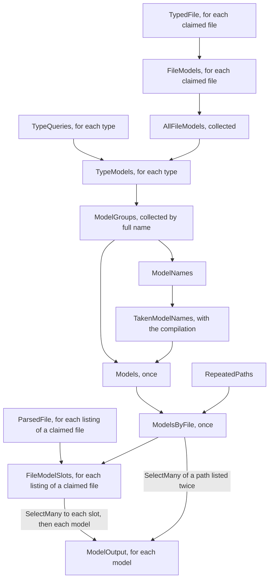
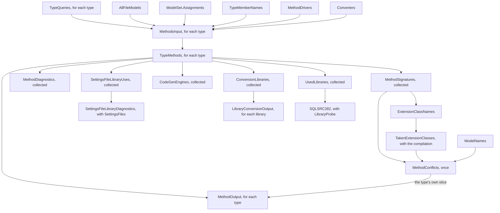

# The generator

How `src/SqlSource` turns a project's `.sql` files into C#: the incremental pipeline, how the settings are read and resolved, how a file is parsed, how a file's sidecar is read and checked, how each column and parameter of a usable entry gets its C# type, how the models of the queries are gathered and decided, what is written for a type, for a model and for a type's query methods, how problems travel to the compiler, and the model of a sidecar that the assembly holds.  What a user writes and gets is in the manual's [generator page](../manual/generator.md) and [`.sql` files page](../manual/sql-files.md).  The terms are the [glossary's](README.md#glossary).

## The pipeline

[`SqlSourceGenerator`](../../src/SqlSource/SqlSourceGenerator.cs) is an `IIncrementalGenerator`, and its `Initialize` only wires the steps, through one method for each stage, called in the order of the source outputs: `RegisterAttribute`, `ReadSettingsFiles`, `ClaimFiles`, `ReportSettingsFiles`, `ReadSettings`, `ParseFiles`, `SelectTypeQueries`, `CheckSidecars`, `TypeFiles`, `FindConverters`, `CollectModels`, `ReportDrivers`, `ReportProblems`, `RegisterModelSources`, `RegisterTypeSources` and `RegisterMethodSources`.  A stage that hands several providers on returns a record struct of them, and each step of a file's check, types and models is a `FileNodes<T>`, the two chains that [the fan-out by file](#the-fan-out-by-file) describes.  Beyond the wiring it holds a few helpers, which sort, join and search collected values, and `ReportAll`, which reports an array of diagnostics.  A step that drops the null values of a provider uses `WhereNotNull`, from [`IncrementalValuesProviderExtensions`](../../src/SqlSource/Generation/IncrementalValuesProviderExtensions.cs).  The steps and their records are at the root of [`Generation/`](../../src/SqlSource/Generation), the path rules in `Paths/`, the chains of the settings files in `Chains/`, the reading and checking of sidecars in `Sidecars/`, the C# types of a query in `Types/`, with what a project references of a driver in `Types/Drivers/`, the base maps in `Types/Maps/` and the resolution of mapped types in `Types/MappedTypes/`, the converters in `Converters/`, the models in `Models/`, the plan of the query methods in `Methods/`, and what writes a type's file, a model's and a type's methods in `Emitting/`.

Before any step runs, a post-initialization output adds `AttributeSource.Text` to the compilation as `SqlSourceGenerateAttribute.g.cs`.  It holds `[SqlSourceGenerate]`, the enums its properties take, `UnexpectedRowCountException` and `TransactionRolledBackException`, which a query method throws, and `[SqlSourceConverter]`, which marks a conversion method and, unlike `[SqlSourceGenerate]`, is not `[Conditional]`, so that it stays in a library's metadata.

The compiler hands the pipeline six inputs: the declarations that carry the attribute, the methods that carry `[SqlSourceConverter]`, the additional files, the compilation, the parse options, and the analyzer config options, of which the generator reads two properties, `SqlSourceBuildFolders` and `SqlSourceTransitivePackageAssemblies`.  The additional files are filtered three times, into the `.sql` files, by `SqlPath.IsSqlFile`, the [sidecars](README.md#sidecar), whose path ends in `.sql.json` ignoring case, by `SqlPath.IsSidecarFile`, and the [settings files](#settings-files), whose last segment is `sqlsource.json` exactly, by `ListedSettingsFile.IsSettingsFile`, so that each kind is an input of its own.  Each named step below is a constant of [`TrackingNames`](../../src/SqlSource/Generation/TrackingNames.cs).  The unnamed boxes are a `Select` or a `Collect` between two named steps.

```mermaid
flowchart TD
    settingsTexts["sqlsource.json additional files"] --> SettingsFile
    SettingsFile --> SettingsFiles
    syntax["Declarations with [SqlSourceGenerate]"] --> TargetTypes
    texts[".sql additional files"] --> listed["Listed paths, collected"]
    listed --> SqlPaths
    listed --> CaseCollisions
    SqlPaths --> CaseCollisions
    listed --> RepeatedPaths
    SqlPaths --> RepeatedPaths
    compilation["Compilation"] --> SupportedFramework
    compilation --> CompilePaths
    SettingsFiles -->|"any file?"| CompilePaths
    SettingsFiles --> ReachedSettingsFiles
    SqlPaths --> ReachedSettingsFiles
    CompilePaths --> ReachedSettingsFiles
    options["Analyzer config options"] --> BuildFolders
    BuildFolders --> ReachedSettingsFiles
    parse["Parse options"] --> UnsupportedLanguageVersion
    TargetTypes --> NestedClassCheck
    SettingsFiles -->|"the chain of the type's folder"| NestedClassCheck
    NestedClassCheck --> TypeFiles
    SqlPaths --> TypeFiles
    SupportedFramework --> TypeFiles
    UnsupportedLanguageVersion --> TypeFiles
    TypeFiles --> ClaimedPaths
    TypeFiles --> CommentPaths
    TypeFiles --> AmbiguousHintNames
    texts --> FileParseInput
    SettingsFiles -->|"dialect, keeps comments?"| FileParseInput
    CommentPaths --> FileParseInput
    FileParseInput --> FileClaim
    ClaimedPaths --> FileClaim
    FileClaim --> ParsedFile
    ParsedFile --> ParsedFiles
    texts --> FileLevel
    SettingsFiles -->|"the chain of the file's folder"| FileLevel
    FileLevel --> FileLevels
    TypeFiles --> TypeQueries
    ParsedFiles --> TypeQueries
    AmbiguousHintNames --> TypeQueries
    FileLevels --> TypeQueries
    TypeQueries --> TypeOutput
    sidecarTexts[".sql.json additional files"] --> SidecarInput
    ClaimedPaths --> SidecarInput
    SidecarInput --> SidecarFile
    SidecarFile --> Sidecars
    TypeQueries --> TypeNeeds
    TypeNeeds --> FileNeeds
    ParsedFile -->|"each file listed once"| SidecarCheckInput
    ParsedFiles -->|"a path listed twice"| SidecarCheckInput
    RepeatedPaths --> SidecarCheckInput
    FileNeeds --> SidecarCheckInput
    Sidecars --> SidecarCheckInput
    SidecarCheckInput --> SidecarCheck
    compilation --> NpgsqlProbe
    compilation --> SqlClientProbe
    compilation --> LibraryProbe
    FileLevels --> MappedTypeNames
    ParsedFiles --> MappedTypeNames
    options --> TransitivePackageAssemblies
    compilation --> ResolvedTypes
    MappedTypeNames --> ResolvedTypes
    TransitivePackageAssemblies --> ResolvedTypes
    ResolvedTypes --> MappedTypes
    ResolvedTypes --> MappedTypeConverters
    SidecarCheck --> FileTypesInput
    ParsedFiles --> FileTypesInput
    FileLevels --> FileTypesInput
    NpgsqlProbe --> FileTypesInput
    SqlClientProbe --> FileTypesInput
    LibraryProbe --> FileTypesInput
    MappedTypes --> FileTypesInput
    converterSyntax["Methods with [SqlSourceConverter]"] --> ProjectConverters
    ProjectConverters --> Converters
    MappedTypeConverters --> Converters
    LibraryProbe --> LibraryConverters
    LibraryConverters --> Converters
    Converters --> outConverters(["SQLSRC277 and SQLSRC278"])
    FileTypesInput --> TypedFile
    TypedFile --> FileTypes
    TypedFile --> FileModels
    FileModels --> AllFileModels
    TypeQueries --> TypeModels
    AllFileModels --> TypeModels
    TypeQueries --> LibraryFailures
    AllFileModels --> LibraryFailures
    TypeModels --> ModelGroups
    ModelGroups --> ModelNames
    compilation --> TakenModelNames
    ModelNames --> TakenModelNames
    ModelGroups --> Models
    TakenModelNames --> Models
    Models --> ModelsByFile
    RepeatedPaths --> ModelsByFile
    ParsedFile --> FileModelSlots
    ModelsByFile --> FileModelSlots
    FileModelSlots -->|"each slot"| ModelOutput
    ModelsByFile -->|"a path listed twice"| ModelOutput
    FileNeeds --> UsesPostgresEntries
    ParsedFiles --> UsesPostgresEntries
    FileNeeds --> UsesSqlServerEntries
    ParsedFiles --> UsesSqlServerEntries
    CaseCollisions --> out13(["SQLSRC013"])
    ClaimedPaths --> out13
    SettingsFiles --> outSettings(["SQLSRC015 to SQLSRC020"])
    ReachedSettingsFiles --> outSettings
    ParsedFiles --> outParse(["Parse errors"])
    SidecarCheck --> outSidecar(["Sidecar checks, SQLSRC209 and SQLSRC210"])
    NpgsqlProbe --> outDriver(["SQLSRC247 and SQLSRC248"])
    UsesPostgresEntries --> outDriver
    SqlClientProbe --> outSqlClient(["SQLSRC267 and SQLSRC268"])
    UsesSqlServerEntries --> outSqlClient
    FileTypes --> outTypes(["SQLSRC246, SQLSRC249 to SQLSRC252, SQLSRC261, SQLSRC269 and SQLSRC270"])
    LibraryFailures --> AllLibraryFailures
    AllLibraryFailures --> outLibraryFailures(["SQLSRC246 of a query at Models typed only by a library"])
    FileModels --> outFileModels(["SQLSRC253 to SQLSRC256, SQLSRC259 and SQLSRC260"])
    Models --> outModels(["SQLSRC251, SQLSRC256, SQLSRC257 and SQLSRC258"])
    ModelOutput --> outModel(["A model's file"])
    TypeOutput --> outType(["A type's file and its diagnostics"])
    TargetTypes --> TypeMemberNames
    NpgsqlProbe --> MethodDrivers
    SqlClientProbe --> MethodDrivers
    TypeQueries --> MethodsInput
    AllFileModels --> MethodsInput
    Models -->|"assignments"| MethodsInput
    TypeMemberNames --> MethodsInput
    MethodDrivers --> MethodsInput
    Converters --> MethodsInput
    LibraryProbe --> LibrariesBelowTheFloor
    LibrariesBelowTheFloor --> MethodsInput
    MethodsInput --> TypeMethods
    TypeMethods --> MethodSignatures
    MethodSignatures --> ExtensionClassNames
    compilation --> TakenExtensionClasses
    ExtensionClassNames --> TakenExtensionClasses
    MethodSignatures --> MethodConflicts
    TakenExtensionClasses --> MethodConflicts
    ModelNames --> MethodConflicts
    TypeMethods --> MethodOutput
    MethodConflicts --> MethodOutput
    TypeMethods --> MethodDiagnostics
    TypeMethods --> SettingsFileLibraryUses
    SettingsFileLibraryUses --> SettingsFileLibraryDiagnostics
    SettingsFiles --> SettingsFileLibraryDiagnostics
    TypeMethods --> CodeGenEngines
    TypeMethods --> ConversionLibraries
    ConversionLibraries -->|"each library"| LibraryConversionOutput
    TypeMethods --> UsedLibraries
    MethodDiagnostics --> outMethodDiagnostics(["SQLSRC272, SQLSRC274 and SQLSRC275"])
    SettingsFileLibraryDiagnostics --> outLibraries(["SQLSRC281 at a settings file's member"])
    MethodConflicts --> outConflicts(["SQLSRC274 across types and SQLSRC276"])
    CodeGenEngines --> outDriverMissing(["SQLSRC273"])
    NpgsqlProbe --> outDriverMissing
    SqlClientProbe --> outDriverMissing
    UsedLibraries --> outLibraryFloor(["SQLSRC282"])
    LibraryProbe --> outLibraryFloor
    MethodOutput --> outMethods(["A file of a type's methods"])
    LibraryConversionOutput --> outConversions(["A file of a library's conversions"])
```



What each step gives:

- **`SettingsFile`**: each settings file read, a [`ListedSettingsFile`](../../src/SqlSource/Generation/Chains/ListedSettingsFile.cs) from `ListedSettingsFile.Read` with `SettingsFileSide.Build`: what it says, its normalised folder and that folder's depth, and the problems that a build reports.  **`SettingsFiles`**: those, collected into a [`SettingsFileSet`](../../src/SqlSource/Generation/Chains/SettingsFileSet.cs) by `SettingsFileSet.Of`, with the chain that starts at each file, so that the chain of any folder is a search for its nearest file.  [Settings files](#settings-files) describes the chains.
- **`TargetTypes`**: a [`DeclaredType`](../../src/SqlSource/Generation/DeclaredType.cs) for each attributed declaration, read by [`TargetTypeReader`](../../src/SqlSource/Generation/TargetTypeReader.cs): the `TargetType`, and under `SqlLocation.Nested` the names its nested class cannot take, those of the type, its members and its type parameters.  Only the declaration that carries a type's first attribute gives one, so a type with the attribute on two partial declarations gets one file.
- **`NestedClassCheck`**: the `TargetType` with its nested class named, from the attribute's `NestedClass`, else the `nestedClass` of the chain of the folder of the type's C# file, else `Sql`, by [`NestedClassCheck.Apply`](../../src/SqlSource/Generation/NestedClassCheck.cs), which adds `SQLSRC007` when the type has taken the name.  It takes the `SettingsFiles`, and normalises the type's path only under `SqlLocation.Nested` in a project with a settings file.  The taken names stop here, so an edit that adds a member to a type runs nothing after this step unless the member takes the name, and an edit to a settings file runs nothing after it for a type whose name it leaves alone.
- **`SqlPaths`**: the normalised paths of the project's `.sql` files, distinct ignoring case and sorted, from `SqlPath.ToSortedSet`.
- **`CompilePaths`**: the `FilePath` of each of the compilation's syntax trees, as given, from `CompilePathsOf` in `SqlSourceGenerator`, and none, without a look at the trees, in a project without a settings file.  It runs on every run, as `SupportedFramework` does, and gives an equal value until a C# file is added, removed or renamed.  **`BuildFolders`**: the folders the build writes C# files and its outputs into and the NuGet package folders, normalised, a [`BuildFolders`](../../src/SqlSource/Generation/Chains/BuildFolders.cs) from `BuildFolders.Read` of the property `SqlSourceBuildFolders`, which is equal until it changes.  **`TransitivePackageAssemblies`**: the names of the referenced assemblies that only a package the project does not reference itself brings, a [`TransitivePackageAssemblies`](../../src/SqlSource/Generation/Types/MappedTypes/TransitivePackageAssemblies.cs) from `TransitivePackageAssemblies.Read` of the property `SqlSourceTransitivePackageAssemblies`, sorted and distinct ignoring case, which is equal until it changes.  **`ReachedSettingsFiles`**: the folders of the settings files that the chain of the folder of some `.sql` file or C# file reaches, from `SettingsFileSet.Reached` of `SqlPaths` and then of the compile paths that are rooted, normalise and are under none of the folders, by `BuildFolders.ReachingPaths`, in the order of the set's files.  It runs only when the set, one of the two lists or the folders change, and reads the compile paths only until every file is reached.  [Which files are checked](#which-files-are-checked) says why.
- **`CaseCollisions`**: the files whose path differs only by case from an earlier one, from `PathCollision.Find`.  **`RepeatedPaths`**: the paths that the project lists more than once, under one spelling or two, from `SqlPath.FindRepeated`.
- **`SupportedFramework`**: whether the compilation has `System.ArgumentException.ThrowIfNullOrWhiteSpace`, which first appeared in .NET 8 and which a generated method calls.  **`UnsupportedLanguageVersion`**: the project's language version when it is older than C# 12, from `LanguageSupport.FindUnsupportedVersion`.
- **`TypeFiles`**: each type with the files its `Path` resolves to, from `PathResolver.Resolve`, and the type's problems so far.  The framework and language problems are added here, so a type that has one gets no file.
- **`ClaimedPaths`**: every file some type claims.  **`CommentPaths`**: the files of the types whose attribute asks for `keep-comments`.
- **`FileParseInput`**: each file with everything outside it that its parse depends on, from the chain of its folder, `SettingsFileSet.ChainOf` of its normalised path (`SettingsChain.None` for a path that does not normalise), and `CommentPaths`.  This is stage one of the settings, described [below](#the-settings-have-two-stages).
- **`FileClaim`**: each file's `FileParseInput` beside whether its path is in `ClaimedPaths`, a [`FileClaim`](../../src/SqlSource/Generation/FileClaim.cs), from `FileClaim.Of`.  It compares by value, so a change to `ClaimedPaths` gives a new value only for a file whose answer changed, and a change to a file's input gives one for that file.
- **`ParsedFile`**: a `ParsedSqlFile` for each claimed file, from `SqlFileReader.Read` of its claim.  An unclaimed file gives nothing and is never read.  **`ParsedFiles`**: those, collected and sorted.
- **`FileLevel`**: each file's level of stage two, a [`FileLevel`](../../src/SqlSource/Generation/FileLevel.cs) from `FileLevel.Resolve`: the chain of its folder, `SettingsFileSet.ChainOf` of its normalised path, for the files whose chain says anything.  The files of a folder share their chain's level, and a file's path is normalised, by `LevelOf` in `SqlSourceGenerator`, only in a project with a settings file.  **`FileLevels`**: those, collected and sorted by path.
- **`AmbiguousHintNames`**: the [hint names](README.md#hint-name) that would clash ignoring case.
- **`TypeQueries`**: a type with its own parsed files, the level of each from `FileLevels` and its unique hint name, from `SelectFiles`.  It compares equal until the type, one of its files or the level of one changes.
- **`TypeOutput`**: the type's file, or none, with its diagnostics, from `TypeEmitter.Emit`.
- **`SidecarInput`**: a `SidecarInput` for each sidecar whose `.sql` file a type claims, from `SidecarInput.Create`: the file and the path of its `.sql` file as `ClaimedPaths` spells it.  Any other sidecar gives null and is never read.
- **`SidecarFile`**: the sidecar read, a `SidecarFile`, from `SidecarFileReader.Read`.  **`Sidecars`**: those, collected and sorted by the path of their `.sql` file.
- **`TypeNeeds`**: what a type needs of each of its files, from `SidecarNeeds.OfType`.  **`FileNeeds`**: the needs of every type merged, one `FileNeeds` for each file, from `SidecarNeeds.Merge`.
- **`SidecarCheckInput`**: each parsed file with its sidecar and its needs, from `SidecarCheckInput.Gather`, taken from the file's `ParsedFile` node, or from `ParsedFiles` for a path in `RepeatedPaths`.  **`SidecarCheck`**: what the checks of the file's sidecar gave, a `SidecarCheckResult`, from `SidecarChecker.Check`.  [Sidecars](#sidecars) describes these steps.
- **`NpgsqlProbe`**: what the project references of Npgsql, an `NpgsqlProbe`, from `NpgsqlProbe.Read`.  **`UsesPostgresEntries`**: whether a file with needs is read as `postgres`, from `UsesEntriesOf` in `SqlSourceGenerator`.  **`SqlClientProbe`** and **`UsesSqlServerEntries`** are the same for Microsoft.Data.SqlClient and `mssql`: an `SqlClientProbe` from `SqlClientProbe.Read`, and `UsesEntriesOf` again.  **`LibraryProbe`**: which libraries the project references, a [`LibraryProbe`](../../src/SqlSource/Generation/Types/Drivers/LibraryProbe.cs) from `LibraryProbe.Read`, which typing reads without its versions, `NodaTimeVersion`, `NetTopologySuiteVersion` and `SqlServerBytesVersion`, a `Select` that sets them to null, so that a change of a library's version alone types no file again.  **`LibrariesBelowTheFloor`**: the libraries that the probe says are older than their floor, without their versions, from `MethodsInput.BelowTheFloorOf`, so that a version that stays on one side of its floor plans no method again.
- **`MappedTypeNames`**: the C# types that the type override and the column types name at any level, and that the `-- param:` and `-- column:` markers of the queries give, from `MappedTypeNames.Collect`.  **`ResolvedTypes`**: each of them resolved against the compilation, with `TransitivePackageAssemblies`, a `MappedType`, with the converters declared on those of a referenced assembly, a [`ResolvedTypes`](../../src/SqlSource/Generation/Types/MappedTypes/ResolvedTypes.cs) from `MappedTypeResolver.Resolve`.  **`MappedTypes`** and **`MappedTypeConverters`**: a `Select` of each half, so that a change to a library's converter types no file again, and a change to a type that leaves its converters alone finds no converter again.
- **`ProjectConverters`**: a [`Converter`](../../src/SqlSource/Generation/Converters/Converter.cs) for each method, local function or operator of the project's source marked `[SqlSourceConverter]`, a local function or an operator only to be reported, read by [`ConverterReader`](../../src/SqlSource/Generation/Converters/ConverterReader.cs): its call, its argument and return types as `ClrTypeName.Text` writes them, a keyword's type as the keyword, the argument's without a `?` at its top, the `T` of `Nullable<T>` or a reference type unannotated, since a converter never sees null, the ids of its warnings, its first fault and its name's position.  **`LibraryConverters`**: the edges of the libraries the project references, an `EquatableArray<Converter>` from `LibraryConverters.Of` of the probe without NodaTime's version, NodaTime's fourteen when it references NodaTime and none otherwise.  **`Converters`**: those, collected and sorted, with the mapped types' converters and the libraries', a [`ConverterSet`](../../src/SqlSource/Generation/Converters/ConverterSet.cs) from `ConverterSet.Of`, which gives `SQLSRC277` at each method with a fault and `SQLSRC278` at each two without one that convert between the same types.
- **`FileTypesInput`**: each claimed file's check with what its types read, from `FileTypesInput.Gather`.  **`TypedFile`**: that input beside the C# types of the file's usable entries and the errors of its queries, a `FileTypes` from `QueryTyper.Type`, as a [`TypedFile`](../../src/SqlSource/Generation/Types/TypedFile.cs).  **`FileTypes`**: the `FileTypes` alone.  [Types](#types) describes these steps.
- **`FileModels`**: the properties of each claimed file's models and the errors of their names, a `FileModels`, from `ModelReader.Read`.  **`AllFileModels`**: those, collected from both chains of [the fan-out by file](#the-fan-out-by-file), combined and sorted by path.
- **`TypeModels`**: what a type asks for of its queries' models, a `ModelRequest` for each, from `TypeModels.Of`.  **`LibraryFailures`**: the failure without its libraries of each query the type claims at `Models` that a library's row alone gave a type, from `TypeModels.LibraryFailuresOf`.  **`AllLibraryFailures`**: every type's together, each once, from `MethodPlanner.Distinct`.  **`ModelGroups`**: every type's requests, collected and grouped by the model's full name, from `ModelCollector.Group`.  **`ModelNames`**: the full names alone.  **`TakenModelNames`**: the full names that the project has already, from `ModelNameChecker.FindTaken`.
- **`Models`**: the models to emit, the place each is emitted from and the problems of the requests, a `ModelSet`, from `ModelCollector.Resolve`.  [Models](#models) describes these steps.
- **`ModelsByFile`**: the models arranged by the file, query and role they come from, a `ModelsByFile`, from `ModelsByFile.Arrange`, with the models of a path in `RepeatedPaths` apart.  **`FileModelSlots`**: the slots of the models of each `ParsedFile` node's file, from `ModelsByFile.SlotsOf`.  **`ModelOutput`**: each model's hint name and source, from `ModelEmitter.Emit`, after a `SelectMany` of each file's slots, or of the models of a path the project lists more than once.  [The fan-out by file](#the-fan-out-by-file) describes these steps.
- **`TypeMemberNames`**: for each type whose methods go on itself, under `MethodLocation.Public`, `Internal` or `Private`, its `DeclaredType.TakenNames` as a [`TypeMemberNames`](../../src/SqlSource/Generation/Methods/TypeMemberNames.cs), collected and sorted by the type's key.  Almost always empty, since the methods go into an extension class by default.
- **`MethodDrivers`**: whether each engine's driver is referenced and not below the floor, a [`MethodDrivers`](../../src/SqlSource/Generation/Methods/MethodDrivers.cs), from `MethodDrivers.Of` of the two probes.
- **`MethodsInput`**: each type's own slice of what its methods need, a [`MethodsInput`](../../src/SqlSource/Generation/Methods/MethodsInput.cs), from `MethodsInput.Gather`.  **`TypeMethods`**: the type's methods and their problems, a [`TypeMethods`](../../src/SqlSource/Generation/Methods/TypeMethods.cs), from `MethodPlanner.Plan`.
- **`MethodSignatures`**: every type's methods as a call sees them, a [`MethodSignature`](../../src/SqlSource/Generation/Methods/MethodSignature.cs) for each, collected and sorted by `ToSortedSignatures`.  **`ExtensionClassNames`**: the extension classes' full names alone.  **`TakenExtensionClasses`**: those names that the project has already, from `ModelNameChecker.FindTaken`.
- **`MethodConflicts`**: the methods that a clash with another type's leaves out and the types whose extension class cannot be written, a [`MethodConflicts`](../../src/SqlSource/Generation/Methods/MethodConflicts.cs), from `MethodConflicts.Find`.
- **`MethodOutput`**: each type's file of methods, or none, from `MethodEmitter.Emit` of its `TypeMethods` and its own slice of the conflicts.  **`MethodDiagnostics`**: every type's problems of its methods, each once, from `MethodPlanner.Distinct`.  **`SettingsFileLibraryUses`**: every type's libraries that a settings file turns on and the project cannot use, without the positions of their members, each once, from `SettingsFileLibraryUse.Distinct`.  **`SettingsFileLibraryDiagnostics`**: those with `SettingsFiles`, each `SQLSRC281` at its member, from `SettingsFileLibraryUse.Locate`.  **`CodeGenEngines`**: the engines of every query whose output is `CodeGen`, OR-ed over the types.  **`ConversionLibraries`**: the libraries whose generated conversion a kept method calls, every type's `TypeMethods.ConversionLibraries`, each once, in the order of `SqlLibrary`.  **`LibraryConversionOutput`**: each of those as the hint name and the text of its class of conversions, from `LibraryConverters.HintNameOf` and `LibraryConverters.SourceOf`.  **`UsedLibraries`**: the libraries that a `CodeGen` query uses, every type's `TypeMethods.UsedLibraries`, each once, in the order of `SqlLibrary`.  [Query methods](#query-methods) describes these steps.

There are twenty-two source outputs.  `TypeOutput` gives each type's file and its diagnostics.  The two `ModelOutput`s give each model's file: one from the slots of each file, and one from the models of a path the project lists more than once.  `MethodOutput` gives each type's file of methods, and `LibraryConversionOutput` the file of each library's class of conversions that a method calls, once for the project.  The other seventeen report what belongs to no one type's file: `CaseCollisions` with `ClaimedPaths` gives `SQLSRC013`, `SettingsFiles` with `ReachedSettingsFiles` gives the problems of each settings file that a chain reaches, `SQLSRC015` to `SQLSRC020`, in the order of the set's files and within a file in the order of their positions, `ParsedFiles` gives each file's parse errors, `SidecarCheck` gives what the checks of each claimed file's sidecar found, `SQLSRC209` and `SQLSRC210` among them, `NpgsqlProbe` with `UsesPostgresEntries` gives `SQLSRC247` and `SQLSRC248`, `SqlClientProbe` with `UsesSqlServerEntries` gives `SQLSRC267` and `SQLSRC268`, a `Select` of `Converters` gives `SQLSRC277` and `SQLSRC278`, `FileTypes` gives the errors of each claimed file's types, `FileModels` the errors of the names of its models, a `Select` of `Models` the problems of the models, `MethodDiagnostics` the problems of each type's methods, `SettingsFileLibraryDiagnostics` `SQLSRC281` at each member of a settings file that turns on a library the project cannot use, `MethodConflicts` the clashes of two types' methods and the extension classes that cannot be written, and `CodeGenEngines` with the two probes `SQLSRC273`.  `SidecarCheck`, `FileTypes` and `FileModels` each report from two outputs, one for each chain of [the fan-out by file](#the-fan-out-by-file).  A file's errors are reported from the collected files, and its sidecar's, its types' and its models' names' each from one node for the file, so a file the project lists twice, or two types claim, is reported once.  The checks' diagnostics come first, then the types', then the models' names', and within each of the three those of the files the project lists once come in the order of its list of files, not in the order of the paths, then those of the paths it lists more than once, in the order of the paths; which diagnostics are reported does not depend on it.

### Records between the steps

The pipeline caches a step's output and compares it with the last run's, so every value that flows between steps has value equality.  Each is a record, and holds its collections in [`EquatableArray<T>`](../../src/SqlSource/EquatableArray.cs), because `ImmutableArray<T>` compares by reference.  Roslyn's own objects have no value equality, and they keep a compilation alive, so none of them flows between steps, with one exception: `FileParseInput` and `SidecarInput` each carry the file's `AdditionalText`, on to the step that reads it, and `FileClaim` carries the `FileParseInput`.  That object compares by reference, and the compiler hands out the same one until the file changes, so it caches as well as a value, and no step after the read holds it.  A position travels as a `LocationInfo` and a problem as a `DiagnosticInfo`, and an output step turns them into Roslyn objects.

Ten steps look at the compilation.  `TargetTypes` reads the symbol and syntax of each declaration, `ProjectConverters` those of each marked method, `SupportedFramework` reads one `bool`, `CompilePaths` the path of each syntax tree and nothing else, and no path in a project without a settings file, `NpgsqlProbe` three type lookups and the identities of the references, `SqlClientProbe` three type lookups and, when the driver is found, the identity and attributes of the assembly that defines its connection type, `LibraryProbe` six type lookups, the identities of the references and the attributes of the assemblies that define NetTopologySuite's `Geometry` and `SqlServerBytesReader`, `ResolvedTypes` the C# types that the type override, the column types and the markers name, and the marked methods of those of a reference, `TakenModelNames` the models' full names in the project's own assembly, and `TakenExtensionClasses` the extension classes' full names there.  Everything after them works on records.  The last eight are a `Select` over `CompilationProvider`, which the driver gives a new compilation on every run, a `.sql` edit's included, so each of them runs on every run.  Each gives a value equal to the last run's until what it reads changes, so nothing after it runs again.

Only the code of those steps touches symbols and syntax: [`TargetTypeReader`](../../src/SqlSource/Generation/TargetTypeReader.cs), the `SupportedFramework` and `CompilePaths` steps of `SqlSourceGenerator`, `NpgsqlProbe`, `SqlClientProbe`, `LibraryProbe` and the `IDriverProbe` the first two share, with the `DriverProbes` all three call, in `Types/Drivers/`, `MappedTypeResolver`, `GenericConstraints`, `ShortNameIndex` and `MappedTypeWarnings` in `Types/MappedTypes/`, `ConverterReader` in `Converters/`, and `ModelNameChecker` in `Models/`, which `TakenModelNames` and `TakenExtensionClasses` both call.  Outside the pipeline, [`AttributeConflictSuppressor`](../../src/SqlSource/Diagnostics/AttributeConflictSuppressor.cs) reads them too, as [the suppressor](#the-suppressor) describes.

A `Collect()` gives an `ImmutableArray<T>`, so each `Collect()` in `SqlSourceGenerator` has a `Select` after it that gives an `EquatableArray<T>`, `AllFileModels` one `Select` after its two chains' `Collect()`s are combined: `SqlPath.ToSortedSet` for paths, `SettingsFileSet.Of` for the settings files, a record of `EquatableArray<T>`s, `HintName.FindAmbiguous` for hint names, the `ToSorted` helper for parsed files, the files' levels and the files' models, `ConverterSet.Sort` for the project's converters, `ToSortedSidecars` for sidecars, `SidecarNeeds.Merge` for what the types need, `ModelCollector.Group` for what they ask of the models, an ordering by key for `TypeMemberNames`, `ToSortedSignatures` for the methods' signatures, `MethodPlanner.Distinct` for the methods' problems, `SettingsFileLibraryUse.Distinct` for the libraries that a settings file turns on and the project cannot use, and an OR for `CodeGenEngines`.  Without it the step after would run on every edit.  Only `CaseCollisions` and `RepeatedPaths` take a collected value as it is, the listed paths.  Those steps are cheap, and their answer is almost always "none", so the steps after them are taken from the last run.

Some values are kept apart because they change less often than their inputs.  `CommentPaths` and `AmbiguousHintNames` are almost always empty, and a file's `FileParseInput` holds `CommentsWanted`, and not its chain's list of generator parameters, so that an edit to another part of the list parses no file.  `TypeNeeds` is a step of its own beside `TypeOutput`, so that a change to a type, or to a settings file, that leaves what it needs alone gives an equal value and checks no file again.  Each file's type override, column types and library types are a level of their own in its `FileTypesInput`, from `FileTypesInput.TypeSettingsOf`, so that a change to another setting types no file again; a settings file keeps the position of each member of its library types beside its level, in `SettingsFile.LibraryMembers`, and `SQLSRC281` is located from it only in `SettingsFileLibraryDiagnostics`, so that an edit that only moves the member types no file again either.  `MethodsInput` is a step of its own beside `TypeOutput` too, and `TypeOutput`'s inputs are not widened for the methods, so that an edit to a sidecar writes no type's file again.

### Paths

A type's `Path` is resolved by `PathResolver.Resolve` from the list of paths alone, never from the text of a file, so an edit to one `.sql` file resolves no type again.  `PathResolver.FindFiles` gives the files of the attribute's folder when there is no `Path`, the files of the folder it names, or the one file it names.  What a `Path` can name is in the manual, [Path](../manual/settings.md#setting-path).

[`SqlPath`](../../src/SqlSource/Generation/Paths/SqlPath.cs) does every path operation as string work.  A generator may not touch the file system (analyzer rule RS1035), and a project must build the same on every operating system, so `SqlPath.Normalize` accepts both separators and resolves `.` and `..`, and `SqlPath.Comparer` compares ignoring case.  The lists of paths and of parsed files are sorted by that comparer, and `SqlPath.IndexOf`, `SqlPath.Contains` and `SqlPath.FindInFolder` search them in that order: the first two by halving, the third from the first path under the folder, each through [`SortedSearch`](../../src/SqlSource/SortedSearch.cs), the one binary search of the generator's sorted lists.  It finds an item by a key, or by a probe, a struct that says how the item at an index sorts against what is looked for, and gives an exact match or a lower bound; every search of a sorted list goes through it but the type override map's, whose key it cannot hold ([TD-0063](../tech-debt/TD-0063-lower-bound-of-the-type-override-map-is-a-search-of-its-own.md)).  An overload of `SqlPath.IndexOf` searches for the first characters of a path, such as one of its folders, in place, with `SqlPath.Comparison`, the comparison of `Comparer`, through the overload of `SortedSearch` that takes a part of a text; `SettingsFileSet.ChainOf` finds a folder's nearest settings file so.  `PathResolver.Resolve` and `SelectFiles` run once for each type, so a linear pass over a list there would cost types times files.

Because the lists are distinct ignoring case, a search may return either of two entries that compare equal, and a file whose path differs only by case from an earlier one is left out of them.  [`PathCollision`](../../src/SqlSource/Generation/Paths/PathCollision.cs) finds such a file in `CaseCollisions`, and it is reported as `SQLSRC013`, for a claimed path only.  The generator cannot ask the file system, so two files on a case-sensitive file system look the same as one file listed under two spellings, and both are the same error.

A file that no type [claims](README.md#claim) is skipped before its text is read, so nothing about it is reported.  That lets a project hold `.sql` files that are not queries, such as migration scripts.  Whether a file is claimed is its `FileClaim`, a value of its own that the read takes, so a change to `ClaimedPaths`, such as a file added to a claimed folder or a `Path` edited, reads only a file that comes to be claimed, and no file whose answer is the same.

### Sidecars

[`Generation/Sidecars/`](../../src/SqlSource/Generation/Sidecars) reads the sidecar of each claimed file and checks it against what the types that claim the file need.  The checks run once for each file, whatever the number of its types, so that a problem is reported once, and they give the entries that passed every check, `SidecarCheckResult.UsableEntries`, the only entries a later step may read.  What each diagnostic means to a user is in the manual's [diagnostics](../manual/diagnostics.md).

**Pairing.**  A sidecar is an additional file whose path ends in `.sql.json`, ignoring case, and its `.sql` file is its normalised path without `.json`, from `SqlPath.SqlPathOfSidecar`.  `SidecarInput.Create` searches `ClaimedPaths` for that path and keeps the claimed spelling, so a sidecar whose path differs by case from its `.sql` file's is still paired with it.  A sidecar whose `.sql` file no type claims, or that has no `.sql` file beside it, gives null and is never read, as a `.sql` file that no type claims is never read.  Two sidecars whose paths differ only by case are both read, and `Sidecars` keeps the one spelled exactly as its `.sql` file's path with `.json` after it, compared ordinally by `SidecarFile.IsSpelledAsItsSqlFile`, since that is the file the tool reads and writes.  When neither is spelled so, it keeps the first the project lists, as `ParsedFiles` keeps the first of two `.sql` files.  A sidecar listed by two items is two inputs, and `Sidecars` keeps it once.

**Reading.**  `SidecarFileReader.Read` hands the file's text to `SidecarReader.Read`, the reader the tool uses, which never throws: see [reading a sidecar](#reading-a-sidecar).  A file whose text cannot be had is read as malformed at its start.  The reader takes a text without a byte order mark, so one is left out of what it reads, and every position is moved past it again.  The `SidecarFile` holds the read result and each position a check reports at, made into a `LocationInfo` while the text is in hand: the start of the file, the error of a malformed one, and the key of each entry.  It holds no text, so no step after it needs the file.

**What a file needs.**  A query needs an entry when its output, resolved by `QuerySettings.Resolve` for some type that claims its file, is not `Sql`.  The output is resolved for each type, so `SidecarNeeds.OfType` gives, for each file of a type, the queries that need an entry with the output that type gives them.  A type with problems of its own counts as well, since the tool describes its files all the same.  `SidecarNeeds.Merge` makes one `FileNeeds` of every type's for each file: each query once, with the greatest of its outputs, in the ordinal order of the names, so that the value does not depend on the order of the types.  A file in which no query needs an entry has none.  A file with parse errors has no queries, so it needs nothing.

**The checks.**  `SidecarCheckInput.Gather` finds the sidecar and the needs of a parsed file with two searches, and `SidecarChecker.Check` checks the file.  A file with neither is done at once, so a project at `Sql` that has no sidecars pays for nothing more.  Otherwise the checks run in this order, and each of the first three says which of the checks after it it stops:

1. **The dialect**, for a file with a query that needs an entry.  A dialect that `SqlDescribableDialects` does not list is `SQLSRC209`, and one that this version has no type map for, which `SidecarChecker.HasTypeMap` decides, is `SQLSRC243`.  Both describable dialects, `postgres` and `mssql`, have a map, so no dialect of this release reports it; it waits for an engine whose describer lands before its map.  Each is reported once for the file, at its first query that needs an entry, which is where the tool reports `SQLSRC209`.  Each stops the check of every query against the sidecar, the fourth below, while the tokens of the queries are still checked.
2. **The tokens.**  Each token without a default of a query that needs an entry is `SQLSRC210`, at the query, whatever the dialect and the sidecar, as the tool reports it.  It stops the check of that query.
3. **The sidecar itself**, in `SidecarFileChecks.Read`.  A malformed file is `SQLSRC237`, at the reader's error, and a format other than `SidecarFormat.Version` is `SQLSRC238` or `SQLSRC239`, at the start of the file.  Each leaves the file no usable entry and stops every check after it.  A `toolVersion` whose prefix, from `PackageVersion.PrefixOf`, is not `PackageVersion.Prefix` is the warning `SQLSRC240`, and the file is used.
4. **Each query that needs an entry**, in file order.  No sidecar, or no entry of its name, names compared ordinally, is `SQLSRC241`.  An entry whose `engine` is not the canonical name of the file's dialect is `SQLSRC242`.  An entry whose `hash` is not the query's is `SQLSRC244`.  Otherwise the entry is usable.  The hash is computed here, and only for a query that needs an entry.
5. **The orphans.**  Each entry that names no query that needs one is the warning `SQLSRC245`, at its key.  A query stopped by an earlier check still needs its entry, so that entry is no orphan.  The check does not run for a file with parse errors, whose every entry would otherwise be an orphan until the file parses.

The diagnostics are reported from the outputs of `SidecarCheck`, one for each chain of [the fan-out by file](#the-fan-out-by-file), once for each file.  A position is in the `.sql` file, at a query's name, or in the sidecar, at the reader's error, an entry's key or the start of the file, and both are additional files, whose positions the compiler accepts.  Nothing of a sidecar reaches a type's file, so a query that a check stops keeps its constant or method.  [`tests/SqlSource.Tests/Generator/SidecarTests.cs`](../../tests/SqlSource.Tests/Generator/SidecarTests.cs) holds each check, and reads the usable entries from the step's output to hold that an entry that failed a check is never one of them.

`SidecarCheckInput` is gathered again for every file when `FileNeeds` or `Sidecars` changes, which costs two searches for each, and `SidecarCheck` runs again only for a file whose input changed.  So an edit to the text of one `.sql` file or one sidecar checks that file alone.  Each file is checked from its own `ParsedFile` node, as [the fan-out by file](#the-fan-out-by-file) describes, and those nodes move for no other file, so a claimed file added or renamed checks that file alone, and one removed checks no other.

### Types

[`Generation/Types/`](../../src/SqlSource/Generation/Types) gives each parameter and column of a usable entry its C# type: for a parameter, the one its `-- param:` marker gives after `->`; for a column, the one its query's `-- column:` marker gives after `->`, else the column types' for the column it is read from, from the most specific level that names it; else the type override's, from the most specific level that names its key; else the row of a library that is on for the query; or else the base map's of its engine, under the column of the project's driver of that engine, Npgsql or Microsoft.Data.SqlClient.  The [models](#models) read them, as the types of their properties.  What a user sees of them, the maps and their diagnostics, is in the manual's types of [PostgreSQL](../manual/postgresql.md#type-map) and [SQL Server](../manual/sqlserver.md#types).

**The probe.**  `NpgsqlProbe.Read` gives a value-equal record of four members: whether `Npgsql.NpgsqlConnection`, which every version has, is found; whether `Npgsql.NpgsqlSlimDataSourceBuilder`, first in 8.0, is; whether `NpgsqlTypes.NpgsqlCube`, first in 10.0, is; and the version of the referenced assembly named `Npgsql`, the newer of two.  The map follows the driver by the types it has, as the epic decides, so `AtLeast10` and `Referenced` alone choose the [`NpgsqlColumn`](../../src/SqlSource/Generation/Types/Drivers/NpgsqlColumn.cs): `Npgsql10` when `AtLeast10`, `Npgsql8` for any other version that is referenced, and `None` without a reference.  `AtLeast8` serves the floor alone, `IsBelowTheFloor`, which is `SQLSRC247`.  The version serves the diagnostics alone: their text, and `IsNewerThanKnown`, a major above 10, which is `SQLSRC248`.

**The SqlClient probe.**  `SqlClientProbe.Read` gives the same for Microsoft.Data.SqlClient: whether `Microsoft.Data.SqlClient.SqlConnection` is found; whether ``Microsoft.Data.SqlTypes.SqlVector`1``, first in 6.1, is; whether `Microsoft.Data.SqlClient.SspiContextProvider`, first in 7.0 and in no 6.x, is; and the version, as a string.  The version is the informational version of the newest assembly named `Microsoft.Data.SqlClient` that defines `Microsoft.Data.SqlClient.SqlConnection` (a driver merged into an assembly of another name has none), up to a `+`, since the identity of a package's assembly keeps its major only (`6.0.0.0` for every 6.0 and 6.1); without that attribute it is the identity's major alone.  [`SqlClientColumn`](../../src/SqlSource/Generation/Types/Drivers/SqlClientColumn.cs) is that of the newest version whose type the project has: `SqlClient7` when `AtLeast7`, `SqlClient61` when `AtLeast61`, `OlderThan61` for any other version that is referenced, and `None` without a reference.  `IsBelowTheFloor` is `SQLSRC267` and `IsNewerThanKnown`, a leading integer above 7, is `SQLSRC268`.  The probe uses only API that Roslyn 4.8.0 has, takes the assembly from the symbols that its lookups found, so that a project without the driver reads nothing more and no list of the references is made, and never throws on an attribute that has no argument or a non-string one (an array, for one).

**The library probe.**  `LibraryProbe.Read` gives a value-equal record of three members: whether `NodaTime.Instant` is found, whether `Npgsql.NpgsqlNodaTimeExtensions`, of the plugin `Npgsql.NodaTime`, is, and the version of the newest referenced assembly named `NodaTime`, which typing does not read.  It is no `IDriverProbe`, since it reports nothing by itself.  `IsAvailable` says whether the project references what a library needs on an engine, NodaTime and the plugin on PostgreSQL and NodaTime on SQL Server; `DefaultOf` is the state of a library that no level names, `On` on PostgreSQL where it is available and `Off` otherwise; and `MissingAssembliesOf` is what `SQLSRC281` names.  `IsBelowTheFloor` says whether a library is older than SqlSource supports, NodaTime below 3.1.9 by that version, and is false where no assembly named `NodaTime` gives one, as for a library merged into another assembly; `VersionTextOf` and `FloorOf` are the versions that `SQLSRC282` names.

**The base map.**  [`PostgresTypeMap.Map`](../../src/SqlSource/Generation/Types/Maps/PostgresTypeMap.cs) gives a [`TypeMapping`](../../src/SqlSource/Generation/Types/Maps/TypeMapping.cs) for a `PostgresType`: its `TypeMappingKind`, the key that answered or failed, the C# type's text, a keyword or `global::`-qualified, and for a failure the detail its message adds.  A row is found by the type's `InternalName`, for a type of `pg_catalog` and for a base type of an extension that `TypeKeyNames.IsExtension` names, in any schema.  Each row holds the C# type of Npgsql 8 and 9, and of 10 where it differs, and `Row.Under` chooses by the column.  Under `None`, a row with two C# types is `DiffersByDriver`, whose detail is the entry a user can write for each driver whose type is not of `NpgsqlTypes`, and a row of `NpgsqlTypes` is `NeedsDriver`.  `bit` and `varbit` are decided by their length.  A row of a type no driver reads is a refusal, `CastToOid` or `CastToText` with the type to cast to in its detail, and a row that only Npgsql 10 reads, `cube`, is `NeedsNpgsql10` under the column of 8.  A type that has no row goes by its kind: an array is its element's mapping with `[]`, and a cast's detail with `[]`, a domain its base's, an enum `string`, a range or a multirange `UserDefinedRange`, another base type of `pg_catalog` `CastToText`, a composite or a base type of another schema `Unreadable`, and a kind this version does not know, or an array or a domain without its element or base, `NotWrittenByTheTool`.  The type override is asked first at every level of that walk, through a `PostgresOverrideOf`, so an entry for an array, `int4[]`, wins over one for its element, `int4`, a domain's own entry wins over its base's, and an entry for a base reaches every domain over it.  [`TypeKeyNames`](../../src/SqlSource/Settings/TypeOverrides/TypeKeyNames.cs) keeps its own list of the names the map knows, which the grammar checks a key against, and the names of the extensions' types, which the map reads.  The map's rows and that list are two lists, held equal by `PostgresTypeMapTests.Keys_OfTheMap_AreTheKnownPostgresNamesOfTheSettings`.

**The SQL Server map.**  [`SqlServerTypeMap.Map`](../../src/SqlSource/Generation/Types/Maps/SqlServerTypeMap.cs) gives a `TypeMapping` for a `SqlServerType` under a `SqlClientColumn`.  A row is found by the type's base name, its `Name` cut before the first `(` by `BaseName`, so `nvarchar(50)` is `nvarchar` and a facet never changes the C# type; rows compare ignoring case, and a mapping's key is the row's own name.  No row differs between SqlClient 6.1 and 7, so a row has one C# type, and the column decides only whether the project has that type: a row whose type is SqlClient's own, `vector`'s `Microsoft.Data.SqlTypes.SqlVector<float>`, records the column of the first version that has it, `SqlClient61`, and `SqlServerTypeMap.Lacks` compares the project's column with it in the order of their versions: under `None` the row is `NeedsDriver`, and under an older column `NeedsNewerSqlClient`, whose detail is that first version, 6.1.  `hierarchyid`, `geography` and `geometry` are rows that refuse, `NeedsSqlServerTypes`, whose detail is the type of `Microsoft.SqlServer.Types` an entry can name, since SqlClient reads them only with that package.  A type with a `UserType` is asked of the type override first, through a `SqlServerOverrideOf`, by the user type's key from `KeyOf`: its bare name for a user type of `sys`, `sysname` among them, and `schema.name` otherwise, each part written by `TypeKeyText.WritePart`.  An alias type, whose user type has no assembly-qualified name, is then mapped as its base, which asks the override again by the base's key, as a PostgreSQL domain does.  A CLR type is mapped by its name only when it is one of the three rows of `sys` that refuse; any other is `Unreadable` by its key.  A type with no row is `Unreadable`, and one with no name `NotWrittenByTheTool`.  The rows are held equal to `TypeKeyNames.KnownSqlServerNames` by `SqlServerTypeMapTests.Keys_OfTheMap_AreTheKnownSqlServerNamesOfTheSettings`.

**The library rows.**  [`LibraryRows`](../../src/SqlSource/Generation/Types/Maps/LibraryRows.cs) holds the rows of the libraries that are on, NodaTime's and NetTopologySuite's, each a `TypeMapping` of kind `Mapped` whose `Library` is set and whose C# type is written from `global::`, so that the generator names no library type in its own code.  `LibraryRows.Of` gives one shared instance for each set of libraries, or null for none: `BuildSets` makes them all when the type is initialized, in an array indexed by a mask of `1 << (int)library` for each library of the set, each set's rows merged from `RowsOf` of each of its libraries.  `PostgresTypeMap.Map` takes it as `libraries` and asks it at each level of its walk after the type override and before the base map's row or kind, so an array of `timestamptz` is `Instant[]`, a domain over it an `Instant`, and an override at any level of the walk wins.  `Find` matches a type of `pg_catalog` by its `InternalName`, ignoring case, and, in a set with NetTopologySuite, a type of PostGIS by `LibraryRows.IsPostgis`: a base type named `geometry` or `geography`, ignoring case, in any schema, since the extension is installed where the user chooses, which is NetTopologySuite's `Geometry`, a reference type.  Those rows are apart from `RowsOf`'s, in one dictionary that every set with NetTopologySuite shares.  A multirange is a row of its own, an array of the range's type.  `SqlServerTypeMap.Map` takes the rows too, asked after the type override and before the map's row; `Find(SqlServerType)` matches a system type by its name without facets, ignoring case, so `datetime2(3)` is NodaTime's `LocalDateTime`, and an alias type maps as its base.  A CLR user type never takes a row.  `QueryTyper` keeps the type without the library beside a library row on both engines, for the models to pick by output, or, for a type that has none without a library, the failure for the query, as [types](#types) describes.  What a user sees of the rows is in the manual's NodaTime on [PostgreSQL](../manual/postgresql.md#nodatime) and on [SQL Server](../manual/sqlserver.md#nodatime).

**The resolution of mapped types.**  `MappedTypeNames.Collect` gives the distinct C# types that the files' levels and the markers of every query name, the C# types of the queries' parameters and of their `-- column:` markers among them, in ordinal order, as a list of their texts that an edit which leaves them alone gives again, equal.  A query's markers are over its preamble's, so the preamble's entries are read through its queries, and the files of a folder share their chain's level, which is read once for a run of them.  `ResolvedTypes` combines that list with the compilation and with the step `TransitivePackageAssemblies`, the names of the referenced assemblies that only a package the project does not list itself brings, which [`TransitivePackageAssemblies.Read`](../../src/SqlSource/Generation/Types/MappedTypes/TransitivePackageAssemblies.cs) decodes from the property that [the targets set](msbuild-and-manifest.md#the-package-brought-assemblies), and [`MappedTypeResolver.Resolve`](../../src/SqlSource/Generation/Types/MappedTypes/MappedTypeResolver.cs) gives a [`MappedType`](../../src/SqlSource/Generation/Types/MappedTypes/MappedType.cs) for each: its `MappedTypeStatus`, whether it is a value type and public, the ids of the warnings that a use of it gives, and no symbol.  The ids, which [`MappedTypeWarnings`](../../src/SqlSource/Generation/Types/MappedTypes/MappedTypeWarnings.cs) reads, come from `[Obsolete]` and `[Experimental]` on the type, a type it is nested in, one of its type arguments, or, for `[Experimental]`, its module or assembly: an `[Obsolete]`'s `DiagnosticId`, or else `CS0612` and `CS0618`, and an `[Experimental]`'s id, or else `CS9204`, in ordinal order, each once.  A type marked `[Obsolete]` as an error, whose use is `CS0619`, which no `#pragma warning disable` turns off, is `NotAPropertyType`, and so is one marked under an id that is not an identifier, which no pragma can name.  An argument that is not a primitive constant, as an attribute of the name declared with an array parameter can take, gives no id and no error.  A keyword is its special type.  A name is looked up by its metadata name, ```A.B+C`1```, with `GetTypesByMetadataName`, from the longest namespace prefix down, so that a nested type is found; of several types the project's own wins, then the one of a reference that the project can see, and several that it can see are `Ambiguous`.  A short name, `UserId` or `List<UserId>`, asks [`ShortNameIndex.MetadataNamesOf`](../../src/SqlSource/Generation/Types/MappedTypes/ShortNameIndex.cs) for the metadata names of the top-level types of its name and arity, in any namespace, that the project can see and name, so never a file-local type: the project's own, by `GetSymbolsWithName` with a type filter, and each reference's, from an index of its top-level types by name and arity, built the first time a short name asks and kept in a `ConditionalWeakTable` keyed by the `MetadataReference`, so that it is built again only when the reference changes.  The index holds metadata names and no symbol, and each name it gives is found again by `GetTypesByMetadataName` in the current compilation, where `IsSymbolAccessibleWithin` decides whether it counts, so a reference's internal type counts only where the reference shows its internals to the project.  A reference under an alias other than `global` is not indexed.  One name is looked up as a full name's, so the project's own wins over a reference's of that same full name; several are `Ambiguous`, and the record's `Candidates` holds their full names, `App.UserId`, or `global::UserId` for one of the global namespace, which `SQLSRC250` lists; none is `NotFound`.  A short name whose one type is of an assembly that `TransitivePackageAssemblies` holds, and not of the project, gives the record its `Package`, a [`PackageBinding`](../../src/SqlSource/Generation/Types/MappedTypes/PackageBinding.cs) of the short name, the type's full name and its assembly: the first such in a name that is found, the name's own before its arguments', and none for a name that fails.  `global::UserId` is a name of the global namespace alone, as before.  The record's `Text` is the name with each short name in it, its type arguments' too, written as its type's full name, `global::System.Collections.Generic.List<global::App.UserId>`, and is the name itself for a name with no short name, so that a short name and its full name are one `PropertyType.Text`, and generated code needs no `using`.  Its type arguments are resolved the same way, each to a symbol as the model writes it, with its ranks and a `?` as `System.Nullable<T>` or an annotation.  When every argument is found, [`GenericConstraints.Construct`](../../src/SqlSource/Generation/Types/MappedTypes/GenericConstraints.cs) constructs the type, from its outermost containing type in, a type nested in a constructed one being found among its members, and each argument is checked against its type parameter: the `class`, `struct`, `unmanaged`, `notnull` and `new()` constraints, `new()` failing for `required` members that the constructor does not set, and each constraint type, with the arguments put for its type parameters, by an identity, implicit reference or boxing conversion, `System.Nullable<T>` boxing, for a constraint, only to `object` and `System.ValueType`.  A model is `#nullable enable`, so an argument that can be null, a reference type written with a `?` or a `System.Nullable<T>`, breaks a `notnull` constraint, a `class` constraint written without a `?`, and a constraint type written without a `?`, unless that constraint type is a type parameter whose own argument can be null.  The nullability inside an argument is not checked ([TD-0067](../tech-debt/TD-0067-nullability-inside-a-mapped-type-argument-is-not-checked.md)).  An interface with a static abstract member that it does not implement, as `System.Numerics.INumber<int>`, is refused as an argument, though not as an array's element or the whole type (CS8920).  A broken constraint is `NotAPropertyType`, the last of the statuses, and no symbol leaves the resolver.  Beside the types, the result holds the converters of the mapped types of referenced assemblies: the named type that a name found, an array's element type or a generic's constructed type, gives each of its methods whose attribute's class is `SqlSource.SqlSourceConverterAttribute` by its display, since each assembly has its own internal copy, read by `ConverterReader` as a `Converter` of origin `MappedType` with no location, its fault kept for the query that would use it.  A type of the project's own assembly gives none, since `ProjectConverters` reads its methods; a type that two names find, `Lib.Email` and `Lib.Email[]`, gives its converters once; a name that fails, or a keyword, gives none; and they are sorted by `ConverterSet.Sort`.  The compiler imports a reference's internal members only when the reference shows its internals to the project, so an internal converter of a library is found only then, and is a converter the project can call; a library that shows its internals to another assembly alone, as to its tests, gives the project none, which `MappedTypeResolverTests` pins.  A `protected` converter is found and is `SQLSRC277` at the query, since `IsSymbolAccessibleWithin` refuses it.  `MappedTypes` and `MappedTypeConverters` hand each half on alone.  An empty list gives an empty result at once, so a project that maps no C# type looks nothing up, and a list with no short name builds no index.

**The types of a query.**  `FileTypesInput.Gather` makes a node for each claimed file from its `SidecarCheck`, with two searches for its parsed file and its level, from `FileLevels`, and the three probes and the mapped types.  It carries the level as its type override, column types and library types alone, so that a change to another setting gives an equal input, and a file with no usable entry carries nothing to type.  None of them holds a position in a settings file, so an edit that only moves a member gives an equal input too.  The `TypedFile` step calls [`QueryTyper.Type`](../../src/SqlSource/Generation/Types/QueryTyper.cs) once for the node, and keeps the input beside the result, so that `FileModels` reads the usable entries and the parsed queries without typing the file again; `FileTypes` is a `Select` of the result alone.  `QueryTyper.Type` types the query of each usable entry:

1. **The query's type override** is `QuerySettings.ResolveTypeOverrides` of the entries of the file's engine, `SqlDescribableDialects.EngineOf` of its dialect, from the query's markers and the file's level, the chain of its folder, computed once for each distinct level of markers, compared by reference, so the queries without markers of their own share their preamble's.  An empty map asks the base map alone; a map of `default` entries alone is asked, since a `default` of an array's own key is `SQLSRC261`.  The query's column types, `QuerySettings.ResolveColumnTypes` of the same two levels, are computed with it, once for each level of markers, in `LevelTypes`, and so are its libraries: `QuerySettings.ResolveLibraries` of the two levels, read by `LibrariesOf`, for which a library is on when its winning entry says `On`, or when no entry or one of `Default` wins and `LibraryProbe.DefaultOf` gives `On` for the engine.  A library that is on and that `IsAvailable` gives the level its rows, through `LibraryRows.Of`, and one that is on and is not keeps the winning entry, which said `On`, in `UnavailableLibraries`, and gives no rows.
2. **Each parameter, then each column**, in order, is mapped by the map of its type's class, except a column whose type a column type or its query's `-- column:` marker chooses, below, and a parameter whose `-- param:` marker gives a C# type after `->`, found in the query's list by its name ignoring case: `QueryTyper.Chosen` gives it that type, its `MappedType` found as an entry's is, over the type override of every level and the map, with the place `the -- param: marker of the parameter`, a `Key` of the database type as an entry would name it, which a converter's message names, `Mapped` set to `@author`, and the `Database` of a type that a type override, a column type or a marker chose, so that its converters apply; its failures are those of a mapped type below, which name it as `@author`, as the model's `SQLSRC251` does from `Mapped`.  A column's type is, in order: the C# type of the query's `-- column:` marker that names it, found by `ColumnMarker.Names`, its name ignoring case with or without its `!` or `?` mark, with the place `a -- column: marker of the query` and `Mapped` the marker's name; then, unless that marker says `-> default`, the entry that `ColumnTypeMap.Find` gives for its origin's schema, table and column, for a column whose origin has a table and a column, with the place that wrote the entry and `Mapped` its key, `users.id`; each through `QueryTyper.Chosen`, as a parameter's marker is, so a column type at any level wins over the type override at any level.  Otherwise a `PostgresType` is mapped by `PostgresTypeMap.Map` under the column of `NpgsqlProbe`, and a `SqlServerType` by `SqlServerTypeMap.Map` under the column of `SqlClientProbe`, so `Typing` carries both columns.  `OverrideLookup` is made for the file's engine, once for each distinct level of markers, and makes that engine's delegate alone, `OfPostgres` or `OfSqlServer`, once, so a query allocates no lookup of its own.  SQL Server's, `Find(string)`, takes the entry of the key that `SqlServerTypeMap` asks, a user type's then its base's, with no rule for an array or an extension, and gives the `MappedType` of its C# type as PostgreSQL's does.  PostgreSQL's, `Find(PostgresType)`, takes the entry of the type's key, which `PostgresTypeMap.KeyOf` writes with `TypeKeyText.WritePart`, its bare name for a type of `pg_catalog` and its schema and name for any other, each part quoted when it needs it, `public."Status"`, or escaped, `public.U&"Order\000AItem"`; or of the bare name of an extension's type, written the same way; and gives the `MappedType` of the entry's C# type, written as its `Text`, or the failure of its status.  An array is found by its element's key with `[]` alone, in every schema, and never by its own key.  A key whose winning entry is `default` has none, as [the type override](#the-type-override) says, so the lookup goes on to the extension's bare name, and when that has none either, the map's walk goes on to the next level, an array's element or a domain's base.  This holds for every key but an array's own, which the lookup asks `TypeOverrideMap.Winner`, and there a winning `default` is the failure below.  The own key of an array of `pg_catalog`, `_int4`, is in no map, since `TypeKeys` reads it as `int4[]`.  That of an array of another schema, `public._user_status`, is another key than `public.user_status[]`, since `public._tag` may name a type that is no array; when it has an entry, `TypeOverrideMap.Winner` including a `default`, the lookup's answer is the failure `ArrayNamedByItsOwnKey`, which carries the key to write, the element's with `[]`.
3. **The first failure** is the query's one error, at its name, and the query has no types.  `QueryTyper.Diagnose` makes it `SQLSRC246`, `SQLSRC249`, `SQLSRC250`, `SQLSRC251`, `SQLSRC252`, `SQLSRC261`, `SQLSRC269` or `SQLSRC270`, by the failure's kind and the engine of the type, and a failure of a mapped type names the place that wrote its entry, from the entry's `SettingPlace` or the marker that chose it, and its C# type as a user writes it, without `global::` but before a name of one part, which would be a short name without it; `SQLSRC250` adds the candidates of a short name that several types answer, the first three and a count of the rest.  The help of an `Unreadable` type names its key as an entry can, with its quotes or escapes, and with `pg_catalog.` before a bare name that `TypeKeys` would not read, `pg_catalog."Odd.Name"`, a key being qualified when `TypeKeyText.TrySplit` gives it a schema, since a dot inside quotes is no schema's; and that of a `UserDefinedRange` with no Npgsql says to reference it first.  For SQL Server, `NeedsDriver` is `SQLSRC269`, which says to reference Microsoft.Data.SqlClient, where PostgreSQL's is `SQLSRC249`; `NeedsNewerSqlClient` is `SQLSRC270`, which names the version the type needs and the probe's `VersionText`, which `Typing` carries; `NeedsSqlServerTypes` is `SQLSRC246` with the entry of the package's type, `geography=Microsoft.SqlServer.Types.SqlGeography`; and the key of an `Unreadable` type gets `sys.` before a bare name that `TypeKeys.TryNormalizeSqlServer` would not read, `sys.newtype`.  `NotWrittenByTheTool` and the failures of a mapped type read the same for both engines.  A parameter whose type is null, or of neither engine, is `SQLSRC246`.  Otherwise the query has a [`QueryTypes`](../../src/SqlSource/Generation/Types/QueryTypes.cs), with a `PropertyType` for each parameter and column.  A type that an override, a column type or a `-- param:` or `-- column:` marker chose carries its `Place` and its `Database`: what `PostgresTypeMap.Map` or `SqlServerTypeMap.Map` gives the database type with no lookup of the override, a domain its base's and an array its element's with `[]`, and whether the element is a value type, which a converter converts from and to.  `ModelCollector.FindDifference` does not compare it, since it changes no model's C#.  A type that a library's row gave carries its `Library`, and `WithoutLibrary`, the `PropertyType` that the override and the base map give it without the library, so that [models](#models) can pick by output.  The row's `Detail` is the library as a place, `LibraryRows.PlaceOf`, `the NodaTime library`, so the type has its `Place` and `Database` as a chosen type has, and no `Mapped`, and [converters](#converters) apply to it.  When the type without the library fails as `Unreadable` or `NeedsSqlServerTypes`, the type has no C# type without a library, as PostGIS's `geometry` has none: the row stays, with `Library` set and `WithoutLibrary` null, and `Diagnose` of that failure, the help of a PostGIS type naming the plugin, `Npgsql.NetTopologySuite`, becomes the query's `QueryTypes.WithoutLibraryFailure`, the first one of its parameters and columns.  The file's diagnostics do not hold it: a `CodeGen` query reads the library's type, and a claim at `Models` gets no models of the query and that diagnostic, as [models](#models) describes.  Any other failure without the library, as of a driver the project lacks, is the type's and the row is not used, so NodaTime's rows, which are all of types the base map reads, never give a query a type that only a library has.  A query of a level with `UnavailableLibraries` carries them in its `QueryTypes`, for `SQLSRC281`.  Beside the errors, a type found whose `MappedType` has a `Package`, which `MappingOf` copies to its `TypeMapping` with the name as written, an array's or a domain's mapping keeping its element's or base's, is `SQLSRC284` at the query's name, for each column and parameter whose chosen type it is: a warning, that leaves the query its types.

The errors and warnings are reported from the outputs of `FileTypes`, one for each chain of [the fan-out by file](#the-fan-out-by-file), beside those of `SidecarCheck`, so that a change to the types alone reports no check again, and a check that is the same reports no type again.  `FileTypesInput` is gathered again for every file when one of its inputs changes, and `TypedFile` types again only a file whose input changed.  Each node follows its file's check, so a claimed file added or renamed types that file alone, and one removed types no other, as it checks no other.  `SQLSRC247` and `SQLSRC248` have no file: the output over `NpgsqlProbe` and `UsesPostgresEntries` reports them once for the project, and the output over `SqlClientProbe` and `UsesSqlServerEntries` does the same for `SQLSRC267` and `SQLSRC268`, as [how a problem travels](#how-a-problem-travels) says.

### Converters

A converter is a static method that a project marks `[SqlSourceConverter]`, an edge from its argument's type to its return type, which a query method calls to read or bind a type that an override, a column type, a marker or a library's row chose.  [`Generation/Converters/`](../../src/SqlSource/Generation/Converters) holds the methods as data, and [`ConversionPlanner`](../../src/SqlSource/Generation/Methods/ConversionPlanner.cs) decides which one a column or parameter goes through.  What a user writes and sees is in the manual's [converters](../manual/settings.md#converters).  The steps, in the order the data flows:

1. **The attribute.**  `AttributeSource.Text` declares `SqlSourceConverterAttribute`, `internal`, on methods, and not `[Conditional]`, so that it stays in a library's metadata, where a consumer matches the library's own copy by its full name, `AttributeSource.ConverterAttributeMetadataName`.
2. **The project's converters.**  `ProjectConverters` is a `ForAttributeWithMetadataName` step, and `ConverterReader.Read` gives a [`Converter`](../../src/SqlSource/Generation/Converters/Converter.cs) for each marked method, local function or operator, of [`ConverterOrigin`](../../src/SqlSource/Generation/Converters/ConverterOrigin.cs) `Project`, at its name.  The reader compares nothing: it writes the two types as `ClrTypeName.Text` writes them, a keyword's type always as the keyword, so that an edge is a pair of texts, and records the first fault, in the order `SQLSRC277` lists them, and the ids of the warnings a call gives.
3. **The mapped types' converters.**  `MappedTypeResolver.Resolve` reads the marked methods of each named type of a referenced assembly that a mapped type names with the same `ConverterReader.Read`, of origin `MappedType` and with no location, beside the `MappedType` records, as [the resolution of mapped types](#types) describes.  `MappedTypeConverters` hands them on alone, so that the models never read them.
4. **The set.**  `Converters` is [`ConverterSet.Of`](../../src/SqlSource/Generation/Converters/ConverterSet.cs) of the three: the project's converters, each method once, then the mapped types' whose edge the project's do not have, so that a project replaces a library's conversion, then the libraries' [`LibraryConverters`](../../src/SqlSource/Generation/Converters/LibraryConverters.cs) whose edge neither has, sorted by `ConverterSet.Comparer`.  It gives `SQLSRC277` and `SQLSRC278` at the project's methods, which a `Select` of `Converters` reports in any project, whatever its output.  A method with a fault stays in the set as an edge, so that a query that would use it gets no method and no second error of its own.
5. **The database side.**  `QueryTyper` gives each property whose type an override, a column type, a marker or a library's row chose its `PropertyType.Database`, a [`DatabaseType`](../../src/SqlSource/Generation/Types/DatabaseType.cs): the base map's type of the database type under the project's driver with no lookup of the override, a domain's base's and an array's element's with `[]`, or no text for a type the base map gives none, as [types](#types) describes.  The models never compare it.
6. **The slice.**  `MethodsInput.Gather` takes from the set, by `ConverterSet.Touching`, the converters of each such property's type and of its element, without their locations.  A property's type is matched as `ClrTypeName.KeywordTextOf` writes it, a keyword's type named from `System` as the keyword and a `System.Nullable<T>` that is a type argument or an array's element as `T?`, so that `App.Id<System.Int64>` finds the converters of `App.Id<long>` and `System.Nullable<App.UserId>[]` those of `App.UserId`; the property and its model keep the text as written, and a conversion by element writes the element in the matched form, so that a nullable element is seen as one.  The set reaches the methods through this slice alone: no `TypeOutput` and no model reads a converter, so an edit to a converter plans and writes again only the methods of the types whose properties it touches, which `CachingConverterTests` pins.
7. **The decision.**  `ConversionPlanner.Plan`, matching by the same text, gives a column or a parameter a [`Conversion`](../../src/SqlSource/Generation/Methods/Conversion.cs), or none for the driver's own route, and the query's `SQLSRC277` to `SQLSRC280`, by the order that [query methods](#query-methods) gives under its plan.  It sees only the converters that serve the query's target, `ConversionContext.Target`: `ConverterTargetsExtensions.Of` of its engine and of `MethodDrivers.PostgresAtLeast10`, Npgsql 10 being a target of its own.  A converter of the project or of a mapped type serves every target, and a library's edge those of its [`LibraryScope`](../../src/SqlSource/Generation/Converters/LibraryScope.cs), so NodaTime's edges, SQL Server's alone, never convert a PostgreSQL column.  `MethodPlanner` filters the type's slice once for each target that one of its queries is on, and a slice without a library's edge is every target's as it is.  A conversion through a library's edge carries its `Library`.
8. **The code.**  `RowReaderWriter` wraps a column's read in the converter's call, and `ParameterBinder` the bound value, null kept from the converter both ways and a PostgreSQL array converted by element, as [query methods](#query-methods) describes under reading a row and binding a parameter.  The file of methods disables the ids of the warnings of every converter it calls.
9. **A library's class.**  A library's edge is a method of a class that the generator writes, `internal static class NodaTimeConversions` in the namespace `SqlSource` for NodaTime, from [`NodaTimeConversions`](../../src/SqlSource/Generation/Converters/NodaTimeConversions.cs).  `AddPlanned` collects the `Conversion.Library` of each read and write of a kept method into `TypeMethods.ConversionLibraries`, `ConversionLibraries` collects those over every type, and `LibraryConversionOutput` adds each library's class once, `LibraryConverters.SourceOf` at `LibraryConverters.HintNameOf`.  A project whose methods call no edge gets no class, so one that references NodaTime and never uses an edge generates what it did without the reference.  A method that a clash with another type's drops still counts, and leaves the class unused.  Two projects that share internals each have a class of their own, which `LibraryConverters.ClassMetadataNames` names for [the suppressor](#the-suppressor).

### Models

[`Generation/Models/`](../../src/SqlSource/Generation/Models) gives each query of a claimed file the properties of its models, gathers what every type asks for by the models' full names, and decides which models are generated and what is reported.  [`ModelEmitter`](#a-models-file) writes each model's file.  What a user writes and gets, the names, the shapes and the rules of sharing, is in the manual's [Models](../manual/generator.md#models).

The steps run once for each file, then once for each type, then once for the project, and go back to one node for each file, from which each model gets a node of its own:



**Each file's properties.**  [`ModelReader.Read`](../../src/SqlSource/Generation/Models/ModelReader.cs) runs on each claimed file's `TypedFile`.  For each usable entry, it finds the query's `SqlQuery` and its types, which are in the order of the file as the entries are, so that each search starts after the last.  An entry without types, whose query has a type error, gets `SQLSRC259` and `SQLSRC260` alone when it has them, and its names are not read.  An entry with types gives a [`QueryModels`](../../src/SqlSource/Generation/Models/QueryModels.cs): a [`ModelProperty`](../../src/SqlSource/Generation/Models/ModelProperty.cs) for each parameter, or null for none, and one for each column, or null for an entry without rows and empty for rows of no column, beside the query's two model markers, its summary, the entry's `matchesTable` and, for an entry with rows, `ColumnNames`, each column's name as the server gave it, in order, which a query method's check of a not-null `vector` names.  An entry with parameters also gives `ParameterTypes`, the `SidecarType` of each parameter, in order, from which the PostgreSQL binding derives the name it binds by and whose `SqlDbType` and facets the SQL Server binding sets; it is null when a parameter has no type, which `QueryTyper` has reported.  `ParameterTypes` is held by the query, not by a model's property, so two queries that share a model each bind by their own.  A property has its name, its `PropertyType` from the types, its nullability, its documentation as escaped XML, its column or parameter as a message names it, and `IsArray`: whether a column's PostgreSQL type is an array, or a domain whose base type, followed down, is one, which is always false for a parameter.  `IsArray` changes no C#, so `ModelCollector.FindDifference` does not compare it.  The name is `PropertyNames.PascalCase` of the column's or the parameter's.  A parameter is nullable when its `nullable` is `true`; a column when its name ends in `?`, when it ends in neither mark and the first `-- column:` marker that names it, ignoring case, and says `null` or `not null` says `null`, or when it ends in neither mark, no such marker names it and its `nullable` is not `false`.  A marker that gives a C# type alone leaves the nullability as it is.  The errors of the names, `SQLSRC253` to `SQLSRC255`, `SQLSRC256` for a name that a record or `object` takes, `SQLSRC259` for an `-- output-model:` on an entry without rows, and `SQLSRC260` for a `-- column:` marker that names no column of the entry, with or without the column's mark, or says `null` or `not null` of one whose name ends in a mark, depend on no setting of a type, so they are found here, once for each file, whatever the number of the types that claim it.  Every error of a query is reported, and a query with any has no `QueryModels`.  The errors are reported from the outputs of `FileModels`, one for each chain of [the fan-out by file](#the-fan-out-by-file), beside those of `FileTypes`, so that a change to the models alone reports no type again.

**What each type asks for.**  [`TypeModels.Of`](../../src/SqlSource/Generation/Models/TypeModels.cs) runs for each type, from its `TypeQueries` and `AllFileModels`.  A type with a diagnostic of its own asks for nothing.  Its queries come from [`UsableQueries.Of`](../../src/SqlSource/Generation/UsableQueries.cs), which gives each query of the files the type can use with its settings from `QuerySettings.Resolve`; a file that `UsableQueries.FindUsableFiles` leaves out of the type, for `SQLSRC008`, `SQLSRC009` or an error of [a form with comments](#a-block-has-two-forms-of-its-sql) that the type keeps, gives it nothing.  For each of those queries that has models, found in its file's `FileModels` by `FileModels.Find`, it gives, when the output is `CodeGen`, or `Models` for a query without a `QueryModels.WithoutLibraryFailure`, a [`ModelRequest`](../../src/SqlSource/Generation/Models/ModelRequest.cs) for each model the query has:

- **The name** is the marker's, or the table's from `PropertyNames.FromTable` with the output suffix, for an output model without a marker when `no-table-models` is not in effect and the table gives a name, or else the query's with the suffix.
- **The namespace** is the part of a marker's name before its last period, or else the model namespace's setting, or else the type's namespace, each as a value and as code writes it, which keeps the `@` of a keyword.
- **The properties** are the query's `ModelProperty` values, except that a query whose output is not `CodeGen` gives each property that has a `PropertyType.WithoutLibrary` that type instead, through `WithoutLibrary`, so that a `Models` query keeps the base map's types while typing runs once for the file, whatever the outputs of the types that claim it.  A model shared by a `CodeGen` query and a query of another output so has two sets of types where a library gave one, which [the decision](#models) reports as `SQLSRC257`.  Nothing is allocated when no property has a library's type.
- **The rest** is the role, the kind, whether `sort-input` or `sort-output` sorts the properties, which then come sorted ordinally, whether the type is public, from `TargetType.IsPublic`, the matched table of a table model, and a [`ModelSource`](../../src/SqlSource/Generation/Models/ModelSource.cs): the query, its file, its index, the claiming type as a key and as a message names it, and the positions of the query's name and of the model's marker.

The requests depend only on the type's settings and the files' models, so a change to a type or to a settings file that leaves them alone gives an equal value, and nothing after `TypeModels` runs.

**A query typed only by a library.**  A query at `Models` whose models carry a `WithoutLibraryFailure` has a property whose type only a library gives, which only `CodeGen` reads, so it gets no request.  [`TypeModels.LibraryFailuresOf`](../../src/SqlSource/Generation/Models/TypeModels.cs), the step `LibraryFailures`, runs for each type from the same inputs as `TypeModels.Of` and gives that failure, once for each such query the type claims.  `AllLibraryFailures` collects every type's and keeps each once, by `MethodPlanner.Distinct`, in the order of its place, id and text, so a query that two types claim at `Models` is reported once, as typing reported its failure before; a source output of its own reports them, beside the types' diagnostics.  A query at `Sql` has no models and needs no types, so it reports nothing, and a type with a diagnostic of its own reports nothing, as it asks for nothing.

**The collection.**  `ModelGroups` collects every type's requests, and `ModelCollector.Group` groups them by full name, compared ordinally, into [`ModelGroup`](../../src/SqlSource/Generation/Models/ModelGroup.cs) values in the ordinal order of the names, each holding its requests in the order of `ModelSource.Comparison`: by the path of the file, by `SqlPath.Comparer`, then by the query's index, then by the claiming type's key, ordinally.  The key carries a generic type's arity, so that `Repository` and `Repository<T>` are told apart.  So the value, and which request is first, do not depend on the order of the compilation's types or files.  `ModelNames` is the full names alone, from `ModelCollector.FullNamesOf`, which an edit that leaves every name alone gives again, equal.

**The names the project has.**  `TakenModelNames` combines `ModelNames` with `CompilationProvider`, and [`ModelNameChecker.FindTaken`](../../src/SqlSource/Generation/Models/ModelNameChecker.cs) looks each name up in the project's own assembly, never in a reference: a type of that metadata name, a namespace of that name, or a part of the name's namespace, from its start, that is a type.  It gives a [`TakenName`](../../src/SqlSource/Generation/Models/TakenName.cs) for each name the project has, with its [`TakenReason`](../../src/SqlSource/Generation/Models/TakenReason.cs), and an empty result at once for no names, so a project without models looks nothing up.  Like `MappedTypes`, it runs on every run, and its value is equal until a type or a namespace of a name appears or goes.

**The decision.**  [`ModelCollector.Resolve`](../../src/SqlSource/Generation/Models/ModelCollector.cs) takes the groups and the taken names.  A group's first request is its model.  Each later request is compared with it by `FindDifference`: the role, the kind, the sorting, the number of properties, then each property's name, C# type and nullability; documentation changes no C#, so it is not compared.  A later request that differs is `SQLSRC257`, at its marker or at its query's name, and joins no model.  The model is public when any request that joined it is.  Then the first request is checked for what keeps the model from being generated: each property whose type is not public in a public model, the second case of `SQLSRC251`; a property named as the model, `SQLSRC256`; and a name that cannot be used, `SQLSRC258`, for a name the project has, the namespace of another model, a part of its namespace that is another model, or a name of lower-case ASCII letters alone, which the compiler warns on.  A model with such a problem is not generated, and each distinct query that joined it is told, of its own property, since another query's column, and the type override that gave its type, can differ from the first query's.  Each other group gives a [`Model`](../../src/SqlSource/Generation/Models/Model.cs): its hint name, its namespace as code writes it, its name, role and kind, whether it is public, the first request's properties, a summary, from [`ModelSummary.Write`](../../src/SqlSource/Generation/Models/ModelSummary.cs), that names each query that joined it, and each table of a table model, and `HasArrayColumn`: whether a property of any request that joined it is an array column.  Like the model's accessibility, `HasArrayColumn` is OR-ed over the requests that joined and is not a difference that `FindDifference` reports, since two queries that share a model can have the one column as an array in the database and as another type through a type override, and the model has the constructor of [a model's file](#a-models-file) for either.  The [`ModelSet`](../../src/SqlSource/Generation/Models/ModelSet.cs) holds the models, in the ordinal order of their full names, the place each is emitted from, the diagnostics, and the `Assignments`: a [`ModelAssignment`](../../src/SqlSource/Generation/Models/ModelAssignment.cs) for each request that joined a generated model, with the claiming type, the query's path, index and role, the model's type as code names it from `global::`, and its kind, ordered by `ModelAssignment.Order`, by type, then path, index and role.  A shared model, a table model or a sorted one is not named after its query, so the [query methods](#query-methods) read the model a query got from here; a request that differs from its model's first, or whose model is not generated, has no assignment.  A model's [`ModelPlace`](../../src/SqlSource/Generation/Models/ModelPlace.cs) is the path, the query's index and the role of its first request, and the claiming type.

### The fan-out by file

The diagnostics of the models are reported from a `Select` of `Models`, an output of their own, so that a change to one model reports nothing again.  Each model is emitted from a node of its own, by `ModelEmitter.Emit`, so an edit that changes the record of one model writes that model alone: it runs `ModelEmitter.Emit` for that model and no other.  The driver still gives a new syntax tree for each of the generator's files whenever any of its outputs changes, so what a model that is not written saves is the run of its emit.  The compiler matches the nodes after a `SelectMany` by their place in its list, so a model's node must not move when another model is added or removed, as it would in a `SelectMany` of the sorted models.  So the models are emitted from the files' nodes.

[`ModelsByFile.Arrange`](../../src/SqlSource/Generation/Models/ModelsByFile.cs) sorts the models by their places and gives a [`FileModelSlots`](../../src/SqlSource/Generation/Models/FileModelSlots.cs) for each file that has one: two slots for each query up to the last that has a model, the slot `QueryIndex * 2 + (int)Role` holding the models of that query and role, ordered by the type that asked for them, and empty when it has none.  `FileModelSlots` combines the path of each `ParsedFile` node with `ModelsByFile` and finds its slots with `ModelsByFile.SlotsOf`, a search.  It runs again for every file when `ModelsByFile` changes, a cost that [TD-0069](../tech-debt/TD-0069-change-to-any-model-runs-every-files-model-node-again.md) records, and gives an equal value for a file whose slots are the same, so nothing after it runs for that file.  Two `SelectMany`s take a file's slots, then each slot's models, to `ModelOutput`.

The `ParsedFile` nodes follow the compiler's list of additional texts, which appends a text added, drops one removed and keeps the place of one replaced, so a file added, removed or renamed moves no other file's node.  Inside a file, a slot stays with its query and role.  So a model added or removed writes no model of another file or slot, and a model renamed in place writes its slot alone.  A shared model is emitted from the file of its first request, and when that file goes, from the next file's node in the same run.  Three kinds of change still write more than the models they change.  A model added to or removed from a slot moves the models of the types sorted after it in that slot.  A slot holds more than one model only when several types claim its file, so this is most often a type that comes to claim such a file, or stops, and sorts before another type that claims it, or the model of such a type that starts or stops being generated.  A query inserted into or removed from a file moves the slots of the queries after it, in that file alone.  A change that renames every model, a setting such as the model namespace or a suffix, or the type's namespace, writes every model it renames.

A path the project lists more than once has a `ParsedFile` node for each listing, and a model emitted from both would add its file twice, which throws and costs every type its code.  `RepeatedPaths` holds those paths, and `ModelsByFile.Arrange` puts their models in `ModelsByFile.OfRepeatedPaths`, apart from every file's slots.  A second `ModelOutput`, a `SelectMany` of that list, emits them, its nodes matched by their place in the list as before.  A project that lists no path twice has an empty list there.

The checks, the types and the models' properties are rooted on the `ParsedFile` nodes too, for the same reason, through two chains of the same steps, a `FileNodes<T>` in `SqlSourceGenerator`.  The first starts from each `ParsedFile` node whose path is not in `RepeatedPaths`, a `Select` that runs again for every file when `RepeatedPaths` changes and gives an equal value for a file whose answer is the same.  The second takes the file of each path in `RepeatedPaths` from `ParsedFiles`, with a search for each path, and a `SelectMany` whose nodes are matched by their place in that short list, so a path listed twice is checked and typed once, and its models' properties read once, and a project that lists no path twice has nothing in it.  `SidecarCheckInput`, `SidecarCheck`, `FileTypesInput`, `TypedFile`, `FileTypes` and `FileModels` each run on both chains under one tracking name, `AllFileModels` collects both and combines them before its one `Select`, and the output of each file's checks, types and models' names is registered for each chain.

### Caching tests

The `Caching*Tests` classes of [`tests/SqlSource.Tests/Generator/`](../../tests/SqlSource.Tests/Generator/) read each step's run reasons by its tracking name, through [`StepReasons`](../../tests/SqlSource.Testing/Generator/StepReasons.cs), with a class for each step: `CachingParseTests` and `CachingOptionsTests` for the parse and the settings, `CachingSettingsFileTests` for the settings files, `CachingSidecarTests` and `CachingCheckTests` for the sidecars, `CachingMappedTypeTests` and `CachingTypeTests` for the types, `CachingConverterTests` for the converters, `CachingModelTests` for the models, and `CachingMethodTests` for the query methods.  They pin what each kind of edit redoes: an edit to one file parses that file and emits the types that use it, an edit of a settings file's setting that is not an input of the parse parses no file, and so on.  In `Run_SqlFileAddedToAClaimedFolder_ReadsOnlyThatFile` and `Run_SqlFileLeavesTheClaimedPaths_ReadsNoOtherFile` they pin that a change to `ClaimedPaths` reads only a file that comes to be claimed, and no file that stays claimed.  For the settings files they pin that an edit of one that changes its folder's dialect reads that file alone and parses only that folder's files, that an edit that leaves the dialect and `keep-comments` of every chain alone parses no file, and that a settings file added parses only the files it reaches.  `Run_CSharpEditThatAddsNoFile_ReachesNoSettingsFileAgain` pins that an edit to C# gives equal `CompilePaths`, reads no `BuildFolders` again and looks for no reached file again, `Run_BuildFolderChanged_ReachesTheSameSettingsFiles` that a changed folder of the build looks for the reached files again and parses no file, and `Run_SettingsFileEditedToAnError_ReportsItWithoutParsing` that a settings file edited to an error reports it and parses no file.  `CachingOptionsTests` pins stage two of the settings files: an edit of a file's `output` resolves every file's level again, changes the `TypeQueries` of the type in its folder alone and parses no file, and an edit of its `nestedClass` names the class of every type again and changes only the type whose C# file is in its folder.  For the sidecars they pin that an edit to a sidecar reads that sidecar alone, parses no file and checks only its file; that an edit to a `.sql` file reads no sidecar and checks only that file; that an edit to C# that changes no attribute reads no sidecar and checks nothing, and an attribute or a settings file that changes no output checks nothing; that a sidecar of a file no type claims is not read, and one listed twice is kept once; that a project at `Sql` computes no hash; in `Run_ClaimedSqlFileAdded_ChecksOnlyThatFile` and `Run_ClaimedSqlFileRemoved_MovesNoOtherFilesCheck`, that a claimed file added checks that file alone, though it sorts before another, and one removed checks and types no other; and, in `Run_FileListedTwice_ChecksItOnce` and `Run_FileListedTwiceUnderTwoSpellings_ChecksItOnce`, that a path listed twice, under one spelling or two, is checked once, and still is when a listing goes.  For the types they pin that an edit to C# runs the probe and the resolution of mapped types, and nothing after them, and types no query; that an edit of a comment in a project whose override names a library's type with converters reads those converters again, equal, and finds no converter again; that a change to such a converter finds the converters again and leaves `MappedTypes` unchanged; that a project without the type override resolves nothing; that an edit to a `.sql` file that leaves its markers alone changes no mapped type, and types that file alone, as an edit to a sidecar does; that a change to the type override of the project's settings file types every file again; that a C# edit that changes no mapped type types no file in a project with the type override too; that an edit of a `-- param:` or a `-- column:` marker's C# type checks its file's sidecar again to an equal value and types that file again; that an edit of the column types of a folder's settings file types the file of that folder alone; that an edit of C# in a project with short names resolves them again through each reference's index, which is the same, to an equal value; in `Run_CSharpEdit_ReadsTheSamePackageAssembliesAndResolvesToAnEqualValue`, that such an edit, in a project whose build names the assembly of the type that a short name finds, reads the same assemblies from the same options and resolves to an equal value, its `Package` kept; that one that adds a type an entry names types again every file with a usable entry, since each carries the resolved types, and only a file that uses it gives a new value; that adding the reference to Npgsql changes the probe and types every file again; and, in `Run_ModelSuffixAboveTheProjectsLibraryTypesChanged_TypesNothing`, that an edit that moves the library types of the project's settings file gathers an equal input for every file and types none.  For the models they pin that an edit to a sidecar that changes one model writes that model alone, and looks up the same names again with an equal answer; that an edit to either query of a shared model writes that model alone; in `Run_ModelAdded_EmitsOnlyThatModel`, `Run_ModelRemoved_EmitsNoOtherModel` and `Run_MiddleFileRemoved_EmitsNoOtherModel`, that a model added or removed with its file, last in the list or between two others, writes no other model; in `Run_MiddleFileRenamed_EmitsOnlyItsModel`, that a file renamed in place writes its own model alone, though its new path sorts after another file's; in `Run_TypeAddedThatSortsFirstInASlot_EmitsTheModelsOfTheTypesSortedAfterItAgain`, that a type that comes to claim a file writes its own model and again the model of the type sorted after it in the slot, and no model of another file; in `Run_ModelRenamedInPlace_EmitsOnlyThatModel`, that a model renamed by its marker writes that model alone, though its new name sorts after others; in `Run_QueryGainsParameters_EmitsOnlyItsInputModel`, that a query that gains an input model writes that model alone; in `Run_FileThatGivesASharedModelRemoved_EmitsItFromTheNextFile`, that a shared model whose first file goes is emitted once, from the next file, in the same run; in `Run_FileListedTwice_EmitsItsModelOnce`, `Run_FileListedAgain_EmitsItsModelOnce` and, under a spelling that differs by case, `Run_FileListedAgainUnderASpellingThatDiffersByCase_EmitsItsModelOnceAndIsSqlsrc013`, that a path listed twice, under one spelling or two, adds its model's file once, and still does when a listing goes or comes; in `Run_FileListedTwice_ReportsItsTypeAndNameErrorsOnce` and `Run_FileListedTwiceUnderTwoSpellings_ReportsItsTypeAndNameErrorsOnce`, that such a path reports the errors of its types and of its models' names once, and still does when a listing goes; in `Run_CSharpEdit_GathersAndArrangesNoModelAgain` and `Run_SqlFileEditedChangingOneModel_ChangesOnlyTheSlotsOfThatFile`, that an edit to C# gathers and arranges no model again, and one that changes a model gathers every file's models and arranges them again, and changes the slots of that model's file alone; that an edit to C#, a change to a setting that no model reads, such as the collection type of the project's settings file, and an attribute argument that changes no request each write no model; and that a project without models looks up no name.  For the methods they pin that an edit to one query writes the methods of the types that claim its file and no other's; that an edit to a sidecar writes the methods again and not the type's file; that an edit to `MethodLocation`, or to a model's setting, writes the methods of that type; that an edit to C#, a member added to a type whose methods go on itself that no method's name meets, or another version of the driver, writes no method; that an edit that makes or removes a clash between two types' methods writes the methods of both, and a class of the project that takes a type's extension class's name those of that type alone; that an edit that leaves every signature alone compares no two types again; and, in `Run_QueryRenamed_ComparesTheSignaturesAgain`, `Run_QueryGainsAProblem_ReportsTheMethodsProblemsAgain` and `Run_TypeTurnedToCodeGen_FindsTheEnginesAgain`, that the project-wide steps run again when what they read changes; and, in `Run_LibraryMemberOfTheProjectsFileMoved_ReportsItAtItsNewLineAndPlansNothing`, that blank lines above a member of a settings file that turns on a library the project cannot use plan no method again, and only `SettingsFileLibraryDiagnostics` runs again, which reports its `SQLSRC281` at the new line.  For the converters they pin that an edit of a converter's body, its name left in place, gives an equal converter and runs nothing after it; that an edit of the signature of a converter that a method calls plans and writes the methods of the type whose file uses the override, gathers the other type's input again, equal, and types no file and reads or writes no model again; that an edit of the overridden type, which has no converter of its own, plans no method again; that a converter of a type that no override, column type or marker chose plans no method again; and, in `Run_EditOfAConverterAboveAnother_MovesOnlyTheirDiagnostics`, that a line added above the converters moves their locations and their `SQLSRC277`, and plans no method again, since a type's slice carries no location.

### The tool runs the same code

The `sqlsource` tool plans a run with the generator's own code, as the overview's [shared code](README.md#shared-code) says.  From `src/SqlSource.Tool/Planning/` it calls `SqlPath.Normalize`, `SqlPath.IsSqlFile`, `SqlPath.Comparer`, `SqlPath.ToSortedSet`, `DatabaseName.Comparer`, `PathResolver.FindFiles`, `TargetTypeReader.IsCandidate`, `ListedSettingsFile.IsSettingsFile`, `ListedSettingsFile.Read` with `SettingsFileSide.Tool`, `SettingsFileSet.Of`, `SettingsFileSet.ChainOf`, `SettingsFileSet.Reached` and `SettingsFileSet.FilesIn`, `BuildFolders.Of` and `BuildFolders.ReachingPaths`, `FileParseInput.Resolve`, with the chain of the file's folder, `FileLevel.Resolve`, `SqlFileReader.Read`, `SqlDescribableDialects.Contains`, `SqlDialectName.Canonical`, `QuerySettings.Resolve` and `QuerySettings.ResolveDatabase`, with the file's level of `FileLevel.Resolve`, and `SqlQueryHash.Compute`.  It gives them an `AdditionalText` of its own, [`SqlFileText`](../../src/SqlSource.Tool/Planning/SqlFileText.cs), for a `.sql` file and a settings file alike.

The tool reads the settings files of a manifest's `Settings=` lines with the generator's reader, and reports of each the problems that `SettingsFileSides.Reports` gives its side: a problem of the file as a file, and a value of `dialect`, `output` or `database` that is not valid.  The build's side reports a value of every setting but `database`, which only the tool uses, so the generator never judges that setting, even for a project whose settings file sets it.  The other way round, the tool never judges the type override, the column types or the other settings, which change nothing that is described: it reads them with the rest of the file, and reports nothing of them.  A `-- type-override:` marker is the parser's, so one that is not valid is a parse error for the tool too.

## Settings

A setting can be written in a query's markers, its file's header, the attribute of a type that claims the file, and the [settings files](#settings-files) of the file's folder and the folders above it.  The settings files join as one level, the file's [`FileLevel`](../../src/SqlSource/Generation/FileLevel.cs): the chain of its folder.  Each source gives a [settings level](README.md#settings-level), a [`SettingsLevel`](../../src/SqlSource/Settings/SettingsLevel.cs) whose members are all nullable: null means the source does not say.  [`QuerySettings.Resolve`](../../src/SqlSource/Settings/QuerySettings.cs) takes each setting from the most specific level that has it, the markers, then the attribute, then the file's level, and from its default otherwise.  The database, which only the tool reads and the attribute has no level for, is `QuerySettings.ResolveDatabase`'s: the markers, then the file's level, then the dialect's name.  The nested class belongs to a type, and is `QuerySettings.ResolveNestedClass`'s: the attribute, then the chain of the folder of the type's C# file, then `Sql`.  The order and its exceptions, as a user sees them, are in the manual, [which place wins](../manual/settings.md#which-place-wins).

### Reading a level

The markers are read by the parser, described [below](#markers).  The attribute and a settings file go through [`SettingsLevelReader.Read`](../../src/SqlSource/Settings/SettingsLevelReader.cs), the one place that says which members such a level has, what makes a value valid, and that a text which is empty or white space is not set.  A source is an [`ISettingSource`](../../src/SqlSource/Settings/ISettingSource.cs), a struct so that the generic reader boxes nothing.  It says how a raw value is found, where one that is not valid goes, and its [`SettingPlace`](../../src/SqlSource/Settings/SettingPlace.cs), which the entries of a type override, of the column types and of the library types it gives carry.  A `SettingPlace` is a `SettingPlaceKind`, which is `Attribute`, `FileHeader`, `Query` or `SettingsFile`, with the path and the depth of a settings file's folder, which any other kind leaves null and 0; `SettingPlace.OfSettingsFile` makes that one, and the others are static properties.  The sources are:

- `TargetTypeReader` reads the attribute, through its `AttributeSettings`, where an enum argument arrives as its number.  A number that is no member was written with a cast, and is reported as an attribute error, and so is a text that is not valid.
- [`SettingsFileSource`](../../src/SqlSource/SettingsFiles/SettingsFileSource.cs) reads a level from the values of one settings file, for `SettingsFileReader`, as [settings files](#settings-files) describes.  A choice is read with `SettingValue.TryReadChoice`, from the names of an enum's members ignoring case, hyphens and spaces.  A value that is not valid, or an element or member by its index, becomes a `SettingsFileError` at its position in the file.

A source finds a raw value as text, or, for four settings, in the form a settings file writes it: the generator parameters as the elements of an array, and the type override, the column types and the library types as the members of an object, key and value.  The reader asks for the elements of the generator parameters first, and for their text, as the attribute writes them, only when the source has none; it reads the type override, the column types and the library types from members alone, since the attribute has no level for them.  `GeneratorParameterList.ReadElements` reads the elements, each one word: a blank element is skipped, no word at all is the empty list, and `default` beside another word leaves the list unset, with each `default` and each unknown word reported on its own.  `GeneratorParameterList.Parse` reads the attribute's text, its words parted at white space.  `TypeOverrideGrammar.ReadMembers` and `ColumnTypeGrammar.ReadMembers` read the members, with the key and the type trimmed, each key by the grammar of its setting and each type by `TypeOverrideGrammar.TryReadType`.  Of two members for one key, by the identity of `TypeOverrideMap` or `ColumnTypeMap`, the first wins and the second is left out, for the type override from both engines' lists.  The library types are read in `SettingsLevelReader.ReadLibraryTypes`: each member's key by `SettingValue.TryReadChoice` as a `SqlLibrary` and its value as a `LibraryState`, telling the source with `LibraryEntry` which member gives each entry, so that a source that knows where its members are keeps that apart from the level; of two members for one library the first wins.  An element or member that is not valid, or whose key is repeated, goes to the source by its index, through `InvalidPart` or `RepeatedKey`, and the others apply.

Every setting is read even after one is not valid, so all the problems of a source are found together.  A source that sets nothing gives the shared `SettingsLevel.None`, so a query or a file without settings allocates nothing.

`SettingId` lists the settings a source other than a marker can give, in the order the reader asks for them.  `SettingsFileKeys.KeyOf` gives a settings file's key for each, and the attribute's source the name of its property, or none for the database, the type override, the column types and the library types.

The attribute's enums are written into every project, so the generator has its own form of each, with the same numbers: `OutputKind` for `GeneratorOutput`, `MemberPlacement` for `SqlLocation`, `ModelKind` for `GeneratorModelType`, `CollectionKind` for `GeneratorCollectionType` and `MethodPlacement` for `MethodLocation`.

[`Settings/`](../../src/SqlSource/Settings) holds the levels and the readers of values, with the type override in `TypeOverrides/`, the column types in `ColumnTypes/` and the library types in `Libraries/`.  The parser, the pipeline and the tool all use it, which is why it depends on none of them.

### The type override

The type override maps database types to C# types.  It is the `typeOverrides` of a settings file and the `-- type-override:` marker, in a file's header and in a query, and it has no attribute level.  Each entry is a [`TypeOverride`](../../src/SqlSource/Settings/TypeOverrides/TypeOverride.cs): its key, its C# type's text, or null for `default`, and the `SettingPlace` that wrote it.  A level holds two arrays of entries, one for each [`DatabaseEngine`](../../src/SqlSource/Settings/DatabaseEngine.cs): `SettingsLevel.TypeOverrides`, keyed by PostgreSQL's rules, and `SettingsLevel.SqlServerTypeOverrides`, keyed by SQL Server's.  An entry whose key an engine does not read is absent from that engine's array, and every rule below runs on each array alone.

[`TypeOverrideGrammar`](../../src/SqlSource/Settings/TypeOverrides/TypeOverrideGrammar.cs) is the one reader, of an object's members and of a marker alike.  An entry is `key=type`, or a member of an object.  The key is read by [`TypeKeys.TryNormalizePostgres`](../../src/SqlSource/Settings/TypeOverrides/TypeKeys.cs), left to right, as one or two parts and an optional `[]`.  A part is plain, letters, digits, `_` and `$`, or quoted, in double quotes with `""` for a quote, which can hold any character, a `.` or `[]` included.  A quoted part may be in PostgreSQL's Unicode-escape form, `U&"a\000Ab"`, which [`UnicodeEscape`](../../src/SqlSource/Settings/TypeOverrides/UnicodeEscape.cs) reads, with `""` for a quote too, `\\` for a backslash, `\XXXX` or `\+XXXXXX` for a character, and a character outside the BMP as one escape or the escapes of its two surrogates; an escape that is not one of these makes the key not valid, and no `UESCAPE` clause is read.  An unqualified key must be a name the base map knows, or an alias of one, and is given as that name, so `integer` is `int4`, and the catalog's name of an array of one, `_int4`, is given as `int4[]`; a quoted one must hold the name exactly, in lower case, and has no alias, so `"char"` is `char` and `"Int4"` is not a key.  A qualified key is kept as written, quotes included, unchecked, with `pg_catalog.` taken off, plain in any case or quoted exactly; a plain name of `pg_catalog` that the map knows is then given in lower case, as it is unqualified, so `pg_catalog.INT4` is `int4`, and every `pg_catalog._name` is `name[]`, `pg_catalog._pg_class` `pg_class[]`, since no other type of `pg_catalog` starts with `_`.  SQL Server's reading, `TypeKeys.TryNormalizeSqlServer`, takes the same grammar and no array: an unqualified key must be a name of `TypeKeyNames.KnownSqlServerNames` or one of SQL Server's aliases, `integer`, `character`, `dec` and `rowversion`, ignoring case, and a quoted one the name exactly; `sys.` is its system schema, taken off as `pg_catalog.` is, with no `_` rule; a `pg_catalog.` key is none; and any other qualified key is what `TryNormalizePostgres` gives, so `dbo.Email` is one key in both.  `TryNormalizePostgres` knows nothing of SQL Server, so `sys.int` is PostgreSQL's key of a schema named `sys`.  So a key is a string in its written form everywhere it goes, `TypeOverride.Key`, `TypeMapping.Key` and `PropertyType.Key`: each part plain, quoted or escaped, as a user writes it.  [`TypeKeyText.TrySplit`](../../src/SqlSource/Settings/TypeOverrides/TypeKeyText.cs) gives a written key's parts, quotes included, `TextOf` a part's text without them and with its escapes decoded, so that `TypeOverrideMap` compares an escaped part and a `"..."` part of one text as one, and `WritePart` writes a type's part: plain when it is not empty and holds only letters, digits, `_` and `$`, none of them upper case, since a plain part is read in lower case, and otherwise quoted.  When the text holds a control character, which may end a marker's line, it is quoted in the escaped form, with `\XXXX` for each control character, `\\` for a backslash and `""` for a quote; white space that is not a control character is kept as it is inside the quotes.  A NUL is left as it is, since a PostgreSQL name cannot hold it and `\0000` is no escape.  Where a quoted part is kept as written, an escaped one is given in the quoted form `WritePart` writes for its text, so `public.U&"st\0061tus"` is `public."status"` and `public.U&"a\000ab"` is `public.U&"a\000Ab"`: no normalized key holds a line break, which would reach the messages of `SQLSRC250` to `SQLSRC252` and `SQLSRC261` through `TypeMapping.Key`.  The type is read by [`ClrTypeName.TryParse`](../../src/SqlSource/Settings/ClrTypes/ClrTypeName.cs), a keyword, a name qualified from the global namespace, or a short name (`IsShort`: one part, written without `global::`), with type arguments and ranks, and kept as `ClrTypeName.Text`: `global::` before a name but a short one, which stays bare, and `, ` between arguments, so that two spellings of one type compare equal.  Only that text is kept: the step that resolves the type reads it again with `ClrTypeName.TryParse` for its parts.  A type nested more than `MaxNesting` deep is not valid, so no text can run the reader out of stack.

- **A settings file's object** serves both engines.  `ReadMembers` reads each member's C# type once and its key by each engine's rules, through `TypeKeys.TryNormalizeEach`, which splits the key once and reads a key of a user's schema once for both, and puts the entry in the list of each engine that reads its key, the two lists of a `TypeOverrideLists`, which `SettingsLevelReader` sets as the level's two arrays.  A member that neither engine reads, or whose type is not valid or is empty, is not valid, and is `SQLSRC019` at the member, from its key to its value.  Of two members for one key of either list the first wins, and the second is `SQLSRC020` at its key.  The other members apply.  The message of `SQLSRC019` for a member of the type override ends with `TypeOverrideGrammar.BracketHelp` of its key: empty, unless the key is written in T-SQL's brackets, `[dbo].[Email]`, which no engine reads, when it shows the plain and the quoted forms that are read, `dbo.Email` and `"dbo"."Email"`: the plain form alone for an unqualified key, whose quoted form no engine reads unless it is a name in lower case, and the quoted form alone when a part cannot be plain.  It reads a part that is not in brackets with `TypeKeyText.TryReadPart` and keeps it as written.
- **A marker** holds one entry, with white space allowed around its `=`, which is the first one outside double quotes.  It applies only to its file's queries, so its key is read by its file's engine alone, `SqlDescribableDialects.EngineOf` of the dialect: SQL Server for `mssql` and PostgreSQL for every other.  `SqlMarkerScope` fills that engine's array, and keeps one entry for each key of that engine, by the identity of `TypeOverrideMap`: the same type again is nothing, another type is `SQLSRC112` and the first stands, and an entry that is not valid, a key that the engine does not read included, is `SQLSRC111`, whose second argument is the same help as `SQLSRC019`'s.  The types are compared as their text, so `int` and `System.Int32` conflict.  A preamble's entries are at `FileHeader`, and a query's, or those of a file with no `-- name:` marker, at `Query`.

The levels merge per key, the exception to the rule that a level replaces the one below it whole.  [`TypeOverrideMap`](../../src/SqlSource/Settings/TypeOverrides/TypeOverrideMap.cs) holds the rules.  Keys are compared by their parts, from `TypeKeyText.TrySplit`, and by the text of each part without its quotes and with its escapes decoded, so `"a.b".c` and `a."b.c"` are two keys.  A key's identity is that text compared ordinally: `public.status` and `public."status"` are one key, and `public.Status` and `public.status` two.  Every array of entries holds each key once, in the order of the parts' text ignoring case, a shorter list of parts first and a key that is not an array before one that is, then ordinally to break a tie, so keys that differ only by case sit together.  `Over` takes every key of two arrays and the higher one's entry for a key both have, and keeps an entry of `default`, so that it hides the key of a level merged under it later and so that `Winner` weighs it in its place.  `Winner` takes a type's key in its written form, binary-searches the first entry equal to it ignoring case, and walks the entries equal to it ignoring case.  An entry matches when its quoted parts are equal to the key's ordinally, so a quoted part matches its own case alone and a plain part any case.  Of the entries that match, the one of the most specific place wins, `Query`, then `FileHeader`, then the settings files, a nearer one above a farther one, each ranked `1 + Depth` of its folder, by `SettingPlaces.Specificity`, which the column types share and which ranks `Attribute` last, since neither has an attribute level; then one equal to the key ordinally; then the first in the map's order.  So a plain key at a higher place wins over an exact one below for every type it matches, as an entry of a higher place does for the one key it names.  `Winner` gives that entry, a `default` included, or null when no entry matches.  `Find` is `Winner` with a winning `default` given as null, as for a key without an entry, so that the lookup goes on, to an extension's bare name, an array's element and a domain's base, from every key it asks `Find`; it asks `Winner` for an array's own key alone, where a winning `default` is the failure `ArrayNamedByItsOwnKey`.  `SettingsLevel.Over`, which puts a query's markers over its preamble's, merges each engine's arrays with `Over`, and `QuerySettings.ResolveTypeOverrides` gives, for the engine it is asked for, that engine's arrays of the markers over the file's level, its `default` entries kept until `Find`; the file's level holds the entries of every settings file of its chain, merged by `SettingsLevel.Over`, each with its place.  It is kept apart from `QuerySettings.Resolve`, which runs for each query and each type that claims its file, so that a caller that needs the map computes it once for each distinct level of markers; the queries of a file without markers of their own share their preamble's level.  A level that sets none has null, and `Over` of two nulls is null, so a file or a project without an override allocates nothing for it.  `QueryTyper` calls `ResolveTypeOverrides` for the engine of each file's dialect, as [types](#types) describes, and `MappedTypeNames` reads the C# types of both engines' entries of every level, which the compilation resolves.

### The column types

The column types map a column's source, a column of a table or view, to a C# type.  They are the `columnTypes` of a settings file and the `-- column:` marker of a file's header, and have no attribute level; the tool does not read them.  Each entry is a [`ColumnType`](../../src/SqlSource/Settings/ColumnTypes/ColumnType.cs): its key, its C# type's text, or null for `default`, and the `SettingPlace` that wrote it.  Unlike the type override, a level holds one array for both engines, `SettingsLevel.ColumnTypes`, since a key is read alike by each.

[`ColumnTypeKey.TryNormalize`](../../src/SqlSource/Settings/ColumnTypes/ColumnTypeKey.cs) reads a key, `table.column` or `schema.table.column`, each part by `TypeKeyText.TryReadPart`, plain or quoted as a part of the type override is, with no `[]`.  A plain part is kept as written, and a quoted one, the escaped form among them, in the quoted form `TypeKeyText.Quote` writes for its text, so `U&"us\0065rs".id` is `"users".id`.  [`ColumnTypeGrammar`](../../src/SqlSource/Settings/ColumnTypes/ColumnTypeGrammar.cs) reads the members of a settings file's object with `ReadMembers`, and a `-- column:` marker of a file's header with `TryReadHeaderEntry`, each type with the type override's `TryReadType`.  A member whose key or type is not valid is `SQLSRC019`, and of two members for one key the first wins and the second is `SQLSRC020`.

[`ColumnTypeMap`](../../src/SqlSource/Settings/ColumnTypes/ColumnTypeMap.cs) holds the merge, as `TypeOverrideMap` does for the type override.  The two maps keep their entries through [`SortedKeyedList`](../../src/SqlSource/Settings/SortedKeyedList.cs), which holds what they share: an array sorted by key with each key once, `Over`, which takes the higher level's entry for a key and keeps a `default`, `IndexOf` and `AddOrFind`, each given the map's order and key as static delegates, and the rule of the order, `Order`, ignoring case and then exactly, over the map's comparison of two keys.  Both compare a part's text with `TypeKeyText.ComparePart`.  `ColumnTypeMap` compares two keys by the text of their parts, so `"users".id` and `users.id` are one key.  It orders its keys by the table, then the column, then the schema, a key without a schema first, each ignoring case and then exactly, so that the entries that can match a column sit together.  `SqlMarkerScope` reads the header's `-- column:` markers into the same entries, as [markers](#markers) describes.  `Find` takes the schema, table and column of a column's origin, and of the entries that match it, each plain part ignoring case, each quoted part exactly and a key of two parts in any schema, gives the one of the most specific place, then one with a schema, then one spelled as the origin is, or null when that is a `default`.  `QuerySettings.ResolveColumnTypes` gives the markers' entries over the file's level's, its chain's, and `MappedTypeNames` reads the C# types of every level's entries, and of each query's `-- column:` markers.  `QueryTyper` asks `Find` for each column with an origin, as [types](#types) describes.

### The library types

The library types say which libraries' types SqlSource may use for the columns and parameters of a `CodeGen` query.  They are the `libraryTypes` of a settings file and the `-- library-types:` marker of a file's header and a query, as [markers](#markers) describes, and have no attribute level; the tool does not read them.  `SqlLibrary` has two members, `NodaTime` and `NetTopologySuite`.  Each entry is a [`LibrarySetting`](../../src/SqlSource/Settings/Libraries/LibrarySetting.cs): a `SqlLibrary`, its `LibraryState` (`On`, `Off` or `Default`), the `SettingPlace` that wrote it, and, as its `Marker`, the span and line span of the whole marker that gave it.  An entry of a settings file has no position: its file keeps where each member is apart from the level, as [settings files](#settings-files) says, so that an edit that only moves a member changes no level.  `SettingsLevel.LibraryTypes` holds one array sorted by library with each library once.

[`LibrarySettings`](../../src/SqlSource/Settings/Libraries/LibrarySettings.cs) holds the rules.  `Over` merges per library, as the type override's merge is per key: the nearer level's entry wins, and an entry of `Default` stays so that it hides the farther levels' entries for that library.  `Find` gives a library's entry.  `TryReadEntry` reads `name=value` with `SettingValue.TryReadChoice` for each side.  The name of a library is the lower-cased name of the `SqlLibrary` member, and a settings file's member is read by `SettingsLevelReader.ReadLibraryTypes`, as [reading a level](#reading-a-level) describes.  `QuerySettings.ResolveLibraries` gives a query's entries, its markers' over its file's level, apart from `QuerySettings.Resolve`, as the type override is, and `QueryTyper` calls it once for each distinct level of markers, as [types](#types) describes.

### Settings files

A settings file, `sqlsource.json` (`SettingsFile.FileName`), is a JSON file of settings.  The generator reads every one the compiler gives it, in the `SettingsFile` step, and the dialect and `keep-comments` of a `.sql` file's [chain](#the-chains) reach its parse, its other settings reach the file's level of [stage two](#the-settings-have-two-stages), and the chain of a type's C# file names its nested class.  Its errors are reported when a chain reaches it, as [which files are checked](#which-files-are-checked) says.  The `sqlsource` tool reads the settings files of a manifest with the same code, and resolves a `.sql` file's dialect, output and database from its chain, as [the plan](tool.md#the-plan) says.  Only a path whose last segment is `sqlsource.json` exactly is read, so a file that a project lists itself as `SqlSource.json` is not; the build's own [search](msbuild-and-manifest.md#finding-the-settings-files) asks the file system for `sqlsource.json`, so on a file system that ignores case, macOS's and Windows', it finds such a file and gives it to the compiler under the lower-case name, and it is read there, while on Linux it is not found, as MSBuild's own search for `Directory.Build.props` does.  The reader is in [`SettingsFiles/`](../../src/SqlSource/SettingsFiles), beside `Settings/` rather than in it, since it reads the dialect with `Parsing/`'s `SqlDialectName`.

[`SettingsFileReader.Read`](../../src/SqlSource/SettingsFiles/SettingsFileReader.cs) reads the text of one file, without its byte order mark.  The text is JSON with comments and trailing commas: `SidecarTokenizer` reads it in its lenient mode, which skips `//` and `/* */` comments as white space and accepts one comma before the bracket that closes a container with a member.  Only this reader sets that mode, so a sidecar stays strict JSON.  The reader never throws, whatever the text, since a file a user writes must not cost every type its generated code, and it reads in two passes, as [a sidecar is read](#reading-a-sidecar):

1. **The grammar.**  `SidecarTokenizer.TrySkipValue` checks that the text is one JSON value nested at most `SidecarTokenizer.MaxDepth` levels, with nothing after it.  A text that is not gives one `InvalidJson` error, and a value that is not an object one `NotAnObject` error, and nothing more is read.
2. **The members.**  A walk that trusts the grammar, as `SidecarCursor` does, reads each member of the object.  A key is matched ordinally against `SettingsFileKeys.All`, so `"Dialect"` is an unknown key.  A key given a second time is reported and its value skipped, so the first applies, a key of the table or not; an unknown key is reported and skipped; and a value not of the JSON type that `SettingsFileKeys.TypeOf` gives its key, `null` included, is reported and sets nothing.  Inside an array or an object, an element or a member whose value is not a string is reported and left out, and the others are kept; an array whose every element is left out sets nothing, while `[]` is the empty list.  `$schema` must be a string, and nothing of it is read.

The walk keeps the raw value of each setting as a [`SettingsFileValue`](../../src/SqlSource/SettingsFiles/SettingsFileValue.cs), with the span of each string, and `SettingsLevelReader.Read` reads them through [`SettingsFileSource`](../../src/SqlSource/SettingsFiles/SettingsFileSource.cs).  A string is its text, `generatorParameters` its elements, and `typeOverrides`, `columnTypes` and `libraryTypes` their members, the forms [reading a level](#reading-a-level) describes, so whether a value is valid is the level reader's alone.  The source's `SettingPlace`, which the entries of the type override, the column types and the library types carry, is the one the caller passes to `Read`.  The source keeps the text, so that `LibraryEntry` can record the member that gives each entry of the library types, from its key's opening quote to its value's closing quote, with its line and column from `TextLines.LineSpanOf`, as a [`LibraryMember`](../../src/SqlSource/SettingsFiles/LibraryMember.cs) in `SettingsFile.LibraryMembers`, apart from the level.  The source turns what the level reader rejects into errors at their spans: a string or an element at its string, quotes included, and a member from its key's opening quote to its value's closing quote.  The dialect is no setting of a level: the walk reads it, trimmed, with `SqlDialectName.TryParse`, and a blank string sets nothing, as for every other text.

The result is a [`SettingsFile`](../../src/SqlSource/SettingsFiles/SettingsFile.cs), a record compared by value, so that the generator can cache it.  `Root` is whether the file ends the search for settings files: true only for `"root": true`, and null when the text is not one JSON object, since its `root` is then unknown.  `Dialect` is the dialect, or null.  `Level` is the `SettingsLevel` of its settings, `SettingsLevel.None` when it sets none, and holds no position in the file.  `LibraryMembers` holds where the member that gives each entry of the library types is, which only `SQLSRC281` reads, through `LibraryMemberOf`.  `Errors` holds its problems in the order of their positions, sorted after the read, whatever order they were found in.

A [`SettingsFileError`](../../src/SqlSource/SettingsFiles/SettingsFileError.cs) is data: a `SettingsFileErrorKind`, a `TextSpan` into the text that was read, and the key of the top level and the texts its message quotes, which each member of `SettingsFileErrorKind` names.  `SettingsFiles/` uses nothing of `Diagnostics/`, so that the build and the tool can each report an error.  [`SettingsFileDiagnostics.Create`](../../src/SqlSource/Diagnostics/SettingsFileDiagnostics.cs) is the one place one becomes a diagnostic: given the file's path and its `SourceText`, it gives a `DiagnosticInfo` at the line and column of the span.  `InvalidJson` and `NotAnObject` are `SQLSRC015`, `UnknownKey` is `SQLSRC016`, `DuplicateKey` `SQLSRC017`, `WrongType` `SQLSRC018`, `InvalidValue` `SQLSRC019` and `RepeatedKey` `SQLSRC020`.  `SettingsFileError.IsAboutTheFile` is true for an error about the file as a file, every kind but `InvalidValue` and `RepeatedKey`, which both the build and the tool report; those two are reported only by the side that reads the setting the error names.

[`schemas/settings-v1.schema.json`](../../schemas/settings-v1.schema.json) is the schema of a settings file, for editors, and accepts what the reader accepts and no more.  It writes each choice, the dialect and the generator parameters as patterns that match what `SettingValue.TryReadChoice`, `SqlDialectName.TryParse` and `GeneratorParameterList` accept, with an `enum` beside each for completion.  `database`, the two suffixes, `modelNamespace` and `nestedClass` are plain strings, since their rules use Unicode categories and C# keywords, which a schema's regular expression cannot be relied on to hold.  [`SettingsFileSchemaTests`](../../tests/SqlSource.Tests/SettingsFiles/SettingsFileSchemaTests.cs) holds the schema to the reader: its properties are `SettingsFileKeys.All`, each of the type of `TypeOf`; each `enum` names every member of its enum, every parameter and `default`, or every dialect; each pattern is the one generated from the enum, from `GeneratorParameterList.Names`, or from the names and options of `SqlDialectName`; and a spelling the reader accepts is valid, and a file it rejects is not.

#### The chains

[`Generation/Chains/`](../../src/SqlSource/Generation/Chains) builds the chains of the files a build or the tool lists, for both, so that the two give one folder the same settings.  [`ListedSettingsFile.Read`](../../src/SqlSource/Generation/Chains/ListedSettingsFile.cs) reads one file, with its normalised folder, that folder's depth, which the `SettingPlace` of its entries carries, and the problems of it that its side reports, by `SettingsFileSides.Reports`: both sides report a problem of the file as a file, the build a value of any setting but `database`, and the tool a value of `dialect`, `output` or `database`.

[`SettingsFileSet.Of`](../../src/SqlSource/Generation/Chains/SettingsFileSet.cs) sorts the files by folder, in the order of `SqlPath.Comparer`, keeps the first of each folder, finds each one's parent, the nearest file in a folder above it, by a search, and computes the chain that starts at each file, a [`SettingsChain`](../../src/SqlSource/Generation/Chains/SettingsChain.cs): the file's level over its parent's chain's, by `SettingsLevel.Over`, and the dialect of the nearest file that sets one.  A chain ends after a file whose `root` is true, and goes on past one whose `root` is false or unknown; a file that says nothing shares its parent's chain.  `ChainOf` gives the chain of a path's folder by a search for each folder above the path, in place, and allocates nothing; a folder with no file above it gets the shared `SettingsChain.None`.  `Reached` gives the folders of the files that the chain of some path's folder reaches, in the order of the files, and stops reading the paths once every file is reached.

#### Which files are checked

The build reports the problems of a settings file only when the chain of the folder of some `.sql` file or C# file of the project reaches it, whether or not a type claims that `.sql` file or that C# file declares a type.  So a file beyond the first `"root": true` of every such chain, above the project, say, is listed and never checked, and a broken `sqlsource.json` there never fails a build, wherever the project puts the folders of the build that the third paragraph below names, and whatever C# files its packages add.  The search for settings files climbs from a package's C# file too, so a file above the NuGet packages folder, one in the home folder, say, is listed; a package's C# file never makes it checked, since the package folders are among those folders.  The project's own `.sql` and C# files still reach it when the project is below it and no `"root": true` stands between them, and it is checked then.  A file whose text is not JSON has an unknown `root`, so the chains pass through it to the files above.  This is the owner's decision of 2026-10-26, in [the design](../superpowers/specs/2026-10-25-settings-files-design.md#what-is-reported).

`ReachedSettingsFiles` gives those files' folders from `SettingsFileSet.Reached` of `SqlPaths`, every listed `.sql` file, and then of `CompilePaths`, each normalised as it is read, and the output over it and `SettingsFiles` reports each reached file's `Diagnostics`, in the order of the set's files.  A file listed twice, or under two spellings of its folder, is kept once by `SettingsFileSet.Of` and reported once.  The `sqlsource` tool checks the same files, from the manifest's `.sql` paths and `Compile=` paths, and reports each once in a run however many of its projects reach it ([the plan](tool.md#the-plan)).

A compile path reaches nothing when it is not rooted, by `SqlPath.IsRooted`, or when it is under a folder of the build or a NuGet package folder, by `BuildFolders.Contains`: `BuildFolders.ReachingPaths` is that rule, and the generator and the `sqlsource` tool both call it.  The compiler gives a `Compile` item its full path, and the post-initialization file of every generator, the attribute's among them, a path of the generator's assembly, type and hint name under its base folder for generated files.  In a build that folder is the compiler's output folder, so the attribute's path is `obj/Debug/net10.0/SqlSource/SqlSource.SqlSourceGenerator/SqlSourceGenerateAttribute.g.cs` in a default Debug build: it is rooted, and under the intermediate folder, as the SDK's own `Compile` items are, `App.AssemblyInfo.cs` and `App.GlobalUsings.g.cs` among them.  Where the compiler sets no base folder, as the test driver does and a host may, the path is relative and reaches nothing.

A file under the folders the build writes C# files and its outputs into is the build's and not the project's.  With the artifacts layout of .NET 8, `UseArtifactsOutput`, or any of those folders moved outside the project, as an `IntermediateOutputPath` of `../../build/obj/` or a `CompilerGeneratedFilesOutputPath` of `../../gen` is, their files are outside the project's folder, and their chain would climb past the project's `"root": true` to a file of the repository above it, so a broken file there would fail the build.  A file under a NuGet package folder is a package's and not the project's either: a package that ships C# source as `contentFiles`, as Polyfill and Nullable do, adds `Compile` items under the folder NuGet restored it to, `~/.nuget/packages/polyfill/7.12.0/contentFiles/cs/net10.0/...`, say, whose chain never meets the project's root file and would reach a broken file in the home folder.  So the targets give the generator `SqlSourceBuildFolders`, the full paths of `BaseIntermediateOutputPath`, `IntermediateOutputPath`, `BaseOutputPath`, `OutDir`, `CompilerGeneratedFilesOutputPath` when `EmitCompilerGeneratedFiles` is `true`, `NuGetPackageRoot` and each fallback folder of `NuGetPackageFolders` ([the build's folders](msbuild-and-manifest.md#the-builds-folders)).  `IntermediateOutputPath` holds the SDK's own `Compile` items and the compiler's output, under which it roots the files of the generators, and `CompilerGeneratedFilesOutputPath` is where it roots them instead when it writes them.  [`BuildFolders`](../../src/SqlSource/Generation/Chains/BuildFolders.cs) holds the rule, for the generator and, from a manifest, the tool: `BuildFolders.Of` parts the property at `|`, leaves out an empty entry and one that is not rooted or does not end with a separator, decodes the rest and keeps each that normalises to a path that is not empty, and `Contains` asks `SqlPath.IsInFolder` of each folder, which compares the folder's segments with `SqlPath.Comparison`, so `artifacts/objx` is not under `artifacts/obj`.  A `.sql` file is an item of the project wherever it is, so the folders never leave one out.

The compiler reads a value up to its first `#` or `;`, and `|` parts the folders, so the targets escape a folder's `%`, `|`, `#` and `;` as `%25`, `%7C`, `%23` and `%3B`, `%` first, and `BuildFolders.Of` decodes exactly those four, in one pass, so that a folder named with a literal `%23`, written `%2523`, is decoded to `%23`.  Any other `%` is kept.  An entry is checked before it is decoded: one cut short anyway, by a host or a tool that gives the raw path, names a folder above the real one or beside it, cut after a separator, as `/repo/a/#b/obj/` is to `/repo/a/`, or inside a segment, as `/repo/App#1/obj/` is to `/repo/App`.  The second never ends with a separator, so `BuildFolders.Of` leaves it out and the other entries still apply; the targets never give the first.

### The settings have two stages

Resolving a query's settings has two stages, and only the first is an input of the parse.

Stage one is [`FileParseInput`](../../src/SqlSource/Generation/FileParseInput.cs), the step of the same name: what must be known before a file is parsed.  That is the file's dialect, described [below](#how-the-dialect-reaches-the-parse), and `CommentsWanted`, whether a level the parser cannot see may ask for `keep-comments`.  It is true when the list of generator parameters of the [chain](#the-chains) of the file's folder, the nearest file's that sets one, has `keep-comments`, or when the file is in `CommentPaths`.  The input holds these two values and not the chain, so an edit of a settings file that leaves them alone gives an equal `FileParseInput` and parses no file.  It may be true where no query ends up keeping its comments, and is never false where one does.

Stage two is everything else.  `FileLevel` gives each file's level, the chain of its folder, and `TargetTypeReader` the attribute's, and these join after a type's queries are selected: the files' levels, `FileLevels`, in `TypeQueries`, which `TypeOutput`, `TypeNeeds`, `TypeModels` and `MethodsInput` read.  The nested class is the exception, since it belongs to the type: the chain of the folder of the type's C# file joins it before the type's files are resolved, in `NestedClassCheck`, with `QuerySettings.ResolveNestedClass`.  No step reads a file's or a type's settings from one settings file alone, which would skip the files above it.  The type override, the column types and the library types join after a file's check instead, in `FileTypesInput`, which the [types](#types) read.  `UsableQueries.Of` then resolves each query's settings with `QuerySettings.Resolve`, from the query's markers, the attribute and the file's level, for `TypeEmitter`, `TypeModels` and `MethodPlanner`, and `SidecarNeeds` resolves them the same way itself, for every file of the type.

So an edit of a settings file that leaves the dialect and `keep-comments` of every chain alone resolves every file's level again, and changes the `TypeQueries` only of the types with a file whose level it changes, and so their `TypeOutput`, `TypeNeeds`, `TypeModels` and `MethodsInput`, and the parse of every file is taken from the last run.  The type override, the column types and the library types are the exception: they also change the `FileTypesInput` of each file whose chain they are in, and so type that file again.  `NestedClassCheck` runs again too, and gives an equal type unless the nested class's name changed.  When it changed, the type's `TypeFiles` and `TypeQueries` change as well, though `ClaimedPaths` and every parsed file are still taken from the last run.

Of the resolved settings, `TypeEmitter` uses two: whether the query keeps its comments, and whether its method checks its arguments.  `MethodPlanner` uses those, the output, the collection type, the generator parameters `async-method-suffix` and `sort-output`, and `no-array-pool`, as `QuerySettings.UseArrayPool`, which it carries to the method for [the row buffer](#the-row-buffer).  `SidecarNeeds` uses one, the output, which decides whether the query [needs an entry](#sidecars) in its file's sidecar.  `TypeModels` uses the output, the two suffixes, the model namespace, the two model types, and the generator parameters `sort-input`, `sort-output` and `no-table-models`, which [models](#models) describes.

### How the dialect reaches the parse

A [dialect](README.md#dialect) decides what a parse produces, so it is resolved for each file in stage one, the opposite of the other settings.  `FileParseInput.Resolve` takes `SettingsChain.Dialect`, the dialect of the nearest file of the [chain](#the-chains) of the file's folder that sets one, options included, and `ansi` when none does.  A settings file's dialect that is not valid sets nothing, as its reader [describes](#settings-files), so a farther file's applies, or `ansi`.

A `FileParseInput` holds the file's `AdditionalText`, which compares by reference and stays the same object until the file changes.  So an edit of a settings file changes the input of only the files whose chain's dialect or `keep-comments` it changes, and parses only those.  A `-- dialect:` marker in the file's header comes before the chain, as [Parsing](#the-dialect-marker) describes.

## Parsing

[`SqlFileParser.Parse`](../../src/SqlSource/Parsing/SqlFileParser.cs) turns the text of one `.sql` file into named SQL blocks, or into errors.  [`SqlFileReader`](../../src/SqlSource/Generation/SqlFileReader.cs), in `Generation/`, calls it with the file's text, name, dialect and `CommentsWanted`, and turns the result into a `ParsedSqlFile`: each block becomes a `SqlQuery`, each span a `LocationInfo`, and each error a `DiagnosticInfo` through `SqlDiagnostics.ForParseError`.  [`Parsing/Markers/`](../../src/SqlSource/Parsing/Markers) holds the reading of the [markers](#markers), [`Parsing/Tokens/`](../../src/SqlSource/Parsing/Tokens) a block's segments and tokens and `TokenScanner`, which finds them, and [`Parsing/Quoting/`](../../src/SqlSource/Parsing/Quoting) the readers of quoted regions.

A parse has three parts:

1. **The header.**  A `SqlLexer` starts with the rules of the dialect it is given, and `SqlDialectMarker.Apply` reads the comments at the top of the file, as described [below](#the-dialect-marker).
2. **The lexemes.**  The lexer reads the rest of the text.  An unterminated quoted region or block comment stops it, and is the file's one error.
3. **The blocks.**  The parser finds the `-- name:` markers.  Without one, `ReadUnnamedFile` reads the whole file as one block in a `WholeFile` scope ([a file with no `-- name:`](../manual/sql-files.md#a-file-with-no----name)).  Otherwise the comments before the first marker are the file's preamble, and each marker starts a block that runs to the next.

Every error is added where it is found, and the result sorts them by position with a stable sort.  A result that holds any error holds no block.

A parse can also find a warning, which travels beside the errors in `SqlFileParseResult.Warnings`, sorted by position the same way.  A warning never stops a block, and the list is empty when the file has an error.  `SqlFileReader` gives them to `ParsedSqlFile.Warnings` through `SqlDiagnostics.ForParseError`, and `ParseFiles` reports them after the errors of the collected files.  The one warning today is `SQLSRC121`, found by [`SqlParameterList`](../../src/SqlSource/Parsing/SqlParameterList.cs) for a SQL Server query, as [parameters](#parameters) describes.  The `sqlsource` tool reads the errors only.

### Lexemes and the rules of a dialect

[`SqlLexer`](../../src/SqlSource/Parsing/SqlLexer.cs) splits the text into quoted regions, comments, hints, parameters and plain text, and the readers of markers and the builder of a block's SQL work on those lexemes.  `SqlDialectRules.FindStarter` skips plain text, most of a file, with one search.  Where the rules leave a choice the lexer keeps text, because a comment left in the SQL is harmless and SQL removed from it is a bug.

Nothing in the lexer is specific to one dialect.  It reads by the [`SqlDialectRules`](../../src/SqlSource/Parsing/SqlDialectRules.cs) it holds: a value there is a rule that dialects differ on by a setting, such as `ParameterPrefix`, `NestedComments` or `HashComments`, and a [`QuoteReader`](../../src/SqlSource/Parsing/Quoting/QuoteReader.cs) is one way a quoted region ends.  The static properties of `SqlDialectRules`, and the rules `SqlDialectRules.For` builds for `mysql` and `mariadb` under each set of options, are the whole table.  What each dialect reads differently is in the manual, [what each dialect changes](../manual/dialects.md#what-each-dialect-changes), and what is still misread is in [TD-0004](../tech-debt/TD-0004-lexer-misreads-dialect-specific-sql.md).

One instance of each reader serves every file of every compilation, on any thread.  A reader is called at the character that opens its region, and may look at the characters before it for a prefix such as `E`.

A reader reads one part of a string.  Whether a string goes on after a gap is the lexer's decision, from `SqlDialectRules.StringContinuation` and from the reader that `QuoteReader.FindContinuation` names for the next part.  Each part is a quoted region of its own, and the gap between two parts is ordinary text and comments.  A quoted region is never searched for a marker, so a comment in the gap, which may be a marker, must not be part of one.

[`SqlText`](../../src/SqlSource/Parsing/SqlText.cs) holds the small readings of a text that the lexer and the readers share: a trim to a span, the end of a line, and the character at an offset or `'\0'` past the end.

### Markers

[`SqlMarkerReader`](../../src/SqlSource/Parsing/Markers/SqlMarkerReader.cs) says whether a lexeme is a marker: a line comment that is the first thing on its line and reads `--`, optional blanks, a keyword and a colon.  The parser reads `-- name:`, `-- summary:` and `-- dialect:` itself, and hands every other marker to a [`SqlMarkerScope`](../../src/SqlSource/Parsing/Markers/SqlMarkerScope.cs).

A scope is made with its `SqlScopeKind`: `Preamble` for the comments before the first query, `Query` for one query, or `WholeFile` for a file with no `-- name:` marker, which takes what either of the others takes.  The scope decides which marker is allowed in it and whether its value is valid.  A marker that is not allowed, not valid, or in conflict with an earlier one of the scope is reported and not applied.  `SqlGeneratorParameterScope` holds what the `-- generator:` lines of one scope give; a query with a list of its own uses it whole.  A query's markers level is its scope's level over its preamble's, through `SettingsLevel.Over`.  The markers a user can write are in the manual's [marker index](../manual/sql-files.md#marker-index).

A block is read by `SqlFileParser.Parser.ReadBlock` in three steps, in this order:

1. **The block's markers**, giving its scope and summary.  A marker after the block's last SQL is reported and not applied.  Then a block without SQL is reported as empty, and builds no query.
2. **The query**: its built SQL, tokens and parameters.  Then an `-- input-model:` marker on a query without parameters is reported.
3. **The settings** that the parser can resolve, and the form with comments when it may be wanted.

Since errors are sorted by position with a stable sort, the order of the steps decides which of two errors at one place comes first.  A block without SQL builds no query, so no error that comes from the parameters is reported for it.

The names that a query's `-- input-model:` and `-- output-model:` markers give stay with where each marker is: the block holds them as [`SqlModelName`](../../src/SqlSource/Parsing/SqlModelName.cs), the marker's name and its span, and [`SqlFileReader`](../../src/SqlSource/Generation/SqlFileReader.cs) turns each into a [`ModelMarker`](../../src/SqlSource/Generation/ModelMarker.cs) with a `LocationInfo`.  A query without the marker holds null, so the parser allocates a record only for a query that has one.

A query's `-- column:` markers are gathered by its scope as [`SqlColumnDeclaration`](../../src/SqlSource/Parsing/Markers/SqlColumnDeclaration.cs)s, in marker order, its name compared ignoring case.  The value is the result's column, then `null` or `not null`, `-> Type` or `-> default`, or both in that order, split at its arrow by `TrySplitArrow`, as a `-- param:` marker's C# type is, and its nullability read with the same `TryTakeLastWord`; the name is one word or a double-quoted name.  A name with a `.` outside quotes is a column's source, `SQLSRC111` in a query, whose help says that a source is mapped in the file header.  Two markers of one column conflict, `SQLSRC112`, when both set the nullability and differ or both set a type and differ; a marker that sets nothing an earlier one does not is dropped, so a column has a second marker only when it gives the type the first does not, or the nullability.  The block holds them as [`SqlColumnMarker`](../../src/SqlSource/Parsing/SqlColumnMarker.cs)s, with the span of each whole marker, and `SqlFileReader` turns each into a [`ColumnMarker`](../../src/SqlSource/Generation/ColumnMarker.cs) with a `LocationInfo`, `IsNullable`, `ClrType` and `ResetsType` carried.  A query without one holds `EquatableArray<T>.Empty`, which allocates nothing.  The markers are comments, so they change neither the query's SQL nor its hash; whether each names a usable column is known only from the entry, so `ModelReader` checks it.

In the file's header, `-- column:` is an entry of the column types instead, `table.column -> Type` or `-> default`, read by `ColumnTypeGrammar.TryReadHeaderEntry` at the place `FileHeader`, which the scope keeps sorted as `ColumnTypeMap` does, one for each key, another type for a key being `SQLSRC112`; a nullability, a key of one part or no arrow is `SQLSRC111`.  The entries are the level's `ColumnTypes`, so they reach each query's markers through `SettingsLevel.Over`.  In a file without a `-- name:` line, which takes both kinds, a name with a `.` outside quotes is the header's kind and any other the query's.

A `-- library-types:` marker, in the file header or a query, is read by `SqlMarkerScope.ReadLibraryTypes`: its value is parted at white space, and each part read by `LibrarySettings.TryReadEntry` into a `LibrarySetting` at the place `FileHeader` or `Query`, with the span and line span of the whole marker as its `Marker`, which `SQLSRC281` points at.  An empty value, or the first part that is not an entry, is `SQLSRC111` for the marker, whose help lists the libraries and the states, and the parts after it are not read.  The scope keeps its entries sorted by library, one for each; the same state again is dropped, and another state is `SQLSRC112`.  The entries are the level's `LibraryTypes`, so they reach each query's markers through `SettingsLevel.Over`.  The marker is a comment, so it changes neither the query's SQL nor its hash.

### The dialect marker

[`SqlDialectMarker.Apply`](../../src/SqlSource/Parsing/SqlDialectMarker.cs) puts a file's dialect marker into effect before the rest of the text is lexed.  It reads the comments at the top of the file one at a time, with `SqlLexer.TryReadLeadingComment`, under the rules the lexer starts with.  At the first valid marker it switches the lexer's rules, which apply from the line after.  It stops at the first `-- name:` marker or the first thing that is not a comment, and returns where the header ends.

The parser reports three kinds of marker error when it reads the blocks: a marker that is not valid, one that names a second dialect, and one that starts at or after the header's end.

The marker and a settings file both read a dialect through [`SqlDialectName`](../../src/SqlSource/Parsing/SqlDialectName.cs), and each gives a `SqlDialectChoice`: a `SqlDialect` with its `SqlDialectOptions`.  [`SqlDescribableDialects`](../../src/SqlSource/Parsing/SqlDescribableDialects.cs) lists the dialects whose database can be asked to describe a query.  The tool reads it for `SQLSRC209`, and so does the generator's check of each claimed file's sidecar, in [`SidecarChecker`](../../src/SqlSource/Generation/Sidecars/SidecarChecker.cs), which reports `SQLSRC209` and `SQLSRC210` where the tool does.

### Building a query's SQL

[`SqlTextBuilder.Build`](../../src/SqlSource/Parsing/SqlTextBuilder.cs) writes a block's SQL from its lexemes, without comments or with them.  It is where a parse does most of its work, so it writes once into a buffer rented from `ArrayPool<T>`, copies text from the file in runs, and allocates nothing for a line or a character.  It trims lines and drops blank ones, but never inside a quoted region or a hint.  What reaches the generated SQL, as a user sees it, is in the manual, [what reaches the generated SQL](../manual/sql-files.md#what-reaches-the-generated-sql).

The result is a `SqlBlockText`: the text, the runs it was copied from, and where each parameter landed.  `TokenScanner.Scan` then splits the text into literal segments and tokens, and `SqlTokenList` gives each token once, with the default its query gives.  A `-- token:` marker's default is read the same way: `SqlMarkerScope` lexes it alone and, when it holds a comment, builds it with `SqlTextBuilder` without comments and trims it, so that it compares, and hashes, as the same default written in the SQL does.  The default as written is kept beside it, for the parameters inside it and their place in the file.

Comments are gone before a token is found, and so is any `}}` a comment holds, which inside a default would let the default run on to a later `}}`.  After the scan, `SqlFileParser` looks at each line or block comment of the block that holds `}}`, and only those: `SqlBlockText.ToOutput` gives the comment's place in the built SQL, and an `OpenDefaultFinder` the token whose default is open there, if any, which is `SQLSRC120` at the comment, an error of the file.  An ignored name counts, since `TokenScanner.Scan` reads its token to the next `}}` too.  The comments' places only grow, so the finder reads the built SQL once for the whole block.  The cost is one ordinal search of each comment's text for `}}`, and one forward read of the built SQL for a block only when one of its comments holds `}}`, which most do not.  The mirror, a comment that opens a default which the SQL after it closes, changes only the form with comments, and is found with it (see [the two forms](#a-block-has-two-forms-of-its-sql)).

### Parameters

`SqlLexer` gives each parameter as a lexeme of its own.  It finds `@name` by `SqlDialectRules.ParameterPrefix`, outside quoted regions, comments and hints, and `SqlTextBuilder` records where each lands in the built SQL.  [`SqlParameterList`](../../src/SqlSource/Parsing/SqlParameterList.cs) turns those, and the `-- param:` declarations of the scope, with the C# type each gives after `->`, which `SqlMarkerScope.TrySplitArrow` splits off and `ClrTypeName` reads, into a query's list: the parameters of the SQL outside every token, in order of first appearance, then those that only a declaration names, in marker order.  Names compare ignoring case, by [`SqlParameterName`](../../src/SqlSource/Parsing/SqlParameterName.cs)'s `Comparer`, `Comparison` and `IndexOf`, the one rule for a parameter's name that the generator and the tool both use.  A parameter inside a token's default is part of a sample, not of the SQL, so it must be in the SQL or declared, or it is `SQLSRC118`.

For `SqlDialect.SqlServer` only, a name written in a spelling other than the list's is the warning `SQLSRC121`, since a SQL Server whose server collation is case-sensitive reads it as another variable; the database's collation does not matter, except that a contained database reads them ignoring case.  The list keeps the spelling that the SQL writes first outside tokens, and a parameter that only a `-- param:` marker brings keeps the marker's spelling, which the spellings in token defaults are compared against.  The SQL and the defaults of tokens, inline and in a `-- token:` marker, are checked; a marker's spelling is never itself warned of, and neither is a declared variable, which is no parameter.  A spelling warns once for each query, at its first place in the file.  This is the one place the parser gives a warning, and it does so whatever the collation of the server that runs the query.

Where `SqlDialectRules.DeclaredVariables` is set, `SqlParameterList` leaves out the names that [`SqlDeclaredVariables`](../../src/SqlSource/Parsing/SqlDeclaredVariables.cs) finds, at every place, in a default too ([variables declared with `DECLARE`](../manual/parameters-and-tokens.md#variables-declared-with-declare)).  It works on the file's lexemes for the query rather than lexing it again.  The parser asks for them only when the SQL has a parameter.

### A block has two forms of its SQL

`Segments` is always the SQL without comments, and the tokens, the parameters and the hash come from it.  `KeptSegments` is the SQL with comments and blank lines, built in step three of a block when the query's markers have a list of generator parameters with `keep-comments`, or have no list and `CommentsWanted` is set.  It is null when it would be the same text as `Segments`.  The kept form is scanned for tokens too, and the errors of its scan are not the file's: they stay with the block as `KeptErrors`, and with its `SqlQuery`, since a type that claims the file may not keep the comments.  An error of the form without comments is the file's, and a file with one has no blocks, so `KeptErrors` holds the errors of the comments alone, such as a `{{class}}` in one.  It also holds `SQLSRC120` for a comment that opens a default which the SQL after it closes: `BuildKept` looks at each line or block comment that holds `{{`, and only those, and asks an `OpenDefaultFinder` over the kept text whether a default is open at the comment's end, through `SqlBlockText.ToOutput`, whose opener starts inside the comment and which a later `}}` closes.  A default open there whose opener is before the comment is the same token in both forms.  It holds `SQLSRC120` as well for a comment in a token's head, from its braces to its colon or closing braces, which is a blank without comments and ends the head with them: for each token of the form without comments, `BuildKept` reads the head with `TokenScanner.TryReadOpener` and maps its two ends to the file with `SqlBlockText.ToSourceSpan`, and only a head that is longer in the file than in the SQL, as a stripped comment makes it, has the block's lexemes searched for the comment.  An ignored name has no token, but `TokenScanner.Scan` reads its text to the closing braces as it does a token's, so a comment in its head changes what the rest of the query holds too: for a query that ignores a name, `BuildKept` also reads the SQL without comments from one `{{` to the next with `TokenScanner.TryReadToken`, as the scanner does, and checks the head of each ignored token the same way.  The cost is one ordinal search of each comment's text for `{{` in a query that keeps its comments, one forward read of the kept text only when a comment holds `{{`, two lookups of the runs for each token, and, only for a query that ignores a name, one more reading of its tokens.  `UsableQueries.FindUsableFiles` reports them for a type that keeps the query's comments, and that type leaves the file out, as it does for `SQLSRC008` and `SQLSRC009`.  It resolves the query's settings for this only when `KeptErrors` is not empty.  The tool never reports them: it describes only the form without comments, so it plans and describes a file whose kept form has an error like any other.

The parser cannot see the attribute or the settings files, and two types that claim one file can ask for different things, so it builds the kept form wherever it may be wanted.  `TypeEmitter` picks one form for each type and query once the settings are resolved, and falls back to `Segments` when the kept form was not built.  A query that keeps its comments costs about twice the parse of one that does not ([TD-0022](../tech-debt/TD-0022-query-that-keeps-its-comments-is-built-and-scanned-twice.md)).

### The hash

[`SqlQueryHash.Compute`](../../src/SqlSource/Parsing/SqlQueryHash.cs) is the one definition of a query's hash, and its remarks give the input.  It is computed from the dialect's canonical name, the form without comments with its tokens, and the parameters whose `-- param:` marker gives a type or a nullability, and every file that stores a hash depends on that input.  Nothing computes it during a parse: the tool computes it when it plans a run, and the generator when it [checks a sidecar](#sidecars), each for a query that needs an entry alone, so a query that needs no description never pays for it.

## Emitting

[`TypeEmitter.Emit`](../../src/SqlSource/Generation/Emitting/TypeEmitter.cs) writes the file of one type from its `TypeQueries`, [`ModelEmitter.Emit`](../../src/SqlSource/Generation/Emitting/ModelEmitter.cs) the file of one model from its `Model`, as [a model's file](#a-models-file) describes, and `MethodEmitter.Emit` the file of a type's methods, as [query methods](#query-methods) describes.  A type that has a problem in its `TypeFiles` gets no file, only its diagnostics.

Otherwise the emitter chooses the members, from the queries that [`UsableQueries.Of`](../../src/SqlSource/Generation/UsableQueries.cs) gives with their settings.  A file gives all of its queries or none: in `UsableQueries.FindUsableFiles`, a file with a query named like the class that holds the members, unless the query's output is `CodeGen`, whose method the [plan](#query-methods) judges, or like a query of an earlier file of the type, is left out, with a diagnostic for each such query that the type's file reports, and so is a file with a query that keeps its comments for the type and has an error in [the form with them](#a-block-has-two-forms-of-its-sql).  For each query, one whose output is `Sql` or `Models` picks one of the [two forms](#a-block-has-two-forms-of-its-sql) and writes a constant, or a method when the form has a token.  A query whose output is `CodeGen` gets no member, since its [method](#query-methods) takes the place of its constant.  Under `SqlLocation.Nested` the nested class is not written when every usable query is `CodeGen`, so that a method may have its name, and a type with no usable query keeps it empty, so that a reference to it reports a missing member and not a missing type.  The type's file reads no sidecar and no model, so an edit to a sidecar never writes it again.  What a user gets, constants, token methods and where they go, is in the manual's [generator page](../manual/generator.md#constants).

The `#pragma` at the top of the file turns off CS0108 and CS0114, since a query can have the name of an inherited member, and a request to add `new` is one nobody can act on in generated code.  [`XmlDocWriter`](../../src/SqlSource/Generation/Emitting/XmlDocWriter.cs) writes each member's documentation comment.  It escapes the text, and turns a character that XML 1.0 does not allow into U+FFFD, which would otherwise make the comment malformed (CS1570) in code the consumer cannot change.

### Language and framework floors

A type's file, and a file of methods, is written for .NET 8 or later and C# 12 or later: a method calls `ArgumentException.ThrowIfNullOrWhiteSpace`, which `SupportedFramework` looks for, `ArgumentNullException.ThrowIfNull` and `ImmutableArray<T>.Builder.DrainToImmutable`.  The `SupportedFramework` and `UnsupportedLanguageVersion` steps check the two, and `PathResolver.Resolve` gives a type `SQLSRC003` or `SQLSRC012`, and so no file, when either fails.  [`LanguageSupport`](../../src/SqlSource/Generation/Emitting/LanguageSupport.cs) holds the C# floor.

The attribute file is different.  It goes into every project that references the package, including one on an older framework that will only ever get `SQLSRC003`, and such a project compiles C# 7.3.  So [`AttributeSource`](../../src/SqlSource/Generation/AttributeSource.cs) uses nothing newer than C# 7.3.

### Token methods

[`MethodWriter`](../../src/SqlSource/Generation/Emitting/MethodWriter.cs) writes the method of a query that has tokens: a `string` parameter for each token, an optional check of each argument, and a body that builds the SQL with `string.Create`, which allocates the result and nothing else.  The length is the literal text as one number plus each argument's length times its uses, in `checked` wherever it can overflow, so a total that would wrap throws and never gives a short string.

Any identifier that is not a reserved keyword can be a token name, and so a parameter name, which would hide any name of the same spelling in the method's body.  The state handed to the lambda is the argument itself for one token, and a tuple for more, since a tuple of one element cannot be written.  The remarks of `MethodWriter` say how the body keeps clear of the parameters' names.

### Query methods

[`Generation/Methods/`](../../src/SqlSource/Generation/Methods) decides which queries of each type get a method and what each is written from, and compares the methods of every type; [`MethodEmitter`](../../src/SqlSource/Generation/Emitting/MethodEmitter.cs) writes a type's file of methods, and [`QueryMethodWriter`](../../src/SqlSource/Generation/Emitting/QueryMethodWriter.cs) each method.  What a user writes and gets, the placements, the signature, the shapes and what a method throws, is in the manual's [query methods](../manual/generator.md#query-methods).

The steps run once for each type, then once for the project, and go back to one node for each type:



**The input.**  `MethodsInput.Gather` takes from what the project gives what one type needs: its `TypeQueries`, the `FileModels` of each of its files by a search of `AllFileModels`, an empty one for a file with none, its run of `ModelSet.Assignments`, found by `ModelAssignment.FirstOf`, its `TypeMemberNames` by a search, `MethodDrivers`, `LibrariesBelowTheFloor`, and the converters that touch the C# type of each property of its files' models that a type override, a column type, a marker or a library's row chose, `PropertyType.Place` set, or that type's element for an array, without the `?` of an element written nullable (`ConversionPlanner.EdgeElementOf`), found by `ConverterSet.Touching`, each once, in the set's order, and without its location, so that an edit that moves a converter's line plans no type again.  A property of the base map's type costs no search.  So its value is equal until something of this type changes, and the cost of gathering it does not grow with the other types.  `TargetTypeReader` keeps a type's taken names, those of the type, its members and its type parameters, when its nested class or its methods need them: under `SqlLocation.Nested`, or under a `MethodLocation` that puts the methods on the type.

**The plan.**  [`MethodPlanner.Plan`](../../src/SqlSource/Generation/Methods/MethodPlanner.cs) gives a type with a diagnostic of its own, or with no file, no method.  Otherwise it takes the type's queries from [`UsableQueries.Of`](../../src/SqlSource/Generation/UsableQueries.cs), without the diagnostics of the files it leaves out, which the type's file reports.  Each query whose output is `CodeGen`, in a file of a describable dialect (a query of any other has no entry, so no method and no driver), adds its engine, `SqlDescribableDialects.EngineOf` of the dialect, to `CodeGenEngines`, whatever else befalls it, gets `SQLSRC281` from `AddUnavailableLibraries` for each entry of its models' `UnavailableLibraries`, as [how a problem travels](#how-a-problem-travels) says, and is planned:

1. **Its models**, found in its file's `FileModels` by `FileModels.Find`, a search of index and name.  A query without them has its error already, from its file, and is passed over.
2. **Its problems.**  The shape is the marker's, or `Many` with an output model and `RowCount` without; `One`, `OneOptional` or `Many` without an output model is `SQLSRC272`.  A token named as one of the fixed arguments is `SQLSRC275`.  The name is the query's, with `Async` under `async-method-suffix`, and `FindTakenReason` gives `SQLSRC274` when something takes it: under `ExtensionClass`, the class's own name or a member of `DbConnection` or `object`, from [`DbConnectionMembers`](../../src/SqlSource/Generation/Methods/DbConnectionMembers.cs), a list written out because the compiler's runtime is not the project's, which `DbConnectionMembersTests` compares with the runtime of the tests; on the type, its name, a type parameter, a taken name, and the names that the type's file writes for its queries that are not `CodeGen`, each constant or token method under `Direct` and the nested class under `Nested` when it is written.
3. **Its models' types.**  A [`MethodInput`](../../src/SqlSource/Generation/Methods/QueryMethod.cs) from the input assignment's `TypeText` and each property beside its parameter, as a `MethodParameter` with the property's `TypeText` and, as `Described`, the parameter's type from `QueryModels.ParameterTypes`, and a `MethodOutput` from the output assignment's `TypeText` and kind, each property beside its column's name from `QueryModels.ColumnNames`, and `ConstructorOrder`, the ordinals in the order of the model's properties, sorted ordinally by name under `sort-output` as `TypeModels` sorts them.  Each property whose type a type override, a column type, a marker or a library's row chose gets its converter from [`ConversionPlanner.Plan`](../../src/SqlSource/Generation/Methods/ConversionPlanner.cs), a column's as `MethodColumn.Read`, a parameter's as `MethodParameter.Write`, a [`Conversion`](../../src/SqlSource/Generation/Methods/Conversion.cs) or null.  It compares the property's type `T` with `PropertyType.Database`, the [`DatabaseType`](../../src/SqlSource/Generation/Types/DatabaseType.cs) `B` that `QueryTyper` gave it, the base map's type of its database type under the project's driver with no lookup of the override, in this order: a `B` the base map has none of is `SQLSRC279` for a foreign `T`, or a foreign element, with converters; the edge the property needs, `B → T` to read and `T → B` to write, is used; the other direction alone is `SQLSRC280`; an array `X[]` over `Y[]` that no converter touches takes the same steps for `X` and `Y`, by element, and so does `X?[]`, by the edges of `X`, its `ElementText` keeping the `?`; and a foreign `T` with converters is `SQLSRC279`.  A type that a library's row chose is never `SQLSRC279` or `SQLSRC280`: with no edge of its direction, whole or by element, the driver reads or binds it, so a project's converter between `Instant` and `DateTimeOffset` leaves the plugin's `timestamptz` alone.  A type is foreign when its engine's map never gives it, `PostgresTypeMap.Gives` or `SqlServerTypeMap.Gives`: a row's or a kind's type exactly, or an array of one; SQL Server's also gives `System.DateOnly` and `System.TimeOnly`, which no row gives but SqlClient reads a `date` and a `time` as when asked.  The messages of the element's steps name the element of the column or parameter.  A query whose engine's driver `MethodDrivers` does not allow has no converter decided, since `SQLSRC273` already leaves it no method.  An edge of two converters, or of one with a fault, leaves the query no method, with `SQLSRC278` or `SQLSRC277` at the query's name for converters of a referenced assembly, and nothing for the project's own, which have theirs at the method.  Any of these problems is the query's, beside its others, and leaves it no method.  A query whose assignment is missing, or whose counts disagree, gets no method and reports nothing, since the models stage has reported why.
4. **Its libraries.**  Each library of a property of its models that a library's row typed, `PropertyType.Library`, and of a conversion of its parameters and columns that is a library's generated one, `Conversion.Library`, is added to the type's `UsedLibraries`, whatever its problems.  A query that uses a library of `LibrariesBelowTheFloor` gets no method, and keeps every problem it found, which stays true once the library is updated: `SQLSRC282`, for the project, says why.  Its models keep the library's types.
5. **The method**, a `QueryMethod`: the names, the summary from `TypeEmitter.GetSummaryXml`, the shape, the collection type, the engine, the segments of the form that is emitted, with its comments under `keep-comments`, whether the tokens are checked, `UseArrayPool`, whether a `Many` method may read its rows into buffers from the shared array pool, false under `no-array-pool`, which `RowBuffer.IsUsedBy` reads, the input, the output and the place of the query's name.

`AddPlanned` then reports `SQLSRC274` at each of two methods of the type that have one name, and keeps the others whose engine `MethodDrivers` allows.  A method that its driver does not allow is planned, so that its name counts against the others', and not kept: the project gets `SQLSRC273`, `SQLSRC247` or `SQLSRC267` for it, and no generated code names a type of a driver that is absent or below the floor.  The [`TypeMethods`](../../src/SqlSource/Generation/Methods/TypeMethods.cs) holds the type's key, its hint name from `HintName.ForMethods`, the placement, the namespace, the types it is nested in, the extension class's name, the type's name and `Extensions`, whether the type and every type around it are public, the attribute's place, the methods, their diagnostics, the engines, and `WarningIds`: the ids of the warnings that the kept methods give, those of every property type they read or bind, `PropertyType.WarningIds`, and of every converter they call, `Conversion.WarningIds`, which `ConversionPlanner` copies from the converter it chose, in ordinal order, each once, and `ConversionLibraries`, the libraries of the conversions those methods call that are a library's generated ones, `Conversion.Library`, in the order of `SqlLibrary`, each once, each a [`LibraryValue`](../../src/SqlSource/Generation/Methods/LibraryValue.cs), since an `EquatableArray<T>` cannot hold an enum, and `UsedLibraries`, the libraries that its `CodeGen` queries use, in the same order and form.  The sets of both are made only when a first library is added, so a type that uses none allocates nothing for them.  A query that fails any check is in no `TypeMethods`, and `TypeEmitter` writes no member for any `CodeGen` query, so such a query gets neither a method nor a constant.

**Across types.**  `MethodSignature.Of` gives each method as a call sees it: the type, its namespace, the extension class, or null on the type, its accessibility, the name and the `ParameterKey`, the input model's type and `,string` for each token.  The signatures hold no SQL, but they hold the place of each query's name, for `SQLSRC274`.  So an edit to a query's SQL that moves no query's name gives equal signatures, and nothing after `MethodSignatures` runs; one that moves a later query's name, as a line added to an earlier query does, runs `ExtensionClassNames` and `MethodConflicts` again, whose values stay equal when nothing clashes.  [`MethodConflicts.Find`](../../src/SqlSource/Generation/Methods/MethodConflicts.cs) compares the methods of the extension classes alone, since only what SqlSource writes is compared, and a method on its type was checked against the type's names by the plan:

- **An extension class that cannot be written** blocks each type that gives it, with `SQLSRC276` at its attribute: a full name that `TakenExtensionClasses` finds in the project, a type, a namespace or a part of a namespace that is a type, by the same `ModelNameChecker.FindTaken` that the models' names use; a model's full name or a namespace of models, from `ModelNames`; or two types that give the class with two accessibilities.
- **A clash** is two methods of one name in one namespace, of two types that are not blocked: in one extension class, or in two with one `ParameterKey`, which a call could not tell apart.  Both are dropped, with `SQLSRC274` at each.  Two methods of one name whose keys differ are overloads, and both are kept.

The value does not depend on the order of the signatures, and is one empty value when there is no problem, so it almost never changes.  `MethodOutput` takes the type's own slice of it, `DroppedOf` and `IsBlocked`, so a clash writes again only the types it touches.

**The file.**  `MethodEmitter.Emit` keeps the methods that are not dropped, none under `ExtensionClass` when the class is blocked, and gives no source when none is left.  Under `ExtensionClass` the file starts with `GeneratedText.Header` and holds, in the type's namespace, a summary that names the type and `public` or `internal static partial class <Type>Extensions`, so that two types that give one class each write a part of it in a file of their own.  On the type it starts with `TypeEmitter.HeaderLines`, whose pragma for CS0108 and CS0114 a method on the type needs as a constant does, and opens a partial declaration of each type around the methods.  Right after those lines, when `WarningIds` is not empty, one `#pragma warning disable` turns off its ids, joined by `, `, as a model's file turns off its mapped types': an obsolete or experimental converter or mapped type is what was asked for, and its warning would be in code the consumer cannot change.  The methods are `public static` in an extension class and under `Public`, `internal static` and `private static` under the other two.  When a kept method uses [the row buffer](#the-row-buffer), its struct follows the types, in the namespace or at the top level.  `HintName.ForMethods` names the file after the type's file, `-Methods.g.cs` in place of `.g.cs`, which no type's or model's file can be named.

**A method.**  `QueryMethodWriter.Append` writes the documentation through `XmlDocWriter`, the signature, and a body in this order:

1. `ArgumentNullException.ThrowIfNull` of the connection and of the input model, and `ArgumentException.ThrowIfNullOrWhiteSpace` of each token's argument unless `no-token-validation` is in effect.
2. On SQL Server, the refusal of a transaction that has completed, which `AppendCompletedTransactionCheck` writes: when a `transaction` was given and its `Connection` is null, which is how SqlClient leaves a transaction that was committed or rolled back, the method throws `global::System.InvalidOperationException` with a message that names the query, before the SQL is built, the connection opened or a command created.  SqlClient runs a command given such a transaction outside any transaction, with no error, and commits it on its own, and the `catch` of `AppendTransactionCheck` below would find the `Connection` null and blame the query for a rollback it did not cause.  With the refusal up front, a `Connection` that is null in that `catch` was left so by the query's own batch.  A PostgreSQL method has no refusal.
3. The SQL: a `const string` local, or, with tokens, the string that `MethodWriter.AppendCreate` builds, as the token method builds it.
4. Whether the connection's `State` is `Closed`, and `OpenAsync` when it is; then a `try` whose `finally` calls `CloseAsync` only then.
5. The command, from `CreateCommand`, with `CommandText`, `Transaction` and `CommandTimeout` when it has a value, and each parameter in a block of its own, by the binder of the file's engine.  Where tokens build the SQL, a `#pragma warning disable CA2100` and its `restore` stand around the line of `CommandText` alone: the analyzer reports a text that is not a constant even in generated code, and the text of a token is the caller's own choice.
6. The execution: `ExecuteNonQueryAsync` for `None` and `RowCount`, and otherwise `ExecuteReaderAsync` under `CommandBehavior.Default`, since `SingleRow` would hide the second row that `One` must see, and `ReadAsync` for each row.  `Many` reads into the buffer of `GetBuffer`, except in a method that streams, which has no buffer and writes `yield return` of each row, after its vector checks, in place of the buffer's `Add`, and no `return`.  For a method that `RowBuffer.IsUsedBy` takes, that is [the row buffer](#the-row-buffer), ended by its `ToList` for `List`, `IList` and `ICollection`, by its `ToImmutableArray` for `ImmutableArray`, and by its `ToArray` for an array and the read-only interfaces.  Otherwise, for `ImmutableList` and `IImmutableList` and for every type under `no-array-pool`, it is a `List<T>` that `ToArray` ends for an array and the read-only interfaces, a `List<T>` itself for `List`, `IList` and `ICollection`, and an immutable builder ended by `DrainToImmutable` for `ImmutableArray` and by `ToImmutable` for the two immutable lists.  `One` and `OneOptional` read, read again, and throw `global::SqlSource.UnexpectedRowCountException` with the query's name.  On SQL Server, every path that returns, the buffered `Many`'s, `One`'s and both of `OneOptional`'s, `return null` included, first calls `NextResultAsync` until it returns false, which `AppendDrain` writes: SqlClient raises an error that a later statement of the batch holds only when `NextResultAsync` reaches it, and drops it when the reader is disposed.  A throw of the method's own, `UnexpectedRowCountException` or a row's, does not drain, so that a later statement's error never replaces it.  The reader's disposal still reads the rest of the batch, and an error there that rolls back the transaction is dropped, so on SQL Server the rows, the drain and the returns of `One`, `OneOptional` and a buffered `Many`, which `ChecksTransaction` decides, are in a `try` after `ExecuteReaderAsync`, whose `catch`, written by `AppendTransactionCheck`, checks the transaction.  Its filter takes an exception only when a `transaction` was given and the exception is neither a `DbException`, the database's error, which reports itself, nor an `OperationCanceledException`, the caller's cancellation, so that neither is wrapped and a call without a transaction is unchanged.  The `catch` disposes the reader, which reads the rest of the batch, and when the transaction's `Connection` is then null, which is how SqlClient leaves a transaction that an error rolled back, it throws `global::SqlSource.TransactionRolledBackException` with the query's name and the caught exception as its inner exception; otherwise it rethrows.  The `await using` disposes the reader again, which does nothing.  A database error at a row is not checked, so a later error that rolls the transaction back goes unreported ([TD-0090](../tech-debt/TD-0090-sql-server-error-at-a-row-hides-a-rollback.md)).  A call that does not throw runs none of the `catch`, though its `await` makes the method's state machine keep room for the exception, a few bytes more for every call.  A PostgreSQL query is one statement, so its reader has no later result and its method no drain or check.

**A method that streams.**  A `Many` method whose collection type is `IAsyncEnumerable`, which `QueryMethodWriter.Streams` decides, is split so that its checks run at the call and the rest when the loop asks for the first row.  The method is not `async`: its signature returns `IAsyncEnumerable<T>`, from `GetResultType`, with no `Task`, and its body holds step 1 and a `return` of a call to a `static async` local function, the iterator, that returns the same type.  The iterator's name is `ReadRows` from the method's `LocalNames`, so a token cannot take it.  It takes every argument of the method by the same name, with no default and its token marked `[EnumeratorCancellation]`, so that it captures nothing, no closure is allocated beside it, the token of `WithCancellation` is combined with the call's, and steps 2 to 6 are written in it as in any other method, so the refusal of a completed transaction runs when the loop starts, and refuses a transaction that completed between the call and the loop.  C# allows a `yield return` inside a `try` that has only a `finally`, and an `await` in that `finally`, so the connection that step 4 opened is closed when the loop ends, by finishing, by `break`, by a throw or by disposal: disposal runs the `finally`, and the reader's disposal before it reads and discards the rows not read, and never cancels the command.  An error that the server raises for a row so discarded is thrown by Npgsql's disposal of the reader, so it leaves the `await foreach` at a `break`, or in place of an exception of the loop's body, which C# drops for an exception of a `finally`.  That is the owner's choice: the database's error is never hidden, since it may have aborted or rolled back the transaction, and the iterator, which cannot see the body's exception, cannot throw both; the manual gives the caller the remedy.  SqlClient's disposal drops such an error, and one of a later statement, so on SQL Server the iterator drains: after its read loop, and, for an early exit, in a `finally` of its own around the loop, which drains when a local `atRow`, from `LocalNames`, is true.  `atRow` is set just before each `yield return`, after the row is built, and cleared after it, so a disposal at a `yield` drains and throws what the rest of the batch raises, as Npgsql does, by the owner's choice that a database's error is thrown even in place of the body's, and an exception of the iterator's own, a read's, a null's or a converter's, is not followed by a drain.  C# allows no `catch` on a `try` that holds a `yield return`, so the iterator checks the transaction around each row instead: the row is declared before a `try` that holds its vector checks and its construction, whose `catch` is the buffered method's, and is yielded after it.  A read's exception is outside that `try`, as it is the database's error or the caller's cancellation, which the filter would not take.  The iterator cannot see why its loop ended, so the body's exception and a `break` are drained alike.  The drain of the `finally` takes no token, as the reader's disposal took none, so a token cancelled before an early exit neither throws in place of the database's error nor cancels the command; the drain after the loop takes `cancellationToken`, as each read does.  The two engines' `StreamNumbersFailingHalfway` tests pin both.  The documentation's `<returns>` says the rows are read as the loop asks for them, and its `connection` that a closed connection is opened when the loop starts and closed when it ends.

Every framework type is written from `global::`, every `await` has `ConfigureAwait(false)`, and the command and the reader are `await using` locals through `TaskAsyncEnumerableExtensions.ConfigureAwait`, an extension method of `IAsyncDisposable` called by its class, since the file imports no namespace.  `cancellationToken` reaches every call that takes one.  A token's argument can have any name but a fixed argument's, so every local, pattern variable and lambda's parameter takes its name from [`LocalNames`](../../src/SqlSource/Generation/Emitting/LocalNames.cs), seeded with the arguments, which [`QueryMethodLocals`](../../src/SqlSource/Generation/Emitting/QueryMethodLocals.cs) holds, and a token named `await`, which an asynchronous method cannot use as an identifier, is written `@await`.

**Reading a row.**  [`RowReaderWriter`](../../src/SqlSource/Generation/Emitting/RowReaderWriter.cs) writes it.  Column `i` of `MethodOutput.Columns` is read at ordinal `i` into its property: a record by its positional constructor, its arguments in `ConstructorOrder`, and a class by an object initializer in column order.  A property that cannot be null is `GetFieldValue<T>(i)` with no `IsDBNull`, so that the driver's throw on a `NULL` is the check.  A nullable one is `IsDBNull(i) ? default(T?) : GetFieldValue<T>(i)`, never `GetFieldValue<T?>`, which Microsoft.Data.SqlClient refuses on a `NULL` and for `DateOnly?`, `TimeOnly?` and an enum, as [the spike](../superpowers/specs/2026-10-24-query-generation-phase-8-spike.md#2-getfieldvaluet-of-a-nullable-value-type) found.  A not-null column read as exactly `QueryMethodWriter.VectorType`, its `ReadText`, `global::Microsoft.Data.SqlTypes.SqlVector<float>`, is read into a local first and refused with `InvalidCastException("Column '<name>' is null.")` when it `IsNull`, since Microsoft.Data.SqlClient gives `SqlVector<float>.Null` for a `NULL` and does not throw.  A column with a converter of its whole value, `MethodColumn.Read`, is read as the converter's database side, which `ReadText` gives, and passed to the converter, `Convert(GetFieldValue<B>(i))`, after `IsDBNull(i) ? default(T?) : ` when it is nullable, so that the converter never sees a `NULL`; the vector's local is keyed on `ReadText`, so a not-null column read as `SqlVector<float>` is refused when it `IsNull` before the converter takes the local.  A PostgreSQL array converted by element, `X[]` over the base map's `Y[]`, is read as `Y?[]` when `Y` is a value type and as `Y[]` otherwise, `Conversion.ReadElementText` with `[]`, which `ReadText` gives, since Npgsql refuses to read an array with a `NULL` element as `Y[]` of a value type and its throw names no column ([the spike](../superpowers/specs/2026-10-24-query-generation-phase-8-spike.md#3-an-array-that-holds-a-null)).  Each element is converted by `global::System.Array.ConvertAll<Y?, X>(GetFieldValue<Y?[]>(i), static element => element is { } item ? Convert(item) : …)`, its type arguments written so that the result is the property's `X[]`, after `IsDBNull(i) ? default(X[]?) : ` when the column is nullable.  A `NULL` element of a value type `X` throws `InvalidCastException("Column '<name>' holds a null element.")`, and one of a reference type stays null, `null!`, the converter not called; so does one of an element the property writes nullable, `X?[]`, `Conversion.ElementIsNullable`, whose null arm is `null`.  The lambda is `static`, captures nothing, and takes `element` and `item` from the method's `LocalNames`, as a [`ConversionNames`](../../src/SqlSource/Generation/Emitting/ConversionNames.cs) beside `value`, named only for a method that converts an array by element.  An override of the array itself with its own converter is a conversion of the whole value.

**Binding a parameter.**  [`ParameterBinder.For`](../../src/SqlSource/Generation/Emitting/ParameterBinder.cs) gives the binder of an engine, and `QueryMethodWriter` hands it each `MethodParameter` of the input, in the order of the query's parameter list, with one [`BindingContext`](../../src/SqlSource/Generation/Emitting/BindingContext.cs) for the method: the builder, the indent, the command's and the parameter's locals, the input's argument, and the names of what a converted binding declares as one `ConversionNames`.  Each engine's binder is a subclass in a file of its own.  Each parameter is bound in a block of its own, by the name of the SQL without the `@`, so a name in snake_case binds as any other, and `value`, the pattern variable's name from the method's `LocalNames`, is reused by each block.  A PostgreSQL array converted by element, `X[]` over `Y[]`, sends what `AppendByElement` writes, `global::System.Array.ConvertAll<X, Y>(value, static element => Convert(element))` for a value type `X`, and for a reference type, or an element written nullable, `ConvertAll<X?, Y?>` with `element is { } item ? Convert(item) : null`, so that a null element is sent as a `NULL` element; its `Y?`, `ConvertedElementText`, is nullable for any `Y`, unlike the element a column is read as.

- **PostgreSQL.**  [`PostgresParameterBinder`](../../src/SqlSource/Generation/Emitting/PostgresParameterBinder.cs) writes `new global::Npgsql.NpgsqlParameter<T>()`, its `ParameterName`, its `DataTypeName`, its `TypedValue`, and `Parameters.Add`.  `DataTypeName` is `PostgresParameterBinder.DataTypeNameOf` of `MethodParameter.Described`, the type the entry describes for the parameter, and the line is left out when that type has no `bindName`, which every PostgreSQL parameter's type has.  The name is the canonical one derived from the type's `schema` and `internalName`, unquoted, as `pg_catalog.int4` or `public._email`, and for a domain over a domain its innermost base's, which Npgsql binds by its own name where it refuses the domain's; a display name such as `integer` costs Npgsql more work to resolve on every new parameter.  Two cases fall back to the `bindName`, written as the entry holds it: an array of a domain over a domain, which Npgsql 8 refuses by its own name, and a type of a kind this version does not know, or whose schema or name holds a dot.  The `bindName` remains the name the tool's `check` proves the parameter binds by, which [the spike](../superpowers/specs/2026-10-24-query-generation-phase-8-spike.md#8-npgsqls-datatypename) found every supported Npgsql accepts.  No `NpgsqlDbType` is named, so the code compiles alike against Npgsql 8, 9 and 10, which `MethodCompileTests` checks.  `T` is the type of the value bound: `MethodParameter.TypeText`, the property's type, with `?` for a nullable value type; for a converter of the whole value, `Conversion.DatabaseText`, with `?` when it is a value type and the property can be null or is of a reference type; and for an array converted by element, `ConvertedElementText` with `[]`.  `TypedValue` sets a value type's value without boxing it, and a null is `TypedValue = null`, never `DBNull.Value`, which the setter of `NpgsqlParameter<T>.Value` refuses.  So the value is `parameters.X` as it is; with a converter, what `ParameterBinder.AppendConverted` writes with no cast and the null text `null`: `Convert(parameters.X)` for a not-null value type, and otherwise `parameters.X is { } value ? Convert(value) : null`, so that the converter never sees a null; and for an array converted by element, the same match around the `ConvertAll`.
- **SQL Server.**  [`SqlServerParameterBinder`](../../src/SqlSource/Generation/Emitting/SqlServerParameterBinder.cs) binds each parameter as the type that `MethodParameter.Described` holds.  `ParameterBinder.AppendValueOrNull` writes its value: `parameters.X` for a not-null value type, `(object?)parameters.X ?? <null>` for a nullable property and for any property of a reference type, and with a converter, what `AppendConverted` writes with the cast `(object)`: `Convert(parameters.X)` for a not-null value type and otherwise `parameters.X is { } value ? (object)Convert(value) : <null>`, so that the converter never sees a null; the null text is `DBNull.Value` unless the binding gives another.

`SqlServerParameterBinder` writes the binding of a SQL Server parameter in these parts:

- **The row.**  A table keyed by the base name of the type's `name`, from `SqlServerTypeMap.BaseName` and matched ignoring case, gives each type its member of `SqlDbType`, what else it sets, and, for a type with a length, the C# type of a value that can be longer and the variable-length type of a fixed one.  An alias type's `name` is its base type's, so it binds as its base.  A CLR type, one whose `userType` has an `assemblyQualifiedName`, is found before the table, by its `userType`, since a CLR type of a user may have a system type's name, `dbo.Money` that of `money`: it is a `Udt` whose `UdtTypeName` is the user type's bare name in `sys`, where `hierarchyid`, `geography` and `geometry` are, and `schema.name` otherwise, a part in brackets, with a `]` written twice, when it holds more than letters, digits and underscores, since SqlClient splits the name at each dot outside brackets.  [`SqlServerNames`](../../src/SqlSource/SqlServerNames.cs) holds that rule, `UdtPart`, beside `Bracketed`, which always brackets, for the T-SQL the tool sends, and the three CLR types, which the type map and the tool's `SqlServerTypes.MayBeClr` read too.  The table has rows for those three too, with their own names as `UdtTypeName`, for a type of them without a `userType`.
- **The lines.**  `CreateParameter` cast to `Microsoft.Data.SqlClient.SqlParameter`, which throws `InvalidCastException` for a connection whose command creates another parameter, the `ParameterName`, the `SqlDbType` but for `vector`, then the facets: `Size` from `maxLength` for `char`, `varchar`, `binary` and `varbinary`, half of it, in characters, for `nchar`, `nvarchar` and `sysname`, `-1` for `max`; `Precision` and `Scale` both for `decimal` and `numeric`, since SqlClient takes the one not set from the value, a `Scale` of 0 included; `Scale` 7 for `datetime2`, `time` and `datetimeoffset`, whatever their scale, since SqlClient takes 0 as not set and truncates to a scale from 1 to 6 where the server rounds; `NVarChar` with `Size` `-1` for `json`; `UdtTypeName` for a `Udt`, which SqlClient refuses a value of a CLR type without and needs for no null, with no facet; and no `SqlDbType` for `vector`, whose `SqlVector<float>` value gives the type and the dimension, with the null text `SqlVector<float>.CreateNull(n)`, `n` read from `vector(n)`, since `DBNull.Value` would be sent as `nvarchar(4000)`.  Then the value, and `Parameters.Add`.
- **A decimal of scale 0.**  For a `decimal` or `numeric` of scale 0, an `if (parameter.Value is decimal)` sets the value to `decimal.Round` of it, half away from zero, as the server rounds on an assignment.  SqlClient takes a `Scale` of 0 as not set and sends a value at its own scale, so `12345.00` for a `numeric(5,0)` would be a `decimal(5,2)`, refused as out of range, and `1.5` for a `decimal(12,0)` a `decimal(12,1)`, which a `WHERE` compares unrounded; a rounded value's scale is 0.  It tests the value sent, so a converted parameter is rounded as converted, and its type pattern declares no variable, which could clash with a name of the method.
- **A value longer than the length.**  For a bounded length, an `if (parameter.Value is string { Length: > n })`, or `byte[]`, sets `Size` to `-1`, and the variable-length `SqlDbType` for `char`, `nchar` and `binary`, so that SqlClient, which cuts a value to the `Size` with no error, sends it whole and the server refuses or compares it as it would by value.  It tests the value sent, so a converted parameter is tested as converted.
- **By value.**  A parameter whose `Described` is not a `SqlServerType`, whose base name has no row, such as a type of a newer server, or whose facets no `SqlParameter` can hold, which only a sidecar edited by hand gives, is bound by `ParameterBinder.AppendByValue`: `CreateParameter`, the `ParameterName`, the `Value` with the null text `DBNull.Value`, and `Parameters.Add`, with nothing else set, so that no sidecar makes the generated code fail to compile.

**The exceptions and the drivers.**  `UnexpectedRowCountException` and `TransactionRolledBackException` are classes of `AttributeSource.Text`, written in C# 7.3 as the rest of that file, both derived from `InvalidOperationException` and holding the query's `QueryName`, and both of `AttributeSource.GeneratedTypes`, so that [the suppressor](#the-suppressor) covers them.  `TransactionRolledBackException` is `sealed` and takes the method's exception as its inner exception.  Each method's documentation names the exceptions it throws: `UnexpectedRowCountException` for `One` and `OneOptional`, and on SQL Server `InvalidOperationException` for a transaction that has completed, on every method, and `TransactionRolledBackException` for every method that `ChecksTransaction` takes.  `MethodDrivers` is false for an engine whose probe finds no driver or one below the floor, and `CodeGenEngines`, OR-ed over the types, is what `SQLSRC273` is reported from, once for each engine that has a `CodeGen` query and whose probe finds no driver.

### The row buffer

[`RowBuffer`](../../src/SqlSource/Generation/Emitting/RowBuffer.cs) writes the struct that a `Many` method reads its rows into when it may use the pool and returns an array, `IEnumerable<T>`, `IReadOnlyCollection<T>`, `IReadOnlyList<T>`, `List<T>`, `IList<T>`, `ICollection<T>` or `ImmutableArray<T>`, which `RowBuffer.IsUsedBy` decides.  Such a method declares `var rows = new global::<namespace>.SqlSourceRowBuffer<Row>();`, its local named by `LocalNames`, calls `rows.Add` for each row, and returns `rows.ToList()` for the three list types, `rows.ToImmutableArray()` for `ImmutableArray<T>` and `rows.ToArray()` for the rest, as `GetBuffer` chooses.  `ImmutableList<T>` and `IImmutableList<T>`, whose builder is a tree and not an array, and every method under `no-array-pool`, read into the buffer that step 6 of [a method](#query-methods) names.  A method that streams buffers nothing, and `IsUsedBy` leaves `IAsyncEnumerable` out, under `no-array-pool` or not.

**Where it is written.**  `MethodEmitter.Emit` closes the extension class or the types around the methods, and then, when one of the kept methods uses the buffer, writes it once with `RowBuffer.Append`, in the namespace, or at the top level for a type of the global namespace: a `file struct` generic in the row, `where T : class`, since it holds its rows as `object`.  The struct is written whole, with its three results, whichever collection types the file's methods return, so its body is the same in every file and only its name, which `RowBuffer.NameFor` chooses below, can differ.  A file none of whose kept methods use it gets no struct, so a file whose `Many` methods each stream or are under `no-array-pool` holds its methods alone.  Its name is `RowBuffer.Name`, `SqlSourceRowBuffer`, or `RowBuffer.OtherName`, `SqlSourceRowBufferOfRows`, when the methods go on a type whose outermost declaration has that name, since that type, declared again in the file, is the one type beside the buffer that could clash with it; `RowBuffer.NameFor` chooses.  `RowBuffer.TypeTextFor` names it from `global::`, so no token, argument or type of the user's hides it.

**Why `file`, and why `object[]`.**  Each file of methods has its own buffer, which nothing outside it sees.  An `internal` type would be one more type that two projects sharing internals both declare, the conflict that [TD-0006](../tech-debt/TD-0006-attribute-conflicts-across-friend-assemblies.md) records for the attribute's types; `AttributeConflictTests.Build_TwoProjectsSharingInternalsWithPooledMethods_HaveNoConflict` builds two such projects.  The struct holds an `object[]?` and a count, whatever its row: the elements are references, so one pool, `ArrayPool<object>.Shared`, serves every row type, the memory it holds is the app's and not multiplied by the row types, and Native AOT gets no pool code for each.

**Growth.**  It rents nothing until the first row.  The first buffer is 16 elements, and each next one twice the last.  One of up to 1,024 elements is rented from the pool, and a larger one is a `new object[n]` left to the GC, which bounds what the pool can hold.  On growth the rows are copied, and the old buffer, when it was rented, is cleared up to the count and returned.

**The result.**  `ToArray` gives `Array.Empty<T>()` when no row came.  Otherwise it allocates a `T[]` of the exact count and copies the rows into it once, reading the `object[]` as `T` through `MemoryMarshal.CreateReadOnlySpan(ref Unsafe.As<object, T>(ref MemoryMarshal.GetArrayDataReference(items)), count)`: every element is a `T`, so the copy checks no element's type, where `new Span<T>` over an `object[]` would throw.  `ToList` gives a new `List<T>` when no row came, and otherwise a `List<T>` of the exact count as its capacity, whose count `CollectionsMarshal.SetCount` sets, and into whose `CollectionsMarshal.AsSpan` the rows are copied the same way.  `ToImmutableArray` gives `ImmutableArray<T>.Empty` when no row came, and otherwise wraps the exact array of `ToArray` with `ImmutableCollectionsMarshal.AsImmutableArray`, which copies nothing again.  Each, after its copy, clears the buffer up to the count, returns it when it was rented, and forgets it, so a returned buffer holds no row and the pool keeps no row alive.  There is no `try` and `finally`: when a read throws or is cancelled, the rented buffer is never returned and becomes garbage, as a `List<T>` would, and the pool rents a new one the next time.

### A model's file

[`ModelEmitter.Emit`](../../src/SqlSource/Generation/Emitting/ModelEmitter.cs) writes one model's file from its `Model` alone, and reads no setting and no sidecar: everything it needs was decided in [models](#models).  The file starts with `// <auto-generated/>` and `#nullable enable`, the `Header` of [`GeneratedText`](../../src/SqlSource/Generation/Emitting/GeneratedText.cs) that a type's file starts with too.  It has no pragma for `CS0108` and `CS0114`, since a model has no member that a query names, and when a property's type has the ids of warnings, for a type override's type marked `[Obsolete]` or `[Experimental]`, it disables them all on one `#pragma warning disable` line, in ordinal order, each once: the warning, or the error of `[Experimental]`, would be in code the consumer cannot change.  A model in the global namespace is written without a `namespace` block.

- **A record**, sealed or not, is positional, its parameters in the order of the properties, with a `<param>` tag for each, which the compiler applies to the positional property.  A record whose `HasArrayColumn` is true has a body as well, with a private constructor without parameters, which has a `<summary>` saying what it is for, that chains to the positional one with `default(T)` for each argument, `default(T)!` for a property of a reference type that is not nullable, as the class's `= default!` does.  Npgsql reports the field type of an array column as `System.Array`, so Dapper finds no public constructor that matches the row and falls back to the private constructor without parameters, then sets each property through its `init` accessor.  A class has that constructor already, and an input model is never read by Dapper, so neither gets the body.
- **A class**, sealed or not, has a public property with `get` and `set` for each, each with its `<summary>`, and no constructor.  A property of a reference type that is not nullable starts as `default!`, so that the class compiles under `#nullable enable` without `CS8618`.

A nullable property is its type's text with `?`, which is `Nullable<T>` for a value type and the annotation for a reference type, so the emitter needs the value-type flag of a `PropertyType` only for `default!`.  The type's text is a keyword or `global::`-qualified, so that a model compiles in any namespace.  The model is `public` or `internal`, from `Model.IsPublic`.  The summary and each property's documentation were escaped when they were made, and `XmlDocWriter.AppendXml` writes them a line at a time.

### Hint names

[`HintName`](../../src/SqlSource/Generation/Emitting/HintName.cs) names a type's file from the values of its namespace and type identifiers, without the `@` or the Unicode escapes they may be written with, so the name holds only characters a hint name may hold.  A generic type's name is followed by its arity.  The compiler compares hint names ignoring case and throws on a clash, so `HintName.FindAmbiguous`, in `AmbiguousHintNames`, finds the names that would clash with another or with the attribute's file, and `HintName.MakeUnique` adds to each a hash of its exact spelling.  The hash is FNV-1a, because `string.GetHashCode` differs from one process to the next.

A model's file is named by `HintName.ForModel`: its full name, from identifier values, then `-Model.g.cs`.  No type's file can have such a name, since a `-` in a type's name is followed only by its arity's digits, so the models' names are made unique among themselves alone: `ModelCollector.Resolve` runs `HintName.FindAmbiguous` over them, which also finds a clash with the attribute's file, and `HintName.MakeUnique` adds the hash to each that would clash, such as the files of `UserDto` and `UserDTO`.

A library's class of conversions is named by `LibraryConverters.HintNameOf`: `SqlSource-`, the library, then `Conversions.g.cs`, `SqlSource-NodaTimeConversions.g.cs`.  No type's file can have it, since a `-` in a type's name is followed only by its arity's digits, and no model's or methods' file, which end in `-Model.g.cs` and `-Methods.g.cs`.

### What costs every type its code

An exception thrown in the generator costs every type its generated code: the compiler reports one warning, CS8785, and drops all output.  A warning the compiler reports in generated code is one the consumer cannot fix, and an error under `TreatWarningsAsErrors`.  The test harness, [`tests/SqlSource.Testing/Generator/GeneratorHarness.cs`](../../tests/SqlSource.Testing/Generator/GeneratorHarness.cs), fails a run whose result holds an exception, and collects the compiler's warnings inside generated code, documentation comments included, for a test to assert that there are none.

## Diagnostics

Each diagnostic is a `DiagnosticDescriptor`.  The generator's are in [`SqlDiagnostics`](../../src/SqlSource/Diagnostics/SqlDiagnostics.cs).  The errors of the tool that are not the generator's own are in [`ToolDiagnostics`](../../src/SqlSource/Diagnostics/ToolDiagnostics.cs), with an `All` of their own.  The generator reports two of them too, `SQLSRC209` and `SQLSRC210`, from its check of each claimed file's sidecar.  The others are here only so that the release tracking of `AnalyzerReleases.Unshipped.md` and the tests of the diagnostics document cover them with the generator's own.  What each id means is in the manual, [diagnostics](../manual/diagnostics.md).

### How a problem travels

A problem travels between steps as a [`DiagnosticInfo`](../../src/SqlSource/Diagnostics/DiagnosticInfo.cs): a descriptor, a `LocationInfo` and the arguments of its message.  Its `ToDiagnostic` makes the Roslyn object in a source output.

- **A problem of a type**, from its declaration, its attribute or resolving its `Path`, is in its `TargetType` and then its `TypeFiles`, and is reported with the type's output.
- **A problem of a converter of the project's source**, `SQLSRC277` and `SQLSRC278`, is found by `ConverterReader` and `ConverterSet.Of` and reported from a `Select` of `Converters`, at the method's name, whatever the output.
- **A problem of a query that only the type can see**, such as two files of a type with one query name, is found by `TypeEmitter` and reported with the type's output.
- **A parse error or warning** is a `SqlParseError` with a `SqlParseErrorKind`.  `SqlFileReader` maps the kind to a descriptor with `SqlDiagnostics.ForParseError`, and the error is reported once for each file, not once for each type that claims it.  An error of a query's [form with comments](#a-block-has-two-forms-of-its-sql) is the exception: it travels with the query and is reported by `TypeEmitter`, with the output of each type that keeps the query's comments.
- **`SQLSRC013`** travels as a `PathCollision`, located at the start of the later file.
- **A problem of a settings file**, `SQLSRC015` to `SQLSRC020`, is a `SettingsFileError` with a span, which `SettingsFileDiagnostics.Create` makes a `DiagnosticInfo` at its line and column, as [settings files](#settings-files) describes, and `ListedSettingsFile` carries in its `Diagnostics`.  The output over `SettingsFiles` and `ReachedSettingsFiles` reports those of each file that a chain reaches, once for each file, as [which files are checked](#which-files-are-checked) says.
- **A problem of a file's sidecar**, and `SQLSRC209` and `SQLSRC210`, is found by `SidecarChecker` and reported from `SidecarCheck`, once for each file, not once for each type that claims it.  `SQLSRC121`, `SQLSRC240`, `SQLSRC245` and `SQLSRC284` are warnings a project may configure, `SQLSRC248` and `SQLSRC268` are information a project may configure, and every other diagnostic is an error that cannot be configured.
- **A problem of a query's C# types**, `SQLSRC246`, `SQLSRC249` to `SQLSRC252`, `SQLSRC261`, `SQLSRC269`, `SQLSRC270` and the warning `SQLSRC284`, is found by `QueryTyper` and reported from `FileTypes`, once for each file, at the query's name.
- **A problem of the names of a query's models**, `SQLSRC253` to `SQLSRC256`, `SQLSRC259` and `SQLSRC260`, is found by `ModelReader` and reported from `FileModels`, once for each file, at the query's name, or at the marker for `SQLSRC259` and `SQLSRC260`.
- **A problem of a model**, `SQLSRC257`, `SQLSRC258`, and `SQLSRC251` and `SQLSRC256` when they are about the model, is found by `ModelCollector.Resolve` and reported from a `Select` of `Models`, apart from the models' files.  `SQLSRC257` is at the later query's marker, or its name, and the others at the name of each distinct query of the model.
- **A problem of a query's method**, `SQLSRC272`, `SQLSRC275`, `SQLSRC274` within one type, `SQLSRC279`, `SQLSRC280`, and `SQLSRC277` and `SQLSRC278` for a converter of a referenced assembly, is found by `MethodPlanner.Plan` and `ConversionPlanner.Plan` and reported from `MethodDiagnostics`, at the query's name.  Two types that claim one file plan its queries alike, so `MethodPlanner.Distinct` keeps each once by place, id and text, and a `SQLSRC274` whose text names the type stays one for each type.
- **A library that is on and not referenced**, `SQLSRC281`, is found by `QueryTyper`, which keeps the winning entry of each such library of a level in `QueryTypes.UnavailableLibraries`, carried by `ModelReader` into `QueryModels.UnavailableLibraries`.  `MethodPlanner` finds it for each `CodeGen` query that has models, before the query is planned, and the query keeps its method.  An entry of a marker is reported from `MethodDiagnostics` at the marker, in the query's file, which an edit of the marker parses again, and `MethodPlanner.Distinct` keeps one for each place and engine, whatever the number of queries and types it reaches.  An entry of a settings file has no position, so the plan gives a [`SettingsFileLibraryUse`](../../src/SqlSource/Generation/Methods/SettingsFileLibraryUse.cs), the file's path, the library, the engine and the missing assemblies, in the type's `SettingsFileLibraries`.  `SettingsFileLibraryUses` collects every type's, each once by `SettingsFileLibraryUse.Distinct`, and `SettingsFileLibraryDiagnostics` combines them with `SettingsFiles` and reports each at the span of its member, which `SettingsFileLibraryUse.Locate` finds in its file's `LibraryMembers`.  So an edit of a settings file that only moves the member types and plans nothing again, and runs that step alone, which reports it at the member's new line.
- **A problem of the methods of several types**, `SQLSRC274` for a clash, at each of the two queries, and `SQLSRC276`, at each type's attribute, is found by `MethodConflicts.Find` and reported from `MethodConflicts`, apart from the methods' files.

`SQLSRC247` and `SQLSRC248` are about the project's reference to Npgsql, so they have no position.  So is `SQLSRC273`, which the output over `CodeGenEngines` and the two probes reports once for each engine that has a `CodeGen` query and whose probe finds no driver, with `Location.None`.  The output step over `NpgsqlProbe` and `UsesPostgresEntries` reports each once for the project, with `Location.None`, and only when some file with needs is read as `postgres`.

`SQLSRC282` is about the project's reference to a library, so it has no position either: the output over `UsedLibraries` and `LibraryProbe` reports it once for each library that a `CodeGen` query uses and that `LibraryProbe.IsBelowTheFloor` says is older than its floor, with `Location.None`, naming the library, `VersionTextOf` and `FloorOf`.

`SQLSRC267` and `SQLSRC268` are the same for the project's reference to Microsoft.Data.SqlClient: the output step over `SqlClientProbe` and `UsesSqlServerEntries` reports each once, with `Location.None`, and only when some file with needs is read as `mssql`.  The two drivers' reports share one method, `ReportDriver`, and nothing of one decides the other's.  `ReportDriver` takes the probe as an [`IDriverProbe`](../../src/SqlSource/Generation/Types/Drivers/IDriverProbe.cs) and reports each of its `Findings`, a `DriverFinding` of a descriptor and the one argument of its message, in the order the probe gives them: too old, then newer than known.  `Findings` is computed from the probe's members and is no member of the record, so the probe's equality is unchanged, and a new thing a probe looks for is a new finding of the probe that `ReportDriver` reports without a change.

### The suppressor

[`AttributeConflictSuppressor`](../../src/SqlSource/Diagnostics/AttributeConflictSuppressor.cs), the package's one analyzer, makes the suppression `SQLSRC901`.  A project that sees the internals of another project that uses SqlSource sees two copies of the attribute and its enums, and of a library's class of conversions when the methods of both call it, and the compiler warns CS0436 at each use, the generated methods' calls of the class among them.  The suppressor turns that warning off where the type the name binds to is one of `AttributeSource.GeneratedTypes`, the types of the attribute's file, or of `LibraryConverters.ClassMetadataNames`, as declared in the project being compiled.  It is not a step of the pipeline, so it may read symbols and syntax.  It hides the conflict and does not remove it ([TD-0006](../tech-debt/TD-0006-attribute-conflicts-across-friend-assemblies.md)).

## Snapshot

[`Snapshot/`](../../src/SqlSource/Snapshot) holds the model of a [sidecar](README.md#sidecar), the writer and the comparer, and [`Snapshot/Reading/`](../../src/SqlSource/Snapshot/Reading) the reader, with its tokenizer and cursor.  The format itself is [the sidecar format](sidecar-format.md) and its schema.  The tool reads, compares and writes sidecars with this code, and the generator reads them with the same reader, as [sidecars](#sidecars) describes.

The model is `Sidecar`, its `SidecarEntry` for each query, and each entry's `SidecarParameter` and `SidecarColumn` values with a `SidecarType` for each type: `PostgresType`, `SqlServerType`, or `OtherEngineType` for an engine this version does not know.  The reader, the writer and the comparer name each key through `SidecarKeys`.  `Snapshot/` depends on no other folder of the assembly, so the names of the two engines are written both in `SidecarValues.Engine` and in `SqlDialectName`.

[`SidecarWriter`](../../src/SqlSource/Snapshot/SidecarWriter.cs) writes a sidecar as its file's text, in the layout and key order of [the format](sidecar-format.md#the-text).  It writes a key when the format's condition for it holds, whatever the model has: an entry without rows has no `columns`.  `PackageVersion.Prefix` is the version the tool records in a sidecar: the first three parts of the assembly's version, so that no prerelease suffix reaches a committed file.  The generator compares it with the `toolVersion` of a sidecar up to its first `-` or `+`, `PackageVersion.PrefixOf`, which matters only for a `toolVersion` that carries a suffix, as a file edited by hand or written by something other than the tool can.

[`SidecarComparer.FindDifference`](../../src/SqlSource/Snapshot/SidecarComparer.cs) gives the first difference between a committed entry and a described one, over what `describe --check` compares.  It compares the database by `DatabaseName.Comparer`, which ignores case, and every other text ordinally.  A parameter's or a column's `type` is compared whole, so a key of a type object is compared as soon as it is added to the model.

### Reading a sidecar

[`SidecarReader.Read`](../../src/SqlSource/Snapshot/Reading/SidecarReader.cs) never throws, whatever the text, because a file a user can commit must not cost every type its generated code.  It reads in two passes:

1. **The grammar.**  `SidecarTokenizer` checks that the whole text is one JSON object nested at most `SidecarTokenizer.MaxDepth` levels.
2. **The model.**  `SidecarCursor` walks the text and checks no grammar: after a key it takes a colon, after a value a comma or the end of its container.  It reads to the first `formatVersion` first.  A file of another version is read as its version alone, since this reader cannot say whether it is well formed.  For this version the cursor starts again at the first brace and reads the model.

Reading a file the tool wrote costs two tokenizing passes.  The tool writes `formatVersion` before the queries, so finding it passes over nothing of them.  It writes `engine` before an entry's `parameters` and `columns`, so `ReadMembers` reads those where they stand, by the engine's type shape.  An array that comes before its entry's `engine` is passed over, and read once the entry ends.  The first error ends the read, and the `SidecarError` says where.

The reader follows the format's [reader rules](sidecar-format.md#reader-rules), and so accepts more than the schema, [`schemas/sidecar-v1.schema.json`](../../schemas/sidecar-v1.schema.json), which says what this version of the tool writes.  A type under an engine this version does not know is read as an `OtherEngineType`, with its name alone.  A provenance value or a PostgreSQL kind it does not know is kept as written, for a later stage to judge.  `SidecarTypeReader` reads a type, with a list of a parameter's keys for each engine, because `bindName` is a key of a parameter's type alone and a type read anywhere else skips it; each object's keys are checked against the list they were read by.  Every switch over a list of keys has a `case` for each key, and its `default` skips the value as `NextKey` skips an unknown key, so a key added to a list without a `case` is skipped, never read as another.

## Not built yet

### Library maps

> **Not built yet.**  How the generator maps the types of NetTopologySuite and System.Text.Json.  Delivered by phase 7 of the [query generation epic](../superpowers/specs/2026-10-07-query-generation-epic-design.md).
