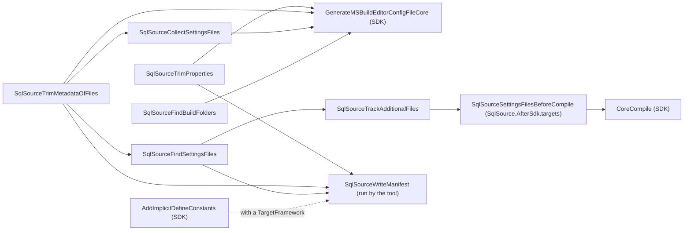

# The MSBuild files and the manifest

How [`build/SqlSource.props`](../../src/SqlSource/build/SqlSource.props) and [`build/SqlSource.targets`](../../src/SqlSource/build/SqlSource.targets) hand a project's `.sql` files, settings and settings files to the compiler, and how the target `SqlSourceWriteManifest` writes the [manifest](README.md#manifest) for the `sqlsource` tool.  What a user writes in MSBuild is in the manual, [which `.sql` files are included](../manual/settings.md#which-sql-files-are-included) and [values written in MSBuild](../manual/settings.md#values-written-in-msbuild).  The terms are the [glossary's](README.md#glossary).

## What the props and targets do

NuGet imports the props into each project that references the package before the project's own content, and the targets after it.  The props have the SDK import a third file, [`build/SqlSource.AfterSdk.targets`](../../src/SqlSource/build/SqlSource.AfterSdk.targets), after all of its own targets: see [finding the settings files](#finding-the-settings-files).

The props do four things.

- They set `SqlSourceImported` to `true`, with no condition.  The tool asks a project for this property, and for nothing else, to tell whether it uses SqlSource.  It is in the props because they reach a project whether the package came from NuGet or its files are imported by path.  A project that was never restored has no props of a package, and so no marker.
- They add `SqlSource.AfterSdk.targets` to `AfterMicrosoftNETSdkTargets`, the list of files the SDK imports last, keeping the list's value.
- They add every `.sql` file under the project's folder as an `AdditionalFiles` item, the only way a source generator sees a file, unless the project sets `SqlSourceIncludeFiles` to `false`.  The item comes before the project's content, so a project can remove files from it.  The same condition and the same excludes give the compiler every `.sql.json` file too, a `.sql` file's sidecar, which the generator reads; a project that sets `SqlSourceIncludeFiles` to `false` lists its sidecars itself.  Items are evaluated after every property, so `DefaultItemExcludes` already holds the output and intermediate folders, whatever the project sets them to.
- They list the twelve settings that the generator reads as `CompilerVisibleProperty` items, and eleven of them as `CompilerVisibleItemMetadata` of `SqlSourceSettingsFile`: all but `SqlSourceNestedClass`, which is a property alone.  A generator sees only the properties and metadata that are listed.  None of these is under the condition of `SqlSourceIncludeFiles`, since a project that lists its own `.sql` files still needs them.  `SqlSourceDatabase` is not listed: the tool reads it and the generator does not, as [the tool runs the same code](generator.md#the-tool-runs-the-same-code) explains.  `SqlSourceTypeOverrides` and `SqlSourceColumnTypes` are the other way round: listed, and not read by the tool.  They also list `SqlSourceBuildFolders`, which is no setting: the targets set it, as [the build's folders](#the-builds-folders) says.

The targets hold six targets of a build.  Four hook `GenerateMSBuildEditorConfigFileCore`, the target of the SDK that writes the file the compiler reads the properties and metadata from; the search for settings files and the tracking of additional files hook `CoreCompile` from `SqlSource.AfterSdk.targets`, or `GenerateMSBuildEditorConfigFileCore` where that file is not imported.  They also hold `SqlSourceWriteManifest`, which no build runs, the `PropertyGroup` that lists what it depends on, an `ItemGroup` that nests each sidecar under its `.sql` file and keeps it out of the output and publish folders, and an `ItemGroup` that keeps the settings files out of them too.  An arrow means "runs before":

The two trims are described under [Trimming](#trimming), the search under [finding the settings files](#finding-the-settings-files), the folders under [the build's folders](#the-builds-folders), and the manifest target under [The manifest](#the-manifest).

### Nesting a sidecar

The `ItemGroup` sets `DependentUpon="%(Filename)"` on every `**/*.sql.json` item, with `Update`, so that an IDE can show `Users.sql.json` under `Users.sql`.  `Update` changes the items that are listed and adds none.  It is on `AdditionalFiles`, on `None`, the item type under which the SDK lists every file of the project, and on `Content`, under which the Web SDK lists a `.json` file in place of `None`, since an IDE may nest on any of them.  The IDEs nest from evaluated items, so the group is outside every target.  It is in the targets and not in the props, so that it also reaches a sidecar that a project lists itself when `SqlSourceIncludeFiles` is `false`.  `SqlSourceWriteManifest` lists `.sql` files alone, so the manifest does not change.

The `Content` item also sets `CopyToOutputDirectory` and `CopyToPublishDirectory` to `Never`.  A sidecar is an input of the generator and nothing else, and the Web SDK copies its `Content`, a `.json` file among it, to the output folder and to what `dotnet publish` writes.  The targets are imported after the project's content, so `Never` wins over the Web SDK and over the project file; a web project that wants its sidecars copied sets the metadata again in its `Directory.Build.targets`, which the SDK imports after the targets of a package.  The `None` item keeps the project's copy metadata: the SDK copies a `None` file only when the project asks, as `tests/SqlSource.Tests` does for the examples of the sidecar format.  A `.sql` file is `None` in the SDK and in the Web SDK, so it needs nothing.  The last stage of [`check-package-install.sh`](../../tools/README.md#check-package-installsh) publishes a web project and fails when either file is copied.

### Finding the settings files

A settings file, `sqlsource.json`, applies to its folder and every folder below it, and a generator cannot read the disk, so every one that can apply to a `.sql` file or to a type must be an `AdditionalFiles` item.  `SqlSourceFindSettingsFiles` finds them the way the SDK finds `.editorconfig` files in `Roslyn/Microsoft.Managed.Core.targets`: every folder above a `.sql` item of `AdditionalFiles` or a `Compile` item, to the top of the drive, by `GetPathsOfAllDirectoriesAbove()`, each made a full path and distinct, combined with `sqlsource.json`, and kept where the file exists.  The step through `FullPath` and `Distinct` is the SDK's too: `GetPathsOfAllDirectoriesAbove()` can give one folder twice for a file linked with a relative path (msbuild issue 4392).  A folder that holds no `.sql` or C# file, and has none below it, is not searched, so a settings file there applies to nothing.  The search is not under `SqlSourceIncludeFiles`: a project that lists its own `.sql` files still gets its settings.  `Exists()` asks the file system, so where names are compared ignoring case, as on macOS and Windows, a `SqlSource.json` is found under the path `sqlsource.json`, as the SDK's search finds an `.EditorConfig`.

The target adds each file it finds as an `AdditionalFiles` item, unless the project lists it already: the comparison is of full paths, since a project may list the file by a relative one, and the compiler is given none twice.  Each item it adds is `Visible="false"`.  An IDE lists the items of a project as evaluated, never one a target adds, so the metadata is for one that might; a settings file in the project's folder is listed anyway, as `None`, or as `Content` in the Web SDK.

It runs in a target, and not where the targets are imported, so that a `.sql` file a target adds is searched above too, and it runs as late as it can: just before `CoreCompile`, after every target of the project that hooks it.  MSBuild runs the targets that hook one target in the order they are declared, and NuGet imports the package's targets before `Directory.Build.targets`, so a target there that hooks `CoreCompile` to add a `.sql` file would run after a search declared in `SqlSource.targets`.  So the props add `SqlSource.AfterSdk.targets` to `AfterMicrosoftNETSdkTargets`, which the SDK imports after all of its targets and after `Directory.Build.targets`, and `SqlSourceSettingsFilesBeforeCompile` there hooks `CoreCompile` and depends on the search and on the tracking.  That file also empties `SqlSourceSettingsSearchHook`, the property the two targets hook in `SqlSource.targets`, which is `GenerateMSBuildEditorConfigFileCore` otherwise; so they run once, from there.  Where the file is not imported, in a project that is not of the SDK or one that sets `AfterMicrosoftNETSdkTargets` without keeping its value, they run before `GenerateMSBuildEditorConfigFileCore`, as the trims do, and a `.sql` file that a later target adds is not searched above.

The search depends on `SqlSourceTrimMetadataOfFiles`, the target that the manual tells a target that adds a `.sql` file to hook, so that the target runs first, before the manifest too.  A design-time build of an IDE runs the search, since that build runs `Compile` with the compiler skipped, and the compiler's arguments then hold every file found, the one beside a file that a target of `Directory.Build.targets` adds from a hook of `CoreCompile` included: `SettingsFileSearchTests` in `tests/SqlSource.Tool.Tests/Projects/` holds it, with and without `SqlSource.AfterSdk.targets`.

`SqlSourceTrackAdditionalFiles` depends on it, so that a settings file added, deleted or moved changes the hash, and the next build compiles again.  It runs where the search runs, so a `.sql` file that a target adds before the compiler is in the hash too.

### Keeping the settings files out of the output

The last `ItemGroup` at the root of the targets sets `CopyToOutputDirectory` and `CopyToPublishDirectory` to `Never` on every `Content` item named `sqlsource.json`, as the nesting group does for a sidecar, since the Web SDK lists a `.json` file as `Content` and copies it.  It is in the targets and not in the props: NuGet imports a package's props from `Microsoft.Common.props`, before the Web SDK adds its `Content` items, and `Update` changes only the items already listed.  The last stage of [`check-package-install.sh`](../../tools/README.md#check-package-installsh) publishes a web project that has one, and fails when it is copied.

### The build's folders

`SqlSourceFindBuildFolders` sets `SqlSourceBuildFolders` to the folders the build writes C# files and its outputs into: `BaseIntermediateOutputPath`, `IntermediateOutputPath`, `BaseOutputPath`, `OutDir` and, when `EmitCompilerGeneratedFiles` is `true`, `CompilerGeneratedFilesOutputPath`, in that order, each after a `|`, made against `MSBuildProjectDirectory` by `$([MSBuild]::NormalizeDirectory(...))`, which ends it with a separator.  A default Debug build gives `|/repo/App/obj/|/repo/App/obj/Debug/net10.0/|/repo/App/bin/|/repo/App/bin/Debug/net10.0/`.  The props show the property to the compiler, and the generator leaves a C# file under any of the folders out of the chains that decide which settings files are checked, so that the SDK's own files in `obj`, and the files of the generators, reach no settings file above the project's root file wherever the project puts them ([which files are checked](generator.md#which-files-are-checked)).  A folder that has no value is left out, since `NormalizeDirectory` would make it the project's own folder.  The target first empties the property and then sets it, so it holds the build's folders whatever the project wrote: it is no setting.  It runs in a target, before `GenerateMSBuildEditorConfigFileCore`, as the trims do, since every property of the SDK and of the artifacts layout is set by then, while `Directory.Build.targets`, which is imported after the package's targets, could still change one where they are imported.

The compiler reads a value up to its first `#` or `;`, and `|` parts the folders, so the target escapes each folder's `%`, `|`, `#` and `;` as `%25`, `%7C`, `%23` and `%3B`, `%` first, with `Replace`, and `BuildFolders.Of` decodes them.  MSBuild reads `%XX` in a project file as the character it stands for, so each escape is written with its `%` as `%25`, `%2523` for `%23`: a real build of a project under `/repo/hash#repo` with `UseArtifactsOutput` gives `|/repo/hash%23repo/artifacts/obj/App/|/repo/hash%23repo/artifacts/obj/App/debug/|...`.  The manifest does not carry the property.

### `SqlSourceSettingsFile`

The SDK writes a section into the file the compiler reads for every item of a type that `CompilerVisibleItemMetadata` names, whether the item has the metadata or not.  Listed for `AdditionalFiles`, that would be a section for every `.sql` file of the project, a cost that [TD-0016](../tech-debt/TD-0016-dialect-of-a-file-added-by-a-late-target-is-lost.md) measures.  So the metadata is listed for `SqlSourceSettingsFile`, and `SqlSourceCollectSettingsFiles` fills that item type with the `AdditionalFiles` items that have any of the ten.  A project has few of them.

The collecting depends on `SqlSourceTrimMetadataOfFiles`, so that it copies trimmed values and leaves out a file whose values were only white space.  It has to say so, because MSBuild promises no order for two targets that hook the same one.  `SqlSourceDatabase` is trimmed and not collected, since the compiler is not shown it.

The compiler finds the metadata of a file by its path, so the generator still reads it for the file, under `MSBuildSettings.MetadataPrefix`, `build_metadata.SqlSourceSettingsFile.`.  A property is under `MSBuildSettings.PropertyPrefix`, `build_property.`.  The tool's `ManifestOptions` gives a manifest's values under keys composed from the same two.

### Tracking additional files

`SqlSourceTrackAdditionalFiles` makes the build after a `.sql` file or a settings file is deleted, renamed or moved compile again.  A file that is gone has no timestamp to compare, and the SDK's own record of what the compiler was given does not hold `AdditionalFiles`.  So the target writes a hash of the list of `AdditionalFiles` to a file under the intermediate folder, and names that file as a `CustomAdditionalCompileInputs` item, the item the SDK reads for more inputs of the compiler.  It writes the file only when the hash changes, so a build with the same files does not compile for it.  It depends on [the search](#finding-the-settings-files), so that the list holds the settings files, and runs where the search runs: just before `CoreCompile` in a project of the SDK.

## Trimming

The compiler reads each property that the props list, and each metadata, from a file that the build writes with one line for each value.  A value on a line of its own, as an element written over several lines has it, would arrive empty there and be taken for the default, and a list with one word on each line would arrive as its first word.  No code in the generator can see that this happened.

So each value is trimmed with one expression, `Regex.Replace(value, '\s+', ' ').Trim()`, which gives what the manual's [values written in MSBuild](../manual/settings.md#values-written-in-msbuild) describes, and both forms mean what they say.  That is safe only because no value of the package gives white space a meaning beyond separating its words.  A trim is written on one line however long it is, since white space around the expression would be part of the value, so the check of the line length is off for both trim targets.

- `SqlSourceTrimProperties` trims the thirteen properties of the package: the twelve the generator reads, and `SqlSourceDatabase`.
- `SqlSourceTrimMetadataOfFiles` trims twelve as metadata of the `AdditionalFiles` items, the same but for `SqlSourceNestedClass`.  Its `Outputs` makes MSBuild run it once for each combination of values the metadata have, with only that combination's items in reach.  Each value goes through a property, `SqlSourceDialectAsWritten` and the like, because MSBuild puts metadata into an expression as text, and a quote in a value would end the argument of the property function early.  The files without any of the metadata are one batch with nothing to trim, so nothing is written back to them.  That condition is on the item group, because the condition of a target cannot read metadata, and each metadata has a condition of its own, so that one an item does not have is not written as an empty value.

The trims run before `GenerateMSBuildEditorConfigFileCore`, and not where the file is imported, because `Directory.Build.targets` is imported later and a target can add an item while the build runs.  Every build that writes the file runs them, a design-time build too.

One target is out of their reach: one that hooks `GenerateMSBuildEditorConfigFileCore` itself and is declared after the package's targets, as one in `Directory.Build.targets` is.  MSBuild runs it after the targets of the package, so the metadata of a `.sql` file that it adds does not reach the compiler, as [TD-0016](../tech-debt/TD-0016-dialect-of-a-file-added-by-a-late-target-is-lost.md) records.  A target that adds a `.sql` file hooks `SqlSourceTrimMetadataOfFiles` instead, which runs it first wherever it is declared, and the manual's [known issues](../manual/settings.md#known-issues) give a user the sample target.

## The manifest

`SqlSourceWriteManifest` writes what the compiler is given, for the `sqlsource` tool, which runs it by name with `dotnet msbuild` and names the file to write with `SqlSourceManifestFile`.  How the tool runs it and uses what it reads is on [the tool's page](tool.md#evaluating-a-project).

The target hooks nothing: it has no `BeforeTargets`, no `AfterTargets` and no condition.  A hook would make every build write the manifest, and a condition would make a run of the tool find no file.  So nothing of a build runs before it but what it depends on, which is the property `SqlSourceManifestDependsOn`.  That property is set in a `PropertyGroup` at the root of the targets file, because a target's `DependsOnTargets` is read before the target runs; the group also sets `SqlSourceSettingsSearchHook`.  The only elements of the file that are not targets are that group, the [nesting of the sidecars](#nesting-a-sidecar) and the [group of the settings files](#keeping-the-settings-files-out-of-the-output), and the one condition outside a target is on the last line of that group.

- The two trims make the manifest hold trimmed values, and make a target of the project that hooks `SqlSourceTrimMetadataOfFiles` to add a `.sql` file run first.
- [The search](#finding-the-settings-files) adds the settings files to the `AdditionalFiles` items.
- `AddImplicitDefineConstants`, when the project has a `TargetFramework`, adds the constants of the framework, `NET10_0` and `NET8_0_OR_GREATER` among them, which the SDK otherwise adds only on the way to a compile.  A project that is not of the SDK has no `TargetFramework` and no such target.

Without `SqlSourceManifestFile` the target writes to `$(IntermediateOutputPath)$(MSBuildProjectFile).SqlSource.manifest`, and adds that file to `FileWrites`, which tells `dotnet clean` of it only once a build runs the target.  A file the tool named is the tool's to delete.  Either way the file is written only when its text changes.

### The format

The manifest's format is the contract between the package and the tool, as the sidecar's is between the tool and the generator.  A project's package may be of another version than the tool that reads its manifest.  The decisions behind version 1 are in the design of [sub-phase 2.3](../superpowers/specs/2026-10-09-query-generation-phase-2-3-project-manifest-design.md).

The file is lines of `key=value`, and the key ends at the first `=`.  The target writes them in this order:

1. `SqlSourceManifest=1`, the version of the format.
2. `Project=`, the full path of the project file.
3. `TargetFramework=`, `LangVersion=` and `DefineConstants=`, three properties of the SDK.
4. `Property.<Name>=` for each of the thirteen properties of the package, empty when it is not set.
5. For each `AdditionalFiles` item whose extension is `.sql`, compared ignoring case, in the order of the items: `File=` and its full path, then `File.<Name>=` for each of the twelve metadata.
6. `Settings=` and the full path of each `AdditionalFiles` item named `sqlsource.json`, compared ignoring case, once each: those the search added and any the project lists itself, so that the tool reads exactly the settings files the compiler is given.
7. `Compile=` and the full path of each `Compile` item.

Three things keep each value on its own line:

- A property goes through `$([MSBuild]::Escape(...))`, or MSBuild would make an item of each part of a value that holds `;`, as `DefineConstants` does.
- A property of the SDK is first put on one line with the expression of a trim.  The trims do not reach it, a project may write its constants one on each line, and a line break inside a value would end its line of the file.
- The lines of one `.sql` file are one item, a transform with `%0a` between them, so that the metadata of a file stays under its `File` line whatever the order of the items.  The path and the metadata come from the item, and MSBuild does not split them.

[`tests/SqlSource.Tool.Tests/Projects/ManifestTargetTests.cs`](../../tests/SqlSource.Tool.Tests/Projects/ManifestTargetTests.cs) runs the target with the real `dotnet msbuild` on the projects of [`tests/SqlSource.Tool.Tests/Fixtures/Projects/`](../../tests/SqlSource.Tool.Tests/Fixtures/Projects), among them `OddPaths`, whose paths hold `;`, `=`, `%`, a quote, a space and a letter outside ASCII.  [`BuildFileTests`](../../tests/SqlSource.Tests/Package/BuildFileTests.cs) compares the `Property.` lines and the `File.` part of the transform, as well as each trim, with its own list of the package's settings.  The manifest is what the compiler is given, whole: a setting with no line here would be read by the generator and not by the tool.

### Reading it

[`ManifestReader.Read`](../../src/SqlSource.Tool/Projects/ManifestReader.cs) gives a `ProjectManifest`, with a `ManifestFile` for each `.sql` file and the paths of the `Settings` lines in `SettingsFiles`, or the reason the text is not a manifest.

- The first line must be `SqlSourceManifest=1`.  A manifest of another version is not read at all, and the reason says that the package and the tool are out of step; the tool reports it as [SQLSRC206](../manual/diagnostics.md#sqlsrc206).  A byte order mark before it is passed over, and a line may end with `\r\n` as well as `\n`.
- A key the reader does not know is passed over, and so is an empty line: both are how a later package adds to the format.  A name under `Property.` or `File.` is kept by its name, whatever it is, and only the names the generator's readers ask for are ever looked up.
- A value is the rest of the line as it is.  An empty value of a property or a metadata is one that is not set, and is left out.
- `DefineConstants` is split at `;`, `,`, a space and a tab, which is where the compiler separates constants.
- The reader needs the version line first, and reads a `File.` line as belonging to the nearest `File` line above it.  It keeps the `File`, `Settings` and `Compile` lines in their order, which is the order of the items, and the tool relies on it for a file listed twice: [`Planning/ListedFiles.cs`](../../src/SqlSource.Tool/Planning/ListedFiles.cs) takes the metadata of the last of its items that has any, as a build does.
- An empty text, a line without `=`, a `File.` line before any `File` line, and a manifest that names no project are not manifests.

So an addition to the format keeps its version, as `Settings` did: a new key, and a new name under `Property.` or `File.`, are passed over or never looked up by a tool that does not know them.  A change to what an existing key means, or to how a line is read, would be misread by such a tool without a word, so it raises the version, and then a reader of another version reads nothing and says why.

## Known limits

- **The manifest misses a `.sql` file or a `Compile` item that a hook of the build adds**, and a settings file that only such a file reaches, since the tool runs the target by name and no build has run its hooks.  A target that hooks `SqlSourceTrimMetadataOfFiles` is the exception.  [TD-0025](../tech-debt/TD-0025-manifest-misses-a-file-that-a-build-hook-adds.md).
- **A project with several target frameworks has the first one's manifest alone**, because the tool passes that framework as `TargetFramework`.  [TD-0026](../tech-debt/TD-0026-manifest-of-a-multi-targeted-project-is-the-first-frameworks.md).
- **The target depends on `AddImplicitDefineConstants`, a target of the SDK, by name**, which is no contract of the SDK.  [TD-0027](../tech-debt/TD-0027-manifest-target-depends-on-a-target-of-the-sdk.md).

## Not built yet

### Build integration

> **Not built yet.**  How a target of the build runs the tool before the compile in the online mode.  Delivered by phase 9 of the [query generation epic](../superpowers/specs/2026-10-07-query-generation-epic-design.md).
