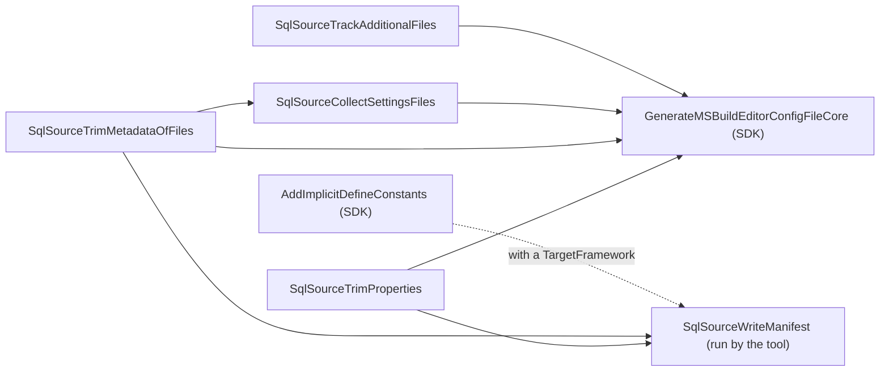

# The MSBuild files and the manifest

How [`build/SqlSource.props`](../../src/SqlSource/build/SqlSource.props) and [`build/SqlSource.targets`](../../src/SqlSource/build/SqlSource.targets) hand a project's `.sql` files and settings to the compiler, and how the target `SqlSourceWriteManifest` writes the [manifest](README.md#manifest) for the `sqlsource` tool.  What a user writes in MSBuild is in the manual, [which `.sql` files are included](../manual/settings.md#which-sql-files-are-included) and [values written in MSBuild](../manual/settings.md#values-written-in-msbuild).  The terms are the [glossary's](README.md#glossary).

## What the props and targets do

NuGet imports the props into each project that references the package before the project's own content, and the targets after it.

The props do three things.

- They set `SqlSourceImported` to `true`, with no condition.  The tool asks a project for this property, and for nothing else, to tell whether it uses SqlSource.  It is in the props because they reach a project whether the package came from NuGet or its files are imported by path.  A project that was never restored has no props of a package, and so no marker.
- They add every `.sql` file under the project's folder as an `AdditionalFiles` item, the only way a source generator sees a file, unless the project sets `SqlSourceIncludeFiles` to `false`.  The item comes before the project's content, so a project can remove files from it.  Items are evaluated after every property, so `DefaultItemExcludes` already holds the output and intermediate folders, whatever the project sets them to.
- They list the nine settings that the generator reads as `CompilerVisibleProperty` items, and the same nine as `CompilerVisibleItemMetadata` of `SqlSourceSettingsFile`.  A generator sees only the properties and metadata that are listed.  None of these is under the condition of `SqlSourceIncludeFiles`, since a project that lists its own `.sql` files still needs them.  `SqlSourceDatabase` is not listed: the tool reads it and the generator does not, as [the tool runs the same code](generator.md#the-tool-runs-the-same-code) explains.

The targets hold four targets of a build, which all hook `GenerateMSBuildEditorConfigFileCore`, the target of the SDK that writes the file the compiler reads the properties and metadata from.  They also hold `SqlSourceWriteManifest`, which no build runs, and the one `PropertyGroup` that lists what it depends on.  An arrow means "runs before":

The two trims are described under [Trimming](#trimming), and the manifest target under [The manifest](#the-manifest).

### `SqlSourceSettingsFile`

The SDK writes a section into the file the compiler reads for every item of a type that `CompilerVisibleItemMetadata` names, whether the item has the metadata or not.  Listed for `AdditionalFiles`, that would be a section for every `.sql` file of the project, a cost that [TD-0016](../tech-debt/TD-0016-dialect-of-a-file-added-by-a-late-target-is-lost.md) measures.  So the metadata is listed for `SqlSourceSettingsFile`, and `SqlSourceCollectSettingsFiles` fills that item type with the `AdditionalFiles` items that have any of the nine.  A project has few of them.

The collecting depends on `SqlSourceTrimMetadataOfFiles`, so that it copies trimmed values and leaves out a file whose values were only white space.  It has to say so, because MSBuild promises no order for two targets that hook the same one.  `SqlSourceDatabase` is trimmed and not collected, since the compiler is not shown it.

The compiler finds the metadata of a file by its path, so the generator still reads it for the file, under `MSBuildSettings.MetadataPrefix`, `build_metadata.SqlSourceSettingsFile.`.  A property is under `MSBuildSettings.PropertyPrefix`, `build_property.`.  The tool's `ManifestOptions` gives a manifest's values under keys composed from the same two.

### Tracking additional files

`SqlSourceTrackAdditionalFiles` makes the build after a `.sql` file is deleted, renamed or moved compile again.  A file that is gone has no timestamp to compare, and the SDK's own record of what the compiler was given does not hold `AdditionalFiles`.  So the target writes a hash of the list of `AdditionalFiles` to a file under the intermediate folder, and names that file as a `CustomAdditionalCompileInputs` item, the item the SDK reads for more inputs of the compiler.  It writes the file only when the hash changes, so a build with the same files does not compile for it.

## Trimming

The compiler reads each property that the props list, and each metadata, from a file that the build writes with one line for each value.  A value on a line of its own, as an element written over several lines has it, would arrive empty there and be taken for the default, and a list with one word on each line would arrive as its first word.  No code in the generator can see that this happened.

So each value is trimmed with one expression, `Regex.Replace(value, '\s+', ' ').Trim()`, which gives what the manual's [values written in MSBuild](../manual/settings.md#values-written-in-msbuild) describes, and both forms mean what they say.  That is safe only because no value of the package gives white space a meaning beyond separating its words.  A trim is written on one line however long it is, since white space around the expression would be part of the value, so the check of the line length is off for both trim targets.

- `SqlSourceTrimProperties` trims the ten properties of the package: the nine the generator reads, and `SqlSourceDatabase`.
- `SqlSourceTrimMetadataOfFiles` trims the same ten as metadata of the `AdditionalFiles` items.  Its `Outputs` makes MSBuild run it once for each combination of values the metadata have, with only that combination's items in reach.  Each value goes through a property, `SqlSourceDialectAsWritten` and the like, because MSBuild puts metadata into an expression as text, and a quote in a value would end the argument of the property function early.  The files without any of the metadata are one batch with nothing to trim, so nothing is written back to them.  That condition is on the item group, because the condition of a target cannot read metadata, and each metadata has a condition of its own, so that one an item does not have is not written as an empty value.

The trims run before `GenerateMSBuildEditorConfigFileCore`, and not where the file is imported, because `Directory.Build.targets` is imported later and a target can add an item while the build runs.  Every build that writes the file runs them, a design-time build too.

One target is out of their reach: one that hooks `GenerateMSBuildEditorConfigFileCore` itself and is declared after the package's targets, as one in `Directory.Build.targets` is.  MSBuild runs it after the targets of the package, so the metadata of a `.sql` file that it adds does not reach the compiler, as [TD-0016](../tech-debt/TD-0016-dialect-of-a-file-added-by-a-late-target-is-lost.md) records.  A target that adds a `.sql` file hooks `SqlSourceTrimMetadataOfFiles` instead, which runs it first wherever it is declared, and the manual's [known issues](../manual/settings.md#known-issues) give a user the sample target.

## The manifest

`SqlSourceWriteManifest` writes what the compiler is given, for the `sqlsource` tool, which runs it by name with `dotnet msbuild` and names the file to write with `SqlSourceManifestFile`.  How the tool runs it and uses what it reads is the tool's page, `tool.md` in this folder.

The target hooks nothing: it has no `BeforeTargets`, no `AfterTargets` and no condition.  A hook would make every build write the manifest, and a condition would make a run of the tool find no file.  So nothing of a build runs before it but what it depends on, which is the property `SqlSourceManifestDependsOn`.  That property is set in a `PropertyGroup` at the root of the targets file, because a target's `DependsOnTargets` is read before the target runs.  It is the file's one element that is not a target, and holds its one condition outside a target.

- The two trims make the manifest hold trimmed values, and make a target of the project that hooks `SqlSourceTrimMetadataOfFiles` to add a `.sql` file run first.
- `AddImplicitDefineConstants`, when the project has a `TargetFramework`, adds the constants of the framework, `NET10_0` and `NET8_0_OR_GREATER` among them, which the SDK otherwise adds only on the way to a compile.  A project that is not of the SDK has no `TargetFramework` and no such target.

Without `SqlSourceManifestFile` the target writes to `$(IntermediateOutputPath)$(MSBuildProjectFile).SqlSource.manifest`, and adds that file to `FileWrites`, which tells `dotnet clean` of it only once a build runs the target.  A file the tool named is the tool's to delete.  Either way the file is written only when its text changes.

### The format

The manifest's format is the contract between the package and the tool, as the sidecar's is between the tool and the generator.  A project's package may be of another version than the tool that reads its manifest.  The decisions behind version 1 are in the design of [sub-phase 2.3](../superpowers/specs/2026-10-09-query-generation-phase-2-3-project-manifest-design.md).

The file is lines of `key=value`, and the key ends at the first `=`.  The target writes them in this order:

1. `SqlSourceManifest=1`, the version of the format.
2. `Project=`, the full path of the project file.
3. `TargetFramework=`, `LangVersion=` and `DefineConstants=`, three properties of the SDK.
4. `Property.<Name>=` for each of the ten properties of the package, empty when it is not set.
5. For each `AdditionalFiles` item whose extension is `.sql`, compared ignoring case, in the order of the items: `File=` and its full path, then `File.<Name>=` for each of the ten metadata.
6. `Compile=` and the full path of each `Compile` item.

Three things keep each value on its own line:

- A property goes through `$([MSBuild]::Escape(...))`, or MSBuild would make an item of each part of a value that holds `;`, as `DefineConstants` does.
- A property of the SDK is first put on one line with the expression of a trim.  The trims do not reach it, a project may write its constants one on each line, and a line break inside a value would end its line of the file.
- The lines of one `.sql` file are one item, a transform with `%0a` between them, so that the metadata of a file stays under its `File` line whatever the order of the items.  The path and the metadata come from the item, and MSBuild does not split them.

[`tests/SqlSource.Tool.Tests/Projects/ManifestTargetTests.cs`](../../tests/SqlSource.Tool.Tests/Projects/ManifestTargetTests.cs) runs the target with the real `dotnet msbuild` on the projects of [`tests/SqlSource.Tool.Tests/Fixtures/Projects/`](../../tests/SqlSource.Tool.Tests/Fixtures/Projects), among them `OddPaths`, whose paths hold `;`, `=`, `%`, a quote, a space and a letter outside ASCII.  [`BuildFileTests`](../../tests/SqlSource.Tests/Package/BuildFileTests.cs) compares the `Property.` lines and the `File.` part of the transform, as well as each trim, with its own list of the package's settings.  The manifest is what the compiler is given, whole: a setting with no line here would be read by the generator and not by the tool.

### Reading it

[`ManifestReader.Read`](../../src/SqlSource.Tool/Projects/ManifestReader.cs) gives a `ProjectManifest`, with a `ManifestFile` for each `.sql` file, or the reason the text is not a manifest.

- The first line must be `SqlSourceManifest=1`.  A manifest of another version is not read at all, and the reason says that the package and the tool are out of step; the tool reports it as [SQLSRC206](../manual/diagnostics.md#sqlsrc206).  A byte order mark before it is passed over, and a line may end with `\r\n` as well as `\n`.
- A key the reader does not know is passed over, and so is an empty line: both are how a later package adds to the format.  A name under `Property.` or `File.` is kept by its name, whatever it is, and only the names the generator's readers ask for are ever looked up.
- A value is the rest of the line as it is.  An empty value of a property or a metadata is one that is not set, and is left out.
- `DefineConstants` is split at `;`, `,`, a space and a tab, which is where the compiler separates constants.
- The reader needs the version line first, and reads a `File.` line as belonging to the nearest `File` line above it.  It keeps the `File` and `Compile` lines in their order, which is the order of the items, and the tool relies on it for a file listed twice: [`Planning/ListedFiles.cs`](../../src/SqlSource.Tool/Planning/ListedFiles.cs) takes the metadata of the last of its items that has any, as a build does.
- An empty text, a line without `=`, a `File.` line before any `File` line, and a manifest that names no project are not manifests.

So an addition to the format keeps its version: a new key, and a new name under `Property.` or `File.`, are passed over or never looked up by a tool that does not know them.  A change to what an existing key means, or to how a line is read, would be misread by such a tool without a word, so it raises the version, and then a reader of another version reads nothing and says why.

## Known limits

- **The manifest misses a `.sql` file or a `Compile` item that a hook of the build adds**, since the tool runs the target by name and no build has run its hooks.  A target that hooks `SqlSourceTrimMetadataOfFiles` is the exception.  [TD-0025](../tech-debt/TD-0025-manifest-misses-a-file-that-a-build-hook-adds.md).
- **A project with several target frameworks has the first one's manifest alone**, because the tool passes that framework as `TargetFramework`.  [TD-0026](../tech-debt/TD-0026-manifest-of-a-multi-targeted-project-is-the-first-frameworks.md).
- **The target depends on `AddImplicitDefineConstants`, a target of the SDK, by name**, which is no contract of the SDK.  [TD-0027](../tech-debt/TD-0027-manifest-target-depends-on-a-target-of-the-sdk.md).

## Not built yet

### `DependentUpon` nesting

> **Not built yet.**  How the targets nest a sidecar under its `.sql` file in an IDE.  Delivered by phase 5 of the [query generation epic](../superpowers/specs/2026-10-07-query-generation-epic-design.md).

### Build integration

> **Not built yet.**  How a target of the build runs the tool before the compile in the online mode.  Delivered by phase 9 of the [query generation epic](../superpowers/specs/2026-10-07-query-generation-epic-design.md).
