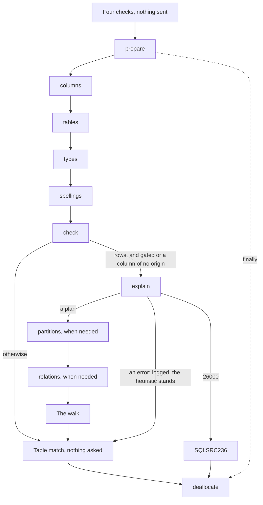

# The PostgreSQL describer

How the tool asks a database about a query: the contract every [describer](README.md#describer) implements and the exchange its calls go through, how a [capture](README.md#capture) is recorded and replayed, and how `src/SqlSource.Tool/Describing/Postgres` describes one query, from the text it prepares to the table it matches.  Which columns can be null, and how the plan proves it, is the [nullability page](postgres-nullability.md).  What a user connects to and sees is in the manual's [PostgreSQL page](../manual/postgresql.md), and each error is in [diagnostics](../manual/diagnostics.md).  The terms are the [glossary's](README.md#glossary).

## The describer contract

[`Describing/Describers/`](../../src/SqlSource.Tool/Describing/Describers) holds what a describer implements and what the run hands it.  It uses `Outcome`, the tool's `Reporting/` and `Logging/` and the generator's types, and nothing of the run's steps, so a describer depends on no step of a run.

- An [`IQueryDescriber`](../../src/SqlSource.Tool/Describing/Describers/IQueryDescriber.cs) has a `SqlDialect` and opens an `IDescribeSession` for one database from an `OpenRequest` and a log.  [`DescriberRegistry`](../../src/SqlSource.Tool/Describing/Describers/DescriberRegistry.cs) holds one describer for each dialect, and refuses two for one.
- An [`OpenRequest`](../../src/SqlSource.Tool/Describing/Describers/OpenRequest.cs) holds the database's name, the connection's value, the exchange of `ToolHost.Exchange` and the clock.  Its `ToString` leaves out the value, and the log is beside it and not in it, for that reason.  How the value reaches it and goes nowhere else is the tool's [where a connection's value goes](tool.md#where-a-connections-value-goes).
- An [`IDescribeSession`](../../src/SqlSource.Tool/Describing/Describers/IDescribeSession.cs) has the `ServerInfo` of its server and describes one `DescribeRequest` at a time: the query's name, its sample SQL as text, and its parameter list.  It is used by one thread and closed when the run is done with its database.
- A [`QueryDescription`](../../src/SqlSource.Tool/Describing/Describers/QueryDescription.cs) is what the database said: whether there are rows, the parameters it typed, the columns, the table the result matches and the provenance of the plan and of the match.  Its types are the sidecar's own records, so a describer's answer and an entry say a type one way.  A parameter's ordinal and nullability are not the describer's: the run takes them from the query's list.
- A [`DescribeFailure`](../../src/SqlSource.Tool/Describing/Describers/DescribeFailure.cs) is why a session could not be opened or a query described: a descriptor and its arguments, the `DescribeStep` that failed, what the server said a line each, and a help.  The run reports it at the query, as [describing](tool.md#describing) says.

Every result is an `Outcome` of a `DescribeFailure`, so what a server or a user can cause comes back as data.  An exception from a describer is a bug of the describer, and what the run does with one is the tool's [describing](tool.md#describing).  A describer measures time with `OpenRequest.Time`, which `DatabaseRuns` sets from the host's clock, so that a test can hold it still.

The released tool registers one describer: `ToolHost.Create` gives `new DescriberRegistry([new PostgresDescriber()])`.  What a run does for a dialect with none is [describing](tool.md#describing) too.

### The exchange

Every call a describer makes to an engine goes through the `IDescribeExchange` of its `OpenRequest`.  [`IDescribeExchange.AskAsync`](../../src/SqlSource.Tool/Describing/Describers/IDescribeExchange.cs) takes the name of the call, its request, and the `live` function that asks the engine.  The exchange decides whether the `live` function runs.  It has three shapes:

| Shape | What it does |
|----|----|
| [`LiveExchange`](../../src/SqlSource.Tool/Describing/Describers/LiveExchange.cs) | Runs the `live` function and keeps nothing.  `ToolHost.Exchange` gives it for every database of a real run. |
| [`CapturingExchange`](../../src/SqlSource.Tool/Describing/Capture/CapturingExchange.cs) | Asks another exchange, and adds each call that answered to a `DescribeCapture`.  Nothing in the released tool records yet. |
| [`ReplayingExchange`](../../src/SqlSource.Tool/Describing/Capture/ReplayingExchange.cs) | Answers from a capture and never runs the `live` function. |

`Describing/Describers/` names the other two shapes and uses nothing of `Describing/Capture/`.

### Requests and answers

A request and an answer are plain records that `CaptureJson.Options` writes and reads, so a capture can hold them and a replay can give them back.  A record of a call is sealed and holds strings, integers, booleans, nullable ones, `IReadOnlyList<T>` of them and records of the same kind.  A driver type, a `DateTime`, an `Exception`, an enum or an abstract base would not read back the same, and neither would an `Outcome`, a `DescribeFailure`, a `QueryDescription` or an `EquatableArray`, which System.Text.Json does not read.  So a describer maps between its records and the seam's types on its own side.

A call that can fail on the server has an answer with an `error` member that is null on success.  The failure is data, so a replay gives it again and the describer reports it as it did live.

A request holds everything that decides the answer, so that two questions with one request are one question.  It holds nothing of a connection, and so the request of the call that opens a session is empty.  A name that the describer makes up and sends is part of a request, so it is a counter within the session: a random one would make each recording of a capture differ.  [`CallRecordTests`](../../tests/SqlSource.Tool.Tests/Describing/Capture/CallRecordTests.cs) holds every record whose name ends in `Request` or `Answer` to these rules.  The one thing a record holds that comes from the driver's own words is the message of an `error`, which [TD-0034](../tech-debt/TD-0034-redaction-of-a-describers-text-has-holes.md) records.

## Capture and replay

A [`DescribeCapture`](../../src/SqlSource.Tool/Describing/Capture/DescribeCapture.cs) holds every call a describer made, each a `CaptureCall` of its method, its request and its answer as JSON, in the order they were made.  `CapturingExchange` adds a call once it has answered.  A call that throws adds nothing, since what a server can cause is an answer and an exception is a bug or the end of the run.  A capture is for one thread, as a session is.

### The file

[`CaptureJson`](../../src/SqlSource.Tool/Describing/Capture/CaptureJson.cs) writes a capture as an object of `captureVersion`, `engine` and `calls`, indented, in UTF-8, with `\n` line ends on every platform, so that a capture under version control differs line by line.  Its encoder is the relaxed one, as the log's is, so a reviewer reads the quotes and angle brackets of the SQL as they are.  `CaptureJson.Read` gives the capture, or a sentence that says why the text is none, and names a `captureVersion` it does not read.  `DescribeCapture.Version` is `1`.

The file is the `capture.json` of a fixture and, from phase 10, of a user's bug bundle.  So what a describer asks and is answered is a contract with every capture that exists, and the file outlives the version of the tool that wrote it.

### Finding a recorded answer

`ReplayingExchange` keys each recorded call once, when it is made, and finds a question by its method and its key.  A question that the capture holds more than once gets its answers in the capture's order, one each time it is asked.  A question with no answer left is a [`CaptureMissException`](../../src/SqlSource.Tool/Describing/Capture/CaptureMissException.cs) that names the method and the request, so a describer whose calls changed fails its fixtures and never passes silently.  Under a run of the tool it is `SQLSRC200`, as any exception of a describer is.  A capture that holds more than was asked is no error, and `ReplayingExchange.Unused` says what was left.

The key is `CaptureJson.KeyOf`: the request without its null members, at every depth, written on one line.  A null in a list is a value of the list and stays, and so does every value that is not null, a zero and an empty list among them.  The key is in no file.  It is made at each replay, of the recorded request and of the asked one alike, and the file holds the request whole.  So what a key leaves out can widen later without recording any capture again, and what a file holds cannot change.  Two requests never share a key by accident because a record holds no dictionary and nothing polymorphic.

An answer is read with `CaptureJson.Options`.  System.Text.Json reads a member of a reference type that the capture lacks, or holds as null, as null whatever the record declares.  [`AnswerNulls`](../../src/SqlSource.Tool/Describing/Capture/AnswerNulls.cs) finds such a null where the record says there is none, and the replay throws a `CaptureMissException` that names the member, where the describer would otherwise fail later with nothing that names the capture.  A missing member of a value type reads as its default, which nothing can find.

### How a record may change

The key is what lets a record grow.  A request's record may gain a member that is nullable and whose null means what the request meant before it had the member: an older capture's request has no such member, its key matches the new request's while the member is null, and the recorded call answers it.  A member that is renamed, removed or moved, a member of a value type, which is never null, and a new member where it holds a value each make a question that no older capture answers.  A new member that gives null another meaning would let an old capture answer a question it was never asked.

An answer's record may gain a member, which is nullable: an older capture is read with null there, and an unknown member of a newer one is ignored.  The PostgreSQL describer's members that came later, and what their null reads as, are in [the calls and their records](#the-calls-and-their-records).  `CaptureJson.Options` is the one set of options for a request and an answer, and what a capture's file holds depends on it, so a change to it changes every fixture.  [`ReplayingExchangeTests`](../../tests/SqlSource.Tool.Tests/Describing/Capture/ReplayingExchangeTests.cs) holds each of these.

### Fixtures and test describers

What a case holds, and how to record and add one, are in the PostgreSQL tests' readme, [the describer's fixtures](../../tests/SqlSource.Tests.Postgres/README.md#the-describers-fixtures).  The harness is in `tests/SqlSource.Tool.Testing/Fixtures/`: `FixtureCases` finds the cases in the output folder of the tests that run them, and `FixtureReplay` describes one through a `ReplayingExchange`, with the connection `replay`, and gives the sidecar's text.  `FixtureCase.ExplainSettings` reads a case's `explain-settings.txt`, and both harnesses, `DescriberFixtureTests` replaying and `FixtureCasesTests` live, construct `PostgresDescriber` with those settings, so every `explain` of the case carries them in its request.

[`FakeDescriber`](../../tests/SqlSource.Tool.Tests/FakeDescriber.cs) is a describer written by the contract, with its records in `FakeDescriberCalls.cs` and its maps in `FakeCalls.cs`, and the tests of the exchanges and of the fixture harness run through it.  Its `live` functions are what a replay skips, so under a replay it keeps nothing in `Opened` and `Described`, and `OnOpen`, `OnDescribe`, `BeforeDescribe`, `OpenException` and `Exceptions` do nothing; what it does outside `live` still holds, the results of a describer with a bug, `CloseException` and `Closed`.  It carries `PostgresType` and `OtherEngineType` and throws for a `SqlServerType`.  Its one descriptor, `SQLSRC999`, exists in the tests only, and `FakeDescriber.RejectedWith` makes one from a text, whose id is no constant and has no row in `AnalyzerReleases.Unshipped.md`.  Every run of `CliRun` records through a `CapturingExchange` into `CliRun.Capture`.

[`PostgresScript`](../../tests/SqlSource.Tool.Tests/PostgresScript.cs) answers a `PostgresSession` with no server.  A test writes each call the session is to make, with its answer, and a `ReplayingExchange` plays them, so a request the session asks otherwise is a `CaptureMissException` and the test holds what is asked as well as what is made of the answers.  `PostgresRows` gives rows of `types` as a server gives them, `PostgresTables` tables of `tables` and columns that name them, and `PostgresPlans` a plan as a server would answer `explain`.  What only a server can show, the types it infers, its errors and their positions, is tested in `tests/SqlSource.Tests.Postgres/Describer/`.  The other helpers are listed in [the tests' readme](../../tests/README.md#the-projects).

Only `ToolHostTests` of `tests/SqlSource.Tool.Tests` sees the registry of `ToolHost.Create`: `Hosts.Create` and `CliRun` keep their own, and `SecretTests` adds the describer to a `CliRun` itself, with a connection that no server answers.  How `tests/SqlSource.Tests.Postgres` runs the whole command with the real describer is its readme's [running](../../tests/SqlSource.Tests.Postgres/README.md#running).

## One describe, step by step

[`PostgresDescriber.OpenAsync`](../../src/SqlSource.Tool/Describing/Postgres/PostgresDescriber.cs) calls [`PostgresSession.OpenAsync`](../../src/SqlSource.Tool/Describing/Postgres/PostgresSession.cs), which asks `open`: the server's version and the session's `search_path`, `plan_cache_mode` and `standard_conforming_strings`, which the `ServerInfo` keeps and the run's `database.open` event records.  A failure of `open` is the session's failure.  A server below `PostgresSession.MinimumMajorVersion`, 14, answers `open` and is then refused.  When `open` fails or the server is refused, the connection is disposed at once.

`PostgresSession.DescribeAsync` describes one query through one prepared statement.  It refuses what it can before anything is sent, with four checks that [why a query cannot run a statement](#why-a-query-cannot-run-a-statement) explains: `ParameterPlaceholders.Rewrite` for a second statement, `StatementShape.RefusedKind` for a kind `PREPARE` does not take, `StatementShape.PositionalParameter` for a `$n` the SQL writes itself, and `ParameterPlaceholders.TypeList` for a declared type that is no type name.  Then it asks `prepare`, which runs `PREPARE sqlsource_<n> (<type>, ...) AS <sql>` on the SQL with `$n` in each parameter's place and an `unknown` for each parameter with no declared type, and reads the statement's `parameter_types` from `pg_prepared_statements`.  A `prepare` that fails is the describe's failure, and there is nothing to free.  Otherwise `DescribePreparedAsync` runs the steps below, and `deallocate` frees the statement in a `finally`.

The steps of `DescribePreparedAsync`, in the order it runs them:

1. **The parameters' types.**  The server lists a type for each parameter of the query's list, in order, and may list more when it read a `$n` that the tool's lexer did not.  The first types are the parameters'; the count of all is the number of arguments an `EXPLAIN EXECUTE` of the statement takes.
2. **`columns`.**  Describes `EXECUTE sqlsource_<n>(NULL, ...)` under `CommandBehavior.SchemaOnly`, so the driver sends no `Execute` and nothing runs.  It passes a `NULL` for each parameter of the query's list, since the server describes an `EXECUTE` whatever the number of its arguments.  Each column has its name, type, table and attribute number, Npgsql's three numbers for its size, precision and scale, and the `typeModifier` of the row description.
3. **`tables`.**  One query of the catalog for every table the columns name, with every attribute of each that is not dropped and what [the catalog](postgres-nullability.md#the-catalog) needs of the table.
4. **The origins.**  `ColumnOrigin.FindAll` finds the table and attribute of each column, as [origins and a schema that changes](#origins-and-a-schema-that-changes) says.
5. **`types`.**  One query for the closure of the OIDs of the parameters, the columns and the origin attributes: the element of an array, the base of a domain, the subtype of a range and the range of a multirange, followed until nothing is new.  It comes after `tables`, because the type of an origin attribute is where a domain is found, and the request is one.
6. **The types checked.**  `PostgresSession.CheckTypes` finds a type that `types` did not answer, and the rows go on only as the `CheckedTypes` it gives.
7. **`spellings`.**  One query of `format_type(oid, modifier)` for each pair of a type and a modifier that the parameters and the columns will be built with, from `PostgresTypes.PairsOf`.
8. **The parameters typed**, as [parameters](#parameters) says.
9. **The columns built.**  `OuterJoinGate.IsGated` decides whether a statement with rows is gated, and each column is built with the catalog's answer or the heuristic's, as [the nullability page](postgres-nullability.md#nullability) says.  A column of a pseudo-type ends the describe.
10. **`check`.**  Npgsql describes the SQL as generated code will send it, as [the check against Npgsql](#the-check-against-npgsql) says.
11. **The plan.**  For a statement with rows that is gated or has a column of no origin, `explain` asks for the plan, `partitions` and `relations` answer what the walk needs of it, and `NullabilityWalk` walks it, as [the plan](postgres-nullability.md#the-plan) and [the plan walk](postgres-nullability.md#the-plan-walk) say.  A query that is neither asks nothing more, and pays nothing.
12. **The table match**, which asks nothing, as [matching a table](#matching-a-table) says.

A statement without rows is `SidecarResultKind.None`, with its parameters and no columns, no table and no provenance.  One with rows records `plan` as `not-needed` when it had no walk.  The events each step writes, and their order, are in the remarks of [`PostgresEvents`](../../src/SqlSource.Tool/Describing/Postgres/PostgresEvents.cs).

### Calls that are not made

A call is not made when it has nothing to ask: `tables` when no column names a table, `types` when there is no OID, `spellings` when there is no pair, `partitions` when the plan holds no `Append` that may scan partitions, and `relations` when `tables` answered every relation the plan scans.  Each request is sorted and holds each item once, so that it is the same however a query orders what it names, and a capture of the same query is the same.

### Why `PREPARE`

`PREPARE` takes a declared type as written, `int`, `varchar(50)` or a domain, resolves it and checks it against every use of the parameter, and infers a type for each `unknown`.  Npgsql's own describe sends no types, so it cannot check a declared one.  The `EXECUTE` of the statement is then described and never run, which gives the columns of the statement as the server will return them.

### The prepared statement and the session

A prepared statement is session state.  It survives a rollback, so `deallocate` is asked in the `finally` of `DescribeAsync`, outside any transaction, and a statement left behind would leak until the session ends.  It is asked with the describe's own token: a cancelled describe leaves the statement to die with its session, since a cancelled run must not wait on a server, and the run closes the session next.  Its error is written to the log and never reported.  The counter of the names advances for a `prepare` that fails too, so a name is used once.

So a describe needs one session, from `prepare` to `deallocate`.  `PostgresConnection` refuses `Multiplexing=true` before it connects, since the driver then shares physical connections between commands.  Behind a pooler in transaction mode, a call can reach another backend.  The read of `prepare` matches the statement's name and the `PREPARE`'s text, which the server lists exactly as it was sent, so a backend that lacks the statement, or holds one of the same name that an earlier run left, answers no row: `PostgresLive.StatementNotListed`.  That, `42P05` at `prepare`, and `26000` at `columns` or `explain` are each a session that was not kept.  A `columns` that reaches another backend can also answer no columns and no error, which `check` reports: [TD-0049](../tech-debt/TD-0049-describe-behind-a-pooler-can-reach-another-backend.md).  What a user sees of it is the manual's [connecting](../manual/postgresql.md#connecting).

### The connection

The `live` functions are [`PostgresLive`](../../src/SqlSource.Tool/Describing/Postgres/PostgresLive.cs), which holds the SQL the tool sends.  `PostgresSession` holds what is asked, in which order, and what is made of each answer: `PostgresSession.cs` the flow, `PostgresSession.Calls.cs` each call, asked through the exchange and timed by the run's clock, and `PostgresSession.Builders.cs` what is made of the answers without the session's state.  A call writes its event where it happens, under a replay too.

[`PostgresConnection`](../../src/SqlSource.Tool/Describing/Postgres/PostgresConnection.cs) holds the connection's value and the describer's log.  It makes one `NpgsqlDataSource` for the session and one connection from it on the first `live` call that asks, and makes every command, every batch and the transaction of `explain`.  Under a replay none of that runs, so a replayed session touches no driver.  A session has a data source of its own because a plain `NpgsqlConnection` shares a type catalog by connection string for the life of the process, and that catalog goes stale when the schema changes.

Each `live` function catches `NpgsqlException` and returns it as its answer's `error`, through `PostgresConnection.ErrorOf`, which keeps a server error's SQLSTATE, message, detail, hint and position.  A cancellation passes through, and anything else is a bug.  `PostgresLive.CheckAsync` also answers the `NotSupportedException`, `InvalidCastException` and `ArgumentException` that Npgsql throws before it sends anything.

`PostgresConnection.OpenAsync` turns what a user can cause at `open` and Npgsql does not wrap into an `NpgsqlException` with a fixed text and no inner exception, since the driver's text quotes the value or a path: a connection string the driver cannot read, a certificate, key or password file that is not there or cannot be used, settings the driver cannot honour together, and GSS where the system's library cannot be loaded.  Its remarks list each with where Npgsql throws it.  Any other type, `IOException` included, is a bug and stays `SQLSRC200`.  A connection that the server ended, by a restart or an idle timeout, is closed by Npgsql on the call that finds it out, which answers what the server or the driver said; for a command on a closed connection Npgsql throws an `InvalidOperationException`.  `OpenAsync` throws an `NpgsqlException` with `PostgresConnection.LostConnection` in its place, so every later call of the session answers an error, and the `deallocate` of the `finally` logs its error and replaces no failure.  The session is not opened again, since what it prepared is gone with its backend.

When the log keeps anything (`IRunLog.Writes`), the data source logs through [`NpgsqlRunLogger`](../../src/SqlSource.Tool/Describing/Postgres/NpgsqlRunLogger.cs): Npgsql's own messages become `postgres.driver` events, with the members `category`, `level`, `eventId`, `message` and `exception`.  `Npgsql.Command` and `Npgsql.Transaction` are forwarded from Debug up and every other category from Warning up.  The exception of `Npgsql.Connection` is not written, since a failed connect names the endpoint, and parameter logging is off.  What the levels trust is [TD-0048](../tech-debt/TD-0048-driver-levels-trust-npgsqls-messages.md).  With Npgsql 10.0.3 a refused connection writes no driver event; what the driver said of it is the `lines` of the `diagnostic` event of `SQLSRC224`, which can name the host ([TD-0034](../tech-debt/TD-0034-redaction-of-a-describers-text-has-holes.md)).

### The calls and their records

The names of the calls are the constants of [`PostgresCallNames`](../../src/SqlSource.Tool/Describing/Postgres/PostgresCallNames.cs), which every capture records, and their records are in [`PostgresCalls.cs`](../../src/SqlSource.Tool/Describing/Postgres/PostgresCalls.cs).

| Call | Asks |
|----|----|
| `open` | The server's version and three settings, through the exchange of the `OpenRequest`, with an empty request |
| `prepare` | The `PREPARE`, then the statement's parameter types |
| `columns` | The row description of the statement's `EXECUTE` |
| `tables` | The relations the columns name, by OID |
| `types` | The closure of the types |
| `spellings` | `format_type` of each pair of a type and a modifier |
| `check` | Npgsql's describe of the SQL as written |
| `explain` | The generic plan, in a transaction that is rolled back |
| `partitions` | The ancestors of each relation an `Append` may scan as a partition |
| `relations` | The relations a plan scans that `tables` did not answer, by schema and name, answered as `tables` answers |
| `deallocate` | `DEALLOCATE` of the statement |

An OID is a `long`.  A row of `types` names its members as the catalog does, `typtypmod` for the modifier a domain fixes, and its `formatType` is `format_type(oid, -1)`.  A row of `spellings` is a type, a modifier and `format_type(oid, modifier)`.  A row of `tables` names its members as the catalog does where the catalog has one word, `attnum`, `relkind`, `relhassubclass`, and `hasForeignPartition` and `hasInsteadRule`, which are no catalog columns, are named for what they say.  A column of `columns` holds Npgsql's three numbers as it gave them, undecoded, and beside them its `typeModifier`.  A row of `partitions` is a relation's schema and name and its `ancestors`, the OIDs of `pg_partition_ancestors` without itself, nearest first; a relation that is gone has no row.  `check`'s record of a parameter holds the `bindName` as its `dataTypeName`.  The tool's own rewrite of the SQL that `check` compares with is an argument of `NpgsqlCheck.Read` and not a member of the request, so the requests of older captures still match.

Several members came after captures that lack them, and each null reads as what a capture recorded before it meant:

| Member | Null reads as |
|----|----|
| `typeModifier` of a column | No modifier read: the column is spelled from `ColumnFacets` on Npgsql's three numbers |
| `typtypmod` of a type | No modifier for the domain to fix |
| `notNullValidated` of an attribute | Validated, which is also what a server older than 18 and a column without the constraint give |
| `relhassubclass`, `hasForeignPartition`, `hasInsteadRule` of a table | No child, no foreign partition, no rule |
| `sent` of `check` | An answer that compares columns alone |
| `textRefused` of `check` | True, since an error without a SQLSTATE of such an answer was the refusal of the text |

## Building parameters and columns

What is made of the answers is in [`PostgresSession.Builders.cs`](../../src/SqlSource.Tool/Describing/Postgres/PostgresSession.Builders.cs) and the classes it calls, none of which asks the server anything.

### Parameters

`TypeParameters` gives each parameter of the query's list the type the server resolved for it, built by `PostgresTypes.Build`, with a `typeSource` of `declared` when a `-- param:` marker gave it a type and `inferred` otherwise.  The protocol gives a parameter an OID and no modifier, and the server drops a modifier that a marker declares, so a parameter's own type has none; the base of a domain has the domain's.  The server accepts a pseudo-type as a parameter's type, declared or inferred, and an array of one such as `cstring[]`, and says nothing, so `PostgresTypes.IsPseudo` finds it and the describe fails.  A parameter's top-level type also gets its `bindName`, from [`PostgresBindNames`](../../src/SqlSource.Tool/Describing/Postgres/PostgresBindNames.cs), which [type names](#type-names) explains.

### Origins and a schema that changes

[`ColumnOrigin`](../../src/SqlSource.Tool/Describing/Postgres/ColumnOrigin.cs) is the relation and the attribute a column comes from, a table, a partitioned table, a view, a materialized view or a foreign table.  A column that names no table, an expression for one, has no origin, and nor does a system column such as `ctid`, whose attribute number is not positive.  `ColumnOrigin.FindAll` asks `ColumnOrigin.MissingFrom` of each column before `ColumnOrigin.Find`.  A table or an attribute that `tables` did not answer was dropped by another session between two calls, which is the server's change and not a bug, so the describe fails at `catalog` through `PostgresErrors.SchemaChanged`.  `PostgresSession.CheckTypes` does the same at `resolve type` for a type that `types` did not answer, of a parameter, a column or an origin attribute; a type the closure reaches by itself comes from the query of the row that reaches it, so it is never missing alone.  The throws that remain, in `ColumnOrigin.Find`, `ColumnTypes`, `PostgresColumns` and `PostgresTypes`, guard a bug of the describer.

### A column's type

[`ColumnTypes.OidOf`](../../src/SqlSource.Tool/Describing/Postgres/ColumnTypes.cs) chooses the type.  The row description flattens a domain to its base type with the domain's modifier, so only the catalog knows that a column is a domain: the column is the origin attribute's type when that is a domain whose chain of bases reaches the reported type, and the reported type otherwise.  An expression over a domain has no origin and says the base, which is also true.  An array of a domain is not flattened.

A column's type is built with the modifier of its row description, whatever its origin, an expression's included.  `RowDescriptions` reads it, since no public member of Npgsql gives it, as [reflection into Npgsql](#reflection-into-npgsql) says.  [`TypeModifiers`](../../src/SqlSource.Tool/Describing/Postgres/TypeModifiers.cs) decodes it into the facets `length`, `precision` and `scale`, for the built-in types that carry one, `BuiltInTypes.WithModifier`, an array's element included; the facets are never parsed from a type's text.  `TypeModifiers`, `ColumnFacets` and `PostgresTypeNames` each handle every type of that set in a switch of their own, and `BuiltInTypesTests` fails for one that a switch leaves out.  An OID the describer names is a constant of [`BuiltInTypes`](../../src/SqlSource.Tool/Describing/Postgres/BuiltInTypes.cs).

[`ColumnFacets.Of`](../../src/SqlSource.Tool/Describing/Postgres/ColumnFacets.cs) serves only a capture recorded without `typeModifier`, so that its column is built as it was then.  It reads the facets from Npgsql's `ColumnSize`, `NumericPrecision` and `NumericScale`, by the internal name of the reported type and for no other type, so on that path an array, which Npgsql gives its element's numbers, gets none.  Three of Npgsql's numbers are decoded there: a `numeric` with a precision and no scale has the scale 0; a scale of 1024 or more is the scale less 2048, a negative one of PostgreSQL 15; and the precision 65535 of an `interval` is none.

[`PostgresColumns.Build`](../../src/SqlSource.Tool/Describing/Postgres/PostgresColumns.cs) puts the column together: its type, its nullability from `ColumnNullability`, its origin, and whether its attribute is an identity or a generated column.

### Type names

A type's `name` is the tool's own spelling, by [`PostgresTypeNames`](../../src/SqlSource.Tool/Describing/Postgres/PostgresTypeNames.cs), and a modifier is spelled by the server, through `spellings` and [`TypeSpellings`](../../src/SqlSource.Tool/Describing/Postgres/TypeSpellings.cs).

- A type of `pg_catalog` with a modifier is the server's text: `character varying(100)`, `timestamp(3) without time zone`, `interval year to month`.
- A type of any other schema with a modifier is the tool's `schema.name`, as identifiers and whatever the `search_path`, and the tail: what the server's text holds after `format_type(oid, -1)`, `PostgresTypeNames.WithModifier`.  So it is `public.geometry(Point,4326)`.  A server text that does not start with `format_type(oid, -1)` is an `InvalidOperationException`, since the rule was verified for PostGIS and for a type made over `varcharin`, and a type that breaks it is a bug to see and not a name to guess.
- A type without a modifier is `format_type(oid, -1)` for `pg_catalog`, which is `bpchar` for `char` and `"bit"`, quoted, for `bit`, since plain `bit` means `bit(1)`.  It is the schema and the name for any other.
- An array's name is its element's and `[]`, and the element takes the array's modifier, so `character varying(10)[]` has an `element` of `character varying(10)`.
- A domain's `base` takes the domain's `typtypmod`, or else the modifier it was built with, so a parameter of a domain over `varchar(254)` has a `base` of `character varying(254)`, and a column of it the same.

A type of `pg_catalog` without a modifier depends on the session's `search_path` when a type of the same name stands before `pg_catalog` on it: [TD-0050](../tech-debt/TD-0050-a-catalog-types-name-depends-on-the-search-path.md).  What the user sees of it is in the manual's [known issues](../manual/postgresql.md#known-issues).

`bindName` is the name Npgsql binds a parameter's type by, written after `name` on a parameter's top-level type alone, never on a column's type, an `element`, a `base` or a `subtype`, and never with a modifier.  It is a candidate that `PostgresBindNames` computes from the catalog rows alone, whatever the `search_path`: a type of `pg_catalog` is its `format_type(oid, -1)` without a leading `pg_catalog.`, so it is `text` whatever the session.  It differs from `name` where Npgsql needs another spelling: plain `bit` is `bit`, `"char"` is `char`, a type of another schema is its schema, a `.` and its name with neither quoted, a domain over a domain is the `bindName` of its innermost base, and an array is its element's and `[]`.  A type with a `.` in its schema or its name has no candidate.  The sidecar records a `bindName` only when `check` bound it in the run.

### The check against Npgsql

The describer prepares the SQL with `$n` where the tool's lexer found a parameter; generated code will send the SQL as written, and Npgsql will find the parameters.  [`NpgsqlCheck`](../../src/SqlSource.Tool/Describing/Postgres/NpgsqlCheck.cs) holds the two to one reading.  `PostgresSession.CheckAsync` first refuses a parameter whose type has no `bindName`, with `PostgresErrors.UnnamedHelp`, before it asks.  `PostgresLive.CheckAsync` then describes `ParameterPlaceholders.AsWritten`, the SQL cut at its trailing `;`, with a parameter for each of the query's list, bound by `DataTypeName` with its `bindName` and no value, under `CommandBehavior.SchemaOnly`.  It is asked for a query without parameters too, since one parse still proves the two describes saw one query.

`NpgsqlCheck.Read` compares two things with what the describer saw.  It reads the text Npgsql sent against the tool's own rewrite, `ParameterPlaceholders.Rewrite` of the query's SQL with each parameter numbered as Npgsql numbered it, so a place one reads as a parameter and the other as text differs even when the server accepts both and the columns agree: `tags[:id]` in a predicate, with a column `id` and a parameter `@id`, which Npgsql sends as `tags[$1]`.  A difference says where the texts part, counted in UTF-16 units of the `$n` text, and, where Npgsql placed a parameter the query lacks, its name.  Then it compares the columns with the answer of `columns`, in count, names and type OIDs.  Its verdict is `same`, `differ`, `unbound` or `error`, which the `check` event's `result` holds, and [errors](#errors) says how each is reported.  What the check cannot see is a `$n` that the SQL writes itself, which `SQLSRC234` refuses first.

Npgsql refuses a type name it cannot bind before it sends anything, with a `NotSupportedException`, an `InvalidCastException` or, for a name that is too long, an `ArgumentException`, and refuses a text with a `;` that something follows the same way.  The `live` function then asks for each parameter alone with `SELECT $1`: the first that is refused is the answer's `driverError`, and a refusal that is no parameter's is the answer's `error`, with `textRefused` true.  The types Npgsql cannot write at all, a composite type, a table's row type and an array of either, `regclass` and the other catalog types that Npgsql does not load, and a type with a `.` in its schema or name, are a known limit, which the manual's [SQLSRC232](../manual/diagnostics.md#sqlsrc232) shows a user how to pass; [D-0003](../deferred/D-0003-custom-type-conversion.md) is the planned way past it.

### Reflection into Npgsql

Two things the describer needs have no public member in Npgsql.  [`RowDescriptions`](../../src/SqlSource.Tool/Describing/Postgres/RowDescriptions.cs) reads the type modifier of each column from the internal `NpgsqlDataReader.RowDescription`, and [`BatchRewrites`](../../src/SqlSource.Tool/Describing/Postgres/BatchRewrites.cs) reads the text Npgsql sent for `check`, `NpgsqlBatchCommand.FinalCommandText`, and the order of its parameters, `PositionalParameters`.  `Directory.Packages.props` pins the Npgsql of the tool, so the members are those of one version.  Each class resolves its members once for the process and throws an `InvalidOperationException` that names the member and the version when one is missing, and `RowDescriptionsTests` and `BatchRewritesTests` resolve them with no server, so an upgrade of Npgsql that moves one fails there and not in a describe.

## Matching a table

[`TableMatcher`](../../src/SqlSource.Tool/Describing/Postgres/TableMatcher.cs) says whether a result is exactly one relation's column list, so that the generator can name the model after the relation.  `PostgresSession.MatchOf` calls it once for a statement with rows, after `check` and after the walk, since its last check reads the `nullable` each column was recorded with.  It is given the columns and the `ColumnOrigin` of each, which holds the relation and every attribute of it that is not dropped, as `tables` answered, so it asks the server nothing.

The checks are the values of the format's `tableMatch`, in the format's order, and the first that fails is the answer, since a sidecar says which failed first ([a query entry](../superpowers/specs/2026-10-07-sidecar-format-design.md#12-a-query-entry)):

| Check | Fails when |
|----|----|
| `no-origin` | A column has no origin |
| `several-tables` | The origins are not one relation |
| `names-differ` | A column's name is not its attribute's, compared ordinally as the server returned it, so an override suffix, `AS "name!"`, differs |
| `columns-differ` | The attribute numbers, as a list and not a set, are not the relation's, so a column left out or there twice differs |
| `order-differs` | The attributes are not in the relation's order |
| `nullability-differs` | A column's `nullable` is not what `ColumnNullability.Of` gives its attribute for a query that is not gated |

A view, a materialized view and a foreign table may match, as a table may.  The last check calls `ColumnNullability.Of` so that the rule of a `NOT NULL` is written once: a gated query over a table with a `NOT NULL` column is `nullability-differs` when the walk finds that a join extends the table or cannot answer, and matches when the join keeps it, and a `SELECT *` from a table whose `NOT NULL` is `NOT VALID` matches.  An `INSERT ... RETURNING *` matches its table.  A statement without rows has no match and no `table-match` event.

## Errors

[`PostgresErrors`](../../src/SqlSource.Tool/Describing/Postgres/PostgresErrors.cs) makes each `DescribeFailure` of the describer, with one id for each cause a user mends differently.  What each id means to a user, with its help, is in [diagnostics](../manual/diagnostics.md); this section is how the code chooses it.  A failure's `server:` lines are the SQLSTATE and the message, the detail, the hint, and the character the error is at.

A server's error gets its id from the first of these that holds:

1. The call: a failure of `open` is `SQLSRC224`, whatever its SQLSTATE, except the tool's own refusal of `Multiplexing=true`, `SQLSRC236`.  A server below `PostgresSession.MinimumMajorVersion` answers `open` and is then `SQLSRC235`, with no server line.
2. At `prepare`, `42P05` or a statement that is not listed is `SQLSRC236`, matched by its SQLSTATE or by the tool's own text alone, since a server's message may be translated, and with no `at character` line.
3. `42P14`, a statement `PREPARE` does not take, is `SQLSRC233` with the kind `utility`, a backstop for what `StatementShape.RefusedKind` misses.
4. A position inside the type list of the `PREPARE` makes the error the declared type's, `SQLSRC228`, with `42704` as "no such type" and anything else as "not a type name".
5. `42P18` or `42P08` with a `$n` of the list in the message is `SQLSRC226` or `SQLSRC227`, naming the parameter as the SQL writes it.
6. Anything else is `SQLSRC225` with the server's message.  For `42883`, `42804` and `42725` in a query with parameters whose type no marker declares and no cast fixes, `UncastParameters` finds them and the help says that the server gave each the type of its first use.

`StatementShape.RefusedKind` refuses before anything is sent the kinds `PREPARE` does not take, with a word as its kind.  `PREPARE` refuses every other command with `42601` at the word, which a typo such as `SELEC 1` gets too, so the server's error cannot tell the two apart: the list is of words to refuse, and a word on no list reaches the server and stays `SQLSRC225`.

The server counts a position in characters of the text as sent, a character outside the basic plane once, so the `at character` line is the position less `ParameterPlaceholders.HeadLength`, which counts the `PREPARE`'s head the same way.  It points into the `$n` form of the SQL, which the `prepare` event logs.  A call whose text is the tool's own has no `at character` line, since the position is not in the user's SQL.

The other calls:

| Where | Id | Step |
|----|----|----|
| An error of `columns` | `SQLSRC225`, but `26000` is `SQLSRC236` | `describe columns` |
| An error of `tables` | `SQLSRC225` | `catalog` |
| An error of `types` or `spellings` | `SQLSRC225` | `resolve type` |
| A table, a column or a type gone during the describe (`PostgresErrors.SchemaChanged`) | `SQLSRC225`, with no server line and `PostgresErrors.SchemaChangedHelp` | `catalog` or `resolve type` |
| A parameter of a pseudo-type | `SQLSRC228` when declared, `SQLSRC226` when inferred, with no server line | `resolve type` |
| A column of a pseudo-type, such as `record`, found after the parameters | `SQLSRC229` | `resolve type` |
| `check`'s verdict `unbound`, or a type with no `bindName` | `SQLSRC232` | `check parameters` |
| `check`'s verdict `differ` | `SQLSRC231` | `check parameters` |
| `check`'s verdict `error` | `SQLSRC225` | `check parameters` |
| `explain`'s `26000` | `SQLSRC236` | `explain` |

Which errors of `check` are a disagreement is decided in one place, `NpgsqlCheck.Read`.  An error is `differ` when it is what a misread `@` looks like: a class `42` SQLSTATE, or Npgsql's own refusal of the text (`textRefused`).  Anything else, a lost connection or a cancel, is `error`, and `PostgresErrors.Check` reports from the verdict.  A table dropped between two calls is class `42` and stays `SQLSRC231`, whose help, `PostgresErrors.CheckHelp`, says so.  None of `check`'s failures has an `at character` line, since the server counts in Npgsql's rewrite, a text the user did not write.  Any other error of `explain`, `partitions` and `relations`, and every error of `deallocate`, is logged and never reported.

## Why a query cannot run a statement

Nothing a `.sql` file holds can make the describer run a statement.  That is a security invariant, and the tool's [`AGENTS.md`](../../src/SqlSource.Tool/AGENTS.md) holds it with its reasons in full, since an agent cannot keep it safely without them.  This section is the map of what the describer sends.

Two texts hold a user's SQL, and each goes through a batch of one command, as that rule requires:

| Text | Sent by | Through |
|----|----|----|
| `PREPARE sqlsource_<n> (<types>) AS <sql>`, with a line break before the `)` | `PostgresLive.PrepareAsync` | `PostgresConnection.ExecuteAsOneStatementAsync`, with no parameters |
| The SQL as written | `PostgresLive.CheckAsync` | `PostgresConnection.BatchOfOneAsync`, under `CommandBehavior.SchemaOnly`, with a named parameter for each of the list |

Every other text is the tool's own and goes through `PostgresConnection.CommandAsync`: the reads of `open`, the read of `pg_prepared_statements`, which takes the `PREPARE`'s text as a parameter's value that the server never parses, the queries of the catalog, `SELECT $1` for a type's name alone, the `EXECUTE` of `columns`, the `SET LOCAL`s and the `EXPLAIN` of `explain`, and `DEALLOCATE`; the transaction of `explain` is begun through `PostgresConnection.BeginAsync`.  The `EXECUTE`, the `EXPLAIN` and the `DEALLOCATE` hold a name the tool made, and the `SET LOCAL`s of `explain` hold settings of `PlannerSettings`' closed list.

The four checks that stand before either text is sent, and why the guarantee does not rest on them, are part of that rule.  They read the generator's lexemes under the rules of `postgres`, and one more thing can make the server read a text otherwise: a setting of the session, `standard_conforming_strings`, changes what it reads as a string, and `open` records it among the settings that change a description.
