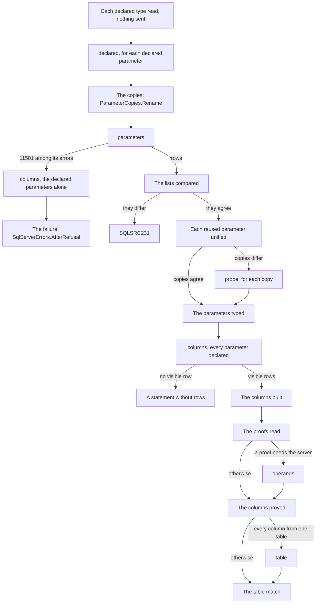

# The SQL Server describer

How `src/SqlSource.Tool/Describing/SqlServer` opens a session with SQL Server, types a query's parameters, from the declarations it reads to the copies of a reused parameter it probes, describes the columns of the query's first result set and the table they match, and proves from the query's text which of those columns cannot be `NULL`.  The contract every [describer](README.md#describer) implements, the exchange its calls go through and how a [capture](README.md#capture) is recorded and replayed are the [PostgreSQL describer's page](postgres-describer.md#the-describer-contract), and this page does not repeat them.  What a user sees of SQL Server is the manual's [SQL Server page](../manual/sqlserver.md), and each error is in [diagnostics](../manual/diagnostics.md).  The terms are the [glossary's](README.md#glossary).

The describer gives a query's parameters, the columns of its first result set with the nullability the server gives them, narrowed where a proof shows that a column the server calls nullable cannot be `NULL`, and the table or view whose column list they are.  It has no plan walk: SQL Server says a column's nullability through every join, and the describer keeps it except where [the proofs of not null](#proofs-of-not-null) correct it from the query's text and the server's answer about the operands the text names.  It never widens the server's answer.  `ToolHost.Create` registers it beside PostgreSQL's ([the host](tool.md#the-host)), and [the realistic corpus](#the-realistic-corpus) is the proof that it calls no column not null that can be `NULL`, on queries written as an application's are.

## The files

| File | Holds |
|----|----|
| [`SqlServerDescriber.cs`](../../src/SqlSource.Tool/Describing/SqlServer/SqlServerDescriber.cs) | The `IQueryDescriber` of `SqlDialect.SqlServer`.  Its `SecretsOf` is `SqlServerConnection.SecretsOf`, which ignores the environment it is passed, its `RewriteOf` is `SqlServerConnection.RewriteOf`, and its `OpenAsync` is `SqlServerSession.OpenAsync` |
| [`SqlServerSession.cs`](../../src/SqlSource.Tool/Describing/SqlServer/SqlServerSession.cs) | The session, on the base of both engines' sessions, `DescriberSession`: the `SessionOpening` of `open`, and `DescribeAsync`, `ResultAsync`, `MatchAsync`, `ResolveAsync` and `UnifyAsync`, with what is asked in which order |
| [`SqlServerSession.Builders.cs`](../../src/SqlSource.Tool/Describing/SqlServer/SqlServerSession.Builders.cs) | What is made of the answers without the session's state: the server, the floor of versions, the rows of `columns` and `table`, each parameter with its type, the declarations of `columns` and the requests of `probe` |
| [`SqlServerSession.Calls.cs`](../../src/SqlSource.Tool/Describing/SqlServer/SqlServerSession.Calls.cs) | Each call, asked through the exchange by `DescriberSession.AskAsync`, timed by the run's clock and written to the log |
| [`SqlServerConnection.cs`](../../src/SqlSource.Tool/Describing/SqlServer/SqlServerConnection.cs) | The connection's value, the one `SqlConnection` of the session and every command made on it, and the listener on SqlClient's events, which it owns |
| [`SqlClientRunListener.cs`](../../src/SqlSource.Tool/Describing/SqlServer/SqlClientRunListener.cs) | The allowlist of SqlClient's events that a run with a log writes as `mssql.driver` |
| [`SqlServerColumns.cs`](../../src/SqlSource.Tool/Describing/SqlServer/SqlServerColumns.cs) | The sidecar's columns from the rows of `columns`, and each column's origin or why it has none |
| [`SqlServerTableMatcher.cs`](../../src/SqlSource.Tool/Describing/SqlServer/SqlServerTableMatcher.cs) | The table every column comes from, and the checks of the table match |
| [`SqlServerLive.cs`](../../src/SqlSource.Tool/Describing/SqlServer/SqlServerLive.cs) | The `live` function of each call and every text the describer sends |
| [`SqlServerCallNames.cs`](../../src/SqlSource.Tool/Describing/SqlServer/SqlServerCallNames.cs), [`SqlServerCalls.cs`](../../src/SqlSource.Tool/Describing/SqlServer/SqlServerCalls.cs) | The names of the calls, and their request and answer records |
| [`DeclaredTypeText.cs`](../../src/SqlSource.Tool/Describing/SqlServer/DeclaredTypeText.cs) | Reads the type of a `-- param:` marker against T-SQL's grammar of a type name |
| [`ParameterCopies.cs`](../../src/SqlSource.Tool/Describing/SqlServer/ParameterCopies.cs) | The rename of a reused parameter's uses to copies, the rule that unifies the copies' types, and the comparison of the server's parameters with the query's list |
| [`SqlServerTypes.cs`](../../src/SqlSource.Tool/Describing/SqlServer/SqlServerTypes.cs) | The sidecar's `SqlServerType` of a row of either describe procedure |
| [`SqlServerErrors.cs`](../../src/SqlSource.Tool/Describing/SqlServer/SqlServerErrors.cs), [`ConnectionErrors.cs`](../../src/SqlSource.Tool/Describing/SqlServer/ConnectionErrors.cs) | A failure of each cause, and what an answer keeps of an exception of SqlClient |
| [`SqlServerEvents.cs`](../../src/SqlSource.Tool/Describing/SqlServer/SqlServerEvents.cs) | The events of the describer's log |

The folder [`Proofs/`](../../src/SqlSource.Tool/Describing/SqlServer/Proofs/) holds [the proofs of not null](#proofs-of-not-null).  None of its files asks the server anything.

| File | Holds |
|----|----|
| [`TsqlTokens.cs`](../../src/SqlSource.Tool/Describing/SqlServer/Proofs/TsqlTokens.cs), [`TsqlToken.cs`](../../src/SqlSource.Tool/Describing/SqlServer/Proofs/TsqlToken.cs), [`TokenRange.cs`](../../src/SqlSource.Tool/Describing/SqlServer/Proofs/TokenRange.cs) | The query's text as the tokens the proofs read, from the lexer's lexemes, and a run of them |
| [`SelectStatement.cs`](../../src/SqlSource.Tool/Describing/SqlServer/Proofs/SelectStatement.cs) | The reader of a text that is one `SELECT`, with its `WITH` clause and the names of its CTEs |
| [`SelectBody.cs`](../../src/SqlSource.Tool/Describing/SqlServer/Proofs/SelectBody.cs) | The reader of one `SELECT`: its items, its `FROM` through its `WHERE`, its grouping, what may take a row away, whether its `FROM` is one table alone, and the one rule of depth |
| [`SelectItem.cs`](../../src/SqlSource.Tool/Describing/SqlServer/Proofs/SelectItem.cs) | One item of a select list: its expression and the name the server gives its column |
| [`Proof.cs`](../../src/SqlSource.Tool/Describing/SqlServer/Proofs/Proof.cs) | A proof: true from the text, never true, an operand to ask, or any or all of other proofs |
| [`ExpressionProofs.cs`](../../src/SqlSource.Tool/Describing/SqlServer/Proofs/ExpressionProofs.cs) | The forms that prove an expression not null, and the operands they leave to ask |
| [`OperandsQuery.cs`](../../src/SqlSource.Tool/Describing/SqlServer/Proofs/OperandsQuery.cs) | The text of `operands`, and the reading of its answer |
| [`ColumnProofs.cs`](../../src/SqlSource.Tool/Describing/SqlServer/Proofs/ColumnProofs.cs) | The proof of each column of a describe, the `PERSISTED NOT NULL` computed column read from its one table among them, and the columns and the rows of `table` as they correct them |

## The connection

[`SqlServerConnection`](../../src/SqlSource.Tool/Describing/SqlServer/SqlServerConnection.cs) holds the connection's value, and is the one place that makes a `SqlConnection` and a `SqlCommand`.  It makes nothing until a `live` function asks for a command, but for the listener of [driver logging](#driver-logging), which only listens, so a replayed session, whose `live` functions never run, touches no driver, and what can go wrong while connecting is the answer of the call that needed the connection, which a capture holds and a replay gives again.  The session has one connection, opened by the first call.  A call that finds it no longer open, as SqlClient leaves it after an error that ends the connection, answers `ConnectionErrors.LostConnection`, and so does every later call: the connection is not opened again.  `ToString` leaves the value out, and `.editorconfig` turns `CA2100` off for this file, as it does for `PostgresConnection.cs`, since every command's text passes through it.

The value is read when the connection is first made, and what a user can write wrong becomes an `UnusableException` with a fixed text of [`ConnectionErrors`](../../src/SqlSource.Tool/Describing/SqlServer/ConnectionErrors.cs), since SqlClient's own text quotes a keyword and, for some keywords, the value: a string the builder cannot read, whatever it throws, `UnreadableConnectionString`; one that sets nothing, `EmptyConnectionString`; settings that `SqlConnection` refuses together, `ConflictingSettings`; an `Authentication` that signs in with a user and a password in a value that lacks either, `MissingCredentials`; a server that SqlClient does not support on this operating system, such as LocalDB off Windows, `UnsupportedOnThisPlatform`; and an `Authentication` of Microsoft Entra ID, for which the tool carries no provider, `NoAuthenticationProvider`.  The remarks of `SqlServerConnection.OpenAsync` list each with what SqlClient throws for it.  `SecretsOf` gives the `Password` that `SqlConnectionStringBuilder` reads from the value, and nothing for a value it cannot read; SqlClient reads no password from the environment or a file, so there is nothing else to give.  `RewriteOf` gives the builder's `ConnectionString`, the value as SqlClient writes it again, and null for a value it cannot read.  Neither throws.

[`SqlServerLive`](../../src/SqlSource.Tool/Describing/SqlServer/SqlServerLive.cs) runs every call through `AnswerAsync`, which answers the call's error for a `SqlException`, through `ConnectionErrors.AtOpen` for `open` and `ConnectionErrors.Of` for every other call, and for an `UnusableException`, through `ConnectionErrors.Own`.  SqlClient reports a command that is cancelled while the server runs it as a `SqlException`, so one thrown once the token is cancelled leaves as an `OperationCanceledException`, and a cancelled run is never an answer.  Anything else is a bug and `SQLSRC200`.

An error keeps each of the exception's errors, in order, with its number, class and state.  What it keeps of the message depends on the call:

| Where | The text |
|----|----|
| `open`, `18456` | `LoginRefused` |
| `open`, `4060` or `4064` | `DatabaseRefused` |
| `open`, `-2`, or a `TimeoutException` in the chain | `ConnectTimedOut` |
| `open`, an `AuthenticationException` in the chain | `CertificateRefused` |
| `open`, a `SocketException` in the chain | `UnreachablePrefix`, then `: ` and the name of its `SocketError` unless that is `Success`, which SqlClient gives on Linux |
| `open`, anything else | `SessionRefused` |
| A later call, `-2` | `NoAnswerInTime` |
| A later call, an error of class 20 or above | `LostConnection` |
| A later call, any other error | The server's message |
| The describer's own refusal | Its text, with 0 for each number |

The server's and SqlClient's texts of a connection name the host, the port, the login or the database, and they would reach the output, the log and a capture.  A server's error of a later call speaks of the query and keeps its message, which can still name the login: [TD-0034](../tech-debt/TD-0034-redaction-of-a-describers-text-has-holes.md).  The texts a user sees are in the manual's [SQLSRC224](../manual/diagnostics.md#sqlsrc224).

## Opening a session

`SqlServerSession.OpenAsync` asks `open` by `DescriberSession.OpenAsync`, through the exchange of the `OpenRequest` and untimed: the server's `SERVERPROPERTY('ProductVersion')` and `SERVERPROPERTY('EngineEdition')`, the version of SqlClient, and four settings that change a description, the database's `compatibility_level` and collation and the session's `ANSI_NULLS` and `QUOTED_IDENTIFIER`, and the session's database, `DB_NAME()`.  The `ServerInfo` holds the product version as its `Version`, which the sidecar's `serverVersion` records, `Microsoft.Data.SqlClient` as its driver, SqlClient's informational version without the commit after `+`, and the settings, which the run's `database.open` event records.  The session keeps the database's name apart, for the rule of [origins](#origins).

A server whose major, the leading digits of its version as for PostgreSQL, is below `SqlServerSession.MinimumMajorVersion`, 14, answers `open` and is then refused as `SQLSRC235`, unless its edition is 5, Azure SQL Database, or 8, Azure SQL Managed Instance, which report a version of their own and have both describe procedures.  A version that starts with no digit is not refused, since the tool cannot tell what it is.  When `open` fails or the server is refused, the connection is disposed at once, and its listener with it.

## The calls and their records

The names of the calls are the constants of [`SqlServerCallNames`](../../src/SqlSource.Tool/Describing/SqlServer/SqlServerCallNames.cs), which every capture records, and their records are in [`SqlServerCalls.cs`](../../src/SqlSource.Tool/Describing/SqlServer/SqlServerCalls.cs), under the rules of [requests and answers](postgres-describer.md#requests-and-answers).

| Call | Request | Answer | Asked |
|----|----|----|----|
| `open` | Nothing | `productVersion`, `engineEdition`, `driverVersion`, `settings`, each a name and a value, and `database`; or `error` | Once, to open the session |
| `declared` | `sql`, `SELECT @p AS [1]`; `params`, the parameter's declaration, `@p dbo.Email` | `rows`, the one column of `sys.dm_exec_describe_first_result_set`, with its type, facets and user type; or `errors`, the describe's error rows, each a number, a type and a message; or `error` | Once for each declared parameter, in the list's order, before `parameters` |
| `parameters` | `sql`, the query's SQL with each reused parameter's uses renamed to copies; `params`, the declarations of the declared parameters, or null | `rows`, one for each parameter the server typed, named as `sp_describe_undeclared_parameters` names its columns; or `error` | Once for each describe that reaches it |
| `probe` | `sql`, as `parameters` was asked it; `params`, every copy and parameter declared | `binds`; or `error` | Only for a reused parameter whose copies' types differ, one or two for each copy |
| `columns` | `sql`, the query's SQL as written; `params`, the declaration of every parameter of the list, or null | `rows`, every row of `sys.dm_exec_describe_first_result_set` in browse mode 2, the hidden ones included, with its name, nullability, type, facets, user type, source and flags, and the tool's `sourceType` and `persistedNotNull`; or `errors`, as `declared`'s; or `error` | Once for each describe whose parameters are typed; or, with the declared parameters alone, once after a `parameters` that failed with `11501` |
| `operands` | As `columns`: `sql`, [the text of `operands`](#the-text-of-operands), built from the query's own tokens; `params`, the declarations `columns` was asked with | As `columns` | After `columns`, only when the proof of a column needs the server's answer about an operand |
| `table` | `schema` and `table` of the one table or view every column comes from | As `columns`, for `SELECT *` from it | Only when every column has an origin in one table |

`parameters` and `probe` call `sys.sp_describe_undeclared_parameters` as a `CommandType.StoredProcedure` with `@tsql` and `@params` as `nvarchar(max)` parameters, `DBNull` for a null.  `declared` runs the tool's own text over `sys.dm_exec_describe_first_result_set(@tsql, @params, 0)` with the same two parameters, and `columns`, `operands` and `table` another over `sys.dm_exec_describe_first_result_set(@tsql, @params, 2)`, through the one `live` function `SqlServerLive.ColumnsAsync`; each answers `errors` when a row has an `error_number`.  That text adds two columns of the tool's own to each row.  The first is `source_type`: the `OBJECTPROPERTYEX` `BaseType` of the row's source, `U` for a table, `V` for a view, `IF` or `TF` for a table-valued function, read only when the row names no linked server and the source's database is the session's, compared by code point, since a linked server's database of the session's name would find a local object.  `OBJECTPROPERTYEX` reads the current database whatever `OBJECT_ID` named, and a name of two parts finds `sys.databases` of the system resource in it, so a source of another database has none.  The second is `persisted_not_null`: true when the row's column is computed, its source is a table of `sys.tables` found under the same condition, and `sys.computed_columns` marks the source column `is_persisted` and not `is_nullable`, the name compared under the database's collation, as the server resolves a name; false otherwise.  The server's `is_nullable` judges a computed column by its expression and does not show that constraint.  `table`'s `@tsql` is `SqlServerLive.TableSelect` of its schema and table, and its `@params` null.  A reader is read to its end, so that an error the server raises after the rows is the call's.

A `probe` answers `binds` true when the procedure raises nothing, and false when it raises a `SqlException` whose every error is of a class below 20 and none is SqlClient's timeout, `-2`: the batch did not bind under the declarations.  Any other error says nothing of the batch, a connection lost or a command timed out, and is the answer's `error`.

An `error` is a `SqlServerServerError`, the list of the exception's errors, each a `SqlServerErrorRow` of number, class, state and message.  A small integer of a row is read as an `int`, whatever the column's own type.  `database` of `open` is the one member that came after a capture: an older capture's null gives no column an origin.  `sourceType` came with the call it is a row of, so no capture has a `columns` without it.  `persistedNotNull` came after captures, and an older capture's null proves no column.

## One describe, step by step

`SqlServerSession.DescribeAsync` runs these steps in order, the columns through `ResultAsync`, their proofs through `ProvedAsync` and the table match through `MatchAsync`, and the first failure ends the describe:



1. **The declarations read.**  A parameter is declared when its `-- param:` marker gives a type: one whose marker gives none is inferred.  `DeclaredTypeText.Read` reads each declared type against T-SQL's grammar of a type name, a name of one or two parts, each plain, bracketed or double-quoted, then an optional `(max)` or one or two numbers in parentheses, and nothing else.  The first type it refuses is `SQLSRC228`, through `SqlServerErrors.TypeRefused`, and nothing is sent.
2. **`declared`.**  For each declared parameter, in the list's order, the server describes `SELECT @p AS [1]` under the parameter's declaration alone, and the type of its one column, built by `SqlServerTypes.FromDeclared`, is the parameter's: the server reads the declaration as it will when the query runs, an alias type included.  Its error rows are `SQLSRC228`, but for a `103` of a parameter whose own name is longer than 127 characters, which is `SQLSRC225` as it is for the same name undeclared.  It comes first, and once for each parameter, so that an error of a type the database lacks, `2715` or `2724`, belongs to one declaration.  When `parameters` is asked every declaration has been read, so a `2715` or a `2724` there is a type that the query's own text names, and `SQLSRC225`.
3. **The copies.**  `ParameterCopies.Rename` renames each use of a reused parameter to a copy of its own, as [the copies and the probe](#the-copies-and-the-probe) says.
4. **`parameters`**, with the renamed SQL and the declarations of every declared parameter, or null when there is none.  Its `error` is the failure that `SqlServerErrors.Parameters` gives for it, unless `11501` is among its errors: that error says only that the batch did not compile, so `columns` is asked first, with the SQL as written and the same declarations, and `SqlServerErrors.AfterRefusal` makes the failure of the two answers, as [errors](#errors) says.  Nothing is asked after it.
5. **The lists compared**, as [the lists' check](#the-lists-check) says, before any probe, so that a text whose parameters the server and the lexer read differently is not probed.
6. **The reused parameters unified**, each by the types of its copies, and by probes when they differ.
7. **The parameters typed.**  Each parameter of the list gets its type: a declared one from `declared`, with the `typeSource` `declared`; a reused one from its copies, `inferred-from-copies`; any other from its row of `parameters`, `inferred`.
8. **`columns`**, with the SQL as written, since the procedure takes a declared parameter any number of times, and every parameter of the list declared, in the list's order: a declared one as `DeclaredTypeText` read its type, and any other at the type it was given, as `SqlServerTypes.Declared` writes it: `[dbo].[Email]` for an alias type, each name in brackets so that one that is a keyword, `[dbo].[User]`, declares, and the system type name otherwise, `nvarchar(128)` for `sysname`.  Its `error` is `SQLSRC225`, and its error rows are classified by their type, as [errors](#errors) says.
9. **The columns built**, by `SqlServerColumns.Build`, as [columns](#columns) says.  A query whose answer has no visible row is a statement without rows: the description is `SidecarResultKind.None`, with the parameters and null for everything else, and nothing more is asked.
10. **The proofs.**  `ColumnProofs.Read` reads the query's text for the proof of each column the server calls nullable, as [the proofs of not null](#proofs-of-not-null) says.  When a proof needs the server, `operands` is asked, with the declarations of `columns`; its answer never fails the describe.  `ColumnProofs.Apply` then answers each proved column `nullable` false, and each `mssql.column` is written.
11. **The table match.**  `table` is asked only when every column has an origin in one table, and `SqlServerTableMatcher.Match` then decides, as [the table match](#the-table-match) says, with the rows of `table` corrected by `ColumnProofs.TableRows`.  The description is `SidecarResultKind.Rows`, with the parameters, the columns, the table that matched or null, `plan` `skipped` and the `tableMatch`.

An answer of `parameters`, `declared`, `columns` or `table` that holds neither rows nor an error, a `declared` with no error and not one row, and a parameter of the list with no row once the lists agreed are each an `InvalidOperationException`, a bug of the describer.  An answer of `operands` is never one: whatever it holds, at worst it proves no operand.

## The copies and the probe

`sp_describe_undeclared_parameters` refuses a parameter used twice, with error `11508`.  So a parameter of the list that is not declared and that the lexer finds more than once, as a `Parameter` lexeme of `DescriberSql.Lex` with the rules of `mssql`, is reused, and `ParameterCopies.Rename` renames each of its uses to a copy: its name, a separator of `_` and the use's number, counted from one, `@name_1` and `@name_2`.  The separator is lengthened, `__`, `___`, until no copy's name is, ignoring case, a name the text holds as a parameter or a variable, a name of the list, or another copy's.  A copy is at most `ParameterCopies.MaximumCopyLength`, 127 characters, since SQL Server's name of 128 counts the `@`: one that would be longer has its parameter's part cut to fit, and a number whose cut name meets a name already held is passed over.  A parameter whose own name is longer than 127 characters is not cut, so the server refuses its copies with the error `103` it gives the name used once, and the query gets the same `SQLSRC225`.  Only the `Parameter` lexemes are renamed, so a string, a comment and a quoted identifier are left as written.  A declared parameter is never copied, since the server takes a declared parameter any number of times, and a `DECLARE`d variable is in no list and is left as written.  `CopiedSql.ParameterOfCopy` takes each copy back to its parameter.

`ParameterCopies.Agreed` gives the copies' type when every copy has a row and every type is the same, compared whole, by name, facets and user type, so `dbo.Email` is not the `nvarchar(320)` it stands over.  Nothing is probed then.  `WHERE @p IS NULL OR @p IS NOT NULL` is such a parameter: each copy is `int`, and the parameter is `int`, `inferred-from-copies`.  A parameter used once is never probed either, and keeps the server's answer, `int` for `WHERE @p IS NULL`.

Otherwise the copies' types are not taken as they are.  The spike of phase 6 found that no copy comes back untyped, `@name_1 IS NULL` alone being `int`, so the two copies of the optional filter, `(@name IS NULL OR name = @name)`, disagree on the very pattern the copies exist for.  It also found that `xml` converts to almost nothing, so a copy that binds declared `xml` and declared `int`, as one in `@p IS NULL`, `@p IS NOT NULL` or `CASE WHEN @p IS NULL` does, constrains nothing, while a copy in a context of `xml` fails as `int` and one in any other typed context fails as `xml` ([the spike](../superpowers/specs/2026-10-20-query-generation-phase-6-sql-server-spike.md)).

So `SqlServerSession.UnifyAsync` asks, for each copy in order of use, a `probe` with that copy declared `xml`, and when it binds, a second with it declared `int`; a copy that binds both ways is ignored.  The other copies and undeclared parameters are declared at the system type that `parameters` gave them, and one it gave none is left out; a declared parameter is declared as it was.  The procedure does not look at the shape of a result, so a query whose two paths return two shapes is probed as any other.  `ParameterCopies.Unify` then takes the copies left: their one type; `SQLSRC226`, through `SqlServerErrors.NoType`, when none is left or one left has no type; and `SQLSRC262`, through `SqlServerErrors.CopiesDisagree`, naming the first two types in order of use, when two differ.

The fixture `update-optional-filter` asks, after `parameters` typed `@name_1` `int` and `@name_2` `nvarchar(100)`:

| `params` of the probe | `binds` |
|----|----|
| `@name_1 xml, @name_2 nvarchar(100)` | true |
| `@name_1 int, @name_2 nvarchar(100)` | true: `@name_1` is ignored |
| `@name_1 int, @name_2 xml` | false: `@name_2` constrains, and is not probed as `int` |

and the parameter is `nvarchar(100)`, `inferred-from-copies`.

## The lists' check

The lexer finds the parameters of the list, and the server finds its own, and the two can read a text differently.  `ParameterCopies.CompareLists` compares the list's undeclared parameters with the names of the rows of `parameters`, each copy taken back to its parameter, ignoring case.  Any difference is `SQLSRC231`, through `SqlServerErrors.ListsDiffer`, at the step `check parameters`, naming each parameter and which side lacks it: the list's first, in its order, then the server's.

A parameter that the server reports and the list lacks is one that the lexer took for a `DECLARE`d variable: after a `DECLARE` with no `;`, a list of declarations ends only at a word that starts a statement, and a label or `RECEIVE` is none, so the `@p` of `DECLARE @x int = @n next_message: RECEIVE TOP (1) message_body, @p + 1 AS q FROM ...` is a variable to the lexer and a parameter to the server.  The other direction is a parameter of the list that the server does not report.  A `CREATE PROCEDURE p @id int AS ...`, whose `@id` the lexer reads as a parameter, never reaches the check: the server will not describe a statement that creates a procedure, error `11527`, which `parameters` answers and which is `SQLSRC225`.  What the lexer misreads is [TD-0004](../tech-debt/TD-0004-lexer-misreads-dialect-specific-sql.md).

## Types

[`SqlServerTypes`](../../src/SqlSource.Tool/Describing/SqlServer/SqlServerTypes.cs) builds the sidecar's `SqlServerType` from a row of `parameters`, `FromParameter`, of `declared`, `FromDeclared`, or of `columns`, `FromColumn`.  Its `name` is the system type name of the row verbatim, its facets included, `nvarchar(100)` or `decimal(18,2)`, and `maxLength`, `precision` and `scale` are the row's.  A row that names a user type gives its `userType`: the schema, the name and, for a CLR type, the assembly-qualified name.  So `sysname` is a user type of `sys` over `nvarchar(128)`, `hierarchyid` a user type of `sys` with its assembly, and an alias type such as `dbo.Email` a user type over its base, while a `rowversion` is `timestamp`, as the server names it.  SQL Server 2025 names `json` and `vector(n)` so to SqlClient, whose TDS knows them, where an older client is told `varchar(max)`, and the describer records what SqlClient is told; `ColumnTests.ColumnsAsync_JsonAndVector_On2025` holds it.  A row with no type name or without a facet is an `InvalidOperationException`, since the server typed the parameter or the column, or raised an error.

`bindName` is never written for SQL Server; the [sidecar format](../superpowers/specs/2026-10-07-sidecar-format-design.md#23-sql-server-mssql) records why.

`SqlServerTypes.Spelled` names a type as a message does: `schema.name` of a user type that is not of `sys`, and the system type name otherwise.  The schema is compared with `sys` exactly (`SystemSchemas.IsSqlServer`), since the server reports its own as `sys` and in a case-sensitive database `SYS` is a user's schema.  `SqlServerTypes.Declared` writes it as a declaration of `@params` does: the same, but each name of a user type in brackets with a `]` written twice, since the server refuses `dbo.User`, whose name is a keyword, with `156`.

## Columns and the table match

A query's columns are those of its first result set as `sys.dm_exec_describe_first_result_set` describes it, which is all the procedure describes: a batch of several statements is described by its first result set, and the others are [D-0006](../deferred/D-0006-multiple-result-sets-on-sql-server.md).  What is made of the rows is in [`SqlServerColumns`](../../src/SqlSource.Tool/Describing/SqlServer/SqlServerColumns.cs) and [`SqlServerTableMatcher`](../../src/SqlSource.Tool/Describing/SqlServer/SqlServerTableMatcher.cs), neither of which asks the server anything.

### Browse mode 2

`columns` and `table` read the procedure in browse mode 2.  Mode 2 names a view as the source of its columns, as PostgreSQL's origin does, and adds one hidden row, `ROWSTAT` followed by a NUL character.  Mode 1 names a view's base table as the source, and adds the hidden key and `rowversion` columns of every table the query reads, which differ between versions on a system view.  A column's nullability and its identity and computed flags are the same under both.  `declared` reads mode 0, since it wants the one column alone.

### Columns

`SqlServerColumns.Build` makes the sidecar's columns from the rows of `columns`, in the order of their ordinals:

1. A row with `is_hidden` is dropped before anything is built, so `ROWSTAT` is in no model.  `mssql.columns` and the capture keep every row.
2. No visible row is a statement without a result set: an `UPDATE` with no `OUTPUT`, a `SELECT ... INTO` or an `OUTPUT ... INTO`.
3. A visible row with no name, as `SELECT 1` has, is `SQLSRC266`, naming the column's place counted from one, through `SqlServerErrors.NoColumnName`.  Paths of an `IF` that differ only in a column's name are not refused as two shapes: the server gives that column no name, and it is `SQLSRC266`.  Two columns of one name are recorded, and the generator's `SQLSRC255` reports them, as for PostgreSQL.
4. Each other row is a column: `name` as the server returned it, a `!` or `?` suffix kept; `ordinal`, its place among the visible columns; `type` by `SqlServerTypes.FromColumn`; `nullable` the server's `is_nullable`, true where it gives none, with the `nullableSource` `server`; `origin`, as [origins](#origins) says; and `identity` and `computed`, the server's `is_identity_column` and `is_computed_column`, null where it gives none.

The server's nullability is where every column starts.  SQL Server says it through every join, and [the spike](../superpowers/specs/2026-10-20-query-generation-phase-6-sql-server-spike.md) found it right everywhere a `NULL` can come out, so there is no plan walk and every entry with rows records `plan` as `skipped`, as the [format](../superpowers/specs/2026-10-07-sidecar-format-design.md#12-a-query-entry) says of an engine with no walk.  The server also calls nullable many columns that cannot be `NULL`, such as `COUNT(*)` and a `PERSISTED NOT NULL` computed column, which is safe but noise.  [The proofs of not null](#proofs-of-not-null) narrow those they can prove, after the columns are built, and only narrow: a column the server answers not null keeps its answer, and no proof makes one nullable.

### Origins

`SqlServerColumns.OriginOf` gives a column an origin when its row names no `source_server`, a `source_schema`, a `source_table` and a `source_column`, a `source_database` that is, compared ordinally, the session's database, the `DB_NAME()` of `open`, and a `sourceType` of `U` or `V`, a table or a view.  The sidecar's origin names no database, so a column of another database, `msdb.dbo.sysjobs`, of a linked server, or of the system resource, `master.sys.databases`, whose source database is `mssqlsystemresource`, has none: the table match must not find a table of that name in the session's database.  Mode 2 names a table-valued function, inline or multi-statement, as the source of its columns, and `SELECT *` from it fails without its arguments, with `216`; so a column of a function has none, as a function's column has none on PostgreSQL, and the query is `no-origin`.  A synonym's column has the synonym's table as its source.  A column with no origin has a reason, tried in this order, `another server`, `expression`, `another database` or `not a table or view`, which its `mssql.column` event holds as `noOrigin`.

Under mode 2 a view's column has the view as its source.  An `OUTPUT` column has its table's column, and `$action` has none.  A query `FOR SYSTEM_TIME` gets no source for any column, so it is `no-origin`.  The names of a source are the catalog's, whatever the query wrote: `SELECT * FROM DBO.USERS`, in a database whose collation ignores case, has `dbo.users` as its origin and matches it.

### The table match

`SqlServerTableMatcher` says whether a result is exactly one table's or view's column list, so that the generator can name the model after it.  `SqlServerSession.MatchAsync` runs it once for a statement with rows, after the columns are built.  Before it does, it asks `table` for the table that `SqlServerTableMatcher.TableOf` finds, and only when it finds one, which every column has as its origin.  The first two checks need no table, and a call that failed for a table the match never reads would fail the query.  `table`'s text is the tool's own, `SqlServerLive.TableSelect`: `SELECT * FROM [schema].[table]`, each name a catalog name the server gave as the origin, in brackets with a `]` written twice, and never the user's text.

The checks are the values of the format's `tableMatch`, in the format's order, held once by [`TableMatchChecks`](../../src/SqlSource.Tool/Describing/Describers/TableMatchChecks.cs) for both engines, and the first that fails is the answer, as PostgreSQL's are.  `SqlServerTableMatcher` gives `TableMatchChecks` its own predicate for each check, and a predicate runs only when every check before it passed, so the names check may read the origin of every column:

| Check | Fails when |
|----|----|
| `no-origin` | A column has no origin |
| `several-tables` | The origins are not one table or view, the schema and the table compared ordinally |
| `names-differ` | A column's name is not its origin column's, compared ordinally as the server returned it, so an alias or an override suffix, `AS [note!]`, differs |
| `columns-differ` | The origin columns, as a list and not a set, are not the table's, so a column left out or there twice differs |
| `order-differs` | The origin columns are not in the table's order |
| `nullability-differs` | A column's `nullable` is not what the server says of the table's column, true where it says nothing |

The table's column list and the nullability of each of its columns are the visible rows of `table`, the server's description of `SELECT *` from it, and not the catalog's.  So a period column declared `HIDDEN` is out of the list, as `SELECT *` leaves it out; a computed column is in it; and a column is the table's in nullability when it has what the describer says of the column read whole.  The server judges a computed column by its expression, so it may call a `PERSISTED NOT NULL` one nullable, and against the catalog's `is_nullable` alone no table with one would ever match.  So `MatchAsync` gives the matcher the rows of `table` as `ColumnProofs.TableRows` corrects them: a `PERSISTED NOT NULL` column of a table is not nullable there, as it is in a query of the table alone, and `select-computed-not-null` matches.  A query that reads such a column other than from the table alone, through a join, a derived table or a CTE, or as an item in parentheses, keeps the server's answer, and so no longer matches the table: it is `nullability-differs`.  A view may match, as a table may, and an `INSERT ... OUTPUT inserted.*` matches its table.  `matchesTable` is the origin's schema and table.  The match writes `mssql.table-match`; a statement without rows has no match and no event.

## Proofs of not null

The server calls nullable many columns that cannot be `NULL`: every `COUNT`, every aggregate over a group, every window function, every `CAST` and every `COALESCE` whose first argument is nullable, among others.  [`ColumnProofs`](../../src/SqlSource.Tool/Describing/SqlServer/Proofs/ColumnProofs.cs) proves from the query's text that some cannot, and asks the server, in one more call, `operands`, whether each operand a proof needs is not null over the query's rows.  A column it proves from its expression is `nullable` false with the `nullableSource` `expression`, and a `PERSISTED NOT NULL` computed column read from its one table is `nullable` false with `catalog`, as the [format](../superpowers/specs/2026-10-07-sidecar-format-design.md#14-a-column) says.  A text the reader cannot follow, a proof that cannot be made and an answer of `operands` that proves nothing each leave the column as the server answered it, and nothing is reported.  A proof only narrows the server's answer: a column it answers not null keeps that answer and asks nothing.  The facts of the server the proofs stand on, and why showplan was not read instead, are in [the design](../superpowers/specs/2026-10-23-sql-server-nullability-noise-design.md).

### The reader

There is no parser of T-SQL.  The reader knows the outline of one `SELECT` and gives up on anything else, and a reader that gives up proves nothing.

- **Tokens.**  [`TsqlTokens`](../../src/SqlSource.Tool/Describing/SqlServer/Proofs/TsqlTokens.cs) reads the text through `DescriberSql.Lex` with the rules of `mssql`, as the lists' check does.  It drops a comment and a hint, makes a quoted region a string when it opens with `'`, an `N` directly before it joined to it, and a name otherwise, keeps a parameter whole, and splits the rest into words, numbers and symbols.  A parameter that the lexer starts after a `#` or a `$` inside a name, `x#@c`, is joined to that name, as the server reads it.
- **The statement.**  [`SelectStatement.Read`](../../src/SqlSource.Tool/Describing/SqlServer/Proofs/SelectStatement.cs) reads a text that is an optional `;`, an optional `WITH` clause of CTEs, never `WITH XMLNAMESPACES`, and one `SELECT` that ends the text or is followed by `;` alone.  It keeps the `WITH` clause, for `operands`, and the names of its CTEs, which are no table.
- **The `SELECT`.**  [`SelectBody.Read`](../../src/SqlSource.Tool/Describing/SqlServer/Proofs/SelectBody.cs) reads `DISTINCT` or `ALL`, `TOP` with `PERCENT` and `WITH TIES`, the select list, then `FROM`, `WHERE`, `GROUP BY`, `HAVING`, `WINDOW`, `ORDER BY` and `OPTION`, each at most once and in that order.  Each of these words is reserved but `WINDOW`, which may be an alias or a column, as in `FROM dbo.t window RIGHT JOIN ...` or `GROUP BY b, window, ROLLUP (a)`: read as a clause, it would end the `FROM` or the `GROUP BY` before the join or the `ROLLUP`.  So a `WINDOW` clause must be `WINDOW name AS ( ... ) [, name AS ( ... )]...` to its end, and any other `window` of the select's level makes the reader give up.  `OFFSET`, no reserved word either, starts no clause: it is looked for only inside the `ORDER BY`, where a column so named only proves less.  An `INTO`, a `FOR XML`, `FOR JSON` or `FOR BROWSE`, a `UNION`, `EXCEPT` or `INTERSECT`, a `;`, a word that starts another statement, an empty item and an unbalanced text make it give up.  Depth counts parentheses and `CASE` ... `END`, by `SelectBody.DepthChange`, the one rule of depth, so a subquery's clauses and a `CASE`'s words are never the select's.  It gives the grouping, none, plain, `ALL`, or sets for any `ROLLUP`, `CUBE`, `GROUPING SETS` or `()`; whether a `HAVING`, a `TOP` or an `OFFSET` is there; the range from `FROM` to the end of `WHERE`; and whether the `FROM` is one table alone, `FROM name [[AS] alias] [WITH (hints)]`, the name of one to four parts and not a CTE's.
- **The items.**  The select list is split at its commas of its own level, and [`SelectItem.Read`](../../src/SqlSource.Tool/Describing/SqlServer/Proofs/SelectItem.cs) gives each its expression and the name the server gives its column: `name = expr`, `expr AS name`, `expr name` when the token before the name ends an expression, so not after `COLLATE`, `ZONE`, `OVER` or `FOR`, and the last part of a column alone.  Any other item has no name.
- **The columns.**  `ColumnProofs.Read` proves anything only when the items are the visible rows of `columns` one for one: as many, none a `*` or `q.*`, and each item's name the server's, compared ordinally.  One item that disagrees proves nothing for the whole query, since the reader has misread its list.  A query whose one item is `*` or `q.*` gets the one proof it can have, [the computed column's](#a-persisted-not-null-computed-column).

### The forms

[`ExpressionProofs`](../../src/SqlSource.Tool/Describing/SqlServer/Proofs/ExpressionProofs.cs) proves an item's expression.  It splits the expression at `+`, `-`, `*`, `/` and `%` of its own level, a sign before a piece being unary, and proves it when every piece is proved, so arithmetic of operands that are not null is not null.  A piece is a string, a number or a binary literal, always proved; `NULL` or a parameter, never proved; `( e )`, proved when `e` is; a scalar subquery, a `CASE` or a column, each a leaf unless it is a form below; or a call.  A call of a name with a schema, `dbo.f(x)`, proves nothing, since it is a user's function or a CLR aggregate; a call of a bare name is one of the forms below, matched without case, or a leaf.  A built-in function is never a user's, since T-SQL calls a user's scalar function only by a name with its schema.  An expression with anything else at its own level, `x AT TIME ZONE 'UTC'` or `a COLLATE c`, is a leaf whole.

| Form | Proved when |
|----|----|
| `COUNT( ... )`, `COUNT_BIG( ... )`, with or without `OVER ( ... )` | Always |
| `( SELECT COUNT( ... ) ... )`, and `COUNT_BIG`, without `OVER` | The subquery is read, and has no `GROUP BY`, `HAVING`, `TOP` or `OFFSET`: it returns one row |
| `ROW_NUMBER()`, `RANK()`, `DENSE_RANK()` with `OVER ( ... )`; `NTILE(n) OVER ( ... )` | `n` is an integer literal |
| `SUM`, `MAX`, `MIN` of `e`, `ALL e` or `DISTINCT e`, without `OVER` | The `SELECT` has a `GROUP BY`, whose every group has a row, and `e` is proved in the rows' context |
| `SUM`, `MAX`, `MIN` of `e` with `OVER ( ... )` | The frame holds the current row, and `e` is proved in the select's context |
| `COALESCE`, `GREATEST`, `LEAST` | One argument is proved, and no argument is of a CLR type |
| `CAST(e AS type)` | `type` is a target, and `e` is proved and of no CLR type |
| `CONVERT(type, e)`, `CONVERT(type, e, style)` | `type` is a target, `e` is proved and of no CLR type, and `style` is an integer literal: a `NULL` style is `NULL` |
| `JSON_OBJECT( ... )`, `JSON_ARRAY( ... )` | Always |

A CLR type, `geometry`, `geography`, `hierarchyid` or a user's, converts a string through its `Parse`, which may answer its Null: `CAST(N'NULL' AS geometry)` is `NULL`, and so is `CAST(wkt AS geometry)` of a `wkt` that is not null but holds `'NULL'` or `'Null'`.  So a target of `CAST` and `CONVERT` is only a built-in type that is no CLR type, written as one word without a schema or brackets, with its facets `(n)`, `(max)` or `(p, s)` ([`CastTargets`](../../src/SqlSource.Tool/Describing/SqlServer/Proofs/CastTargets.cs)): the numeric and money types, `bit`, the date and time types, the character and binary types, `uniqueidentifier`, `xml`, `sql_variant` and `sysname`, an alias of `nvarchar(128)`.  A user's type cannot take a system type's name, so `date` is always the system's.  A synonym, `integer`, and a type whose conversions were not checked, `json` and `vector`, are none.  `COALESCE`, `GREATEST` and `LEAST` convert every argument to the type of highest precedence, which a CLR type has, so `COALESCE(shape, 'NULL')` of a `geometry` is `NULL` where `shape` is.  Each of their arguments must be of no CLR type: a literal or `NULL` is none, nor is `COUNT`, `COUNT_BIG`, a ranking function, `SUM`, `JSON_OBJECT`, `JSON_ARRAY`, a count subquery or a `CAST` or `CONVERT` to a target; `MAX` and `MIN` are of their operand's type, `( e )`, `COALESCE`, `GREATEST`, `LEAST` and arithmetic of their parts'; a call of a schema's name may return a CLR type and proves nothing; and anything else, a parameter included, is [asked its type](#operands-and-their-context).  `CAST` and `CONVERT` also need their operand of no CLR type, since a CLR type's conversion to a string is its `ToString`, which a user's type may answer null.  Last, `ColumnProofs` gives no proof of its expression to a column whose own row may be of a CLR type, by `SqlServerTypes.MayBeClr`, the one rule of what is one: an assembly-qualified name, the name `geometry`, `geography` or `hierarchyid`, or no type name.  Arithmetic has no CLR operand, and a `CASE`, `ISNULL` or `IIF` is a leaf, whose nullability the server judges: it answers each of them nullable when a branch converts a string to a CLR type.

A form whose condition fails proves nothing and is no leaf, so its own answer is never asked.  A form called with `WITHIN GROUP`, or with `OVER w`, a named window, proves nothing.  So does `SUM`, `MAX` or `MIN` with `OVER (w ...)`, a window that does not start with `PARTITION BY`, `ORDER BY`, `ROWS` or `RANGE` and may take a named window's frame, which is not read.  A frame holds the current row when there is none, or when it is `ROWS` or `RANGE` with a start of `UNBOUNDED PRECEDING`, `n PRECEDING` or `CURRENT ROW` and an end, if any, of `CURRENT ROW`, `n FOLLOWING` or `UNBOUNDED FOLLOWING`, `n` an integer literal.  Under `GROUP BY ALL`, which returns a group that no row of the `WHERE` holds, no item is proved.  `TRY_CAST`, `TRY_CONVERT` and every other function are no form: a call of one is a leaf, which the server answers.

### Operands and their context

A leaf is an expression the forms do not read, and a proof that needs it holds only when the server answers it not null over the same rows.  The server's answer about an expression over the rows of the `FROM` and the `WHERE` holds where the item reads it in two contexts.  The rows' context is the operand of an aggregate without `OVER`, computed over those rows, and a leaf in it may be asked whatever the grouping.  The select's context is everything else, and a leaf in it may be asked unless the grouping is sets: in a total's row of a `ROLLUP`, a `CUBE` or `GROUPING SETS`, a grouping column is `NULL` whatever the server says of it over the rows.  Under a plain `GROUP BY`, an expression outside an aggregate can only be of the grouping columns, whose value in a group's row is a value of its rows.

A leaf is asked for its nullability, `Proof.Operand`, or for its type, `Proof.NotClr`, which holds when the server answers it of no CLR type, whatever its nullability.  A leaf's type is the same in every context, so a type leaf is asked under a grouping set too, and a parameter's type is its declaration, which `operands` is asked with, so a parameter is asked its type.  Otherwise a type leaf is asked as a nullability leaf is.  A nullability leaf is never asked when it is a parameter or `NULL`; no leaf is asked when it holds anywhere, its subqueries included, `OVER`, an aggregate's name before `(`, or a name after `.` or `::` before `(`: outside its `GROUP BY` an aggregate means something else, and a call of a schema's name may be a CLR aggregate or a type's method.  An old table hint after a table of a schema, `FROM dbo.o (NOLOCK)`, reads as such a call, and so makes the leaf never asked.  An item that is one leaf alone, its outer parentheses aside, proves nothing and asks nothing, since `columns` has answered that very expression over the same rows.  A leaf inside a form is still asked: `CAST(x AS int)` may be nullable where `x` is not.

[`Proof`](../../src/SqlSource.Tool/Describing/SqlServer/Proofs/Proof.cs) is true, never true, an operand not null, an operand of no CLR type, or any or all of other proofs, and has no negation, so an operand answered not null, or of no CLR type, never makes a proof fail that held without it.  A proof is simplified as it is built, so a leaf whose answer cannot change it, the `a` of `a + NULL`, is never numbered and never asked; `COALESCE(a, 0)` asks `a` its type alone.  Every other leaf becomes an operand, each text once, compared token by token, in the order the items first use them, a leaf asked for both its nullability and its type once.

### The text of `operands`

[`OperandsQuery.Text`](../../src/SqlSource.Tool/Describing/SqlServer/Proofs/OperandsQuery.cs) builds the text from the query's own characters: its `WITH` clause as written and a line break; `SELECT` and each operand, from its first token's start to its last token's end, so a comment inside it is kept, followed by a line break and `AS [n]`, `n` counted from one, the operands separated by `,` and a line break; then a line break and the query's text from its `FROM` to the end of its `WHERE`, or of its `FROM` without one, or nothing without a `FROM`.  `GROUP BY`, `HAVING`, `WINDOW`, `ORDER BY` and `OPTION` are left out.  Each operand is so evaluated over the rows of the query's own `FROM` and `WHERE`, behind its own `WITH`.  The line break before each `AS [n]` keeps a line comment inside an operand from swallowing it.  The fixture `select-proved-forms` asks:

```sql
SELECT o.total
AS [1],
u.credit
AS [2],
u.nickname
AS [3],
u.name
AS [4],
o.user_id
AS [5]
FROM dbo.orders AS o
JOIN dbo.users AS u ON u.id = o.user_id
WHERE o.total >= @minimum_total
```

`operands` is asked with the declarations of `columns`, through the `live` function of `columns`.  `OperandsQuery.AnswersOf` reads its answer into an `OperandFacts` for each operand: it is not null when its row says `is_nullable` false, and of no CLR type when `SqlServerTypes.MayBeClr` says so of its row.  An answer that holds an `error` or error rows, or whose visible rows are not the operands one for one, named `1` to `n` in order, proves no operand, and the proofs of the text alone still hold.  `ColumnProofs.Apply` then answers each column whose proof holds.

### A `PERSISTED NOT NULL` computed column

The server judges a computed column by its expression, so it calls one declared `PERSISTED NOT NULL` nullable whenever the expression could be.  The row's `persistedNotNull` says what the catalog holds, and `ColumnProofs` alone acts on it: the column is `nullable` false, `catalog`, when its row says so with a `sourceType` of `U`, the `FROM` is one table alone, the grouping is none or plain, and its item is a column alone, without parentheses, or the one `*` or `q.*`.  Then every row of the result is a row of that table, which the constraint keeps not null.  Read through an outer join the column is `NULL` while the server still names it as the source, so a join, a derived table, a CTE or an expression of it proves nothing; the fixture `select-computed-outer-join` holds it nullable.  `ColumnProofs.TableRows` corrects the rows of `table` by the same rule, since they are `SELECT *` from the table alone, which is how [the table match](#the-table-match) compares a corrected query with a corrected table.

### The setting the proofs assume

`COUNT`, which is an `int`, `SUM`, `CAST`, `CONVERT`, `COALESCE`, `GREATEST` and `LEAST`, which convert to their type, and arithmetic are not null only under `ANSI_WARNINGS` on: `GREATEST(CAST(NULL AS datetime), 1e10)` is `NULL` under both off, and an error under `ANSI_WARNINGS` on.  With `ANSI_WARNINGS` and `ARITHABORT` both off, an arithmetic overflow, a conversion overflow and a divide by zero return `NULL` instead of raising an error.  The proofs assume `ANSI_WARNINGS` on, as SqlClient sets it when it connects, and the manual's [known issues](../manual/sqlserver.md#known-issues) tell a user who turns it off.  `MAX`, `MIN`, `COUNT_BIG`, the ranking functions, `JSON_OBJECT`, `JSON_ARRAY` and the computed column hold whatever the settings.

### How the proofs are held

The reader, the forms, the text of `operands` and the reading of its answer are tested without a server in `tests/SqlSource.Tool.Tests/Describing/SqlServer/Proofs/`, each form beside what it must refuse, and the order of the calls in `SqlServerSessionProofTests`.  `ProofTests` of `tests/SqlSource.Tests.SqlServer/Describer/`, on every image the tests run, describes each proved form and runs it over rows that tempt a `NULL`, finding none; describes the queries that try to break a proof, each of which must stay nullable, and runs each to show the `NULL` the server foresaw; and pins the facts of the server the proofs stand on, the `ANSI_WARNINGS` one included.  Over the realistic corpus, `RealisticNullabilitySafetyTests` finds no proof that answers `false` for a column that can be `NULL` ([the realistic corpus](#the-realistic-corpus)).

## Errors

[`SqlServerErrors`](../../src/SqlSource.Tool/Describing/SqlServer/SqlServerErrors.cs) makes each `DescribeFailure` of the describer, with one id for each cause a user mends differently.  What each id means to a user, with its help, is in [diagnostics](../manual/diagnostics.md); this section is how the code chooses it.  A `server:` line is `Msg <number>, Level <class>, State <state>: <message>` for each error of the server in its order, or the text alone of an error of the describer's own, whose number is 0, and an error row of `declared`, `columns` or `table` is `Msg <number>: <message>`, since a row has no level or state.  `SQLSRC224`, `SQLSRC235` and `SQLSRC228` are built by [`DescribeFailures`](../../src/SqlSource.Tool/Describing/Describers/DescribeFailures.cs), which both engines share, each giving its own help.

| Where | Id | Step |
|----|----|----|
| An error of `open` | `SQLSRC224`, whatever its numbers | None |
| A server below the floor | `SQLSRC235`, with no server line | None |
| A declared type that `DeclaredTypeText` refuses | `SQLSRC228`, `it is not written as a type name` and what was found, with no server line | `resolve type` |
| The error rows of `declared`, `103` among them, for a parameter whose name is longer than 127 characters | `SQLSRC225` | `resolve type` |
| The error rows of `declared`, `2715` or `2724` among them | `SQLSRC228`, `the database has no such type` | `resolve type` |
| Any other error rows of `declared`, such as `102` | `SQLSRC228`, `it is not a type` | `resolve type` |
| The `error` of `declared` | `SQLSRC225` | `resolve type` |
| The `error` of `parameters`, whose first error is `11502`, `11503`, `11506` or `11507` | `SQLSRC226` | `describe parameters` |
| Any other `error` of `parameters`: `11508`, `11527`, a type the query's text names that the database lacks, and the query rejected, the cause first and `11501` last, when the `columns` asked after the `11501` gives no cause, below | `SQLSRC225` | `describe parameters` |
| The `error` of `parameters` with `11501` among its errors, when the `columns` asked after it has an error row of type 3, 4 or 10 | That row's id, as for `columns` below | `describe columns` |
| The `error` of `parameters` with `11501` among its errors, for any other answer of that `columns` | What the rows above give for `parameters`, with its lines | `describe parameters` |
| The lists differ | `SQLSRC231`, with no server line | `check parameters` |
| The `error` of a `probe` | `SQLSRC225` | `describe parameters` |
| No copy of a reused parameter left, or one left with no type | `SQLSRC226`, with no server line | `describe parameters` |
| Two types among the copies left | `SQLSRC262`, with no server line | `describe parameters` |
| The `error` of `columns` | `SQLSRC225` | `describe columns` |
| An error row of `columns` of type 3, `CONFLICTING_RESULTS`: two paths return different shapes | `SQLSRC263` | `describe columns` |
| An error row of `columns` of type 4, `DYNAMIC_SQL`: an `EXEC` of a string the server cannot read | `SQLSRC264` | `describe columns` |
| An error row of `columns` of type 10, `TEMPORARY_TABLE`: a temporary table in a batch of several statements | `SQLSRC265`, with the help to make the query one statement or use a table variable | `describe columns` |
| Error rows of `columns` of no such type: `2812` then `11529`, an `EXEC` with no argument of a procedure the database lacks; `11519`, an extended procedure | `SQLSRC225`, each row a server line in the server's order | `describe columns` |
| A visible column with no name | `SQLSRC266`, with no server line | `describe columns` |
| The `error` of `table`, or its error rows | As for `columns` | `table match` |

An id is chosen by the error's number, the first error's for `parameters`, or by the `error_type` of a row of `columns` or `table`, and never by its message, which may be translated.  Of the rows of type 3, 4 and 10, the first decides, and every row is a server line.  `SQLSRC225`'s message ends with the first error's message, the cause.  For the rows of `columns` or `table` it ends with the message of the first row of type 8, `UNDECLARED_PARAMETER`, when there is one, and else with the first row's: every parameter is declared, so a row of type 8 is a bug of the describer, and its message says so.  `SQLSRC226` of `parameters` reads the messages only to choose the parameter it names: the first undeclared parameter of the list whose `@name` stands in an error's message as a whole token, a copy taken back to its parameter, and else the first undeclared parameter.  `11508` is a parameter used twice, which the copies prevent, so it is a bug of the describer that a user sees as `SQLSRC225` with the server's line.

An unknown column, `207`, a `GO` inside the query, `102`, and a word read as a procedure that the database lacks, `2812`, reach `columns` only after `parameters` has refused them with `11501`, and that `columns` gives them no cause, so each is `SQLSRC225` at `describe parameters`.  `2812` reaches `columns` first only for an `EXEC` with no argument, which `parameters` takes.

`11501` says only that the batch did not compile, and comes last, after its cause.  For a temporary table of a batch of several statements the cause that `parameters` gives is `208`, a missing table, where `columns` gives a row of type 10: so `columns` is asked after it, and `SqlServerErrors.AfterRefusal` reports `SQLSRC265`.  An `OUTPUT` with no `INTO` on a table with a trigger, `334`, takes the other path: `parameters` raises `334` and then `11501`, and the `columns` asked after it answers `334` and `11501` as rows, neither of a type that gives a cause, so the query is `SQLSRC225` with the lines of `parameters`, at `describe parameters`.

## Why a query cannot run a statement

Nothing a `.sql` file holds can make the describer run a statement.  That is a security invariant, and the tool's [`AGENTS.md`](../../src/SqlSource.Tool/AGENTS.md) holds it.  This section is the map of what the describer sends.

The user's SQL and the declarations reach the server only as the values of `@tsql` and `@params`, `nvarchar(max)` parameters of two things that analyse a text and run nothing:

| Text | Sent by | As |
|----|----|----|
| The query's SQL, its reused parameters renamed, and the declarations | `SqlServerLive.ParametersAsync` and `SqlServerLive.ProbeAsync` | `@tsql` and `@params` of `sys.sp_describe_undeclared_parameters`, called as a `CommandType.StoredProcedure` |
| `SELECT @p AS [1]` and one declaration | `SqlServerLive.DeclaredAsync` | `@tsql` and `@params` of `sys.dm_exec_describe_first_result_set`, in the tool's own text |
| The query's SQL as written, and the declarations | `SqlServerLive.ColumnsAsync` | `@tsql` and `@params` of `sys.dm_exec_describe_first_result_set`, in the tool's own text |
| The text of `operands`, slices of the query's SQL cut at its tokens with `SELECT`, commas, line breaks and the aliases `AS [n]` between them, and the declarations of `columns` | `SqlServerLive.ColumnsAsync`, asked as `operands` | The same |

The text of `operands` is the query's own characters rearranged, with nothing added but `SELECT`, commas, line breaks and `AS [n]`, and it reaches the server only as `@tsql`, as the query's does.  Every other text is the tool's own: the read of `open`, the texts of `declared` and of `columns`, `operands` and `table`, and the `@tsql` of `table`, `SELECT * FROM [schema].[table]` of `SqlServerLive.TableAsync`, whose two names are catalog names that the server gave as an origin, each in brackets with a `]` written twice, and never the user's text.  The server parses `@params` as a list of declarations and refuses one that is not, so a declaration such as `int; DROP TABLE x` is an error and runs nothing.  `DeclaredTypeText` is the first refusal, with an error that says what is wrong, and the guarantee does not rest on it.  The canary tests of `tests/SqlSource.Tests.SqlServer/Describer/ParameterTests.cs` send a text of two statements whose second drops a table, through `parameters` and `probe`, and a declaration that drops it, through `declared`, `parameters` and a describe, and find the table there after each.  Those of `SafetyTests.cs` send `columns` a text that drops it, one that waits and one that shuts the server down: the table is there, the call answers without waiting and the server still answers.  One more describes a query whose operand takes the next value of a sequence, which `operands` asks about: the sequence has given no value.

## Events

[`SqlServerEvents`](../../src/SqlSource.Tool/Describing/SqlServer/SqlServerEvents.cs) builds the events of the describer's calls and steps, which the session's log names `mssql.` and the event's name.  A describe writes them in this order, each where its call is made or its step reached, under a replay too, so a describe that fails writes nothing after the step that failed.  `mssql.driver`, SqlClient's own, is written around each command that a live call runs, as [driver logging](#driver-logging) says.

| Event | Written | Holds |
|----|----|----|
| `mssql.declared` | For each declared parameter, in the list's order | `query`, the `sql` and the `params` the call sent, the answer, `rows`, `errors` or `error`, and `durationMs` |
| `mssql.parameters` | Once | The same, with `rows` or `error` |
| `mssql.probe` | For each probe, one or two for each copy of a reused parameter whose copies' types differ | The same, with `binds` or `error` |
| `mssql.columns` | Once; after a `parameters` that failed with `11501`, as the last event | The same, with every row, the hidden ones included, `errors` or `error` |
| `mssql.operands` | When `operands` is asked, after `mssql.columns` | As `mssql.columns` |
| `mssql.column` | For each column of a statement with rows, in order | `query`, `ordinal`, `name`, the type's `name` as `type`, `origin`, a map of `schema`, `table` and `column`, or null, `noOrigin`, why it has none, `nullable`, `nullableSource`, `identity` and `computed` |
| `mssql.table` | When `table` is asked | `query`, the `schema` and the `table` it describes, the answer as `columns`', and `durationMs` |
| `mssql.table-match` | For each statement with rows | `query`, `tableMatch`, and `table`, a map of `schema` and `table`, or null |

`durationMs` is measured by the run's clock in `DescriberSession.AskAsync`.  A row is a map of every member of its record, `sourceType` and `persistedNotNull` included, an error row a map of `number`, `type` and `message`, and an `error` the list of every error, each a map of `number`, `class`, `state` and `message`.  `open` has no event of its own: the run's `database.open` records the server, the four settings included.  Every string goes through the session's redaction, as `RunLogRedactionTests` holds.  The remarks of `SqlServerEvents` give the same order.

### Driver logging

When the run's log writes (`IRunLog.Writes`), SqlClient's own events reach it through [`SqlClientRunListener`](../../src/SqlSource.Tool/Describing/SqlServer/SqlClientRunListener.cs), an `EventListener` on `Microsoft.Data.SqlClient.EventSource` that enables the keyword `ExecutionTrace` at `Informational`.  What it writes is an allowlist, not a filter: an event whose name is listed is written as `mssql.driver`, with `category`, the event's name, `level`, `eventId`, the payload members the list names for it, in its order, and `exception`, null; every other event, and every other member, is dropped.

| Event | Members written |
|----|----|
| `BeginExecute` | `objectId`, `commandText` |
| `EndExecute` | `objectId`, `compositestate`, in lower case as SqlClient 7.1.1 writes it, and `sqlExceptionNumber`, 0 on success |

SqlClient 7.1.1 writes these two events alone under `ExecutionTrace`.  Their `dataSource` is the host and the port, their `database` the database's name, and their `message` repeats the rest with the connection's id, so none of the three is written.  `commandText` is always one of the tool's own constant texts or `sys.sp_describe_undeclared_parameters`, since the user's SQL reaches the server only as the value of a parameter.  The other keywords write a free-form `message` alone and are not enabled, so a message that a later SqlClient adds is dropped until someone lists it.  A connection that is refused, or a login that is rejected, runs no command and writes no event.  Every string still passes the session's redaction.

An `EventListener` is the process's: it sees SqlClient's commands on every connection while it lives, which in the tool are the session's alone, since the run describes one database at a time.  So it lives as long as the session's connection.  `SqlServerConnection` makes it, through `SqlClientRunListener.For`, when `SqlServerSession.OpenAsync` makes the `SqlServerConnection`, before `open` is asked, and disposes it in `DisposeAsync`, which runs when `open` fails, when the server is refused and when the session is disposed.  The connection owns it, and not the session, because `CA2000` cannot follow a disposable through `DescriberSession.OpenAsync`, which keeps the connection only on success.  A run without a log makes none.  SqlClient writes from the thread that runs a command, and the run's log writes each event under a lock.  `DriverLogTests` holds what is written, that a refused connection and a rejected login write no secret, and that a run without a log enables no listener.

## Fixtures

The describer's fixtures are in `tests/SqlSource.Tool.Tests/Fixtures/Describers/mssql/`, beside the schema that `tests/SqlSource.Tests.SqlServer` applies to its container, and are recorded on the default image by `tools/record-fixtures.sh mssql`.  Six cases are statements without rows, which prove the parameters: `update-inferred`, `insert-declared`, `delete-declared-only`, `update-optional-filter`, `update-copies-agree` and `update-wide-types`.  Twenty are statements with rows, which prove the columns, their proofs and the table match: a table, a view, a table with a `PERSISTED NOT NULL` computed column that the server calls nullable and the describer answers not null, and one with hidden period columns, each `matched` (`select-table-star`, `select-view-star`, `select-computed-not-null`, `select-hidden-period`), and `insert-output`, matched to its table; the forms the proofs prove, with an `operands` in its capture, and that computed column read through an outer join, which stays nullable (`select-proved-forms`, `select-computed-outer-join`); the nullability of an outer join, aggregates, an alias type and a CLR type, the first result set of two, `FOR SYSTEM_TIME ALL`, columns of another database, the columns of an inline table-valued function, which have no origin, and a `MERGE` with `OUTPUT` (`select-left-join`, `select-aggregates`, `select-alias-and-clr`, `select-first-result-set`, `select-temporal-all`, `select-other-database`, `select-table-function`, `merge-output`); and one case for each check of the match that fails (`select-several-tables`, `select-names-differ`, `select-columns-differ`, `select-order-differs`, `select-nullability-differs`).  `json` and `vector` need SQL Server 2025, so their case is `ColumnTests.ColumnsAsync_JsonAndVector_On2025`, which skips below it, and not a fixture, since every fixture is described on every image the tests run.  `DescriberFixtureTests` replays each with no server, and `FixtureCasesTests` of `tests/SqlSource.Tests.SqlServer` describes each against the container, as [fixtures and test describers](postgres-describer.md#fixtures-and-test-describers) says of PostgreSQL's.  A capture's `open` holds the version of SqlClient that recorded it.  How a case is added and recorded is the SQL Server tests' readme, [the describer's fixtures](../../tests/SqlSource.Tests.SqlServer/README.md#the-describers-fixtures).

[`SqlServerScript`](../../tests/SqlSource.Tool.Tests/SqlServerScript.cs) answers a `SqlServerSession` with no server, from a capture that a test writes, so a test holds what is asked as well as what is made of the answers.  What only a server can show, the types it infers, its columns and their origins, the tables it matches, its errors, what it runs and what SqlClient logs, is tested in `tests/SqlSource.Tests.SqlServer/Describer/`, on 2025 and on 2017.

## The realistic corpus

The fixtures prove each rule on a query written for it.  [`tests/SqlSource.Tests.SqlServer/Realistic/`](../../tests/SqlSource.Tests.SqlServer/Realistic/) proves the describer on queries written as an application's are: 56 cases of T-SQL, written fresh and not translated from PostgreSQL's, over the `realistic` database, a shop with customers, a tree of categories, products, orders and their lines, carts, prices with their history and, in a schema `billing`, invoices and their payments, with an alias type, a sequence, computed columns, a system-versioned table and a view over an outer join.  Each case holds its truth, written by hand from the SQL and the schema and never from what the describer answers: whether each column can be `NULL`, with why, and the samples of its parameters.  How a case is added, and the budget kept, is the SQL Server tests' readme, [the realistic corpus](../../tests/SqlSource.Tests.SqlServer/README.md#the-realistic-corpus); the case and its reader are shared with PostgreSQL's corpus in `tests/SqlSource.Tool.Testing/Realistic/`.

The checks describe each case once in a run, as a run of the tool does, on 2017 and on 2025, the two recorded majors:

- **No wrong `false`.**  `RealisticNullabilitySafetyTests` fails on a column that the describer calls not null and the truth says can be `NULL`, and then runs the query over the seed through `RealisticNullabilityOracle`, once for each sample, in a transaction that it rolls back, and fails on a `NULL` in a column that the describer or the truth calls not null.  The oracle binds each sample through `sp_executesql`, declared at the type the describer gave its parameter, so a sample reaches the query as a caller's value does.  No case found one, on either major: the server's answer stands where a `NULL` can come out, as the spike found, and so do [the proofs of not null](#proofs-of-not-null), which answer 29 columns of the corpus `false` that the server calls nullable, 24 of them of cases that run on 2017 too.
- **The noise, measured.**  `RealisticNullabilityNoiseTests` counts the columns that the truth calls not null and the describer nullable, and holds the count to its budget for each major: 15 of the 193 such columns of the cases that run on 2017, and 15 of the 209 of those that run on 2025, the same 15 columns.  The count failing either way keeps the budget current.  The noise is what the server over-reports and no proof corrects: the columns of a recursive CTE, a `COALESCE` over both sides of a `FULL JOIN`, `EOMONTH`, `AT TIME ZONE`, `LAG` with a default, a `CASE` that guards a nullable column, a computed column that is not persisted, and the columns of a statement that is not one `SELECT` (`UPDATE ... OUTPUT`, `UNION`), which the reader does not read.  [TD-0071](../tech-debt/TD-0071-sql-server-answers-nullable-for-columns-that-cannot-be-null.md) records them by kind, with the next proofs proposed.
- **What a case expects.**  `RealisticDescriptionTests` fails on a case that is described when its truth names a refusal, refused by another id, or whose columns differ from the truth's in number or name, and on a case with models that is described otherwise than its committed sidecar holds, every field of it but the server's version, the provenance and the origins included.  Three cases are refusals, `SQLSRC226`, `SQLSRC264` and `SQLSRC265`, and four need a later server than 2017 by their `minimumMajor`, 16 for `GREATEST`, `IS DISTINCT FROM` and `JSON_OBJECT`, and 17 for a `json` column, and run on 2025 alone.

Each case that is not refused is a `Models` query of the end-to-end project with a committed sidecar, `query.sql.json`, written on 2025 by `tools/describe-end-to-end.sh`.  `--check` and `RealisticDescriptionTests` compare it on each recorded major that runs the case, and 2017 describes every such case as 2025 does, so none needs a `checkedFrom`.  A change to what the describer answers shows as a diff of those sidecars.  The generated models are held to the truth's nullability and read through Dapper over the seed ([the models](../../tests/SqlSource.Tests.SqlServer/README.md#the-models)).  The failure of the budget still lists the noisy columns, each by its case, its position and its name.

