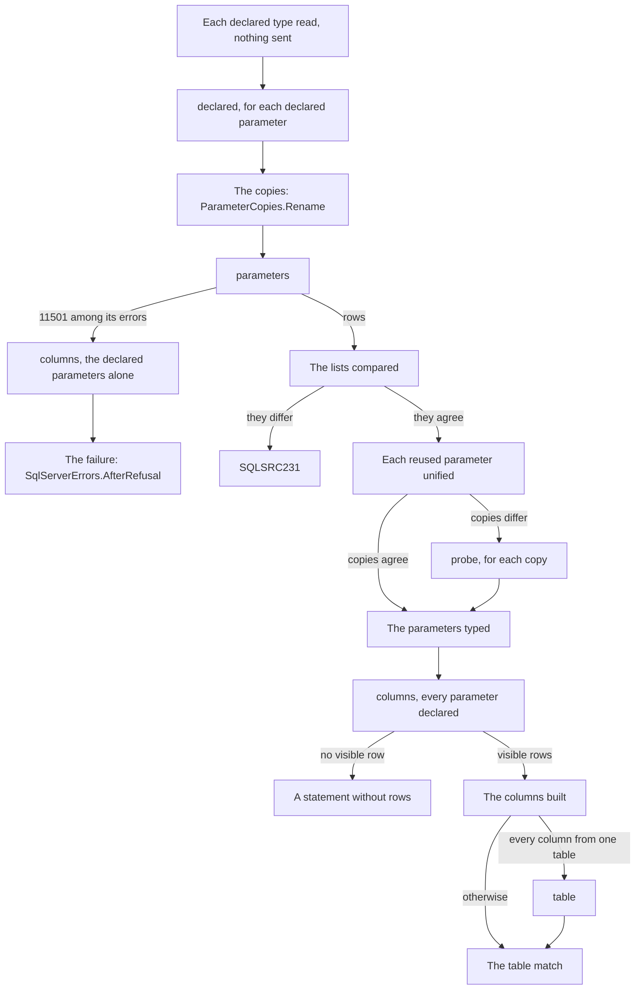

# The SQL Server describer

How `src/SqlSource.Tool/Describing/SqlServer` opens a session with SQL Server, types a query's parameters, from the declarations it reads to the copies of a reused parameter it probes, and describes the columns of the query's first result set and the table they match.  The contract every [describer](README.md#describer) implements, the exchange its calls go through and how a [capture](README.md#capture) is recorded and replayed are the [PostgreSQL describer's page](postgres-describer.md#the-describer-contract), and this page does not repeat them.  What a user sees of SQL Server is the manual's [SQL Server page](../manual/sqlserver.md), and each error is in [diagnostics](../manual/diagnostics.md).  The terms are the [glossary's](README.md#glossary).

The describer gives a query's parameters, the columns of its first result set with the nullability the server gives them, and the table or view whose column list they are.  It has no plan walk: SQL Server says a column's nullability through every join, and the describer records it as given.  `ToolHost.Create` does not register it, so the released tool reports `SQLSRC216` for a query of `mssql`, and only the tests run it ([the host](tool.md#the-host)).

## The files

| File | Holds |
|----|----|
| [`SqlServerDescriber.cs`](../../src/SqlSource.Tool/Describing/SqlServer/SqlServerDescriber.cs) | The `IQueryDescriber` of `SqlDialect.SqlServer`.  Its `SecretsOf` is `SqlServerConnection.SecretsOf`, and its `OpenAsync` is `SqlServerSession.OpenAsync` |
| [`SqlServerSession.cs`](../../src/SqlSource.Tool/Describing/SqlServer/SqlServerSession.cs) | The session: `open`, the floor of versions, and `DescribeAsync`, `ResultAsync` and `MatchAsync`, with what is asked in which order and what is made of each answer |
| [`SqlServerSession.Calls.cs`](../../src/SqlSource.Tool/Describing/SqlServer/SqlServerSession.Calls.cs) | Each call, asked through the exchange, timed by the run's clock and written to the log |
| [`SqlServerConnection.cs`](../../src/SqlSource.Tool/Describing/SqlServer/SqlServerConnection.cs) | The connection's value, the one `SqlConnection` of the session and every command made on it, and the listener on SqlClient's events, which it owns |
| [`SqlClientRunListener.cs`](../../src/SqlSource.Tool/Describing/SqlServer/SqlClientRunListener.cs) | The allowlist of SqlClient's events that a run with a log writes as `mssql.driver` |
| [`SqlServerColumns.cs`](../../src/SqlSource.Tool/Describing/SqlServer/SqlServerColumns.cs) | The sidecar's columns from the rows of `columns`, and each column's origin or why it has none |
| [`SqlServerTableMatcher.cs`](../../src/SqlSource.Tool/Describing/SqlServer/SqlServerTableMatcher.cs) | The table every column comes from, and the checks of the table match |
| [`SqlServerLive.cs`](../../src/SqlSource.Tool/Describing/SqlServer/SqlServerLive.cs) | The `live` function of each call and every text the describer sends |
| [`SqlServerCallNames.cs`](../../src/SqlSource.Tool/Describing/SqlServer/SqlServerCallNames.cs), [`SqlServerCalls.cs`](../../src/SqlSource.Tool/Describing/SqlServer/SqlServerCalls.cs) | The names of the calls, and their request and answer records |
| [`DeclaredTypeText.cs`](../../src/SqlSource.Tool/Describing/SqlServer/DeclaredTypeText.cs) | Reads the type of a `-- param:` marker against T-SQL's grammar of a type name |
| [`ParameterCopies.cs`](../../src/SqlSource.Tool/Describing/SqlServer/ParameterCopies.cs) | The rename of a reused parameter's uses to copies, the rule that unifies the copies' types, and the comparison of the server's parameters with the query's list |
| [`SqlServerSql.cs`](../../src/SqlSource.Tool/Describing/SqlServer/SqlServerSql.cs) | The generator's lexemes of a query's SQL, read by the rules of `mssql` |
| [`SqlServerTypes.cs`](../../src/SqlSource.Tool/Describing/SqlServer/SqlServerTypes.cs) | The sidecar's `SqlServerType` of a row of either describe procedure |
| [`SqlServerErrors.cs`](../../src/SqlSource.Tool/Describing/SqlServer/SqlServerErrors.cs), [`ConnectionErrors.cs`](../../src/SqlSource.Tool/Describing/SqlServer/ConnectionErrors.cs) | A failure of each cause, and what an answer keeps of an exception of SqlClient |
| [`SqlServerEvents.cs`](../../src/SqlSource.Tool/Describing/SqlServer/SqlServerEvents.cs) | The events of the describer's log |

## The connection

[`SqlServerConnection`](../../src/SqlSource.Tool/Describing/SqlServer/SqlServerConnection.cs) holds the connection's value, and is the one place that makes a `SqlConnection` and a `SqlCommand`.  It makes nothing until a `live` function asks for a command, but for the listener of [driver logging](#driver-logging), which only listens, so a replayed session, whose `live` functions never run, touches no driver, and what can go wrong while connecting is the answer of the call that needed the connection, which a capture holds and a replay gives again.  The session has one connection, opened by the first call.  A call that finds it no longer open, as SqlClient leaves it after an error that ends the connection, answers `ConnectionErrors.LostConnection`, and so does every later call: the connection is not opened again.  `ToString` leaves the value out, and `.editorconfig` turns `CA2100` off for this file, as it does for `PostgresConnection.cs`, since every command's text passes through it.

The value is read when the connection is first made, and what a user can write wrong becomes an `UnusableException` with a fixed text of [`ConnectionErrors`](../../src/SqlSource.Tool/Describing/SqlServer/ConnectionErrors.cs), since SqlClient's own text quotes a keyword and, for some keywords, the value: a string the builder cannot read, whatever it throws, `UnreadableConnectionString`; one that sets nothing, `EmptyConnectionString`; settings that `SqlConnection` refuses together, `ConflictingSettings`; an `Authentication` that signs in with a user and a password in a value that lacks either, `MissingCredentials`; a server that SqlClient does not support on this operating system, such as LocalDB off Windows, `UnsupportedOnThisPlatform`; and an `Authentication` of Microsoft Entra ID, for which the tool carries no provider, `NoAuthenticationProvider`.  The remarks of `SqlServerConnection.OpenAsync` list each with what SqlClient throws for it.  `SecretsOf` gives the `Password` that `SqlConnectionStringBuilder` reads from the value, and nothing for a value it cannot read; it never throws.

[`SqlServerLive`](../../src/SqlSource.Tool/Describing/SqlServer/SqlServerLive.cs) runs every call through `AnswerAsync`, which answers the call's error for a `SqlException`, through `ConnectionErrors.AtOpen` for `open` and `ConnectionErrors.Of` for every other call, and for an `UnusableException`, through `ConnectionErrors.Own`.  SqlClient reports a command that is cancelled while the server runs it as a `SqlException`, so one thrown once the token is cancelled leaves as an `OperationCanceledException`, and a cancelled run is never an answer.  Anything else is a bug and `SQLSRC200`.

An error keeps each of the exception's errors, in order, with its number, class and state.  What it keeps of the message depends on the call:

| Where | The text |
|----|----|
| `open`, `18456` | `LoginRefused` |
| `open`, `4060` or `4064` | `DatabaseRefused` |
| `open`, `-2`, or a `TimeoutException` in the chain | `ConnectTimedOut` |
| `open`, an `AuthenticationException` in the chain | `CertificateRefused` |
| `open`, a `SocketException` in the chain | `UnreachablePrefix`, then `: ` and the name of its `SocketError` unless that is `Success`, which SqlClient gives on Linux |
| `open`, anything else | `SessionRefused` |
| A later call, `-2` | `NoAnswerInTime` |
| A later call, an error of class 20 or above | `LostConnection` |
| A later call, any other error | The server's message |
| The describer's own refusal | Its text, with 0 for each number |

The server's and SqlClient's texts of a connection name the host, the port, the login or the database, and they would reach the output, the log and a capture.  A server's error of a later call speaks of the query and keeps its message, which can still name the login: [TD-0034](../tech-debt/TD-0034-redaction-of-a-describers-text-has-holes.md).  The texts a user sees are in the manual's [SQLSRC224](../manual/diagnostics.md#sqlsrc224).

## Opening a session

`SqlServerSession.OpenAsync` asks `open`, through the exchange of the `OpenRequest` and untimed: the server's `SERVERPROPERTY('ProductVersion')` and `SERVERPROPERTY('EngineEdition')`, the version of SqlClient, and four settings that change a description, the database's `compatibility_level` and collation and the session's `ANSI_NULLS` and `QUOTED_IDENTIFIER`, and the session's database, `DB_NAME()`.  The `ServerInfo` holds the product version as its `Version`, which the sidecar's `serverVersion` records, `Microsoft.Data.SqlClient` as its driver, SqlClient's informational version without the commit after `+`, and the settings, which the run's `database.open` event records.  The session keeps the database's name apart, for the rule of [origins](#origins).

A server whose major, the version's first part, is below `SqlServerSession.MinimumMajorVersion`, 14, answers `open` and is then refused as `SQLSRC235`, unless its edition is 5, Azure SQL Database, or 8, Azure SQL Managed Instance, which report a version of their own and have both describe procedures.  A version whose first part is no number is not refused, since the tool cannot tell what it is.  When `open` fails or the server is refused, the connection is disposed at once, and its listener with it.

## The calls and their records

The names of the calls are the constants of [`SqlServerCallNames`](../../src/SqlSource.Tool/Describing/SqlServer/SqlServerCallNames.cs), which every capture records, and their records are in [`SqlServerCalls.cs`](../../src/SqlSource.Tool/Describing/SqlServer/SqlServerCalls.cs), under the rules of [requests and answers](postgres-describer.md#requests-and-answers).

| Call | Request | Answer | Asked |
|----|----|----|----|
| `open` | Nothing | `productVersion`, `engineEdition`, `driverVersion`, `settings`, each a name and a value, and `database`; or `error` | Once, to open the session |
| `declared` | `sql`, `SELECT @p AS [1]`; `params`, the parameter's declaration, `@p dbo.Email` | `rows`, the one column of `sys.dm_exec_describe_first_result_set`, with its type, facets and user type; or `errors`, the describe's error rows, each a number, a type and a message; or `error` | Once for each declared parameter, in the list's order, before `parameters` |
| `parameters` | `sql`, the query's SQL with each reused parameter's uses renamed to copies; `params`, the declarations of the declared parameters, or null | `rows`, one for each parameter the server typed, named as `sp_describe_undeclared_parameters` names its columns; or `error` | Once for each describe that reaches it |
| `probe` | `sql`, as `parameters` was asked it; `params`, every copy and parameter declared | `binds`; or `error` | Only for a reused parameter whose copies' types differ, one or two for each copy |
| `columns` | `sql`, the query's SQL as written; `params`, the declaration of every parameter of the list, or null | `rows`, every row of `sys.dm_exec_describe_first_result_set` in browse mode 2, the hidden ones included, with its name, nullability, type, facets, user type, source and flags; or `errors`, as `declared`'s; or `error` | Once for each describe whose parameters are typed; or, with the declared parameters alone, once after a `parameters` that failed with `11501` |
| `table` | `schema` and `table` of the one table or view every column comes from | As `columns`, for `SELECT *` from it | Only when every column has an origin in one table |

`parameters` and `probe` call `sys.sp_describe_undeclared_parameters` as a `CommandType.StoredProcedure` with `@tsql` and `@params` as `nvarchar(max)` parameters, `DBNull` for a null.  `declared` runs the tool's own text over `sys.dm_exec_describe_first_result_set(@tsql, @params, 0)` with the same two parameters, and `columns` and `table` another over `sys.dm_exec_describe_first_result_set(@tsql, @params, 2)`; each answers `errors` when a row has an `error_number`.  `table`'s `@tsql` is `SqlServerLive.TableSelect` of its schema and table, and its `@params` null.  A reader is read to its end, so that an error the server raises after the rows is the call's.

A `probe` answers `binds` true when the procedure raises nothing, and false when it raises a `SqlException` whose every error is of a class below 20 and none is SqlClient's timeout, `-2`: the batch did not bind under the declarations.  Any other error says nothing of the batch, a connection lost or a command timed out, and is the answer's `error`.

An `error` is a `SqlServerServerError`, the list of the exception's errors, each a `SqlServerErrorRow` of number, class, state and message.  A small integer of a row is read as an `int`, whatever the column's own type.  `database` of `open` is the one member that came after a capture: an older capture's null gives no column an origin.

## One describe, step by step

`SqlServerSession.DescribeAsync` runs these steps in order, the columns through `ResultAsync` and the table match through `MatchAsync`, and the first failure ends the describe:

1. **The declarations read.**  A parameter is declared when its `-- param:` marker gives a type: one whose marker gives none is inferred.  `DeclaredTypeText.Read` reads each declared type against T-SQL's grammar of a type name, a name of one or two parts, each plain, bracketed or double-quoted, then an optional `(max)` or one or two numbers in parentheses, and nothing else.  The first type it refuses is `SQLSRC228`, through `SqlServerErrors.TypeRefused`, and nothing is sent.
2. **`declared`.**  For each declared parameter, in the list's order, the server describes `SELECT @p AS [1]` under the parameter's declaration alone, and the type of its one column, built by `SqlServerTypes.FromDeclared`, is the parameter's: the server reads the declaration as it will when the query runs, an alias type included.  Its error rows are `SQLSRC228`, but for a `103` of a parameter whose own name is longer than 127 characters, which is `SQLSRC225` as it is for the same name undeclared.  It comes first, and once for each parameter, so that an error of a type the database lacks, `2715` or `2724`, belongs to one declaration.  When `parameters` is asked every declaration has been read, so a `2715` or a `2724` there is a type that the query's own text names, and `SQLSRC225`.
3. **The copies.**  `ParameterCopies.Rename` renames each use of a reused parameter to a copy of its own, as [the copies and the probe](#the-copies-and-the-probe) says.
4. **`parameters`**, with the renamed SQL and the declarations of every declared parameter, or null when there is none.  Its `error` is the failure that `SqlServerErrors.Parameters` gives for it, unless `11501` is among its errors: that error says only that the batch did not compile, so `columns` is asked first, with the SQL as written and the same declarations, and `SqlServerErrors.AfterRefusal` makes the failure of the two answers, as [errors](#errors) says.  Nothing is asked after it.
5. **The lists compared**, as [the lists' check](#the-lists-check) says, before any probe, so that a text whose parameters the server and the lexer read differently is not probed.
6. **The reused parameters unified**, each by the types of its copies, and by probes when they differ.
7. **The parameters typed.**  Each parameter of the list gets its type: a declared one from `declared`, with the `typeSource` `declared`; a reused one from its copies, `inferred-from-copies`; any other from its row of `parameters`, `inferred`.
8. **`columns`**, with the SQL as written, since the procedure takes a declared parameter any number of times, and every parameter of the list declared, in the list's order: a declared one as `DeclaredTypeText` read its type, and any other at the type it was given, as `SqlServerTypes.Spelled` names it, `dbo.Email` for an alias type and the system type name otherwise.  Its `error` is `SQLSRC225`, and its error rows are classified by their type, as [errors](#errors) says.
9. **The columns built**, by `SqlServerColumns.Build`, as [columns](#columns) says.  A query whose answer has no visible row is a statement without rows: the description is `SidecarResultKind.None`, with the parameters and null for everything else, and nothing more is asked.
10. **The table match.**  `table` is asked only when every column has an origin in one table, and `SqlServerTableMatcher.Match` then decides, as [the table match](#the-table-match) says.  The description is `SidecarResultKind.Rows`, with the parameters, the columns, the table that matched or null, `plan` `skipped` and the `tableMatch`.

An answer of `parameters`, `declared`, `columns` or `table` that holds neither rows nor an error, a `declared` with no error and not one row, and a parameter of the list with no row once the lists agreed are each an `InvalidOperationException`, a bug of the describer.

## The copies and the probe

`sp_describe_undeclared_parameters` refuses a parameter used twice, with error `11508`.  So a parameter of the list that is not declared and that the lexer finds more than once, as a `Parameter` lexeme of `SqlServerSql.Lex`, is reused, and `ParameterCopies.Rename` renames each of its uses to a copy: its name, a separator of `_` and the use's number, counted from one, `@name_1` and `@name_2`.  The separator is lengthened, `__`, `___`, until no copy's name is, ignoring case, a name the text holds as a parameter or a variable, a name of the list, or another copy's.  A copy is at most `ParameterCopies.MaximumCopyLength`, 127 characters, since SQL Server's name of 128 counts the `@`: one that would be longer has its parameter's part cut to fit, and a number whose cut name meets a name already held is passed over.  A parameter whose own name is longer than 127 characters is not cut, so the server refuses its copies with the error `103` it gives the name used once, and the query gets the same `SQLSRC225`.  Only the `Parameter` lexemes are renamed, so a string, a comment and a quoted identifier are left as written.  A declared parameter is never copied, since the server takes a declared parameter any number of times, and a `DECLARE`d variable is in no list and is left as written.  `CopiedSql.ParameterOfCopy` takes each copy back to its parameter.

`ParameterCopies.Agreed` gives the copies' type when every copy has a row and every type is the same, compared whole, by name, facets and user type, so `dbo.Email` is not the `nvarchar(320)` it stands over.  Nothing is probed then.  `WHERE @p IS NULL OR @p IS NOT NULL` is such a parameter: each copy is `int`, and the parameter is `int`, `inferred-from-copies`.  A parameter used once is never probed either, and keeps the server's answer, `int` for `WHERE @p IS NULL`.

Otherwise the copies' types are not taken as they are.  The spike of phase 6 found that no copy comes back untyped, `@name_1 IS NULL` alone being `int`, so the two copies of the optional filter, `(@name IS NULL OR name = @name)`, disagree on the very pattern the copies exist for.  It also found that `xml` converts to almost nothing, so a copy that binds declared `xml` and declared `int`, as one in `@p IS NULL`, `@p IS NOT NULL` or `CASE WHEN @p IS NULL` does, constrains nothing, while a copy in a context of `xml` fails as `int` and one in any other typed context fails as `xml` ([the spike](../superpowers/specs/2026-10-20-query-generation-phase-6-sql-server-spike.md)).

So `SqlServerSession.UnifyAsync` asks, for each copy in order of use, a `probe` with that copy declared `xml`, and when it binds, a second with it declared `int`; a copy that binds both ways is ignored.  The other copies and undeclared parameters are declared at the system type that `parameters` gave them, and one it gave none is left out; a declared parameter is declared as it was.  The procedure does not look at the shape of a result, so a query whose two paths return two shapes is probed as any other.  `ParameterCopies.Unify` then takes the copies left: their one type; `SQLSRC226`, through `SqlServerErrors.NoType`, when none is left or one left has no type; and `SQLSRC262`, through `SqlServerErrors.CopiesDisagree`, naming the first two types in order of use, when two differ.

The fixture `update-optional-filter` asks, after `parameters` typed `@name_1` `int` and `@name_2` `nvarchar(100)`:

| `params` of the probe | `binds` |
|----|----|
| `@name_1 xml, @name_2 nvarchar(100)` | true |
| `@name_1 int, @name_2 nvarchar(100)` | true: `@name_1` is ignored |
| `@name_1 int, @name_2 xml` | false: `@name_2` constrains, and is not probed as `int` |

and the parameter is `nvarchar(100)`, `inferred-from-copies`.

## The lists' check

The lexer finds the parameters of the list, and the server finds its own, and the two can read a text differently.  `ParameterCopies.CompareLists` compares the list's undeclared parameters with the names of the rows of `parameters`, each copy taken back to its parameter, ignoring case.  Any difference is `SQLSRC231`, through `SqlServerErrors.ListsDiffer`, at the step `check parameters`, naming each parameter and which side lacks it: the list's first, in its order, then the server's.

A parameter that the server reports and the list lacks is one that the lexer took for a `DECLARE`d variable: after a `DECLARE` with no `;`, a list of declarations ends only at a word that starts a statement, and a label or `RECEIVE` is none, so the `@p` of `DECLARE @x int = @n next_message: RECEIVE TOP (1) message_body, @p + 1 AS q FROM ...` is a variable to the lexer and a parameter to the server.  The other direction is a parameter of the list that the server does not report.  A `CREATE PROCEDURE p @id int AS ...`, whose `@id` the lexer reads as a parameter, never reaches the check: the server will not describe a statement that creates a procedure, error `11527`, which `parameters` answers and which is `SQLSRC225`.  What the lexer misreads is [TD-0004](../tech-debt/TD-0004-lexer-misreads-dialect-specific-sql.md).

## Types

[`SqlServerTypes`](../../src/SqlSource.Tool/Describing/SqlServer/SqlServerTypes.cs) builds the sidecar's `SqlServerType` from a row of `parameters`, `FromParameter`, of `declared`, `FromDeclared`, or of `columns`, `FromColumn`.  Its `name` is the system type name of the row verbatim, its facets included, `nvarchar(100)` or `decimal(18,2)`, and `maxLength`, `precision` and `scale` are the row's.  A row that names a user type gives its `userType`: the schema, the name and, for a CLR type, the assembly-qualified name.  So `sysname` is a user type of `sys` over `nvarchar(128)`, `hierarchyid` a user type of `sys` with its assembly, and an alias type such as `dbo.Email` a user type over its base, while a `rowversion` is `timestamp`, as the server names it.  SQL Server 2025 names `json` and `vector(n)` so to SqlClient, whose TDS knows them, where an older client is told `varchar(max)`, and the describer records what SqlClient is told; `ColumnTests.ColumnsAsync_JsonAndVector_On2025` holds it.  A row with no type name or without a facet is an `InvalidOperationException`, since the server typed the parameter or the column, or raised an error.

`bindName` is never written for SQL Server; the [sidecar format](../superpowers/specs/2026-10-07-sidecar-format-design.md#23-sql-server-mssql) records why.

`SqlServerTypes.Spelled` names a type as a message does: `schema.name` of a user type that is not of `sys`, and the system type name otherwise.

## Columns and the table match

A query's columns are those of its first result set as `sys.dm_exec_describe_first_result_set` describes it, which is all the procedure describes: a batch of several statements is described by its first result set, and the others are [D-0006](../deferred/D-0006-multiple-result-sets-on-sql-server.md).  What is made of the rows is in [`SqlServerColumns`](../../src/SqlSource.Tool/Describing/SqlServer/SqlServerColumns.cs) and [`SqlServerTableMatcher`](../../src/SqlSource.Tool/Describing/SqlServer/SqlServerTableMatcher.cs), neither of which asks the server anything.

### Browse mode 2

`columns` and `table` read the procedure in browse mode 2.  Mode 2 names a view as the source of its columns, as PostgreSQL's origin does, and adds one hidden row, `ROWSTAT` followed by a NUL character.  Mode 1 names a view's base table as the source, and adds the hidden key and `rowversion` columns of every table the query reads, which differ between versions on a system view.  A column's nullability and its identity and computed flags are the same under both.  `declared` reads mode 0, since it wants the one column alone.

### Columns

`SqlServerColumns.Build` makes the sidecar's columns from the rows of `columns`, in the order of their ordinals:

1. A row with `is_hidden` is dropped before anything is built, so `ROWSTAT` is in no model.  `mssql.columns` and the capture keep every row.
2. No visible row is a statement without a result set: an `UPDATE` with no `OUTPUT`, a `SELECT ... INTO` or an `OUTPUT ... INTO`.
3. A visible row with no name, as `SELECT 1` has, is `SQLSRC266`, naming the column's place counted from one, through `SqlServerErrors.NoColumnName`.  Paths of an `IF` that differ only in a column's name are not refused as two shapes: the server gives that column no name, and it is `SQLSRC266`.  Two columns of one name are recorded, and the generator's `SQLSRC255` reports them, as for PostgreSQL.
4. Each other row is a column: `name` as the server returned it, a `!` or `?` suffix kept; `ordinal`, its place among the visible columns; `type` by `SqlServerTypes.FromColumn`; `nullable` the server's `is_nullable`, true where it gives none, with the `nullableSource` `server`; `origin`, as [origins](#origins) says; and `identity` and `computed`, the server's `is_identity_column` and `is_computed_column`, null where it gives none.

The server's nullability is recorded as it is given and never narrowed.  SQL Server says it through every join, and [the spike](../superpowers/specs/2026-10-20-query-generation-phase-6-sql-server-spike.md) found it right everywhere a `NULL` can come out, so there is no plan walk and every entry with rows records `plan` as `skipped`, as the [format](../superpowers/specs/2026-10-07-sidecar-format-design.md#12-a-query-entry) says of an engine with no walk.  The describer corrects the server nowhere a test has not proved it wrong.  The server calls some columns nullable that cannot be null, such as `COUNT(*)` and a computed column, which is safe.

### Origins

`SqlServerColumns.OriginOf` gives a column an origin when its row names a `source_schema`, a `source_table` and a `source_column`, no `source_server`, and a `source_database` that is, compared ordinally, the session's database, the `DB_NAME()` of `open`.  The sidecar's origin names no database, so a column of another database, `msdb.dbo.sysjobs`, of a linked server, or of the system resource, `master.sys.databases`, whose source database is `mssqlsystemresource`, has none: the table match must not find a table of that name in the session's database.  A column with no origin has a reason, `expression`, `another server` or `another database`, which its `mssql.column` event holds as `noOrigin`.

Under mode 2 a view's column has the view as its source.  An `OUTPUT` column has its table's column, and `$action` has none.  A query `FOR SYSTEM_TIME` gets no source for any column, so it is `no-origin`.  The names of a source are the catalog's, whatever the query wrote: `SELECT * FROM DBO.USERS`, in a database whose collation ignores case, has `dbo.users` as its origin and matches it.

### The table match

`SqlServerTableMatcher` says whether a result is exactly one table's or view's column list, so that the generator can name the model after it.  `SqlServerSession.MatchAsync` runs it once for a statement with rows, after the columns are built.  Before it does, it asks `table` for the table that `SqlServerTableMatcher.TableOf` finds, and only when it finds one, which every column has as its origin.  The first two checks need no table, and a call that failed for a table the match never reads would fail the query.  `table`'s text is the tool's own, `SqlServerLive.TableSelect`: `SELECT * FROM [schema].[table]`, each name a catalog name the server gave as the origin, in brackets with a `]` written twice, and never the user's text.

The checks are the values of the format's `tableMatch`, in the format's order, and the first that fails is the answer, as PostgreSQL's are:

| Check | Fails when |
|----|----|
| `no-origin` | A column has no origin |
| `several-tables` | The origins are not one table or view, the schema and the table compared ordinally |
| `names-differ` | A column's name is not its origin column's, compared ordinally as the server returned it, so an alias or an override suffix, `AS [note!]`, differs |
| `columns-differ` | The origin columns, as a list and not a set, are not the table's, so a column left out or there twice differs |
| `order-differs` | The origin columns are not in the table's order |
| `nullability-differs` | A column's `nullable` is not what the server says of the table's column, true where it says nothing |

The table's column list and the nullability of each of its columns are the visible rows of `table`, the server's description of `SELECT *` from it, and not the catalog's.  So a period column declared `HIDDEN` is out of the list, as `SELECT *` leaves it out; a computed column is in it; and a column is the table's in nullability when it has what the server says of the column read whole.  The server judges a computed column by its expression, so a `PERSISTED NOT NULL` one may be nullable in every query, and against the catalog's `is_nullable` no table with one would ever match.  A view may match, as a table may, and an `INSERT ... OUTPUT inserted.*` matches its table.  `matchesTable` is the origin's schema and table.  The match writes `mssql.table-match`; a statement without rows has no match and no event.

## Errors

[`SqlServerErrors`](../../src/SqlSource.Tool/Describing/SqlServer/SqlServerErrors.cs) makes each `DescribeFailure` of the describer, with one id for each cause a user mends differently.  What each id means to a user, with its help, is in [diagnostics](../manual/diagnostics.md); this section is how the code chooses it.  A `server:` line is `Msg <number>, Level <class>, State <state>: <message>` for each error of the server in its order, or the text alone of an error of the describer's own, whose number is 0, and an error row of `declared`, `columns` or `table` is `Msg <number>: <message>`, since a row has no level or state.

| Where | Id | Step |
|----|----|----|
| An error of `open` | `SQLSRC224`, whatever its numbers | None |
| A server below the floor | `SQLSRC235`, with no server line | None |
| A declared type that `DeclaredTypeText` refuses | `SQLSRC228`, `it is not written as a type name` and what was found, with no server line | `resolve type` |
| The error rows of `declared`, `103` among them, for a parameter whose name is longer than 127 characters | `SQLSRC225` | `resolve type` |
| The error rows of `declared`, `2715` or `2724` among them | `SQLSRC228`, `the database has no such type` | `resolve type` |
| Any other error rows of `declared`, such as `102` | `SQLSRC228`, `it is not a type` | `resolve type` |
| The `error` of `declared` | `SQLSRC225` | `resolve type` |
| The `error` of `parameters`, whose first error is `11502`, `11503`, `11506` or `11507` | `SQLSRC226` | `describe parameters` |
| Any other `error` of `parameters`: `11508`, `11527`, a type the query's text names that the database lacks, and the query rejected, the cause first and `11501` last, when the `columns` asked after the `11501` gives no cause, below | `SQLSRC225` | `describe parameters` |
| The `error` of `parameters` with `11501` among its errors, when the `columns` asked after it has an error row of type 3, 4 or 10 | That row's id, as for `columns` below | `describe columns` |
| The `error` of `parameters` with `11501` among its errors, for any other answer of that `columns` | What the rows above give for `parameters`, with its lines | `describe parameters` |
| The lists differ | `SQLSRC231`, with no server line | `check parameters` |
| The `error` of a `probe` | `SQLSRC225` | `describe parameters` |
| No copy of a reused parameter left, or one left with no type | `SQLSRC226`, with no server line | `describe parameters` |
| Two types among the copies left | `SQLSRC262`, with no server line | `describe parameters` |
| The `error` of `columns` | `SQLSRC225` | `describe columns` |
| An error row of `columns` of type 3, `CONFLICTING_RESULTS`: two paths return different shapes | `SQLSRC263` | `describe columns` |
| An error row of `columns` of type 4, `DYNAMIC_SQL`: an `EXEC` of a string the server cannot read | `SQLSRC264` | `describe columns` |
| An error row of `columns` of type 10, `TEMPORARY_TABLE`: a temporary table in a batch of several statements | `SQLSRC265`, with the help to make the query one statement or use a table variable | `describe columns` |
| Error rows of `columns` of no such type: `207`, an unknown column; `102`, a `GO` inside the query; `2812`, a word read as a procedure | `SQLSRC225`, each row a server line in the server's order | `describe columns` |
| A visible column with no name | `SQLSRC266`, with no server line | `describe columns` |
| The `error` of `table`, or its error rows | As for `columns` | `table match` |

An id is chosen by the error's number, the first error's for `parameters`, or by the `error_type` of a row of `columns` or `table`, and never by its message, which may be translated.  Of the rows of type 3, 4 and 10, the first decides, and every row is a server line.  `SQLSRC225`'s message ends with the first error's message, the cause.  For the rows of `columns` or `table` it ends with the message of the first row of type 8, `UNDECLARED_PARAMETER`, when there is one, and else with the first row's: every parameter is declared, so a row of type 8 is a bug of the describer, and its message says so.  `SQLSRC226` of `parameters` reads the messages only to choose the parameter it names: the first undeclared parameter of the list whose `@name` stands in an error's message as a whole token, a copy taken back to its parameter, and else the first undeclared parameter.  `11508` is a parameter used twice, which the copies prevent, so it is a bug of the describer that a user sees as `SQLSRC225` with the server's line.

`11501` says only that the batch did not compile, and comes last, after its cause.  For a temporary table of a batch of several statements the cause that `parameters` gives is `208`, a missing table, where `columns` gives a row of type 10: so `columns` is asked after it, and `SqlServerErrors.AfterRefusal` reports `SQLSRC265`.  An `OUTPUT` with no `INTO` on a table with a trigger, `334`, takes the other path: `parameters` raises `334` and then `11501`, and the `columns` asked after it answers `334` and `11501` as rows, neither of a type that gives a cause, so the query is `SQLSRC225` with the lines of `parameters`, at `describe parameters`.

## Why a query cannot run a statement

Nothing a `.sql` file holds can make the describer run a statement.  That is a security invariant, and the tool's [`AGENTS.md`](../../src/SqlSource.Tool/AGENTS.md) holds it.  This section is the map of what the describer sends.

The user's SQL and the declarations reach the server only as the values of `@tsql` and `@params`, `nvarchar(max)` parameters of two things that analyse a text and run nothing:

| Text | Sent by | As |
|----|----|----|
| The query's SQL, its reused parameters renamed, and the declarations | `SqlServerLive.ParametersAsync` and `SqlServerLive.ProbeAsync` | `@tsql` and `@params` of `sys.sp_describe_undeclared_parameters`, called as a `CommandType.StoredProcedure` |
| `SELECT @p AS [1]` and one declaration | `SqlServerLive.DeclaredAsync` | `@tsql` and `@params` of `sys.dm_exec_describe_first_result_set`, in the tool's own text |
| The query's SQL as written, and the declarations | `SqlServerLive.ColumnsAsync` | `@tsql` and `@params` of `sys.dm_exec_describe_first_result_set`, in the tool's own text |

Every other text is the tool's own: the read of `open`, the texts of `declared` and of `columns` and `table`, and the `@tsql` of `table`, `SELECT * FROM [schema].[table]` of `SqlServerLive.TableAsync`, whose two names are catalog names that the server gave as an origin, each in brackets with a `]` written twice, and never the user's text.  The server parses `@params` as a list of declarations and refuses one that is not, so a declaration such as `int; DROP TABLE x` is an error and runs nothing.  `DeclaredTypeText` is the first refusal, with an error that says what is wrong, and the guarantee does not rest on it.  The canary tests of `tests/SqlSource.Tests.SqlServer/Describer/ParameterTests.cs` send a text of two statements whose second drops a table, through `parameters` and `probe`, and a declaration that drops it, through `declared`, `parameters` and a describe, and find the table there after each.  Those of `SafetyTests.cs` send `columns` a text that drops it, one that waits and one that shuts the server down: the table is there, the call answers at once and the server still answers.

## Events

[`SqlServerEvents`](../../src/SqlSource.Tool/Describing/SqlServer/SqlServerEvents.cs) builds the events of the describer's calls and steps, which the session's log names `mssql.` and the event's name.  A describe writes them in this order, each where its call is made or its step reached, under a replay too, so a describe that fails writes nothing after the step that failed.  `mssql.driver`, SqlClient's own, is written around each command that a live call runs, as [driver logging](#driver-logging) says.

| Event | Written | Holds |
|----|----|----|
| `mssql.declared` | For each declared parameter, in the list's order | `query`, the `sql` and the `params` the call sent, the answer, `rows`, `errors` or `error`, and `durationMs` |
| `mssql.parameters` | Once | The same, with `rows` or `error` |
| `mssql.probe` | For each probe, one or two for each copy of a reused parameter whose copies' types differ | The same, with `binds` or `error` |
| `mssql.columns` | Once; after a `parameters` that failed with `11501`, as the last event | The same, with every row, the hidden ones included, `errors` or `error` |
| `mssql.column` | For each column of a statement with rows, in order | `query`, `ordinal`, `name`, the type's `name` as `type`, `origin`, a map of `schema`, `table` and `column`, or null, `noOrigin`, why it has none, `nullable`, `nullableSource`, `identity` and `computed` |
| `mssql.table` | When `table` is asked | `query`, the `schema` and the `table` it describes, the answer as `columns`', and `durationMs` |
| `mssql.table-match` | For each statement with rows | `query`, `tableMatch`, and `table`, a map of `schema` and `table`, or null |

`durationMs` is measured by the run's clock in `SqlServerSession.AskAsync`.  A row is a map of every member of its record, an error row a map of `number`, `type` and `message`, and an `error` the list of every error, each a map of `number`, `class`, `state` and `message`.  `open` has no event of its own: the run's `database.open` records the server, the four settings included.  Every string goes through the session's redaction, as `RedactionTests` holds.  The remarks of `SqlServerEvents` give the same order.

### Driver logging

When the run's log writes (`IRunLog.Writes`), SqlClient's own events reach it through [`SqlClientRunListener`](../../src/SqlSource.Tool/Describing/SqlServer/SqlClientRunListener.cs), an `EventListener` on `Microsoft.Data.SqlClient.EventSource` that enables the keyword `ExecutionTrace` at `Informational`.  What it writes is an allowlist, not a filter: an event whose name is listed is written as `mssql.driver`, with `category`, the event's name, `level`, `eventId`, the payload members the list names for it, in its order, and `exception`, null; every other event, and every other member, is dropped.

| Event | Members written |
|----|----|
| `BeginExecute` | `objectId`, `commandText` |
| `EndExecute` | `objectId`, `compositestate`, in lower case as SqlClient 7.1.1 writes it, and `sqlExceptionNumber`, 0 on success |

SqlClient 7.1.1 writes these two events alone under `ExecutionTrace`.  Their `dataSource` is the host and the port, their `database` the database's name, and their `message` repeats the rest with the connection's id, so none of the three is written.  `commandText` is always one of the tool's own constant texts or `sys.sp_describe_undeclared_parameters`, since the user's SQL reaches the server only as the value of a parameter.  The other keywords write a free-form `message` alone and are not enabled, so a message that a later SqlClient adds is dropped until someone lists it.  A connection that is refused, or a login that is rejected, runs no command and writes no event.  Every string still passes the session's redaction.

An `EventListener` is the process's: it sees SqlClient's commands on every connection while it lives, which in the tool are the session's alone, since the run describes one database at a time.  So it lives as long as the session's connection.  `SqlServerConnection` makes it, through `SqlClientRunListener.For`, when `SqlServerSession.OpenAsync` makes the `SqlServerConnection`, before `open` is asked, and disposes it in `DisposeAsync`, which runs when `open` fails, when the server is refused and when the session is disposed.  The connection owns it, and not the session, because `CA2000` cannot follow a disposable through the session's `OpenAsync`, which keeps the connection only on success.  A run without a log makes none.  SqlClient writes from the thread that runs a command, and the run's log writes each event under a lock.  `DriverLogTests` holds what is written, that a refused connection and a rejected login write no secret, and that a run without a log enables no listener.

## Fixtures

The describer's fixtures are in `tests/SqlSource.Tool.Tests/Fixtures/Describers/mssql/`, beside the schema that `tests/SqlSource.Tests.SqlServer` applies to its container, and are recorded on the default image by `tools/record-fixtures.sh mssql`.  Six cases are statements without rows, which prove the parameters: `update-inferred`, `insert-declared`, `delete-declared-only`, `update-optional-filter`, `update-copies-agree` and `update-wide-types`.  Seventeen are statements with rows, which prove the columns and the table match: a table, a view, a table with a computed column that the server calls nullable and one with hidden period columns, each `matched` (`select-table-star`, `select-view-star`, `select-computed-not-null`, `select-hidden-period`), and `insert-output`, matched to its table; the nullability of an outer join, aggregates, an alias type and a CLR type, the first result set of two, `FOR SYSTEM_TIME ALL`, columns of another database and a `MERGE` with `OUTPUT` (`select-left-join`, `select-aggregates`, `select-alias-and-clr`, `select-first-result-set`, `select-temporal-all`, `select-other-database`, `merge-output`); and one case for each check of the match that fails (`select-several-tables`, `select-names-differ`, `select-columns-differ`, `select-order-differs`, `select-nullability-differs`).  `json` and `vector` need SQL Server 2025, so their case is `ColumnTests.ColumnsAsync_JsonAndVector_On2025`, which skips below it, and not a fixture, since every fixture is described on both images.  `DescriberFixtureTests` replays each with no server, and `FixtureCasesTests` of `tests/SqlSource.Tests.SqlServer` describes each against the container, as [fixtures and test describers](postgres-describer.md#fixtures-and-test-describers) says of PostgreSQL's.  A capture's `open` holds the version of SqlClient that recorded it.  How a case is added and recorded is the SQL Server tests' readme, [the describer's fixtures](../../tests/SqlSource.Tests.SqlServer/README.md#the-describers-fixtures).

[`SqlServerScript`](../../tests/SqlSource.Tool.Tests/SqlServerScript.cs) answers a `SqlServerSession` with no server, from a capture that a test writes, so a test holds what is asked as well as what is made of the answers.  What only a server can show, the types it infers, its columns and their origins, the tables it matches, its errors, what it runs and what SqlClient logs, is tested in `tests/SqlSource.Tests.SqlServer/Describer/`, on 2025 and on 2017.
