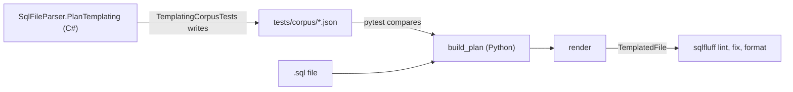

# The sqlfluff templater

`src/sqlfluff-templater-sqlsource` is a Python package, `sqlfluff-templater-sqlsource`, that registers the `sqlsource` templater with sqlfluff.  It reads a `.sql` file exactly as SqlSource's parser does, and shows sqlfluff a text it can parse: each token's default in place of the token, a value in place of each query parameter, and a `;` after a query that has none.  sqlfluff then lints, fixes and formats the SQL around them, and never writes into what SqlSource reads.  What a user sets up and sees is in [the guide](../../site/guides/sqlfluff.md).

The parser is C# and sqlfluff is Python, so the templater holds a port of the part of the parser it needs.  The two are kept equal by a corpus: the C# side writes what its parser gives for each case, and the Python side is tested against it.

## The plan

A templating plan is what the templater must not show sqlfluff as written: the spans of a file, each with its kind, or the error that stops SqlSource reading it.  The kinds are those of [`SqlTemplatingSpanKind`](../../src/SqlSource/Parsing/Templating/SqlTemplatingSpanKind.cs):

- a **token**, the whole `{{...}}` outside comments, with its name and the default its query resolves for it, or none;
- a **parameter**, a `@name` the parser reads as one, inside a token's default too;
- a **list**, a parameter that `SqlListUses.Find` gives as a list, as in `id IN @ids`;
- a **marker comment**, every line comment in a marker's form, wherever it stands, but one inside a token, whose span covers it;
- a **query end**, an empty span right after the last SQL of each query but the file's last whose SQL does not end in `;`.

### The C# side

[`SqlFileParser.PlanTemplating`](../../src/SqlSource/Parsing/SqlFileParser.cs) gives the plan from the parser itself, with the classes of [`Parsing/Templating/`](../../src/SqlSource/Parsing/Templating/).  The generator never calls it.  How it runs the parser, and which error stops a plan, is in [the templating plan](generator.md#the-templating-plan).

The plan is exact for a file that SqlSource accepts.  A file with another error, such as a duplicated name, gets the parser's best-effort spans and `HasOtherErrors`.

### The Python side

`build_plan` of `plan.py` gives the same plan, with the same fields, from a port of the parser.  Each module mirrors the C# files its docstring names; the table gives the files under `src/SqlSource/` unless it says otherwise.

| Module | Mirrors |
|----|----|
| `dialects` | `Parsing/SqlDialect.cs`, `SqlDialectOptions.cs`, `SqlDialectChoice.cs` and `SqlDialectName.cs` |
| `rules` | `Parsing/SqlDialectRules.cs` and `SqlStringContinuation.cs` |
| `text` | `Parsing/SqlText.cs`, and the methods of .NET's `System.Char` that the parser calls |
| `quoting` | The readers of `Parsing/Quoting/` |
| `lexer` | `Parsing/SqlLexer.cs`, `SqlLexeme.cs` and `SqlLexemeKind.cs`, with `SqlParameterName.Of` |
| `errors` | `Parsing/SqlParseError.cs`, with each kind as the code of its diagnostic |
| `markers` | `Parsing/Markers/SqlMarker.cs`, `SqlMarkerKind.cs` and `SqlMarkerReader.cs`, and the `PlaceOf` of `SqlFileParser` |
| `dialect_marker` | `Parsing/SqlDialectMarker.cs`, and where `SqlFileParser.InvalidDialect` places its error |
| `identifiers` | `SqlIdentifier.cs`, and the methods of Roslyn's `SyntaxFacts` that it and the token scanner call |
| `marker_scope` | The `-- token:` and `-- token-ignore:` parts of `Parsing/Markers/SqlMarkerScope.cs`, and which markers each scope allows |
| `text_builder` | `Parsing/SqlTextBuilder.cs` and `SqlBlockText.cs`, without the kept form |
| `tokens` | The files of `Parsing/Tokens/` that find tokens and resolve defaults, without the segments |
| `list_uses` | Whether `Parsing/SqlListUses.cs` gives a use as a list |
| `plan` | `SqlFileParser.PlanTemplating` and the parts of its `Parser` a plan rests on, with `Parsing/Templating/` |
| `settings` | The reading of `root` and `dialect` in `SettingsFiles/`, and the chain of `Generation/Chains/` |
| `render` | No C# file: it turns a plan into sqlfluff's `TemplatedFile` |
| `stand_ins` | No C# file: what sqlfluff sees for a parameter, and which dialects pair |
| `templater` | No C# file: the `sqlsource` templater that sqlfluff calls |

`text` is a module of its own so that `quoting` and `rules` share it without a cycle, and `marker_scope` is apart from `markers` because it builds a default's SQL with `text_builder`, which reads markers.  The port leaves out everything a plan does not need: the parser's other checks, the hash, the kept form and the segments.

The C# parser tests UTF-16 units, and a Python `str` holds code points.  `text` answers for a code point outside the Basic Multilingual Plane as C# answers for a surrogate, so the two read such a character alike, and the corpus counts every offset in code points.

### The file's dialect

`settings.py` finds the dialect a file starts with as the generator does: the nearest `sqlsource.json` above the file that sets a valid one, up to the first that says `"root": true`, else `ansi`.  It reads no settings file above the one that decides the dialect, since `dialect_of_chain` takes each text from a generator as the walk up the folders reads it.  It reads the JSON with comments and a trailing comma that SqlSource's reader takes, decodes a file by its byte order mark, and passes over a file whose text is not JSON, as the generator does with `SQLSRC015`, and one it cannot read.  The file's `-- dialect:` marker then wins, through `dialect_marker`.

## The corpus

The corpus is in `src/sqlfluff-templater-sqlsource/tests/corpus/`, in the Python project, so that a change to it runs the project's checks.  It is written by [`TemplatingCorpusTests`](../../tests/SqlSource.Tests/Parsing/Templating/TemplatingCorpusTests.cs), with the cases and the writer in `TemplatingCorpus.cs` beside it, and is never edited by hand.  A case's file holds its input, the texts of the settings files above it, and the plan the parser gives, with every offset in code points.

- **`repo/`** holds a case for every `.sql` file of the repository that SqlSource accepts or that an error stops.
- **`lexer/`** holds a case for each row of `SqlLexerTests.Lex_Construct_IsReadByTheRulesOfTheDialect`, once for each dialect it names.
- **`cases/`** holds the fidelity cases, the `.sql` files of `tests/SqlSource.Tests/Parsing/Templating/Cases/`: each rule the templater must follow that the other two sources do not reach.
- **`dialect-names.json`** holds the names of the dialects and their options, as `SqlDialectName` reads them, so that a new alias fails the Python tests.
- **`diagnostic-titles.json`** holds the code and title of each error that stops a plan, as `SqlDiagnostics.ForParseError` gives them, so that the templater names an error as the build does.

A run of `tests/SqlSource.Tests` fails when a file is missing, out of date or has no case.  `SQLSOURCE_UPDATE_TEMPLATER_CORPUS=1` writes the files instead and deletes the orphans.  [The templater's corpus](../../tests/README.md#the-templaters-corpus) in `tests/README.md` has the commands and what to read in the diff.

## Rendering

`render.py` turns a plan into a `TemplatedFile` as sqlfluff's own `PlaceholderTemplater` does.  Each span is one `templated` slice, and the text between two spans is a `literal` slice.  sqlfluff writes no fix into a templated slice, so nothing a span covers can change.

| Span | sqlfluff sees | Tag |
|----|----|----|
| Token | Its default, with each parameter in the default replaced as below; its name when it has no default | `literal` |
| Parameter | The parameter's stand-in | `literal` |
| List | The stand-in in parentheses | `literal` |
| Marker comment | The comment as written | `literal` |
| Query end | `;`, then the white space and comments up to the next span | None |

The tag `literal` is the one `PlaceholderTemplater` gives: sqlfluff keeps a violation that touches only such slices, as it keeps one in literal SQL, since the slice holds what the user wrote.  A query end holds no SQL of the user's, so its slice has no tag, and sqlfluff drops a violation there, such as `CV06` at the `;`.  The query end's slice covers the white space and comments up to the next span, which is the next `-- name:` line or another marker comment, so that no fix can write the `;` into the file or move it past a comment.  When a marker comment follows the SQL at once, the slice covers nothing.

### Stand-ins

A parameter's stand-in must parse wherever SqlSource lets a parameter stand, and must set off no rule that a value would not.  `stand_ins.py` holds the table, which `tests/test_sqlfluff_end_to_end.py` settled against sqlfluff.  In `tsql`, `mysql`, `mariadb` and `sqlite`, a parameter is shown as written, `@name`.  In `postgres`, `oracle`, `duckdb`, `greenplum` and `materialize`, it is shown as `:name`, since `@name` does not parse there everywhere.  In every other sqlfluff dialect, `ansi`, `db2`, `redshift` and `snowflake` among them, it is the literal `0`, which parses wherever a value stands.  A prefixed dialect keeps a name only when it lexes the name after its prefix, and gives any other name `0`, by the rule `_PREFIXES` holds for it, which a probe of each name SqlSource reads set on sqlfluff 4.5.0.  `tsql` takes ASCII digits, `_`, `@`, `#`, `$` and letters of any script, so a T-SQL variable such as `@_total` keeps its name where `0` could not stand, in `DECLARE`, `SET` or `FROM`.  `mysql` and `mariadb` take ASCII letters, digits, `_` and `$`, and `sqlite` the same but `$`.  `postgres`, `duckdb`, `greenplum` and `materialize` take ASCII letters, digits, `_` and `$`, but no leading digit or `$`, and `oracle` no leading `_` either.  `test_stand_ins.py` holds the names at each edge, and `test_sqlfluff_end_to_end.py` lints each name kept.  `NULL` is never a stand-in, as `= NULL` sets off `CV05`.

### Dialect pairs

The plan is read by the SqlSource dialect, and the stand-ins are chosen by the sqlfluff dialect.  `compatible` of `stand_ins.py` allows a pair only when both can be right about one file: `ansi` with any sqlfluff dialect, and each other SqlSource dialect with the sqlfluff dialects that `_COMPATIBLE` names for it.  A MySQL or MariaDB choice with an option of `UNLINTABLE_OPTIONS`, `ANSI_QUOTES` or `NO_BACKSLASH_ESCAPES`, pairs with no sqlfluff dialect: sqlfluff's `mysql` and `mariadb` read `"..."` as a string and a backslash in a string as an escape, as the server does without the option, so CV10 could rewrite a string as an identifier.  [The guide's table](../../site/guides/sqlfluff.md#sqlfluff-dialects) lists the pairs for users.  Any other pair is a templating error that names both dialects, and for an option, the option and why, from `_mismatch` of `templater.py`.

### The templater

`SqlSourceTemplater.process` of `templater.py` resolves the file's dialect, builds the plan, and checks the pair.  An error that stops the plan, or a pair that is not allowed, is a `SQLTemplaterError`, which sqlfluff reports as `TMP`: the error of a plan carries its code, its title from `_TITLES` of `templater.py`, which a test keeps equal to `diagnostic-titles.json`, and its line and position.  Any other exception is caught and reported the same way, so that one file cannot stop sqlfluff's whole run.  The templater has no configuration of its own; it reads only sqlfluff's `dialect`.

### Byte order marks and line endings

SqlSource reads a file without its byte order mark.  sqlfluff drops the mark when it detects the encoding, and keeps it in the text when the encoding is configured; then `process` plans the text after the mark and shifts every span by its length.  sqlfluff reads a file with universal newlines, so the text the templater gets has `\n` alone, as the corpus's `repo/` cases have.  The port still reads `\r` and `\r\n` as the parser does, for the fidelity cases that keep their own line endings.

## How the two sides keep each other honest

- **The C# side** fails when a plan changes and the corpus does not.  [`src/SqlSource/Parsing/AGENTS.md`](../../src/SqlSource/Parsing/AGENTS.md) lists what a plan changes with.
- **The Python side** fails when the corpus changes and the port does not.  `test_lexer_corpus.py` compares the lexemes, the dialect and the lexer's error of every case.  `test_plan_corpus.py` compares the spans, the dialect and its options, and the error of every case without other errors, those whose plan an error stops included, and builds a plan without failing for the rest.  `test_settings.py` resolves each case's chain of settings files, and `test_dialect_names.py` and a test of `test_sqlfluff_end_to_end.py` read the two files of names.
- **sqlfluff itself** is run by `test_sqlfluff_end_to_end.py`, which shows that `lint`, `fix` and `format` change no token, default, parameter, list or marker comment, and never write a `;`, and by `test_examples_parse.py`, which lints every example of the repository and fails on a parse error, but for those that `tests/examples_unparsable.txt` lists.  CI runs the tests on the lowest sqlfluff the project allows, and the nightly run on the newest.
- **The corpus covers what its cases reach.**  A rule that no case reaches is a fidelity case of its own.

A change that rewrites much of the port can also be checked against the built parser directly, beyond what the corpus reaches.  A scratch console app loads the built `SqlSource.dll` by reflection, compares each character test of `text.py` with .NET's over all 65,536 UTF-16 units, and compares `build_plan` with `PlanTemplating`, offsets in code points, on many generated inputs of every dialect.

## Known limitations

- **Unicode categories come from the running Python's `unicodedata`.**  Python 3.14 and .NET 10 both have the tables of Unicode 16.0, but the package allows Python 3.10.  An older Python can classify a character newer than its Unicode version differently, just as SqlSource classifies a character by the .NET runtime it builds on.
- **The safety of a query end's `;` is empirical.**  No rule of sqlfluff's edits the slice, and the tests show it; nothing in sqlfluff guarantees it for a slice that covers nothing.
- **`CV06` with `multiline_newline = True` reports, without a fix, a multi-line query that has no `;`.**  sqlfluff anchors that report on a zero-length marker of its own, which it treats as literal, so dropping violations at the query end does not reach it.  [The guide's limit](../../site/guides/sqlfluff.md#limit-cv06-without-semicolon) tells users to end such queries with `;`.
- **A violation on the white space or comments between a query without `;` and the next query is dropped, and no fix is written there**, such as `LT01` on trailing white space or `LT05` on a long comment line, since that text is part of the query end's slice.  [The guide's limit](../../site/guides/sqlfluff.md#limit-text-after-query) says so.
