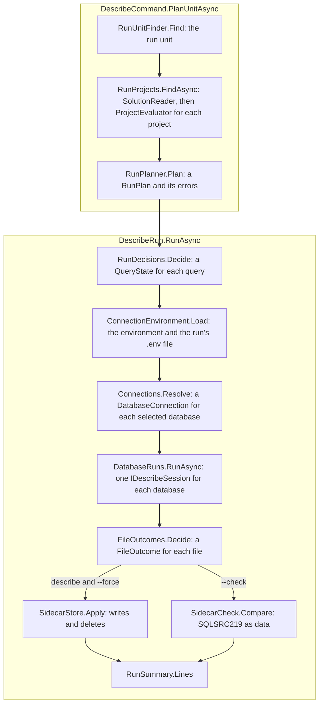
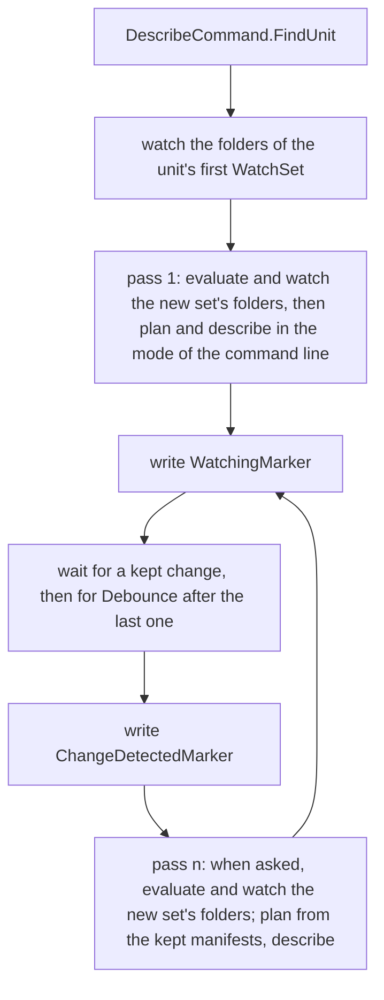

# The tool

How `src/SqlSource.Tool` runs `sqlsource describe`: how a command line is read and a run ends, the steps from a [run unit](README.md#run-unit) to the [sidecars](README.md#sidecar), how `describe --watch` runs them again after each change, what each folder does and needs, and how a run reports and logs.  How `sqlsource replay` runs the pipeline from a bug-report bundle, how `sqlsource diagnose` makes one, and how a bundle is renamed, is [bundles and replay](bundles.md).  What a user types and sees is in the manual's [tool page](../manual/tool.md).  The terms are the [glossary's](README.md#glossary).

## The command line

[`Program.cs`](../../src/SqlSource.Tool/Program.cs) calls [`Cli.Run`](../../src/SqlSource.Tool/Cli.cs), which makes the host, listens for the signals that end a run, and hands the rest to `Cli.RunAsync`.  The tests call `Cli.RunAsync` with a host of their own.

### The host

[`ToolHost`](../../src/SqlSource.Tool/ToolHost.cs) is a record of everything the tool takes from outside itself: standard output and standard error, the working directory, the environment, the runner of processes, the temporary directory, the number of processors, the describers by [dialect](README.md#dialect), the exchange of each database, the clock, a `TimeProvider`, `CreateFile`, which makes a file for writing, or empties the one that is there, and gives its stream, `ReadTextFile`, which gives the text of the file at a full path, null when there is no file there (none, or a folder), and throws when the file cannot be read, `OpenReadFile`, which gives the file at a full path opened for reading, null when there is no file there (none, or a folder), and throws when the file cannot be opened, `Runtime` and `OperatingSystem`, the descriptions of .NET and of the system that the log's `run.start` holds, and `Watch`, which starts watching a folder for a `describe --watch` ([the watches](#the-watches)).  `ToolHost.Create` makes the host of a real run from the console, the current directory and the machine, with a `DescriberRegistry` that holds `PostgresDescriber` and `SqlServerDescriber`, the describers of `postgres` and `mssql` that the released tool registers, an exchange that is `LiveExchange` for every database, the two descriptions from `RuntimeInformation`, `ToolHost.WatchFolder` for `Watch`, and, for `CreateFile`, `ToolHost.NewFile`, a `FileStream` made with `FileMode.Create`, opened for writing and shared for reading, which the hosts of the tests give too.  `Cli.OpenLog` gives `CreateFile` to `RunLogFile.Open`, so a test gives a log a stream of its own, one that fails included.  `ToolHost.Create` gives `ReadTextFile` the real `ToolHost.ReadText`; the tests' hosts read only under the system's temporary folder, where a test makes its files, and find no file elsewhere, so no test reads a developer's `.env`.  `ToolHost.Create` gives `OpenReadFile` the real `ToolHost.OpenRead`, a `FileStream` opened for reading and shared for reading, which the hosts of the tests give too.  `replay` reads a bundle through the two: a zip through `OpenReadFile`, and a folder's files through `ReadTextFile` ([reading and writing](bundles.md#reading-and-writing)).  How a describer calls through its exchange is [the describer contract](postgres-describer.md#the-describer-contract).

Every dialect that `SqlDescribableDialects` lists has a describer in the released host, so no query of the released tool is `SQLSRC216` ([describing](#describing)); a test that gives its host a `DescriberRegistry` without a dialect's describer reaches it.  [The SQL Server describer](sqlserver-describer.md) carries Microsoft.Data.SqlClient into the tool's package, whose copy for each platform is under `runtimes/`, beside a copy outside it that throws on any use; `tools/check-tool-install.sh` describes an `mssql` query with the installed tool against a port that refuses, so that the copy for the machine's platform is shown to load ([tools](../../tools/README.md)).

A test makes its host with [`Hosts`](../../tests/SqlSource.Tool.Testing/Hosts.cs), which fixes `Runtime` and `OperatingSystem`.  The clock of the tests' runs, hosts and sessions is [`TestClock`](../../tests/SqlSource.Tool.Testing/TestClock.cs) unless a test brings its own, so the time of an event and the length of a step never come from `DateTime` or `Stopwatch`.  A database is reached only through `ToolHost.Describers` and `ToolHost.Exchange`, and the log's file only through `ToolHost.CreateFile`, which a test replaces with a stream that fails.

`ToolHost.Create` asks for the current directory, which throws when it was deleted.  `Cli.Run` catches that, writes the `SQLSRC200` to standard error with a reporter of its own, and returns `1`, since there is no host to report to.

### Signals

`Cli.Run` listens for Ctrl+C, and registers a handler for `SIGTERM` and `SIGHUP`, which on Windows are the shutdown and the closed console.  Each of the three adds one to a count shared by all three, with `Interlocked.Increment`, so that two signals that come at once on two threads are not both the first.

- **The first signal** cancels the run's token and keeps the process (`Cli.Interrupt`).  The run then ends as it would end anyway, with its exit code: each step that looks at the token throws `OperationCanceledException`, `Cli.RunCommandAsync` catches it, and the exit code is `1`, or `0` for a watch ([how a watch ends](#how-a-watch-ends)).
- **A second signal**, while the run has not ended, does not keep the process, so the system ends it.  A run that waits on a database may not look at its token.
- **`SIGTERM` and `SIGHUP`** do what Ctrl+C does, and for the first signal the handler returns only when the run has ended (`Cli.Terminate`).  Windows ends the process when the handler of a shutdown or a closed console returns, whatever it answers, so a handler that returned at once would leave the run no time to end.  [`TerminationTests`](../../tests/SqlSource.Tool.Tests/Commands/TerminationTests.cs) sends each signal to the tool in a process of its own, on a system that has signals, and closes the tool's console on Windows.  It cannot raise the shutdown of Windows, which has the same handler as the closed console it tests.

What the user sees of a stopped run is in the manual's [exit codes](../manual/tool.md#exit-codes).

### Reading a command line

A command line is read twice: by [`UsageCheck`](../../src/SqlSource.Tool/UsageCheck.cs), the tool's own reader, and by System.CommandLine.  System.CommandLine's messages repeat the token they reject, and a token can be a connection string, such as the one after a misspelt `--conection`.  So the tool writes every message about a command line itself, and System.CommandLine only binds a command line that `UsageCheck` accepted.

`UsageCheck.Check` walks the tokens once, with the options of the command it is in.  A token that starts with `-` is an option, named by the text before its first `=` or `:`.

- An unknown option ends the walk with one message, and drops the messages found before it, since the token after it may be its value.  The message names the option when it is within two edits (`NearName.MaxDistance`, the optimal string alignment distance, which counts the swap of two neighbouring characters as one) of a name or alias of any option of the tool, of the root or of any command, whichever command the walk is in: `--forse` is named, `--force describe` too.  Any other token may be a secret typed as an option, such as `-pS3cret`, so the message is `unknown option at position <n>`, counted from one.
- A flag that is given a value, an option that is given none, `--name=` with nothing after it, and a second value of an option that takes one, are each a message.  A value is the text after the separator, or else the next token, unless that token names an option of the command or is `--`, which System.CommandLine takes for no value either.
- The first token that names a subcommand, before any argument, moves the walk into it, with the options of the root that are recursive.
- An argument past the number the command takes is `unexpected argument at position <n>`, counted from one.

`UsageCheck` gives a [`Usage`](../../src/SqlSource.Tool/Usage.cs): the command, its arguments, and each argument and value of an option as a `UsageValue` with its position.  When it found nothing wrong, `DescribeCommand.CheckUsage` holds the values of `describe` to the command's own rules, by their positions, `ReplayCommand.CheckUsage` those of `replay`, which needs its bundle and holds `--log` to `describe`'s rule without `--online` (`DescribeCommand.ProblemOfLogPath`), and `DiagnoseCommand.CheckUsage` those of `diagnose` ([its command line](bundles.md#the-command-line)).  The rules of `describe`:

- A path that ends in `.sql` is a filter and any other is the unit, so `describe` takes several paths and `CheckUsage` allows one unit.  System.CommandLine would otherwise reject a `.sql` path beside the unit.
- A value of `--database` is a database name, by the rule of the `-- database:` marker (`SettingValue.IsDatabaseName`).
- A value of `--connection` is a name, `=` and a value that is not white space (`ConnectionArgument.TryParse`), and each name is given once, by `DatabaseName.Comparer`, which ignores case.  A connection string holds `=` itself and a shell removes quotes, so the option always has a name.
- A value of `--log` is not empty or white space, which is what `--log "$UNSET"` gives, and, without `--online`, holds neither `=` nor `;`, which a token typed there by mistake, such as a connection string, would.  The build's paths may hold them, as a project's name may, and the owner ruled that a path the build writes is no secret, so under `--online` such a path of `--log`, `--manifest` or `--env-file` is taken and printed in full: `RunLogFile` and `RunProjects.FromManifestAsync` report it at its full path with the system's reason, and `LoggedArguments` writes it as it was given.  Each of the three is so always printed in full, since without `--online` one that holds `=` or `;` never reaches the run.
- A value of `--env-file` is held to the rule of `--log` (`DescribeCommand.ProblemOfEnvFile`).
- On a line with a `--connection`, an argument that holds `=` or `;` is taken for the part of a value that the shell split.

`Cli.ReadCommandLineAsync` writes these lines to standard error, with no id, and the run does not start.  Otherwise System.CommandLine parses the line with response files and the bundling of short options turned off (`Cli.Parser`), so that `@name` is no file to read and `-ab` is not `-a -b`.  Nothing runs unless it found no error, the same command and the same arguments (`Usage.IsReadTheSameBy`), and the same values of `--project`, `--database`, `--connection`, `--log`, `--env-file`, `--manifest` and `--online` in the same order (`DescribeCommand.ReadsValuesAs`, `ReplayCommand.ReadsValuesAs` for `replay`'s `--log`, and `DiagnoseCommand.ReadsValuesAs` for `diagnose`'s options, `--query`, `--out` and `--scrub` among them).  `describe` reads its unit, its `.sql` paths and these options but `--log` from `Usage`, so every value has its position; the flags come from System.CommandLine's parse, and so does the path of `--log`, which `DescribeCommand.LogPathOf` takes from it.  `replay` reads its bundle from `Usage` and the rest from the parse, `ReplayCommand.LogPathOf` with `SQLSOURCE_LOG` as `describe`'s.  A line that fails these checks gets one message, `sqlsource: the command line is not valid`, and no other text.

The root is a `Command` named `sqlsource`, built by `Cli.BuildCommands`, with a `HelpOption` under `--help`, `-h` and `-?`, a `--version` of its own, `DescribeCommand.Create`, `ReplayCommand.Create` and `DiagnoseCommand.Create`.  A `RootCommand` would take its name from the process and read `[suggest]` as a directive, and System.CommandLine's own version action prints the version of the assembly the process started with, which under a test is the test host.  The tool's `VersionAction` prints `Cli.Version`, the informational version of the tool's assembly.  A root with no command prints the help.  The options of the three commands are in the manual's [command reference](../manual/tool.md#command-reference); `--check` beside `--force` is `RunMode.Check`.

### The steps of a run

`Cli.RunAsync` makes a `RunState`, which holds the host, the time the run started, the reporter, the log, the counts that `run.end` holds, and whether the run was cancelled.  It calls `Cli.RunCommandAsync`, whose one `try` runs three steps in order:

1. `Cli.ReadCommandLineAsync` reads the command line, as above.
2. `Cli.OpenLog` opens the log, when the command line runs `describe`, `replay` or `diagnose` and names one, and writes `run.start` ([the log](#the-log)).  `Cli.RunningOf` tells which command runs, by `DescribeCommand.Runs`, `ReplayCommand.Runs` and `DiagnoseCommand.Runs`, and each step switches over it.
3. `Cli.InvokeAsync` gives the run its reporter, gives `describe` its action with `DescribeCommand.Bind`, and invokes the command.  The command's action runs `DescribeCommand.PlanUnitAsync`, which gives the plan with its unit, and then `DescribeRun.RunAsync` with the unit's folder as `DescribeOptions.UnitFolder`, and returns `0`: what went wrong is in the reporter.  Under `--watch` it runs a watch session instead ([watch mode](#watch-mode)).  `replay` gets its action with `ReplayCommand.Bind`, and `diagnose` with `DiagnoseCommand.Bind`, each with a reporter whose trace prints under its own `--verbose`; their steps are in [`replay`](bundles.md#replay) and [`diagnose`](bundles.md#diagnose) of bundles and replay.

Its `catch` blocks end a run early.  A cancellation sets `RunState.Cancelled` and gives `1`.  A `DescriberFaultException` is reported as the `SQLSRC200` it holds ([describing](#describing)), and any other exception as the `SQLSRC200` of `UnexpectedFailure.Of`; both give `0`, since the reporter now holds an error.

`Cli.RunAsync` then ends the run outside that `try`.  `Cli.ExitCodeOf` gives `1` when the reporter holds an error other than `SQLSRC219`, else the step's own code when that is not `0`, as `replay`'s `2` for an answer that is not the bundle's, else `2` when it holds `SQLSRC219`, else `0`.  What each code means to a user is in the manual's [exit codes](../manual/tool.md#exit-codes).  A `describe` that failed and had no log then writes `Cli.RunAgainLine`, unless it watched or was a run of the build ([build integration options](#build-integration-options)).  `Cli.End` writes `run.end` and closes the log, there because the exit code and the error of an exception are known only once the command has ended, and a `finally` closes the log on any other way out.

## A describe run

A run is two halves.  `DescribeCommand.PlanUnitAsync` finds the unit and its projects, makes the plan and reports what is wrong with it, and gives the plan with its unit.  `DescribeCommand.PlanAsync` is the same step without the unit, for the tests.  [`Describing/DescribeRun.cs`](../../src/SqlSource.Tool/Describing/DescribeRun.cs) runs the plan in steps, each a class of its own that gives the next its result.

### Finding the projects

[`RunUnitFinder.Find`](../../src/SqlSource.Tool/Projects/RunUnitFinder.cs) resolves the path of the command line that does not end in `.sql`, or the working directory, to a `RunUnit`: a `.sln`, `.slnx` or `.csproj` file, or the one such file in a directory, looked for among the directory's files alone.  It returns an `Outcome`, and `PlanUnitAsync` reports its failure.  The path arrives as a `UsageValue`, and an error names it with `UsageValue.NamedAsPath`: the full path in quotes, or `The path at position <n>` when the token holds `=` or `;`, which a connection string typed in its place would.  The rule reads the token and not the full path, so a working directory that holds `=` is still printed.  `RunProjects.FindAsync` names a `--project` value and `RunFilters.Create` a `.sql` path the same way, and a file that several paths name is named by the first.

[`RunProjects.FindAsync`](../../src/SqlSource.Tool/Projects/RunProjects.cs) gives the run's projects, the [manifests](README.md#manifest) of those that use SqlSource, and the full path of each project's `ProjectAssetsFile`, as a `FoundProjects`; a watch watches the folder of each project, with a manifest or not, and the folder of each assets file.  A solution's projects come from [`SolutionReader`](../../src/SqlSource.Tool/Projects/SolutionReader.cs), the C# projects only, with `Microsoft.VisualStudio.SolutionPersistence`, the library the `dotnet` command reads solutions with.  `--project` keeps the ones it names, in the unit's order, which is the ordinal order that `SolutionReader` gives.  `ProjectEvaluator` evaluates the rest, and `RunProjects` reports what each evaluation says, in the order of the projects: what a user sees of it is in the manual's [arguments](../manual/tool.md#arguments).  A run with no manifest left ends after `PlanUnitAsync`, and says so on standard output when nothing was reported.  A run with `--manifest` finds neither: it reads the manifest that the build wrote ([build integration options](#build-integration-options)).

### Evaluating a project

[`ProjectEvaluator`](../../src/SqlSource.Tool/Projects/ProjectEvaluator.cs) asks MSBuild about each project, at most `ProjectEvaluator.MaxAtOnce` at once and no more than `ToolHost.ProcessorCount`.  It makes one folder for the run's manifests in `ToolHost.TempDirectory`, and deletes it at the end.

1. It evaluates the project with `dotnet msbuild`, asking for `SqlSourceImported`, `TargetFramework`, `TargetFrameworks` and `ProjectAssetsFile` with `-getProperty`, and for `PackageReference` with `-getItem`, and reads the JSON that MSBuild prints.  A project with several target frameworks is evaluated again under the first, since NuGet imports a package's props into such a project only under a condition on `TargetFramework` ([TD-0026](../tech-debt/TD-0026-manifest-of-a-multi-targeted-project-is-the-first-frameworks.md)).
2. From the answer it tells a project that uses SqlSource, one that does not, and one that was not restored, a `ProjectState`.  The marker `SqlSourceImported` says the package's props reached the project.  Without it, a `PackageReference` to `SqlSource`, or an assets file that the project names and the disk lacks, says the project was not restored since; a project with no assets file at all, as one with `packages.config` has, does not use SqlSource, since it would import the props by a line of its own.
3. For a project that uses SqlSource it runs the target `SqlSourceWriteManifest`, with `SqlSourceManifestFile` naming a file in the run's folder, and reads that file with `ManifestReader`.  The target and the format of the file are on [the manifest](msbuild-and-manifest.md#the-manifest).

A run of a project of a solution also sets `SolutionDir`, `SolutionPath` and the other properties that `dotnet build` of the solution gives each project.  `dotnet` is the one that `DOTNET_HOST_PATH` names, when it is set, and runs in the project's folder, so that the project's own `global.json` picks the SDK.  Each property goes through `MSBuildProperty.Switch`, which escapes `%`, `;` and `,` so that MSBuild reads the value back whole.

`ProjectEvaluator` sets two environment variables of `dotnet` and removes the ones it lists, with the reason beside each: the paths of an SDK that a tool started by a build inherits, and every connection variable.  The rest of the environment reaches MSBuild, which reads it for properties, so a `Configuration` there applies to the tool's runs as it does to that user's `dotnet build`, and the manifest is what their compiler is given.

When the run is cancelled, `ProcessRunner` kills `dotnet` with every process it started and waits up to five seconds for it to end.  MSBuild itself writes the manifest into the run's folder, which is deleted next, and on Windows a program ends some time after it is killed.  Nothing waits for the processes that MSBuild started.  A kill that fails is passed over, so the caller still sees the cancellation and not an exception of its own.

What goes wrong is a `ProjectEvaluation` in the state `Failed`, with its error, which `RunProjects` reports.  `SQLSRC205` holds a reason and the first `ProjectEvaluator.MaxOutputLines` lines that MSBuild printed, its error output first, where an evaluation writes its errors, and then its output, where a target writes them.

### The plan

[`RunPlanner.Plan`](../../src/SqlSource.Tool/Planning/RunPlanner.cs) turns the manifests into a `RunPlan`, the files that a type [claims](README.md#claim) with their queries, and the databases of those queries.  It calls the generator's own path resolver, reader of settings files, parser and hash, as the generator's page lists under [the tool runs the same code](generator.md#the-tool-runs-the-same-code), so that a run claims the files and computes the hashes that a build does.  [`GeneratorParityTests`](../../tests/SqlSource.Tool.Tests/Planning/GeneratorParityTests.cs) runs the generator and the planner over the same sources and compares the types, their `Source`, and the files each claims, and, for a file that two types claim, which of its queries need an entry.  It also compares the `SQLSRC209` and `SQLSRC210` that both report, the `SQLSRC015` to `SQLSRC020` of the settings files that a case reaches, by id, place and message, and the `SQLSRC209` and `SQLSRC210` that the dialect and the output of a settings file give.  What a file's settings and a query's hash come to is held by the tests of `RunPlanner`, which reach both through the generator's code.

For each project it reads, in this order:

- **The claims.**  [`AttributeReader`](../../src/SqlSource.Tool/Planning/AttributeReader.cs) has no compilation, so it reads `[SqlSourceGenerate]` from the project's `Compile` files as syntax.  It parses only a file that holds the word `SqlSourceGenerate`, with the project's language version and constants so that `#if` reads as the compiler reads it, and walks namespaces and types alone.  On each type that `TargetTypeReader.IsCandidate` takes, it finds the attribute by its name, and reads `Source` alone, as a string literal, and the type's identifier as its `TypeClaim.TypeName`, which names the type's file when there is no `Source`, as the generator's `TargetType.Name` does.  Any other argument, which the attribute does not have and the compiler rejects, is stepped over.  Anything but a string literal in `Source` is `SQLSRC208`, and that claim is not planned.  A `Source` written outside ASCII in a file that is not UTF-8 is `SQLSRC271`, and so is a type's name written outside ASCII there when there is no `Source`, read from the identifier's start over the characters that can be part of a name, since a character that is not UTF-8 reads as U+FFFD, which ends the parsed identifier, or, first in the name, leaves none, when the first character outside ASCII after the keyword stands for the name; neither claim is planned.  What it cannot see, such as an alias of the attribute, is [TD-0031](../tech-debt/TD-0031-attribute-reader-of-the-tool-is-syntax-only.md).
- **The settings files**, with [`RunSettingsFiles`](../../src/SqlSource.Tool/Planning/RunSettingsFiles.cs), which the run makes once: each `Settings=` path of the manifest that `ListedSettingsFile.IsSettingsFile` takes is read by `ListedSettingsFile.Read` for `SettingsFileSide.Tool`, once in the run however many projects list it, and the project's files make a `SettingsFileSet`, as the generator's do ([the chains](generator.md#the-chains)).  A path that cannot be read is read as empty, which is not JSON.
- **The listed files**, with [`ListedFiles`](../../src/SqlSource.Tool/Planning/ListedFiles.cs): the manifest's `.sql` files, normalised and each once ignoring case, as the generator lists them.  `PathResolver.FindFiles` gives the files each claim's `Source` and `TypeName` resolve to.  A file that no claim takes is skipped, unread.
- **The problems of the settings files**, after the errors of the claims, its `SQLSRC208`s and `SQLSRC271`s: `RunSettingsFiles.AddProblems` adds the `Diagnostics` of each file of the set that the chain of the folder of some path reaches, by `SettingsFileSet.Reached` and `SettingsFileSet.FilesIn`, in the order of the set's files, at the file's line and column.  The paths are every listed `.sql` file, claimed or not, and then the manifest's `Compile=` paths that `BuildFolders.ReachingPaths` keeps, with the folders of `BuildFolders.Of` over the manifest's `BuildFolders`, so the tool checks the files the build checks ([which files are checked](generator.md#which-files-are-checked)).  A file is reported once in the run, by its folder, so one that two projects reach is reported under the first.  The tool's side has `SQLSRC015` to `SQLSRC018`, and `SQLSRC019` of `dialect`, `output` and `database` alone, the settings it reads, by `SettingsFileSides.Reports`: `SQLSRC020` is of `typeOverrides` and `columnTypes`, which it does not read.

A file that two projects claim is planned once, under the first.  It is read through `SqlFileText`, an `AdditionalText` over the file on the disk, and parsed by `SqlFileReader.Read` with the dialect of `FileParseInput.Resolve` and no comments, since the hash covers the SQL without them.  The dialect is its header marker's, else that of the chain of its folder in its project's settings files, `SettingsFileSet.ChainOf`, else `ansi`.  A file with parse errors has those errors, and no queries.  `SqlFileText` reads the file once, and says whether the C# compiler would read it in its fallback encoding: the system's code page on Windows, where its text and hashes are then not the tool's, and UTF-8 with replacement characters elsewhere, as the tool reads it, where the file's characters outside ASCII are lost to both.  A file like that with parse errors has `SQLSRC271` in their place.  Each planned file has a `PlannedFileState`: `HasParseErrors` for a file with parse errors, `NotUtf8` for a file that the compiler reads in a fallback encoding and that has parse errors or a query that needs an entry, as below, `NotDescribable` when a query of it needs an entry under a dialect that cannot be described, as below, and `Ready` otherwise.

For each query the planner resolves the output with `QuerySettings.Resolve`, from its markers and the file's level, once for each project that claims the file, with the chain of the file's folder in that project, by `FileLevel.Resolve`, and takes the greatest.  The types of one project need not be asked apart, since a type's attribute gives no output.  A query whose output is `Sql` needs no entry and has no database and no hash.  Any other gets the database that `QuerySettings.ResolveDatabase` gives, from its marker, its file's level, or else the dialect's name, and the hash of `SqlQueryHash.Compute`.  A token without a default is `SQLSRC210` and a `QueryProblems` flag.  The first query of a file that needs an entry makes the file `NotUtf8`, with one `SQLSRC271`, when the compiler reads the file in a fallback encoding, and otherwise `NotDescribable`, with one `SQLSRC209`, when its dialect is outside `SqlDescribableDialects`.  A `NotUtf8` file keeps its queries, as a `NotDescribable` one does, and its `SQLSRC209` is not reported: saving the file as UTF-8 comes first.  A file that is not UTF-8 and whose queries all need no entry stays `Ready`.

The databases are the plan's `PlannedDatabase` list, in the order the plan first meets a query of each.  Names are compared by `DatabaseName.Comparer`, which ignores case, and every query gets the first spelling.  A database takes the dialect of its first query in a `Ready` file, or of its first file when no `Ready` file has one.  A query in a `Ready` file of another dialect has a problem, and the first such query of its file is `SQLSRC211`.

Last, the filters of `RunFilters` select queries, by `PlannedQuery.IsSelected`.  A query is selected when its file is named, or no file is, and its database is named, or none is.  `RunFilters.Create` keeps the first value of `--database` of each name, by `DatabaseName.Comparer`, and `RunFilters.NamesDatabase` compares a database with them the same way.  The plan keeps its filters as `RunPlan.Filters`, and `DescribeCommand.OptionsOf` takes from them whether the run has a filter, beside `--project`, and the names of `--database`.  A `.sql` path is resolved against the working directory and compared as the generator compares paths.  One that names no planned file is `SQLSRC212`, and the run goes on.  A path whose `..` climbs above the root, which on Linux and macOS only a path written with backslashes can do since `Path.GetFullPath` keeps a backslash in a name, has no normalised path: it is kept in `RunFilters.Files` with a null `FileFilter.NormalizedPath`, selects no file and is `SQLSRC212`, so a run with no other filter describes nothing.  Any file filter makes the run one on a part, which deletes no sidecar.

`RunPlanner` reports nothing: its errors are in the `RunPlanResult` in the order they are to be reported, and so is `RunPlanResult.Unclaimed`, the number of each project's listed files that no type of it claims.  `PlanUnitAsync` reports the errors, says each project's number with `RunEvents.Unclaimed`, and writes the events of the plan's files from the plan.

### Deciding

[`RunDecisions.Decide`](../../src/SqlSource.Tool/Describing/RunDecisions.cs) reads the sidecar of each file that is `Ready` and has a selected query that needs an entry, with `SidecarOnDisk.Read`, and gives each query a `QueryWork` with its `QueryState`, by the first row that holds:

| State | When |
|----|----|
| `NotNeeded` | The query needs no entry |
| `Failed` | Its file is not `Ready`, the plan gave it a problem, or it is selected and its sidecar is of a higher format version in a run that writes (`SQLSRC221`) |
| `ToDescribe` | It is selected, under `--force` or `--check` |
| `Skipped` | Its entry is current, and is kept |
| `ToDescribe` | It is selected and has no current entry |
| `LeftOut` | It is not selected and has no current entry |

An entry is current when its hash, its database and its own tool version are the query's and this tool's (`SidecarEntry.IsCurrentFor`), whatever the file's `toolVersion` says, so a run never keeps an entry from another tool, one that a git merge brought in included.  What a user sees of this is in the manual's [describing again](../manual/tool.md#describing-again).

`DescribeRun` writes an event for each query that it decided without a database.  A query to describe gets its event when it is described or fails.

### Connections

`RunDecisions.SelectedDatabases` gives the databases with a selected query that needs an entry, and `RunDecisions.DescribableDatabases` those of them with such a query that the plan did not fail.  [`Connections.Resolve`](../../src/SqlSource.Tool/Describing/Connections.cs) finds a `DatabaseConnection` for every selected database.  For each it takes the value of `--connection` for its name, by `DatabaseName.Comparer`, else the variable of its name (`ConnectionVariables.For`), else `SQLSOURCE_CONNECTION` when it is the one describable database.  Each variable is looked up by [`ConnectionEnvironment.Find`](../../src/SqlSource.Tool/Describing/ConnectionEnvironment.cs), which gives a value and its source: the environment's, with the variable as the source, else the `.env` file's, with the variable, `in` and the file's path.  So the environment wins variable by variable, and a variable of a name in the file beats `SQLSOURCE_CONNECTION` in the environment.  A database whose every selected query the plan failed is still selected, with its line in the summary, but it is none the variable could be meant for, since only an error of the plan brings it into the run.  A database whose variable another selected database shares has no connection, unless both have one on the command line.  A variable that is empty or white space is not set, since redacting white space would turn every space of a describer's text into the mark.

`Connections` reports nothing.  It keeps the names of `--connection` that are no selected database for the help of `SQLSRC213`: `UnusedNames` holds those close to a database of the plan, selected or not, by `NearName.IsNear` ignoring case, and `UnusedPositions` the `ConnectionArgument.Position` of the rest, since a name far from every database may be the start of a secret.  It keeps its `ConnectionEnvironment` too, whose file the help names.  The rules a user sees are in the manual's [connections](../manual/tool.md#connections) and [`.env` file](../manual/tool.md#env-file).

`DescribeRun` makes the run's `ConnectionEnvironment` with `ConnectionEnvironment.Load`, once, before it resolves the connections, from `DescribeOptions.UnitFolder`, the folder of the run's unit, and `DescribeOptions.EnvFile`, the run's file, and reports the file's errors.  `Load` reads the file through [`DotEnvSearch.Read`](../../src/SqlSource.Tool/DotEnv/DotEnvSearch.cs) with `ToolHost.ReadTextFile`, so a test gives a run a `.env` of its own.

- **The file** is named by `DotEnvSearch.FileOf`, which `DescribeCommand.EnvFileOf` calls for `describe`, for each pass of a watch and for `diagnose`: the full path of the `.env` in the unit's folder, or, with `--env-file`, of the path it gives, made full against `ToolHost.WorkingDirectory`, or null under `none`, which it matches ignoring case and the white space around it, so that `./none` names a file.  No folder above the unit's is looked in, and no `.git` is looked for, so that a file that is not the project's own is never read by chance.  A run from a manifest has the project as its unit, and the build passes `--env-file` only when `SqlSourceEnvFile` is set ([the online build](msbuild-and-manifest.md#the-online-build)).
- **The file read**, by `DotEnvSearch.Read`, is that one: no path, or one where `ReadTextFile` gives null, none there or a folder, gives no file.  One file is read and never merged with another.  A [`DotEnvFile`](../../src/SqlSource.Tool/DotEnv/DotEnvFile.cs) holds its path, its values and its errors.  An `IOException` or `UnauthorizedAccessException` of the read is one `SQLSRC285` at the file, with the system's message.
- **The text is read** by [`DotEnvParser.Parse`](../../src/SqlSource.Tool/DotEnv/DotEnvParser.cs), one line at a time, into a `DotEnvContents` of the values of the tool's keys and a `DotEnvLineError` for each line of one of them that cannot be read.  `DotEnvParser.IsToolKey` takes `SQLSOURCE_CONNECTION` and the names that start with `SQLSOURCE_CONNECTION_`, ordinally, from `ConnectionVariables`, a name being letters, digits and `_` as `ConnectionVariables.For` writes one, so that the variable of any database name is a key; every other line is passed over, since the file is shared with other programs.  The rules of a line are the manual's [`.env` file](../manual/tool.md#env-file), and [`DotEnvParserTests`](../../tests/SqlSource.Tool.Tests/DotEnv/DotEnvParserTests.cs) holds a case of each.  `ToolHost.ReadText` decodes the file as UTF-8 and leaves U+FFFD for each byte that is not, without a word, since the file is usually another program's; the parser makes a line of the tool's with a U+FFFD in its key or value an error, and leaves the others be.  An error names the key, its line and column, and a reason, and never any of the value.  Each is a `SQLSRC286`, and a file with any of them gives no values.
- **The files not read**, for the help of `SQLSRC213`, are found by `DotEnvSearch.NotRead`.  `DatabaseRuns` gives `DescribeErrors.NoConnection` the folders of the projects of the database's queries, and `NotRead` gives each `.env` that `ReadTextFile` finds, or fails to read, in a project's folder or a folder above it, up to and not including the unit's folder or one of its ancestors, other than the file read.  The help names `ConnectionEnvironment.LookedFor`, the path of `FileOf` whether or not a file is there, or says that the run reads none when it is null, and then each file not read, with `--env-file` and `SqlSourceEnvFile` as the ways to name another.

### Describing

[`DatabaseRuns.RunAsync`](../../src/SqlSource.Tool/Describing/DatabaseRuns.cs) takes the selected databases in the plan's order.  A database with no query to describe gets only its event.  For one that has, the first of these that holds is reported and fails all its queries: no describer for its dialect in `ToolHost.Describers` (`SQLSRC216`, at each query), and once, at the first query, a variable that two databases share (`SQLSRC214`), no connection (`SQLSRC213`, or `SQLSRC215` when `SQLSOURCE_CONNECTION` is set and more than one database could use it), or a session that cannot be opened.

Otherwise the describer opens one `IDescribeSession` with an [`OpenRequest`](postgres-describer.md#the-describer-contract) and a `SessionRunLog` that prefixes its events with the engine.  The queries are described one at a time, since a connection is not for several threads and a describe takes milliseconds.  Each is asked as a `DescribeRequest`, whose SQL is that of `SampleSql.Build`: the SQL the hash covers, with each token's default in its place.  A list parameter is described as one value of its element: a use after `IN` is written `(@ids)`, and the test of the list for `NULL` is written as a value that asks the server nothing of the parameter, so that the server types the parameter from the use after `IN` alone and no describer knows of lists.  That value is `(SELECT NULL)` on PostgreSQL, which the planner cannot fold: a folded `NULL IS NOT NULL OR o.total > 0` is the strict `o.total > 0`, which makes a `LEFT JOIN` on `o` inner, while the running query's `@ids IS NOT NULL` is a parameter that leaves the join outer ([the plan walk](postgres-nullability.md#the-plan-walk)).  In the index predicate of `ON CONFLICT (...) WHERE`, which runs to the `DO` of the action, it is `NULL`: PostgreSQL refuses a subquery there, and the predicate only chooses the index that a conflict is found by, so no join is reduced.  `SampleSql` finds the predicates by lexing the sample it built, only when the sample holds a null test, so a string or a quoted name is never one, and counts one only when it ends at that `DO`, so a join `ON` a function named `conflict` and the `WHERE` after it are none.  On SQL Server it is `NULL`, since SQL Server refuses a subquery in an aggregate, a `GROUP BY` and an `OUTPUT` clause and describes nullability without a plan; `SampleSql.Build` takes the dialect for that.  `EntryBuilder.Build` makes the [sidecar](README.md#sidecar) entry from the plan, the session's `ServerInfo` and the `QueryDescription`, with the query's parameters in the list's order.  A failure is reported at the query, and the query fails.  What a describer may and may not do is [the describer contract](postgres-describer.md#the-describer-contract).

Everything a describer gives or does runs inside the `Guard` of `DatabaseRuns`, which turns whatever the describer throws, and a `null` where it must give a value, into a `DescriberFaultException`.  That exception holds the `SQLSRC200` of the exception, with the connection's secret taken out of its whole text before the text is cut into lines, and no inner exception.  The guard that asks the describer for the secret parts of the connection, before anything else of the database, knows only the whole value; every guard after it knows the parts and the whole forms too.  It ends the run: `Cli.RunCommandAsync` reports it.  A session that fails to close after an exception is dropped, so that the first exception is the one reported and a cancelled run prints nothing more.  A described entry that holds the connection's value is a fault of the same kind ([where a connection's value goes](#where-a-connections-value-goes)).  When `DatabaseRuns` returns, no query is `ToDescribe`.

A run may be given a [`RunCapture`](../../src/SqlSource.Tool/Describing/Capture/RunCapture.cs), which records its one session for a bundle.  The database's exchange is then the host's behind a `CapturingExchange` that adds each call to the capture, and the capture keeps the session's `ServerInfo`.  A query's failure is reported without being written (`Reporter.ReportWithoutWriting`), since the bundle holds it, and is kept, redacted, on the query's `QueryWork.Failure`.  Once the session has closed, the capture is written through `CaptureJson.Write` with the secret, under the guard, so a capture that holds the secret is `SQLSRC200` and the secret never leaves `DatabaseRuns`.  A second session for the same capture, or a database of another engine, is a fault of the tool.  A run given no capture is `describe`'s, and records nothing.

### Writing or checking

A cancelled run stops before this step.  [`FileOutcomes.Decide`](../../src/SqlSource.Tool/Describing/FileOutcomes.cs) gives each file a `FileOutcome`, with its `FileAction` and, for a file to write, its target, a `Sidecar` made of the entry of each query that needs one, and its text from `SidecarWriter`.

- A file that is not `Ready` is `None`.
- A file none of whose queries needs an entry is `Delete` when the run may delete and its sidecar is there and not a newer tool's, and `None` otherwise.  `DescribeRun` decides whether the run may delete, `mayDelete`: only a run with no filter, in which nothing has been reported, may.  A run on a part does not know what the rest needs of a file, and the plan drops a setting or a claim that it could not read, so after an error a file can look as if it needs no entry.  Only such a run reads the sidecar of such a file, through the `SidecarOnDisk.Read` it hands `FileOutcomes.Decide`.  A sidecar that the system will not let the tool open could be a newer tool's, so it is `Unreadable`, with the `SQLSRC218` that says which file stays.
- A file none of whose queries that need an entry is selected is `None`.
- A file with a query that failed or was left out is `HeldBack`, and keeps the sidecar it has.
- Any other is `Write`, or `Unchanged` when the text on the disk is the target's, line endings aside.

A run that writes hands the outcomes to [`SidecarStore.Apply`](../../src/SqlSource.Tool/Describing/SidecarStore.cs), the one place that writes or deletes a sidecar.  It writes each sidecar to a temporary file beside it, named the sidecar's name, a point, the 32 digits of a `Guid` and `.tmp`, and moves that file over the old one, so a run that is stopped leaves the old file or the new one.  A move over a sidecar, or a delete of one, that fails because another process holds the sidecar open is tried again, up to ten times with 100 ms between them, before it is reported: the Windows sharing and lock violations, by `HResult`, on an `IOException`, and `ERROR_ACCESS_DENIED` on an `UnauthorizedAccessException`, which Windows gives for a file held open without `FILE_SHARE_DELETE` and which a lasting refusal of access shares.  The move, the delete and the wait are the parameters of an internal overload of `Apply`, which the tests give fakes, and a cancelled run ends the wait and removes its temporary file.  A run killed between the two leaves the temporary file.  Before it writes, `Apply` removes such leftovers: those of every sidecar in the folders of a run on the whole, since the `.sql` file of one may be gone, and those of the sidecars whose outcome is not `None` in a run with a filter.  It removes only a name that it gives one itself, and only one older than `SidecarStore.LeftoverAge` by the run's clock, since another run may be writing the same sidecar and its move would fail.  What the user sees of it is in the manual's [describing again](../manual/tool.md#describing-again).  It reports `SQLSRC217` for a held-back file of which a query was described, and `SQLSRC218` for a file the system would not let it change.

`--check` hands the outcomes to [`SidecarCheck.Compare`](../../src/SqlSource.Tool/Describing/SidecarCheck.cs) instead, which reads nothing and changes nothing.  It compares each selected query's described entry, not a file's target, since under a filter a file with a query left out has none, with the sidecar on the disk, through `SidecarComparer`.  A sidecar that `FileOutcomes` would delete is one difference, taken from its outcome, and an entry for a query that is gone or needs none is another.  Under `--database` such an entry is reported only when the file's outcome is `Write`, whatever its database: the entry is in no target, so a file that holds one and is not held back is written, and a `describe` with the same filters drops it, while a file held back by a query that `--database` left out keeps it.  It returns each difference as an `SQLSRC219` in a `FileCheck`, and `DescribeRun` reports them, with the `SQLSRC218` of an `Unreadable` outcome as an error and no difference.  The help line of a difference names the command that mends it, `describe --force` for what the database said.  What a user sees of `--check` is in the manual's [check in CI](../manual/tool.md#check-in-ci).

### The summary

`DescribeRun` hands `Cli` the counts that `run.end` holds, from `RunSummary.Counts`, before it writes the summary, so that a summary that cannot be written, as when standard output is closed, does not lose them.  [`RunSummary.Lines`](../../src/SqlSource.Tool/Describing/RunSummary.cs) gives one line for each selected database and one for each name of `--database` that is none, and counts the selected queries that need an entry.  A name of `--database` that is no database of the plan is printed only when it is close to one, by `NearName.IsNear` ignoring case; any other is `--database at position <n>`, with the position of the first value of that name.  A name that equals a database of the plan has that database's label.  The lines are in the manual's [summary](../manual/tool.md#the-summary).

### Where a connection's value goes

The value of a connection comes from `--connection`, as a `ConnectionArgument`, or from a variable of the environment or of the run's `.env` file, and `Connections.Resolve` puts it in a `DatabaseConnection`.  The values of the file are held by its `DotEnvFile` and by the run's `ConnectionEnvironment`, whose `ToString` leaves them out, and are never set in the process's environment, so no process the tool starts sees them: the `dotnet msbuild` of `ProjectEvaluator` loses the connection variables of the environment, and is never given the file's.  `DatabaseConnection.Source` says where a value came from, `--connection`, a variable's name, or a variable's name, `in` and the file's path, which is all the tool says of it.  `DatabaseRuns` hands it to the describer three times: to `IQueryDescriber.SecretsOf`, with the host's `ToolHost.GetEnvironmentVariable`, to `IQueryDescriber.RewriteOf`, and in the `OpenRequest` of the session.  Those are the places it leaves the run.

The tool reads no connection string itself, so it asks the describer, once for a database and under a guard that knows only the whole value, what of the value is secret.  `SecretsOf` gives the parts, the passwords as the describer's driver reads them: the PostgreSQL describer's `Password` and `SSL Password`, and, when the string has no `Password`, the `PGPASSWORD` of the host's environment, or else the password of every entry of the files that Npgsql would read ([the describer contract](postgres-describer.md#the-describer-contract)); the SQL Server describer's `Password` alone, since SqlClient reads none from elsewhere.  It gives none for a value the driver cannot read.  The environment is the one it is passed and never the process's, so that the host stays the one way in.  `RewriteOf` gives the value as the driver's builder writes it again, or null for a value it cannot read, since a driver quotes a connection in its errors from what it read, with its keywords in another order and another spelling.  The run holds all of it in a [`ConnectionSecret`](../../src/SqlSource.Tool/Describing/ConnectionSecret.cs).  Its whole forms, `ConnectionSecret.Wholes`, are the value, the value without the white space at its ends, which a driver may trim, and the rewrite, each kept once and longest first, and none that is empty or white space.  Its parts drop one that is empty or white space, one shorter than `ConnectionSecret.MinimumPartLength`, four characters, which would match too much ordinary text, one equal to a whole form, and one equal to a word the run writes of the database itself, its logical name or the engine's canonical name, compared ordinally.  Such a word is printed whatever the describer does, so hiding it hides nothing: the password `postgres` would otherwise print `query: GetUser, database app, *** 16.4`.  The parts it keeps are ordered longest first, so that a part that holds another is replaced first.

A describer's text is redacted before anything prints it, whatever the describer's own rule, since a driver's message for a wrong connection string can quote the string, and one for a wrong password the password.  [`Redaction`](../../src/SqlSource.Tool/Describing/Redaction.cs) replaces each whole form with `***` wherever it stands, and then each part where it stands as a token, `Redaction.HoldsToken`: its first character, when it is a letter, a digit or `_`, follows none of those, and its last, when it is one, is followed by none.  A dev password such as `test` so leaves `latest_orders` alone, while `Password=hunter2;` or `'hunter2'` loses it.  A failure goes through it twice.  The first pass cleans its descriptor because a describer may build one from a server's text, each text of it before and after it is put on one line, and leaves as it is a descriptor that holds the secret neither as it is nor on one line.  It searches the server's lines joined, since a value with a line break is cut over two.  The second pass cleans the arguments of the error made of it and the label and the text of every line under it, each before and after `OneLine` puts it on one line as `Reporter` prints it, since a line break written as a space can make a part that holds a space.  It then formats the message from the cleaned arguments, as `Reporter` does, and searches that too, as it is and on one line, since a describer's format may hold a line break: when a format and an argument, or two arguments, make the secret together, the error gets a copy of its descriptor whose format is `{0}`, with the message, cleaned in the same way, as its one argument.

Once a database has its secret, what the run writes of that database goes through `RunTrace.Without`, a trace whose lines under `--verbose` are redacted in the same way, before and after they are put on one line, and whose log is a [`SessionRunLog`](../../src/SqlSource.Tool/Logging/SessionRunLog.cs), as the describer's log is.  It searches every string of an event, the names of members included, alone, and then through [`JoinedRedaction.Of`](../../src/SqlSource.Tool/Describing/JoinedRedaction.cs) all of them joined in the order they were written, and the texts of the values joined without the names between them, since a describer can write a value half in one member and half in the next.  Each joined text is searched with nothing between the strings and with a line break, for a value that holds one and was written over the items of a list.  Every range is found in the original strings, and the mark is then written over the slice of each string that a range overlaps, so that the strings keep their number and their order; each marked string is then cleaned alone again, since a part that stood against a whole form is a token only once the form is a mark.

A described entry would go into a committed file.  `EntrySecretCheck.Holds` takes the `ConnectionSecret`, writes the entry as `SidecarWriter` would, and looks for each whole form of the value as `SidecarJsonBuilder` escapes it.  The text holds more than the describer gave: the words of the format and the names of the query, its database and its parameters.  So the check also writes the entry without what the describer gave, `EntrySecretCheck.WithoutTheDescribersPart`, and counts a form only when it is in the first text and not the second, so a dummy value of a test, such as `postgres`, is no fault.  That second entry is made with the constructors, so that a new member of an entry does not compile there until it is given to one side.  The check searches for the whole forms alone and not for the parts: an entry holds the names of a catalog and no driver's message, so a part found there would mostly be a name that equals a password, the password `password` beside a column `password`, and `SQLSRC200` would end the run for a common schema.  The values of an entry that `--check` prints in a line of `SQLSRC219`, `SidecarCheck.FoundOf`, are held to this check alone.

A [capture](README.md#capture) is a file that is committed or sent, and it holds what the server answered as the server said it.  [`CaptureJson.Write`](../../src/SqlSource.Tool/Describing/Capture/CaptureJson.cs), given the `ConnectionSecret`, gives the file, or a failure that names nothing it found when a request or an answer holds a whole form anywhere or a part as a token.  It searches the decoded string values of each, and not the names of members, which the records fix, nor the file's text, where an escape would hide a token; the strings of one request or answer are searched as the strings of a log's event are, through `JoinedRedaction.Of`.  It refuses and does not remove, since a capture is replayed and a mark in place of a word would answer a request that the describer never asked.  The describers' fixtures are recorded through it, with a secret made as `DatabaseRuns` makes one, and `DatabaseRuns` writes the capture of a run given a `RunCapture`, as `diagnose`'s is, through it ([describing](#describing)); `CaptureJson.Write` without the secret writes whatever a capture holds.  What all of this does not cover is [TD-0034](../tech-debt/TD-0034-redaction-of-a-describers-text-has-holes.md).

## Watch mode

`describe --watch` runs a pass, then another after each change to a file of the run, until it is stopped.  What a user sees of it is in the manual's [describe on save](../manual/tool.md#describe-on-save).  The code is in [`Watching/`](../../src/SqlSource.Tool/Watching/).

### The steps a pass reuses

The action that `DescribeCommand.Bind` gives the command checks `DescribeCommand.Watches` first.  A watch finds its unit with `DescribeCommand.FindUnit`, reported on the run's reporter when there is none, and hands it to [`WatchSession.RunAsync`](../../src/SqlSource.Tool/Watching/WatchSession.cs), which returns only by the cancellation of the run's token.  A run's first half is three steps that a pass calls one by one: `FindUnit`, `FindManifestsAsync`, which runs `RunProjects.FindAsync` with the `--project` values and gives its `FoundProjects`, and `PlanFromAsync`, which plans the manifests with the `.sql` paths and `--database` as filters; `PlanUnitAsync` is the three in a row, or, under `--manifest`, `RunProjects.FromManifestAsync` and `PlanFromAsync` ([build integration options](#build-integration-options)), and a watch never has `--manifest`.  Its second half is `DescribePlanAsync`, which runs `DescribeRun.RunAsync` in the mode it is given.  So a pass narrows by the same filters as a run, and takes `--connection` and `--verbose` from the same `Usage` and trace.

### The session

A `WatchSession` keeps the manifests of its last evaluation, and the `WatchSet` made from them and from the evaluation's projects.  Every pass plans again from the manifests it keeps, with `PlanFromAsync`, and runs the manifest targets again first, with `FindManifestsAsync`, only when one of these holds:

- it is the first pass;
- a change since the last pass asked for it, `WatchEffect.Evaluate`;
- the last evaluation reported an error, so that a project that was not restored is evaluated again on every pass until it is;
- a listed path that a change deleted is still missing when the pass starts.

The first pass runs in the mode of `DescribeCommand.ModeOf`, so `--force` forces it alone; every later pass is `RunMode.Describe`.  `--check` never reaches the session: `DescribeCommand.CheckUsage` refuses it beside `--watch`.

Each pass has a [`Reporter`](../../src/SqlSource.Tool/Reporting/Reporter.cs) of its own over the session's trace, so its errors go to standard error and to the log, and count only in the pass.  A pass that reported an error therefore leaves the next one free to delete a sidecar, which `DescribeRun` allows only in a run in which nothing has been reported, and the session's own reporter, whose count `Cli.ExitCodeOf` reads, holds only what the session reports itself.  A pass catches a `DescriberFaultException`, and reports the `SQLSRC200` it holds, and any other exception but a cancellation of the token, and reports `UnexpectedFailure.Of` of it, as `Cli.RunCommandAsync` does for a run; then the session goes on.  A cancellation ends the session, and the watches are closed in a `finally`.

Before the first pass the session watches the folders of the first `WatchSet`, made from the unit and the run's `.env` file alone: the unit's folder with the folders below, the folders of `RepositoryFolders.FoldersOf` of it and of the file's folder, and, outside a repository, the folder above each, alone.  Each evaluation then watches the folders of the set it gives as soon as it ends, inside its pass and before `PlanFromAsync` reads a file, so that a change made during any pass, the first included, is seen: it watches each folder of the new set that has no watch yet, and only then stops the watch of each folder that the set no longer holds, so that a folder of both keeps its watch and a poller its last listing.  A pass that does not evaluate changes no watch.  A folder that does not exist is skipped, and tried again by the next evaluation, and so is a folder whose watch could not start.  Before it opens anything, an evaluation closes each stale watch, which it then opens again when its folder exists; it takes them from the list under the session's lock and closes them after releasing it, since closing a poller waits for a poll whose report may be waiting for that lock, and no watch is made or closed under it: a change that deletes or renames away a folder with a watch, or a folder above one, which a watch of the folder above sees, marks those watches stale under the session's lock and asks to evaluate, since a watch does not follow its folder and on Linux goes deaf without a word when it is deleted, even if a folder of that name is made again.  A change that creates or renames to a folder of either set that has no open watch, by `_watched`, the folders the loop last watched, asks to evaluate too, so that a folder made after the watch started is watched by the pass it starts.  Each folder above a folder of the set, up to the root of the repository, is in the set, so the creation of the topmost new folder is the one that a watch sees.  After each pass the session starts to wait for the next changes, and only then writes `WatchSession.WatchingMarker` to standard output, so that a change that came during the pass already has its timer when the marker is read.  When the wait ends it writes `WatchSession.ChangeDetectedMarker` and runs the next pass.  The two markers are the session's constants, since a recipe of an editor reads them.

### Changes and the debounce

A watch calls `WatchRequest.Changed` with each event as a [`FileChange`](../../src/SqlSource.Tool/Watching/FileChange.cs), on a thread of its own.  The session classifies it at once, under its lock, by the `WatchSet` of the last evaluation: `WatchSet.Classify` gives what it asks, `WatchSet.Gone` the listed paths it may have removed, and a change that gives neither is dropped.  While a pass evaluates, from just before `FindManifestsAsync` until the new set is in place, the session keeps each change as it came, with its time, and classifies it when the evaluation ends, by the set before it and the set it gave, keeping the larger effect and the paths that either says are gone: the change may be of a file that the evaluation read or of one that it now lists.  An evaluation that throws leaves the set as it was and still classifies what it kept.  A change in a folder that an evaluation makes for its manifests, `ProjectEvaluator.ManifestFolderPrefix` and the 32 digits of a `Guid` in `ToolHost.TempDirectory`, or below it, is the tool's own and dropped, unless it is a rename from a path outside it.  Nothing else of `ToolHost.TempDirectory` is, since a project may live there, as one in `/tmp` does.  A kept change adds one to the count of changes, raises the effect to the larger of the two, `WatchEffect` being ordered, notes the time it came by `ToolHost.Time` when it is the latest yet, and wakes the wait.

The wait ends once `WatchSession.Debounce`, 300 ms, has passed by `ToolHost.Time` since the last kept change, with `Task.Delay` on that clock, so a test moves it with [`TestClock`](../../tests/SqlSource.Tool.Testing/TestClock.cs).  A change that comes during the delay moves the end on.  A change that comes during a pass is kept in the same way, so the wait after that pass ends once `Debounce` has passed since the last of them, often at once, with one more pass that covers every change since the last pass began.  `pass.start` holds the count of those changes and whether the pass evaluated, and `pass.end` the pass's errors and its duration ([the trace](#the-trace)).

### What is watched

[`WatchSet`](../../src/SqlSource.Tool/Watching/WatchSet.cs) reads nothing but the `.git` markers that [`RepositoryFolders.FoldersOf`](../../src/SqlSource.Tool/Watching/RepositoryFolders.cs) looks for, a plain check of the disk, as the tool's other reads of a project's folders are, whether the folder of an assets file, and those above it, exist, and, outside a repository, where the nearest `Directory.Build.props` above a project is, and compares paths ignoring case, as `RunProjects.PathComparer` does.  `WatchSet.Folders` is the unit's folder and the folder of each project the evaluation asked about, with a manifest or not, each with the folders below it, so that a project that was not restored or does not use SqlSource yet still starts a pass when that changes.  So is the folder of each project's assets file, with the folders above it in the project's repository alone, so that its deletion is seen, which an artifacts layout puts outside every folder of the unit, as `<repo>/artifacts/obj/App` for a unit in `<repo>/src/App`; before a restore makes it, the nearest folder above it that exists is watched in its place, at or below the root of the project's repository, the last folder of `RepositoryFolders.FoldersOf` of the project's folder; outside a repository, at or below the folder of the nearest `Directory.Build.props` at or above the project's folder, beside which `UseArtifactsOutput` puts its `artifacts` folder, or the project's folder when there is none.  None is watched for an assets file above that bound whose folder does not exist.  The next evaluation, which the restore starts, watches the folder itself.  Each other folder that holds a listed file, a `.sql` file, a settings file or a `Compile` item of a manifest, or that is one of `RepositoryFolders.FoldersOf` of such a folder, of the unit's or of a project's folder, is watched alone, so that a settings file made above a listed file is seen.  So is the folder of the run's `.env` file, `WatchSet.Of`'s `envFile`, with those of `RepositoryFolders.FoldersOf` of it, so that the file and its folder are seen made.  Outside a repository, where `RepositoryFolders.IsInRepository` is false, no folder above these is otherwise watched, so the folder that holds each of them is watched alone too, one level up: a folder deleted and made again is then seen by the watch above it, since on Linux its own watch says nothing.  None is below another that is watched with its folders below but the folder of the run's `.env` file when it is below a `bin`, `obj` or `.git` folder of one, which a poller does not list; none is there twice, and the list is in ordinal order, so that two sets compare.

`WatchSet.Classify` gives each change its `WatchEffect`, by the first rule that holds:

| Change | Effect |
|----|----|
| A path that is ignored, below, but the run's `.env` file | `None` |
| A listed path, written: a `Changed`, a `Created`, or a `Renamed` to it | `Describe` |
| A file that is the unit, a `.csproj`, `.sln` or `.slnx` file, a `Directory.Build.props`, `Directory.Build.targets` or `Directory.Packages.props`, or a `project.assets.json`, of any kind | `Evaluate` |
| A `.sql`, `.cs` or `sqlsource.json` file, or a folder, created or renamed to under the folder of a project with a manifest: in one without, nothing changes until the package is added, a save of its project file | `Evaluate` |
| A `.sql` or `.cs` file, a `sqlsource.json`, or a folder, created or renamed to in a folder that holds a listed path, which a glob of another folder may reach | `Evaluate` |
| A `sqlsource.json` created or renamed to in a folder above a listed path, up to the last folder of `RepositoryFolders.FoldersOf` of the path's folder, since a settings file applies to the folders below it | `Evaluate` |
| The run's `.env` file, of any kind, wherever it is; any other `.env` asks nothing, since the run reads no other | `Describe` |
| Anything else | `None` |

A `Renamed` asks as much as the larger of its two sides, the old path as a deletion and the new one as a creation.  A deletion of a listed path, or of a folder above one, asks nothing by itself: `Gone` names the paths it may have removed, and the next pass evaluates when one of them is still missing, so a save that deletes a file and writes it again is a write.  The systems raise different kinds for the same save, as [`FileChangeKind`](../../src/SqlSource.Tool/Watching/FileChangeKind.cs) says, so a `Changed`, a `Created` and a `Renamed` to a path are each a write of it, and a `Created` never says that a file is new.  A folder created under a project's folder evaluates because Linux misses the files written into a folder before its own watch is added.

A path is ignored when it is a sidecar, or a temporary file of `SidecarStore` (the sidecar's name, a point, 32 hexadecimal digits and `.tmp`), or when one of its parts below the nearest watched folder is `bin`, `obj` or `.git`, but for a `project.assets.json`, which a restore writes, and which is ignored only below `bin` or `.git`: a restore writes it below `obj`, at any depth, as an artifacts layout or a custom `MSBuildProjectExtensionsPath` puts it.  So the session never wakes for its own writes, nor for a folder named `bin` above the project.  The run's `.env` file is never ignored, and the nearest watched folder is one of the set made without it, so that a folder watched for that file alone lets nothing else through.

### The watches

Every watch comes through `ToolHost.Watch`, which takes a [`WatchRequest`](../../src/SqlSource.Tool/Watching/WatchRequest.cs), the folder, whether its folders below are watched, whether to poll and the two callbacks, and gives an `IDisposable` that stops the watch.  `ToolHost.Create` gives `ToolHost.WatchFolder`, which makes one of two:

- [`SystemFolderWatcher`](../../src/SqlSource.Tool/Watching/SystemFolderWatcher.cs), one `FileSystemWatcher` with a buffer of 64 KiB, which passes on each event as it came.  Its `Error` is a `WatchFailure`, with `Overflow` set for an `InternalBufferOverflowException`.
- [`PollingFolderWatcher`](../../src/SqlSource.Tool/Watching/PollingFolderWatcher.cs), which lists the folder every `PollingFolderWatcher.Interval`, one second, on a timer of the `TimeProvider` it is given, and raises a `Created`, a `Changed` or a `Deleted` for each path whose presence, kind, length or time of last write differs from the last listing.  The first listing raises nothing.  It lists nothing under `bin`, `obj` or `.git` but a `project.assets.json` at any depth below `obj`, outside a `bin` or `.git` folder, follows no link to a folder, and turns a listing that fails into one `WatchFailure`, and the listings that fail after it into nothing until one works, which it compares with the last listing that worked: a folder that stays gone asks for one pass, and not one a second.

The session asks to poll when `DOTNET_USE_POLLING_FILE_WATCHER`, read through `ToolHost.GetEnvironmentVariable`, is `true` ignoring case or `1`, as .NET's own watchers read it.  `FileSystemWatcher` does not read the variable itself.  The tests' hosts of [`Hosts`](../../tests/SqlSource.Tool.Testing/Hosts.cs) watch only under the system's temporary folder, and the session's tests give a [`FakeFolderWatcher`](../../tests/SqlSource.Tool.Tests/FakeFolderWatcher.cs) that raises a test's changes and failures.

A `WatchFailure`, and a `ToolHost.Watch` that throws, keep a change that asks to evaluate, since the folder may have changed unseen; but a watch that throws again when an evaluation tries its folder again keeps none, or each evaluation would start the next.  One that is not an overflow is also kept, under the session's lock, and the session's loop reports it on the session's reporter as `SQLSRC287`, with a help line that names the variable unless the session polls already, right after the pass during which it came, before `WatchingMarker`, or, when it came while the session waited, before the next pass's `ChangeDetectedMarker`: so it is never written in the middle of a pass's output, and the reporter is used by the loop alone.  It is reported once for each folder and message in the session, since a limit of the system raises the same error again and again.

### How a watch ends

`Cli.OpenLog` sets `RunState.Watches` for a command line that watches, and clears `RunState.MayPoint`, so a watch never writes `Cli.RunAgainLine`: its errors are behind it in their passes.  When the run's token is cancelled, `Cli.RunCommandAsync` gives `1` as for any run, and `Cli.RunAsync` then makes the exit code `0` for a watch that was cancelled.  A unit that cannot be found, and a command line or a log that ends the run before the command, end a watch as they end a run, with `1`.  A log that fails to be written or closed is still `SQLSRC218` and `1`, from `Cli.End`.

The log of a watch is one file: `run.start` once, the events of every pass between their `pass.start` and `pass.end`, and `run.end`, whose `databases` are the counts of the last pass that reached its summary, since each pass hands its counts to `Cli` as a run does.

### Deliberate limits

Three cases are left unseen on purpose, and the manual lists the user's side of them under its known issues.  Closing any of them means watching ever higher folders, up to a home folder or `/`, on every watch, for layouts that are rare.

- **Watching reaches one level up.**  A folder deleted and made again is seen only by the watch of the folder above it: inside a repository the folders up to its root are watched, so the root itself, deleted and made again, is not seen; outside a repository the folder one level above each watched folder is watched, so a folder deleted together with the one above it is not seen.  The cause is partly the system's: on Linux a watch dies with its folder's inode and raises nothing, even when a folder of the same name is made again.
- **An assets folder that does not exist yet is looked for within a bound.**  Before a restore, the nearest existing folder above a project's assets folder is watched only at or below the repository's root, or outside a repository the folder of the nearest `Directory.Build.props`, or the project's folder when there is none.  An `artifacts` folder, or an `ArtifactsPath`, above that bound is watched once it exists, so the first restore into it starts no pass.
- **Outside a repository the folder above each watched folder is watched, the unit's included.**  It is the cost of the first limit's watch one level up: a project or solution file saved in such a folder, such as `/tmp` or a home folder above a project's folder, starts an evaluating pass that changes nothing.

## Folders

Each folder is a namespace of its own.  "From the generator" is what the folder uses of `src/SqlSource`, which the tool references with its internals, as the overview's [shared code](README.md#shared-code) says.

| Folder | Responsibility | Uses in the tool | From the generator |
|----|----|----|----|
| The root | `Cli`, `DescribeCommand`, `ReplayCommand`, `ToolHost`, `UsageCheck` with `Usage` and `UsageValue`, and `Outcome`: reading a command line, the steps of a run, and the host | Every folder but `Describing/Capture/` and `Bundles/Renaming/` | `ToolDiagnostics`, `SqlPath.IsSqlFile`, `SettingValue.IsDatabaseName`, `DatabaseName`, `SidecarFormat`, `PackageVersion` |
| `Projects/` | The run unit, the solution's projects, the evaluation of each and the reading of its manifest | `Processes/`, `Reporting/`, `Logging/` for the project events, and `ConnectionVariables` of `Describing/` for the variables to remove | `ToolDiagnostics` |
| `Processes/` | Starting a program and waiting for it: `IProcessRunner`, and `ProcessRunner` over `Process` | Nothing | Nothing |
| `Planning/` | The plan, from the manifests: claims, settings, settings files, parsing, outputs, databases and filters | `Projects/` for the manifests, `Reporting/` for its errors as data | The path rules (`SqlPath`, `PathResolver`), `TargetTypeReader.IsCandidate`, `AttributeSource`, `SettingsLevel` and `SettingValue.NameOf`, the chains (`ListedSettingsFile`, `SettingsFileSide`, `SettingsFileSet`, `SettingsChain`, `BuildFolders`), `FileLevel`, `FileParseInput`, `SqlFileReader` and the parsed `SqlQuery`, `QuerySettings.Resolve` and `QuerySettings.ResolveDatabase`, `SqlQueryHash`, `SqlDescribableDialects`, `SqlDialectName`, `DatabaseName`, and the descriptors |
| `Describing/` | The steps of a run after its plan, the connections, the errors of describing, and the redaction of a connection's value | `Planning/`, `Describing/Describers/`, `DotEnv/` for the run's `.env` file, `Logging/`, `Reporting/` | The sidecar's model, `SidecarFormat`, `SidecarReader`, `SidecarWriter`, `SidecarComparer` and `SidecarJsonBuilder`, `SqlPath.IsSidecarFile`, `PackageVersion`, `SqlDialectName`, `SettingValue.IsDatabaseName`, `DatabaseName`, the parsed `SqlQuery`, and the descriptors |
| `Describing/Describers/` | The contract a describer implements, `DescriberRegistry`, `LiveExchange`, `DescriberFaultException`, and `DescriberSession`, the base of the describers' sessions, with `SessionOpening`, `DescriberEvents`, the members both engines' events share, `TableMatchChecks`, the one order of the table match's checks, `DescribeFailures`, the failures both engines build, `ExceptionChain`, which finds an exception of a type in a chain, `ConnectionTexts`, the connection texts both engines give and the text of a server that could not be reached, and `DescriberSql`, which lexes a query's SQL for an engine's rules: [the describer contract](postgres-describer.md#the-describer-contract) | `Logging/` for a describer's log, `Reporting/` | `SqlDialect`, `SqlQueryParameter`, `Versions`, the sidecar's model for what a describer gives, and the descriptors |
| `Describing/Capture/` | Recording and replaying a describer's calls, as a [capture](README.md#capture): [capture and replay](postgres-describer.md#capture-and-replay) | `Describing/Describers/` | Nothing |
| `Describing/Postgres/` | The PostgreSQL describer, with `Columns/`, which builds a column and matches a table, `Statements/`, the checks of a statement before anything is sent, `Types/`, which builds and names a type, and `Walk/`, the plan walk: [its page](postgres-describer.md) and [nullability](postgres-nullability.md) | `Describing/Describers/`, `Logging/` | `SqlLexer` and its `SqlLexeme`s, `SqlParameterName`, `SqlDialectRules` and `QuoteReader.IsNameCharacterOfPostgreSql`, `SqlQueryParameter`, `SystemSchemas`, the sidecar's model, and `ToolDiagnostics` |
| `Describing/SqlServer/` | The SQL Server describer, with `Columns/`, which builds a column and matches a table, `Statements/`, which reads a declared type and makes the copies of a reused parameter, `Types/`, which builds and names a type, and `Proofs/`, which proves from a query's text that a column cannot be `NULL`: [its page](sqlserver-describer.md) | `Describing/Describers/`, `Logging/` | `SqlLexer` and its `SqlLexeme`s, `SqlParameterName`, `SqlDialectRules` and `QuoteReader.IsNameCharacterOfSqlServer`, `SqlQueryParameter`, `SystemSchemas`, `SqlServerNames`, the sidecar's model, and `ToolDiagnostics` |
| `DotEnv/` | Naming the run's `.env` file, reading the tool's keys from it, and finding the files a run did not read: `DotEnvSearch`, `DotEnvParser`, `DotEnvFile`, `DotEnvContents` and `DotEnvLineError` | `Reporting/` for its errors as data, and `ConnectionVariables` of `Describing/` for the names of the tool's keys | The descriptors |
| `Logging/` | What a run says of itself: the trace, the events and the log file | `Describing/` for `Redaction`, `ConnectionSecret` and the run's records, `ServerInfo` of `Describing/Describers/`, `Planning/`, `Projects/`, `Reporting/` | `ToolDiagnostics`, `SqlDialectName`, `SqlPath.SqlExtension` and `SqlPath.SidecarExtension` |
| `Reporting/` | Errors as data, `ToolDiagnostic`, and the `Reporter` that writes and counts them | `Logging/` for the trace | The descriptors, `DiagnosticInfo` for a parse error |
| `Bundles/` | The bundle, its `bundle.json`, reader and writer, `BundleReplay`, the one replay of a bundle, the describer it is replayed with, the differences of two entries and `replay`'s lines: [bundles and replay](bundles.md) | `Describing/` for `EntryBuilder` and `SampleSql`, `Describing/Describers/`, `Describing/Capture/`, `PlannerSettings` and `PostgresDescriber` of `Describing/Postgres/`, `Planning/` for `PlannedQuery`, `Logging/`, `Reporting/` | `SqlFileReader`, `SqlQueryHash`, `SqlDialectName`, `SqlDescribableDialects`, `DatabaseEngine`, `SidecarReader`, `SidecarWriter`, `SidecarFileChecks`, `SidecarFormat`, the sidecar's model, and the descriptors |
| `Bundles/Renaming/` | The renaming of a raw bundle: the mapping and its key, the SQL renamer, the steps over a capture and an entry, the token check and the proof, behind `IEngineRenaming`, the engine's part, with `Postgres/`, PostgreSQL's part, and `SqlServer/`, SQL Server's: [renaming](bundles.md#renaming) | `Bundles/`, `Describing/Capture/`, `Describing/Describers/`, `Describing/Postgres/` with `Statements/` and `Walk/`, `Describing/SqlServer/`, `Logging/`, `Reporting/` | `SqlLexer` and its `SqlLexeme`s, `QuoteReader`, `SqlDialect`, `SqlDialectRules`, `SqlDialectName`, `SqlParameterName`, `SqlMarkerReader`, `SqlMarkerScope`, `SqlDialectMarker`, `TokenScanner`, `SettingValue`, `DatabaseEngine`, `SidecarKeys`, `SidecarReader`, `SidecarWriter` and the sidecar's model |
| `Watching/` | `describe --watch`: `WatchSession`, the passes and the wait between them; `WatchSet`, which folders are watched and what a change asks, with `RepositoryFolders`, the folders of a repository that a folder is in; `SystemFolderWatcher` and `PollingFolderWatcher`, the two watches of `ToolHost.Watch`; and the records they share: [watch mode](#watch-mode) | The root for the steps of a run and the host, `Projects/` for the unit, the manifests and `RunProjects.PathComparer`, `DescriberFaultException` of `Describing/Describers/`, `Logging/` for the pass events, `Reporting/` | `ToolDiagnostics` |

`Logging/` and three folders use each other: `Describing/` and `Projects/` write events, and `Logging/` reads their records and redacts with `Redaction` and `ConnectionSecret`; a reporter carries a trace, and a trace writes with `OneLine` of `Reporting/`.  `DotEnv/` and `Describing/` use each other too: the parser takes the names of the variables from `ConnectionVariables`, and `ConnectionEnvironment` reads the file through `DotEnvSearch`.  So do the root and `Watching/`: `DescribeCommand` starts a `WatchSession`, which runs the steps of `DescribeCommand`, and `ToolHost` makes the watches.

### An outcome of a disposable

A method that returns an [`Outcome`](../../src/SqlSource.Tool/Outcome.cs) of a value that must be disposed, such as `RunLogFile.Open` and `DescriberSession.OpenAsync`, which opens the session of either describer, makes it with the constructor, `new Outcome<RunLogFile, ToolDiagnostic>(log)`, and never with `Outcome.Of`, and it carries no `SuppressMessage`.  `.editorconfig` sets `dotnet_code_quality.CA2000.dispose_ownership_transfer_at_constructor` for `*.cs`, so `CA2000` treats a disposable given to a constructor as handed over, and still checks the rest of the method.  The cost is that the analyzer no longer follows a disposable given to the constructor of a type that is not disposable, such as a record that holds one without owning it.  Such code is rare here, and `CA2213` and `CA1001` still check a type's own disposable fields.

## Logging and reporting

A run says three kinds of thing: its errors, through the reporter; its summary, on standard output; and what it decided, through its trace, to the log and under `--verbose`.

### The reporter

[`Reporter`](../../src/SqlSource.Tool/Reporting/Reporter.cs) writes each `ToolDiagnostic` to standard error in the compiler's format, and counts the errors it wrote and, of them, the `SQLSRC219`s, which is what `Cli.ExitCodeOf` reads.  An error is one write under a lock, and the reporter writes the error's `diagnostic` event to its trace under the same lock.  `OneLine.Of` writes each line break as a space in the path, the arguments and every line of an error, and the tool's other outputs use it for the texts they did not write.

Until `Cli.InvokeAsync` makes the run's reporter, `RunState` holds one with no trace, which is what a log that cannot be opened or an exception before the command has.  Neither is followed by an error of the run, so no count is split between two reporters.

`UnexpectedFailure.Of` makes the `SQLSRC200` of an exception: its type and message, and its stack trace as lines labelled `trace` when `SQLSOURCE_DEBUG` is set and not empty.  It takes a function that redacts the message, and the whole stack trace before the trace is cut into lines, so that a value which spans lines is replaced whole.

### The trace

A [`RunTrace`](../../src/SqlSource.Tool/Logging/RunTrace.cs) holds the run's `IRunLog`, which is the log file or `NullRunLog`, and standard output under `--verbose`.  The reporter carries it, so every step that can report can say what it did.  [`RunEvents`](../../src/SqlSource.Tool/Logging/RunEvents.cs) builds each event of the run but `run.start`, `run.end` and `diagnostic`: `project`, `file`, `database`, `database.open`, `query` and `sidecar`, and for a watch `pass.start` and `pass.end`, which say no line.  Beside each it says the line of `--verbose` with `RunTrace.Say`, which writes one line to standard output with the prefix `sqlsource:`.  `RunEvents.Unit` and `RunEvents.Unclaimed` say a line and write no event.  The lines are in the manual's [`--verbose`](../manual/tool.md#verbose).  `replay` writes its lines another way: [`ReplayLines`](../../src/SqlSource.Tool/Bundles/ReplayLines.cs) prints them from the describer's events ([what it prints](bundles.md#what-it-prints)), and its trace says none.

### The log

[`RunLogFile`](../../src/SqlSource.Tool/Logging/RunLogFile.cs) writes the file of `--log`, or of `SQLSOURCE_LOG`, as JSON Lines in UTF-8, one object for each event.  `RunLogFile.Open` refuses a path that names a file of the run, as the manual's [logs](../manual/tool.md#logs) lists, before it opens anything.  Every object starts with `event` and `time`, the moment of `ToolHost.Time` in UTC with milliseconds, and a member of the event that is named `event`, `time` or `truncated` is written with an underscore before it, and with another for as long as a member of the event has the name that results: `event` beside `_event` is written `__event`.  A string over `RunLogFile.MaxStringBytes`, 1 MiB of UTF-8, is cut between two characters, and its object gains `"truncated": true`.

A value of an event is a [`LogValue`](../../src/SqlSource.Tool/Logging/LogValue.cs), a closed set of what JSON can hold, so that the writer writes every value and `SessionRunLog` reaches every string.  `run.start` holds the versions of the tool, of the sidecar format, of .NET and of the system, and `arguments`, which `LoggedArguments.Of` builds from what `UsageCheck` read: each token, with every `--database` value and every `--connection` value replaced by `***`, and each argument and `--project` value, and `diagnose`'s `--query`, `--out` and `--scrub` value, that holds `=` or `;` (the rule of [a path in a message](#reading-a-command-line)).  A `--log`, `--manifest` or `--env-file` value is written as it was given, since one that holds `=` or `;` is the build's own, under `--online`, or refused.  A replaced token keeps its option and its separator, as in `--connection=***`.  `run.start` is written before the plan, which decides whether a name would be printed, so a database name and a connection's name are never written there; the `database` events and `run.end` name every selected database, and `connectionSource` says which got its connection from `--connection`.  `run.end` holds the exit code, the run's duration by the clock, and the counts of each database.

A write that the system refuses keeps its exception as `RunLogFile.Failure`, and the writer writes nothing more.  `Cli.End` reports it as `SQLSRC218` and the exit code is `1`.  So does a close that fails, which `Cli.End` learns of only after it wrote `run.end`: every event is flushed as it is written, so that line is in the file already and holds the exit code before the close.  No line can hold what closing its own file did, so `run.end`'s exit code is documented as the run's, and the error of the close is on standard error.  What a user should know of a log before sharing it is in the manual's [logs](../manual/tool.md#logs).

## Build integration options

The options that a build gives `describe`.  What a user sees of them is in the manual's [running in the build](../manual/tool.md#running-in-the-build).

### `--manifest` and `--online`

The package's target `SqlSourceRunOnline` runs `describe --manifest <path> --online <auto|true>` on the manifest of its build ([the online build](msbuild-and-manifest.md#the-online-build)).  `DescribeCommand.ManifestOption` and `DescribeCommand.OnlineOption` are options of `describe` that take one value each, whose help says they are for the build, and `DescribeCommand.OnlineOf` gives a run's `OnlineMode`, `Off` without `--online`.  [`ManifestRunTests`](../../tests/SqlSource.Tool.Tests/Commands/ManifestRunTests.cs) and [`OnlineRunTests`](../../tests/SqlSource.Tool.Tests/Commands/OnlineRunTests.cs) run both through `Cli.RunAsync`.

- **Their rules.**  `DescribeCommand.CheckManifestUsage`, after the loop of `CheckUsage`, gives a line for each value that `--manifest` does not take, a unit, a `.sql` path, a `--project` or a `--database`, by its position; for `--watch` beside `--manifest`, which `Usage.Flags` holds without a position, since a run from a manifest evaluates no project again; for a `--manifest` value that is white space, or that holds `=` or `;` on a line without `--online`; for an `--online` value that is not `auto` or `true`, ignoring case; and for `--online` without `--manifest`.
- **A run from a manifest.**  `PlanUnitAsync` reads the file with `RunProjects.FromManifestAsync`, through `ToolHost.ReadTextFile` and `ManifestReader.Read`, in place of `RunUnitFinder` and `RunProjects.FindAsync`, so no `dotnet msbuild` starts: the build has evaluated the project and written the manifest with its own properties.  A file that is not there, cannot be read or is no manifest is `SQLSRC206` at its full path, whatever the path holds.  The unit is the manifest's project, so the run reads the `.env` of the project's folder, or the file of the `--env-file` that the build passes, and the run has no filter, so it may delete a sidecar.
- **One line for each error.**  Under `--online`, `Cli` makes the run's `Reporter` with `oneLine`, which writes an error's first line, then `; <label>: <text>` for each line under it and `; see: <link>`, in one write.  MSBuild reads each line of what the tool prints as an error in the compiler's format or as a message, and a continuation line whose text holds `error:`, as a server's message can, would be read as a second error with no place.
- **Errors the compiler reports too.**  The planner finds, with the generator's own code, the errors of a settings file and of a `.sql` file that does not parse, and the generator reports them again when the compiler runs after the tool.  `PlanFromAsync` therefore passes an error of `SqlDiagnostics`, and the two of `ToolDiagnostics` that `SidecarChecker` reports where the tool does, `OutputNeedsDescribableDialect` and `TokenHasNoDefault`, to `Reporter.ReportWithoutWriting` under `--online`, which counts and logs it as `Report` does but writes no line.  The count is what the run reads to delete nothing after an error, and `FileOutcomes` holds back the files of the plan, so only the line is left out.  `Cli.ExitCodeOf` does not count them: a build takes an exit code of 1 with no error line of the tool's for `SQLSRC027`, so a run whose only errors are these exits 0 and writes its summary.  The decision is made per error: `RunSettingsFiles` marks a settings-file error that `SettingsFileSides.Reports` says the build's side does not report, the value of `database`, with `ToolDiagnostic.IsNotReportedByTheCompiler`, and `PlanFromAsync` writes it as it does any error that only the tool reports, such as `SQLSRC208`, and the run exits 1.  [`OnlineRunTests`](../../tests/SqlSource.Tool.Tests/Commands/OnlineRunTests.cs) runs each, and `OnlineBuilds.ShouldListABrokenSettingsFileOnceAsync` builds a project with a broken settings file, to show the build lists it once.
- **No log but `--log`.**  `DescribeCommand.LogPathOf` passes over `SQLSOURCE_LOG` under `--online`, since the projects and frameworks of a build run at once and would open one file; the target gives `--log` a path of each project and framework when the variable is set.  `Cli` writes no `RunAgainLine` either (`RunState.MayPoint`), since the build's user cannot give the run `--log`.
- **Offline.**  Under `auto`, `DescribeRun.OfflineDatabases` gives, before the databases are run, the selected databases with a query to describe, when none of them has a connection, `SQLSOURCE_CONNECTION` is not set for several (`Connections.UnnamedIsSetAndNotUsed`, which is `SQLSRC215`), and no variable that two of them share is set (a `DatabaseConnection` with `SharesVariableWith` whose variable `ConnectionEnvironment.Find` finds, which is `SQLSRC214`): in either case the user gave a connection, and the run reports the error as a run by hand does.  When it gives any, `DatabaseRuns.RunAsync` fails their queries without reporting `SQLSRC213`, so `FileOutcomes` holds their files back as after that error, the run deletes nothing, and `DescribeRun` writes `sqlsource: offline: no connection for <databases>; the build uses the committed sidecars` to standard output in place of the summary.  A run where every entry is current has no such database, and prints its summary.  Under `true` a missing connection is `SQLSRC213`, as in any run.
- **A line of its own.**  The target tells a tool that did not start from one that did by a line that only the tool writes: a line that starts `sqlsource:`, or an error.  Under `--online` `DescribeRun` writes each line of `RunSummary.Lines` after `DescribeRun.SummaryPrefix`, `sqlsource: summary: `, so the summary is such a line, and so that `Exec`, which reads a line that starts `error ` or `warning ` as one of the build, does not read the line of a database named `error` or `warning` as one.  A run with nothing to describe has no summary, so under `--online` it writes `sqlsource: online: nothing to describe`.
- **The help of a database that cannot be opened.**  `DescribeErrors.Failure` takes the run's `OnlineMode`, and under `--online` adds to the help of `SQLSRC224` that the build goes without the database when its connection is removed or `SqlSourceOnline` is `false`.  It knows the descriptor by its id, since a replayed run rebuilds its descriptors.

## Bug-report bundles

A bundle, how `replay` runs the pipeline from one with no database, how `diagnose` makes one of a user's query, and how a raw bundle is renamed are [bundles and replay](bundles.md).
