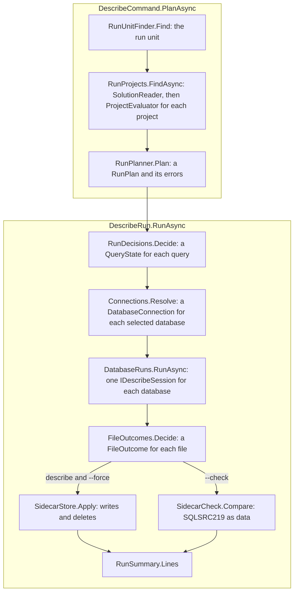

# The tool

How `src/SqlSource.Tool` runs `sqlsource describe`: how a command line is read and a run ends, the steps from a [run unit](README.md#run-unit) to the [sidecars](README.md#sidecar), what each folder does and needs, and how a run reports and logs.  What a user types and sees is in the manual's [tool page](../manual/tool.md).  The terms are the [glossary's](README.md#glossary).

## The command line

[`Program.cs`](../../src/SqlSource.Tool/Program.cs) calls [`Cli.Run`](../../src/SqlSource.Tool/Cli.cs), which makes the host, listens for the signals that end a run, and hands the rest to `Cli.RunAsync`.  The tests call `Cli.RunAsync` with a host of their own.

### The host

[`ToolHost`](../../src/SqlSource.Tool/ToolHost.cs) is a record of everything the tool takes from outside itself: standard output and standard error, the working directory, the environment, the runner of processes, the temporary directory, the number of processors, the describers by [dialect](README.md#dialect), the exchange of each database, and the clock, a `TimeProvider`.  `ToolHost.Create` makes the host of a real run from the console, the current directory and the machine, with a `DescriberRegistry` that holds `PostgresDescriber` alone, the one describer the released tool registers, and an exchange that is `LiveExchange` for every database.  How a describer calls through its exchange is [the describer contract](postgres-describer.md#the-describer-contract).

`ToolHost.Create` asks for the current directory, which throws when it was deleted.  `Cli.Run` catches that, writes the `SQLSRC200` to standard error with a reporter of its own, and returns `1`, since there is no host to report to.

### Signals

`Cli.Run` listens for Ctrl+C, and registers a handler for `SIGTERM` and `SIGHUP`, which on Windows are the shutdown and the closed console.  Each of the three adds one to a count shared by all three, with `Interlocked.Increment`, so that two signals that come at once on two threads are not both the first.

- **The first signal** cancels the run's token and keeps the process (`Cli.Interrupt`).  The run then ends as it would end anyway, with its exit code: each step that looks at the token throws `OperationCanceledException`, `Cli.RunCommandAsync` catches it, and the exit code is `1`.
- **A second signal**, while the run has not ended, does not keep the process, so the system ends it.  A run that waits on a database may not look at its token.
- **`SIGTERM` and `SIGHUP`** do what Ctrl+C does, and for the first signal the handler returns only when the run has ended (`Cli.Terminate`).  Windows ends the process when the handler of a shutdown or a closed console returns, whatever it answers, so a handler that returned at once would leave the run no time to end.  `TerminationTests` cannot raise the shutdown of Windows, which has the same handler as the closed console it tests.

What the user sees of a stopped run is in the manual's [exit codes](../manual/tool.md#exit-codes).

### Reading a command line

A command line is read twice: by [`UsageCheck`](../../src/SqlSource.Tool/UsageCheck.cs), the tool's own reader, and by System.CommandLine.  System.CommandLine's messages repeat the token they reject, and a token can be a connection string, such as the one after a misspelt `--conection`.  So the tool writes every message about a command line itself, and System.CommandLine only binds a command line that `UsageCheck` accepted.

`UsageCheck.Check` walks the tokens once, with the options of the command it is in.  A token that starts with `-` is an option, named by the text before its first `=` or `:`.

- An unknown option ends the walk with one message that names it, and drops the messages found before it, since the token after it may be its value.
- A flag that is given a value, an option that is given none, `--name=` with nothing after it, and a second value of an option that takes one, are each a message.  A value is the text after the separator, or else the next token, unless that token names an option of the command or is `--`, which System.CommandLine takes for no value either.
- The first token that names a subcommand, before any argument, moves the walk into it, with the options of the root that are recursive.
- An argument past the number the command takes is `unexpected argument at position <n>`, counted from one.

`UsageCheck` gives a [`Usage`](../../src/SqlSource.Tool/Usage.cs): the command, its arguments, and each argument and value of an option as a `UsageValue` with its position.  When it found nothing wrong, `DescribeCommand.CheckUsage` holds the values of `describe` to the command's own rules, by their positions:

- A path that ends in `.sql` is a filter and any other is the unit, so `describe` takes several paths and `CheckUsage` allows one unit.  System.CommandLine would otherwise reject a `.sql` path beside the unit.
- A value of `--database` is a database name, by the rule of the `-- database:` marker (`SettingValue.IsDatabaseName`).
- A value of `--connection` is a name, `=` and a value that is not white space (`ConnectionArgument.TryParse`), and each name is given once, ignoring case.  A connection string holds `=` itself and a shell removes quotes, so the option always has a name.
- A value of `--log` is not empty or white space, which is what `--log "$UNSET"` gives.
- On a line with a `--connection`, an argument that holds `=` or `;` is taken for the part of a value that the shell split.

`Cli.ReadCommandLineAsync` writes these lines to standard error, with no id, and the run does not start.  Otherwise System.CommandLine parses the line with response files and the bundling of short options turned off (`Cli.Parser`), so that `@name` is no file to read and `-ab` is not `-a -b`.  Nothing runs unless it found no error, the same command and the same arguments (`Usage.IsReadTheSameBy`), and the same values of `--connection` in the same order (`DescribeCommand.ReadsConnectionsAs`).  A line that fails these checks gets one message, `sqlsource: the command line is not valid`, and no other text.

The root is a `Command` named `sqlsource`, built by `Cli.BuildCommands`, with a `HelpOption` under `--help`, `-h` and `-?`, a `--version` of its own, and `DescribeCommand.Create`.  A `RootCommand` would take its name from the process and read `[suggest]` as a directive, and System.CommandLine's own version action prints the version of the assembly the process started with, which under a test is the test host.  The tool's `VersionAction` prints `Cli.Version`, the informational version of the tool's assembly.  A root with no command prints the help.  The options of `describe` are in the manual's [command reference](../manual/tool.md#command-reference); `--check` beside `--force` is `RunMode.Check`.

### The steps of a run

`Cli.RunAsync` makes a `RunState`, which holds the host, the time the run started, the reporter, the log, the counts that `run.end` holds, and whether the run was cancelled.  It calls `Cli.RunCommandAsync`, whose one `try` runs three steps in order:

1. `Cli.ReadCommandLineAsync` reads the command line, as above.
2. `Cli.OpenLog` opens the log, when the command line runs `describe` and names one, and writes `run.start` ([the log](#the-log)).
3. `Cli.InvokeAsync` gives the run its reporter, gives `describe` its action with `DescribeCommand.Bind`, and invokes the command.  The command's action runs `DescribeCommand.PlanAsync` and then `DescribeRun.RunAsync`, and returns `0`: what went wrong is in the reporter.

Its `catch` blocks end a run early.  A cancellation sets `RunState.Cancelled` and gives `1`.  A `DescriberFaultException` is reported as the `SQLSRC200` it holds ([describing](#describing)), and any other exception as the `SQLSRC200` of `UnexpectedFailure.Of`; both give `0`, since the reporter now holds an error.

`Cli.RunAsync` then ends the run outside that `try`.  `Cli.ExitCodeOf` gives `1` when the reporter holds an error other than `SQLSRC219`, else the step's own code when that is not `0`, else `2` when it holds `SQLSRC219`, else `0`.  What each code means to a user is in the manual's [exit codes](../manual/tool.md#exit-codes).  A `describe` that failed and had no log then writes `Cli.RunAgainLine`.  `Cli.End` writes `run.end` and closes the log, there because the exit code and the error of an exception are known only once the command has ended, and a `finally` closes the log on any other way out.

## A describe run

A run is two halves.  `DescribeCommand.PlanAsync` finds the unit and its projects, makes the plan and reports what is wrong with it.  [`Describing/DescribeRun.cs`](../../src/SqlSource.Tool/Describing/DescribeRun.cs) runs the plan in steps, each a class of its own that gives the next its result.

### Finding the projects

[`RunUnitFinder.Find`](../../src/SqlSource.Tool/Projects/RunUnitFinder.cs) resolves the path of the command line that does not end in `.sql`, or the working directory, to a `RunUnit`: a `.sln`, `.slnx` or `.csproj` file, or the one such file in a directory, looked for among the directory's files alone.  It returns an `Outcome`, and `PlanAsync` reports its failure.

[`RunProjects.FindAsync`](../../src/SqlSource.Tool/Projects/RunProjects.cs) gives the [manifests](README.md#manifest) of the run's projects.  A solution's projects come from [`SolutionReader`](../../src/SqlSource.Tool/Projects/SolutionReader.cs), the C# projects only, with `Microsoft.VisualStudio.SolutionPersistence`, the library the `dotnet` command reads solutions with.  `--project` keeps the ones it names, in the unit's order, which is the ordinal order that `SolutionReader` gives.  `ProjectEvaluator` evaluates the rest, and `RunProjects` reports what each evaluation says, in the order of the projects: what a user sees of it is in the manual's [arguments](../manual/tool.md#arguments).  A run with no manifest left ends after `PlanAsync`, and says so on standard output when nothing was reported.

### Evaluating a project

[`ProjectEvaluator`](../../src/SqlSource.Tool/Projects/ProjectEvaluator.cs) asks MSBuild about each project, at most `ProjectEvaluator.MaxAtOnce` at once and no more than `ToolHost.ProcessorCount`.  It makes one folder for the run's manifests in `ToolHost.TempDirectory`, and deletes it at the end.

1. It evaluates the project with `dotnet msbuild`, asking for `SqlSourceImported`, `TargetFramework`, `TargetFrameworks` and `ProjectAssetsFile` with `-getProperty`, and for `PackageReference` with `-getItem`, and reads the JSON that MSBuild prints.  A project with several target frameworks is evaluated again under the first, since NuGet imports a package's props into such a project only under a condition on `TargetFramework` ([TD-0026](../tech-debt/TD-0026-manifest-of-a-multi-targeted-project-is-the-first-frameworks.md)).
2. From the answer it tells a project that uses SqlSource, one that does not, and one that was not restored, a `ProjectState`.  The marker `SqlSourceImported` says the package's props reached the project.  Without it, a `PackageReference` to `SqlSource`, or an assets file that the project names and the disk lacks, says the project was not restored since; a project with no assets file at all, as one with `packages.config` has, does not use SqlSource, since it would import the props by a line of its own.
3. For a project that uses SqlSource it runs the target `SqlSourceWriteManifest`, with `SqlSourceManifestFile` naming a file in the run's folder, and reads that file with `ManifestReader`.  The target and the format of the file are on [the manifest](msbuild-and-manifest.md#the-manifest).

A run of a project of a solution also sets `SolutionDir`, `SolutionPath` and the other properties that `dotnet build` of the solution gives each project.  `dotnet` is the one that `DOTNET_HOST_PATH` names, when it is set, and runs in the project's folder, so that the project's own `global.json` picks the SDK.  Each property goes through `MSBuildProperty.Switch`, which escapes `%`, `;` and `,` so that MSBuild reads the value back whole.

`ProjectEvaluator` sets two environment variables of `dotnet` and removes the ones it lists, with the reason beside each: the paths of an SDK that a tool started by a build inherits, and every connection variable.  The rest of the environment reaches MSBuild, which reads it for properties, so a `Configuration` there applies to the tool's runs as it does to that user's `dotnet build`, and the manifest is what their compiler is given.

When the run is cancelled, `ProcessRunner` kills `dotnet` with every process it started and waits up to five seconds for it to end.  MSBuild itself writes the manifest into the run's folder, which is deleted next, and on Windows a program ends some time after it is killed.  Nothing waits for the processes that MSBuild started.  A kill that fails is passed over, so the caller still sees the cancellation and not an exception of its own.

What goes wrong is a `ProjectEvaluation` in the state `Failed`, with its error, which `RunProjects` reports.  `SQLSRC205` holds a reason and the first `ProjectEvaluator.MaxOutputLines` lines that MSBuild printed, its error output first, where an evaluation writes its errors, and then its output, where a target writes them.

### The plan

[`RunPlanner.Plan`](../../src/SqlSource.Tool/Planning/RunPlanner.cs) turns the manifests into a `RunPlan`, the files that a type [claims](README.md#claim) with their queries, and the databases of those queries.  It calls the generator's own path resolver, settings readers, parser and hash, as the generator's page lists under [the tool runs the same code](generator.md#the-tool-runs-the-same-code), so that a run claims the files and computes the hashes that a build does.  [`GeneratorParityTests`](../../tests/SqlSource.Tool.Tests/Planning/GeneratorParityTests.cs) runs the generator and the planner over the same sources and compares the types, their `Path` and `Output`, and the files each claims.  What a file's settings and a query's hash come to is held by the tests of `RunPlanner`, which reach both through the generator's code.

For each project it reads, in this order:

- **The claims.**  [`AttributeReader`](../../src/SqlSource.Tool/Planning/AttributeReader.cs) has no compilation, so it reads `[SqlSourceGenerate]` from the project's `Compile` files as syntax.  It parses only a file that holds the word `SqlSourceGenerate`, with the project's language version and constants so that `#if` reads as the compiler reads it, and walks namespaces and types alone.  On each type that `TargetTypeReader.IsCandidate` takes, it finds the attribute by its name, and reads `Path` as a string literal and `Output` as a member of `GeneratorOutput`.  Anything else in either is `SQLSRC208`, and that claim is not planned.  What it cannot see, such as an alias of the attribute, is [TD-0031](../tech-debt/TD-0031-attribute-reader-of-the-tool-is-syntax-only.md).
- **The project's settings**, through `ManifestOptions`, which gives a manifest's values under the keys the compiler would give them.  The keys are those of `MSBuildSettings.ManifestProperty` and `MSBuildSettings.ManifestMetadata`, which hold `SqlSourceDatabase` as well.
- **The listed files**, with [`ListedFiles`](../../src/SqlSource.Tool/Planning/ListedFiles.cs): the manifest's `.sql` files, normalised and each once ignoring case, as the generator lists them.  `PathResolver.FindFiles` gives the files each claim's `Path` resolves to.  A file that no claim takes is skipped, its metadata unread.
- **The invalid values**, after the project's `SQLSRC208`s: each dialect that is not valid as one `SQLSRC011`, then each value of `SqlSourceOutput` or `SqlSourceDatabase` as one `SQLSRC014`, at the project file, as the generator reports them.

A file that two projects claim is planned once, under the first.  It is read through `SqlFileText`, an `AdditionalText` over the file on the disk, and parsed by `SqlFileReader.Read` with the dialect of `FileParseInput.Resolve` and no comments, since the hash covers the SQL without them.  A file with parse errors has those errors, and no queries.  Each planned file has a `PlannedFileState`: `HasParseErrors` for such a file, `NotDescribable` when a query of it needs an entry under a dialect that cannot be described, as below, and `Ready` otherwise.

For each query the planner resolves the output of every claim of every project with `QuerySettings.Resolve` and takes the greatest.  A query whose output is `Sql` needs no entry and has no database and no hash.  Any other gets the database of its marker, its file's metadata, its project's property, or else the dialect's name, and the hash of `SqlQueryHash.Compute`.  A token without a default is `SQLSRC210` and a `QueryProblems` flag.  The first query of a file that needs an entry under a dialect outside `SqlDescribableDialects` makes the file `NotDescribable`, with one `SQLSRC209`.

The databases are the plan's `PlannedDatabase` list, in the order the plan first meets a query of each.  Names are compared ignoring case, and every query gets the first spelling.  A database takes the dialect of its first query in a `Ready` file, or of its first file when no `Ready` file has one.  A query in a `Ready` file of another dialect has a problem, and the first such query of its file is `SQLSRC211`.

Last, the filters of `RunFilters` select queries, by `PlannedQuery.IsSelected`.  A query is selected when its file is named, or no file is, and its database is named, or none is.  A `.sql` path is resolved against the working directory and compared as the generator compares paths.  One that names no planned file is `SQLSRC212`, and the run goes on.

`RunPlanner` reports nothing: its errors are in the `RunPlanResult` in the order they are to be reported, `PlanAsync` reports them, and it writes the events of the plan's files from the plan.

### Deciding

[`RunDecisions.Decide`](../../src/SqlSource.Tool/Describing/RunDecisions.cs) reads the sidecar of each file that is `Ready` and has a selected query that needs an entry, with `SidecarOnDisk.Read`, and gives each query a `QueryWork` with its `QueryState`, by the first row that holds:

| State | When |
|----|----|
| `NotNeeded` | The query needs no entry |
| `Failed` | Its file is not `Ready`, the plan gave it a problem, or it is selected and its sidecar is of a higher format version in a run that writes (`SQLSRC221`) |
| `ToDescribe` | It is selected, under `--force` or `--check` |
| `Skipped` | Its entry is current, and is kept |
| `ToDescribe` | It is selected and has no current entry |
| `LeftOut` | It is not selected and has no current entry |

An entry is current when its hash and its database are the query's (`SidecarEntry.IsCurrentFor`) and its sidecar was written in this format by this version of the tool (`SidecarOnDisk.Usable`), so an entry from an older tool is never kept.  What a user sees of this is in the manual's [describing again](../manual/tool.md#describing-again).

`DescribeRun` writes an event for each query that it decided without a database.  A query to describe gets its event when it is described or fails.

### Connections

`RunDecisions.SelectedDatabases` gives the databases with a selected query that needs an entry, and `RunDecisions.DescribableDatabases` those of them with such a query that the plan did not fail.  [`Connections.Resolve`](../../src/SqlSource.Tool/Describing/Connections.cs) finds a `DatabaseConnection` for every selected database.  For each it takes the value of `--connection` for its name, ignoring case, else the variable of its name (`ConnectionVariables.For`), else `SQLSOURCE_CONNECTION` when it is the one describable database.  A database whose every selected query the plan failed is still selected, with its line in the summary, but it is none the variable could be meant for, since only an error of the plan brings it into the run.  A database whose variable another selected database shares has no connection, unless both have one on the command line.  A variable that is empty or white space is not set, since redacting white space would turn every space of a describer's text into the mark.

`Connections` reports nothing, and lists the names of `--connection` that are no selected database for the help of `SQLSRC213`.  The rules a user sees are in the manual's [connections](../manual/tool.md#connections).

### Describing

[`DatabaseRuns.RunAsync`](../../src/SqlSource.Tool/Describing/DatabaseRuns.cs) takes the selected databases in the plan's order.  A database with no query to describe gets only its event.  For one that has, the first of these that holds is reported and fails all its queries: no describer for its dialect in `ToolHost.Describers` (`SQLSRC216`, at each query), and once, at the first query, a variable that two databases share (`SQLSRC214`), no connection (`SQLSRC213`, or `SQLSRC215` when `SQLSOURCE_CONNECTION` is set and more than one database could use it), or a session that cannot be opened.

Otherwise the describer opens one `IDescribeSession` with an [`OpenRequest`](postgres-describer.md#the-describer-contract) and a `SessionRunLog` that prefixes its events with the engine.  The queries are described one at a time, since a connection is not for several threads and a describe takes milliseconds.  Each is asked as a `DescribeRequest`, whose SQL is that of `SampleSql.Build`: the SQL the hash covers, with each token's default in its place.  `EntryBuilder.Build` makes the [sidecar](README.md#sidecar) entry from the plan, the session's `ServerInfo` and the `QueryDescription`, with the query's parameters in the list's order.  A failure is reported at the query, and the query fails.  What a describer may and may not do is [the describer contract](postgres-describer.md#the-describer-contract).

Everything a describer gives or does runs inside the `Guard` of `DatabaseRuns`, which turns whatever the describer throws, and a `null` where it must give a value, into a `DescriberFaultException`.  That exception holds the `SQLSRC200` of the exception, with the connection's value taken out of its whole text before the text is cut into lines, and no inner exception.  It ends the run: `Cli.RunCommandAsync` reports it.  A session that fails to close after an exception is dropped, so that the first exception is the one reported and a cancelled run prints nothing more.  A described entry that holds the connection's value is a fault of the same kind ([where a connection's value goes](#where-a-connections-value-goes)).  When `DatabaseRuns` returns, no query is `ToDescribe`.

### Writing or checking

A cancelled run stops before this step.  [`FileOutcomes.Decide`](../../src/SqlSource.Tool/Describing/FileOutcomes.cs) gives each file a `FileOutcome`, with its `FileAction` and, for a file to write, its target, a `Sidecar` made of the entry of each query that needs one, and its text from `SidecarWriter`.

- A file that is not `Ready` is `None`.
- A file none of whose queries needs an entry is `Delete` when the run may delete and its sidecar is there and not a newer tool's, and `None` otherwise.  `DescribeRun` decides whether the run may delete, `mayDelete`: only a run with no filter, in which nothing has been reported, may.  A run on a part does not know what the rest needs of a file, and the plan drops a setting or a claim that it could not read, so after an error a file can look as if it needs no entry.  Only such a run reads the sidecar of such a file, through the `SidecarOnDisk.Read` it hands `FileOutcomes.Decide`.  A sidecar that the system will not let the tool open could be a newer tool's, so it is `Unreadable`, with the `SQLSRC218` that says which file stays.
- A file none of whose queries that need an entry is selected is `None`.
- A file with a query that failed or was left out is `HeldBack`, and keeps the sidecar it has.
- Any other is `Write`, or `Unchanged` when the text on the disk is the target's, line endings aside.

A run that writes hands the outcomes to [`SidecarStore.Apply`](../../src/SqlSource.Tool/Describing/SidecarStore.cs), the one place that writes or deletes a sidecar.  It writes each sidecar to a temporary file beside it, named the sidecar's name, a point, the 32 digits of a `Guid` and `.tmp`, and moves that file over the old one, so a run that is stopped leaves the old file or the new one.  A run killed between the two leaves the temporary file.  Before it writes, `Apply` removes such leftovers: those of every sidecar in the folders of a run on the whole, since the `.sql` file of one may be gone, and those of the sidecars whose outcome is not `None` in a run with a filter.  It removes only a name that it gives one itself, and only one older than `SidecarStore.LeftoverAge` by the run's clock, since another run may be writing the same sidecar and its move would fail.  What the user sees of it is in the manual's [describing again](../manual/tool.md#describing-again).  It reports `SQLSRC217` for a held-back file of which a query was described, and `SQLSRC218` for a file the system would not let it change.

`--check` hands the outcomes to [`SidecarCheck.Compare`](../../src/SqlSource.Tool/Describing/SidecarCheck.cs) instead, which reads nothing and changes nothing.  It compares each selected query's described entry, not a file's target, since under a filter a file with a query left out has none, with the sidecar on the disk, through `SidecarComparer`.  A sidecar that `FileOutcomes` would delete is one difference, taken from its outcome, and an entry for a query that is gone or needs none is another, unless `--database` is given and does not name the entry's database.  It returns each difference as an `SQLSRC219` in a `FileCheck`, and `DescribeRun` reports them, with the `SQLSRC218` of an `Unreadable` outcome as an error and no difference.  The help line of a difference names the command that mends it, `describe --force` for what the database said.  What a user sees of `--check` is in the manual's [check in CI](../manual/tool.md#check-in-ci).

### The summary

`DescribeRun` hands `Cli` the counts that `run.end` holds, from `RunSummary.Counts`, before it writes the summary, so that a summary that cannot be written, as when standard output is closed, does not lose them.  [`RunSummary.Lines`](../../src/SqlSource.Tool/Describing/RunSummary.cs) gives one line for each selected database and one for each name of `--database` that is none, and counts the selected queries that need an entry.  The lines are in the manual's [summary](../manual/tool.md#the-summary).

### Where a connection's value goes

The value of a connection comes from `--connection`, as a `ConnectionArgument`, or from a variable, and `Connections.Resolve` puts it in a `DatabaseConnection`.  `DatabaseRuns` puts it in the `OpenRequest` it hands the describer, and that is the one place it leaves the run.

A describer's text is redacted before anything prints it, whatever the describer's own rule, since a driver's message for a wrong connection string can quote the string.  [`Redaction`](../../src/SqlSource.Tool/Describing/Redaction.cs) replaces the whole value with `***`: the tool reads no connection string, so it knows no part of one.  A failure goes through it twice.  The first pass cleans its descriptor because a describer may build one from a server's text, and leaves a descriptor that does not hold the value as it is.  The second pass cleans the arguments of the error made of it and the text of every line under it.  Once a database has its value, what the run writes of that database goes through `RunTrace.Without`, a trace whose log is a `SessionRunLog` and whose lines are redacted too.

A described entry would go into a committed file.  `EntrySecretCheck.Holds` writes the entry as `SidecarWriter` would, and looks for the value as `SidecarJsonBuilder` escapes it.  The text holds more than the describer gave: the words of the format and the names of the query, its database and its parameters.  So the check also writes the entry without what the describer gave, `EntrySecretCheck.WithoutTheDescribersPart`, and counts the value only when it is in the first text and not the second, so a dummy value of a test, such as `postgres`, is no fault.  That second entry is made with the constructors, so that a new member of an entry does not compile there until it is given to one side.  What the removal does not cover is [TD-0034](../tech-debt/TD-0034-redaction-of-a-describers-text-has-holes.md).

## Folders

Each folder is a namespace of its own.  "From the generator" is what the folder uses of `src/SqlSource`, which the tool references with its internals, as the overview's [shared code](README.md#shared-code) says.

| Folder | Responsibility | Uses in the tool | From the generator |
|----|----|----|----|
| The root | `Cli`, `DescribeCommand`, `ToolHost`, `UsageCheck` with `Usage` and `UsageValue`, and `Outcome`: reading a command line, the steps of a run, and the host | Every folder | `ToolDiagnostics`, `SqlPath.IsSqlFile`, `SettingValue.IsDatabaseName`, `SidecarFormat`, `PackageVersion` |
| `Projects/` | The run unit, the solution's projects, the evaluation of each and the reading of its manifest | `Processes/`, `Reporting/`, `Logging/` for the project events, and `ConnectionVariables` of `Describing/` for the variables to remove | `ToolDiagnostics` |
| `Processes/` | Starting a program and waiting for it: `IProcessRunner`, and `ProcessRunner` over `Process` | Nothing | Nothing |
| `Planning/` | The plan, from the manifests: claims, settings, parsing, outputs, databases and filters | `Projects/` for the manifests, `Reporting/` for its errors as data | The path rules (`SqlPath`, `PathResolver`), `TargetTypeReader.IsCandidate`, `AttributeSource`, the settings readers and `MSBuildSettings`, `FileParseInput`, `SqlFileReader`, `QuerySettings`, `SqlQueryHash`, `SqlDescribableDialects`, and the descriptors |
| `Describing/` | The steps of a run after its plan, the connections, the errors of describing, and the redaction of a connection's value | `Planning/`, `Describing/Describers/`, `Logging/`, `Reporting/` | The sidecar's model, `SidecarReader`, `SidecarWriter`, `SidecarComparer` and `SidecarJsonBuilder`, `SqlDialectName`, `SettingValue.IsDatabaseName`, the parsed `SqlQuery`, and the descriptors |
| `Describing/Describers/` | The contract a describer implements, `DescriberRegistry`, `LiveExchange` and `DescriberFaultException`: [the describer contract](postgres-describer.md#the-describer-contract) | `Logging/` for a describer's log, `Reporting/` | `SqlDialect`, `SqlQueryParameter`, the sidecar's model for what a describer gives, and the descriptors |
| `Describing/Capture/` | Recording and replaying a describer's calls, as a [capture](README.md#capture): [capture and replay](postgres-describer.md#capture-and-replay) | `Describing/Describers/` | Nothing |
| `Describing/Postgres/` | The PostgreSQL describer, with `Columns/`, which builds a column and matches a table, and `Walk/`, the plan walk: [its page](postgres-describer.md) and [nullability](postgres-nullability.md) | `Describing/Describers/`, `Logging/` | `SqlLexer`, `SqlDialectRules` and `QuoteReader.IsNameCharacterOfPostgreSql`, `SqlQueryParameter`, the sidecar's model, and `ToolDiagnostics` |
| `Logging/` | What a run says of itself: the trace, the events and the log file | `Describing/` for `Redaction` and the run's records, `Planning/`, `Projects/`, `Reporting/` | `ToolDiagnostics`, `SqlDialectName` |
| `Reporting/` | Errors as data, `ToolDiagnostic`, and the `Reporter` that writes and counts them | `Logging/` for the trace | The descriptors, `DiagnosticInfo` for a parse error |

`Logging/` and three folders use each other: `Describing/` and `Projects/` write events, and `Logging/` reads their records and redacts with `Redaction`; a reporter carries a trace, and a trace writes with `OneLine` of `Reporting/`.

## Logging and reporting

A run says three kinds of thing: its errors, through the reporter; its summary, on standard output; and what it decided, through its trace, to the log and under `--verbose`.

### The reporter

[`Reporter`](../../src/SqlSource.Tool/Reporting/Reporter.cs) writes each `ToolDiagnostic` to standard error in the compiler's format, and counts the errors it wrote and, of them, the `SQLSRC219`s, which is what `Cli.ExitCodeOf` reads.  An error is one write under a lock, and the reporter writes the error's `diagnostic` event to its trace under the same lock.  `OneLine.Of` writes each line break as a space in the path, the arguments and every line of an error, and the tool's other outputs use it for the texts they did not write.

Until `Cli.InvokeAsync` makes the run's reporter, `RunState` holds one with no trace, which is what a log that cannot be opened or an exception before the command has.  Neither is followed by an error of the run, so no count is split between two reporters.

`UnexpectedFailure.Of` makes the `SQLSRC200` of an exception: its type and message, and its stack trace as lines labelled `trace` when `SQLSOURCE_DEBUG` is set and not empty.  It takes a function that redacts the message, and the whole stack trace before the trace is cut into lines, so that a value which spans lines is replaced whole.

### The trace

A [`RunTrace`](../../src/SqlSource.Tool/Logging/RunTrace.cs) holds the run's `IRunLog`, which is the log file or `NullRunLog`, and standard output under `--verbose`.  The reporter carries it, so every step that can report can say what it did.  [`RunEvents`](../../src/SqlSource.Tool/Logging/RunEvents.cs) builds each event of the run but `run.start`, `run.end` and `diagnostic`: `project`, `file`, `database`, `database.open`, `query` and `sidecar`.  Beside each it says the line of `--verbose` with `RunTrace.Say`, which writes one line to standard output with the prefix `sqlsource:`.  `RunEvents.Unit` and `RunEvents.Unclaimed` say a line and write no event.  The lines are in the manual's [`--verbose`](../manual/tool.md#verbose).

### The log

[`RunLogFile`](../../src/SqlSource.Tool/Logging/RunLogFile.cs) writes the file of `--log`, or of `SQLSOURCE_LOG`, as JSON Lines in UTF-8, one object for each event.  `RunLogFile.Open` refuses a path that names a file of the run, as the manual's [logs](../manual/tool.md#logs) lists, before it opens anything.  Every object starts with `event` and `time`, the moment of `ToolHost.Time` in UTC with milliseconds, and a member of the event that is named `event`, `time` or `truncated` is written with an underscore before it.  A string over `RunLogFile.MaxStringBytes`, 1 MiB of UTF-8, is cut between two characters, and its object gains `"truncated": true`.

A value of an event is a [`LogValue`](../../src/SqlSource.Tool/Logging/LogValue.cs), a closed set of what JSON can hold, so that the writer writes every value and `SessionRunLog` reaches every string.  `run.start` holds the versions of the tool, of the sidecar format, of .NET and of the system, and `arguments`, which `LoggedArguments.Of` builds: each token, with the value of each `--connection` replaced by its name and `***`.  `run.end` holds the exit code, the run's duration by the clock, and the counts of each database.

A write that the system refuses keeps its exception as `RunLogFile.Failure`, and the writer writes nothing more.  `Cli.End` reports it as `SQLSRC218` and the exit code is `1`.  What a user should know of a log before sharing it is in the manual's [logs](../manual/tool.md#logs).

## Not built yet

### The SQL Server describer

> **Not built yet.**  How the describer of `mssql` queries asks SQL Server about a query, and how the host registers it.  Delivered by phase 6 of the [query generation epic](../superpowers/specs/2026-10-07-query-generation-epic-design.md).

### Build integration options

> **Not built yet.**  How `--manifest`, `--online` and `--watch` let a build or an editor run `describe`.  Delivered by phase 9 of the [query generation epic](../superpowers/specs/2026-10-07-query-generation-epic-design.md).

### Bug-report commands

> **Not built yet.**  How `diagnose` writes a bundle of one query's description and `replay` runs the pipeline from one.  Delivered by phase 10 of the [query generation epic](../superpowers/specs/2026-10-07-query-generation-epic-design.md).
