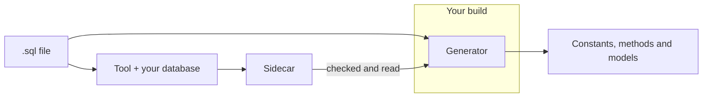

# Concepts

SqlSource reads the queries you keep in `.sql` files.  The **generator**, in the `SqlSource` package, runs inside the compiler whenever you build the project, and turns each query into C# code: for a described query its models, a type for its parameters and a type for its rows, and by default a method that runs it; or a string constant, or a method where the query has tokens, that holds its SQL for your own code to run.  The **tool**, in the `SqlSource.Tool` package, connects to your database, asks it what each query's parameters and columns are, and writes the answer into a **sidecar** file beside the `.sql` file.  You commit the sidecar with the project, and the generator reads it during the build, so that the build needs no database.  A query whose [output](#output) is `models` or `codegen`, the default, must be described: the build reports an error for one that has no current entry in its sidecar.  A query whose output is `sql` needs neither the tool nor a sidecar.

The rest of this page defines the words the manual uses.  Each is used in this one sense everywhere.

## Glossary

### The files

#### Query

The SQL that follows a `-- name:` line, up to the next `-- name:` line or the end of the file.  A file with no `-- name:` line is one query.  Each query becomes one member of the generated code, named after the query.  See [queries and names](sql-files.md#queries-and-names).

#### Marker

A line comment that starts its line and has the form `-- word: value`, where the word is one SqlSource knows, such as `-- name: GetUser` or `-- summary: Loads one user.`  Nothing else in a comment is read.  The [marker index](sql-files.md#marker-index) lists every marker.

#### File header

The part of a `.sql` file before its first `-- name:` line.  It holds comments, such as a licence, and the markers that apply to every query in the file.  See [the file header](sql-files.md#the-file-header).

#### Sidecar

The tool's record of what the database said about each query's parameters and columns.  It is the file `Users.sql.json` beside `Users.sql`.  It is committed with the project, so that a build never needs a database, and it is never edited by hand: the tool writes it.  The build checks it, and reports a query that must be described and has no current entry in it.  See [sidecar files](tool.md#sidecar-files).

The generator builds the [models](generator.md#models) and the [query method](#query-method) of a query from its entry in the sidecar.

### What a query gets

#### Output

The setting that says what SqlSource produces for a query: its SQL alone, its SQL and its [models](generator.md#models), or its models and a [query method](#query-method), the default.  It also decides which queries must be described: the ones the tool describes, and the ones the build checks against their sidecar.  See [the output setting](settings.md#setting-output).

#### Query method

What a described query whose [output](#output) is `codegen` becomes: an asynchronous method that opens a connection when it is closed, sends the query's parameters, runs it and reads its rows into its models.  It holds the query's SQL, in place of a constant or a token method.  See [query methods](generator.md#query-methods).

#### Token method

What a query with a [token](#token) becomes in place of a constant: a static method that takes the text of each token and returns the SQL with the tokens filled in.  See [token methods](generator.md#token-methods).

### Three kinds of parameter

SqlSource uses the word "parameter" for three different things.  The manual always says which.

#### Query parameter

A value you pass when you run a query, written in the SQL as `@` and a name: `@id` in `WHERE id = @id`.  SqlSource finds them and leaves them in the SQL exactly as written.  A `-- param:` marker gives one its database type, whether it can be null, or a C# type of your choice.  See [parameters and tokens](parameters-and-tokens.md).

#### Generator parameter

A word that changes what the generator does with a query, such as `keep-comments`.  A list of them is given in a `-- generator:` marker, on the attribute, or in an MSBuild property.  It has nothing to do with the parameters of the SQL.  See [generator parameters](settings.md#setting-generator-parameters).

#### Token

A place in a query's SQL, written `{{table}}`, that your code fills in with text when it asks for the SQL.  A query parameter cannot stand for a table name or a clause; a token can.  A token is replaced by plain text substitution and nothing is escaped, so it must only carry text that your own code chooses.  See [parameters and tokens](parameters-and-tokens.md).

### Two meanings of database

#### Dialect

The set of rules by which SqlSource reads a `.sql` file: where a comment or a string starts and ends, which differs from one database to the next.  It is named after a database, such as `postgres` or `mssql`, and it is set for a project, for some of its files, or for one file.  A dialect connects to nothing.  See [dialects](dialects.md) and [the dialect setting](settings.md#setting-dialect).

#### Logical database

A name for one particular database your queries run against, such as `billing`.  The tool uses it to choose which connection to describe a query through, and a sidecar records it.  A query belongs to the logical database its markers or settings name, and to the one named after its dialect when they name none.  See [the database setting](settings.md#setting-database).

The two answer different questions.  The dialect is *which kind of SQL* a file is written in; the logical database is *which database* the tool asks about it.  Several logical databases can share a dialect: `billing` and `reports` can both be `postgres`.

### The packages

#### Generator

The part of the `SqlSource` package that runs in the compiler and writes C# from your `.sql` files.  See [the generator](generator.md).

#### Tool

The `sqlsource` command of the `SqlSource.Tool` package.  Its `describe` command asks a database about your queries and writes the sidecars.  See [the tool](tool.md).

#### Describe

To ask a database, without running a query, what the query's parameters and columns are.  The tool does it and writes the answer to the query's [sidecar](#sidecar).  It needs your schema, not your data.  See [which queries are described](tool.md#which-queries).
