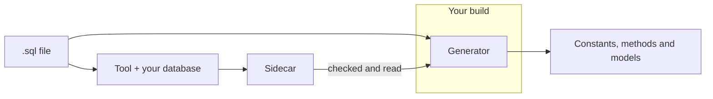

# How SqlSource works

This page says how the source generator, the tool and the sidecar file worked together on the last page, to describe a query and build.

## The picture

SqlSource has two parts, one in each package:

- **The generator** is in the `SqlSource` package.  It is a source generator: it runs inside the compiler at each build.  It turns each query of your `.sql` files into C# code.
- **The tool** is the `sqlsource` command of the `SqlSource.Tool` package.  It asks your database about each query, and writes the answer to a sidecar file beside the `.sql` file.

The build reads the sidecar, so it needs no database.  By default, every query must be described.  The build reports an error for a query that has no current entry in its sidecar.

## The words

- **Query**: the SQL that follows a `-- name:` line, up to the next `-- name:` line or the end of the file.  See [queries and names](../reference/sql-files.md#queries-and-names).
- **Marker**: a line comment of the form `-- word: value` that SqlSource reads, such as `-- name: GetUser`.  See [markers](../reference/sql-files.md#marker).
- **Describe**: to ask your database, without running the query, what its parameters and columns are.  See [what describe does](../reference/describing.md#describe).
- **Sidecar**: the file beside a `.sql` file, such as `UserRepository.sql.json`, where the tool writes what your database said.  See [sidecar files](../reference/sidecars.md#sidecar-files).
- **Repository**: a class marked `[SqlSourceGenerate]` that gets one method for each query of its `.sql` file.  See [repository methods](../reference/repositories.md#repository-methods).
- **Model**: a record that the build generates for a query, such as `GetUserParams` for its parameters and `GetUserDto` for its rows.  See [models](../reference/models.md#models).

## What needs a database and what does not

- **Describing needs your database.**  The tool connects to it to describe a query that is new or changed.
- **Describing checks each query against your schema.**  A table or a column that does not exist is an error when you describe, not when the query runs.
- **A build needs no database.**  It reads the sidecars that you committed, so it builds on a colleague's machine or in CI with no connection.
- **The tool reads your schema, not your data.**  A database with your tables and no rows is enough.

## If it does not work

- If a colleague's build reports [SQLSRC241](../diagnostics.md#sqlsrc241) for every query, the sidecars are not in git.  Commit them, as [Your first query](first-query.md#describe) says.

## What you have now

The six words that the next pages use, and the reason the sidecars go into git.

Rules: [the generator](../reference/members.md#generator), [the tool](../reference/cli.md#tool), [sidecar files](../reference/sidecars.md#sidecar-files), [running in the build](../reference/online-build.md#running-in-the-build), what describing does on [PostgreSQL](../reference/databases/postgresql/index.md#what-describing-does) and [SQL Server](../reference/databases/sqlserver/index.md#what-describing-does).

Next: [Write queries](write-queries.md)
