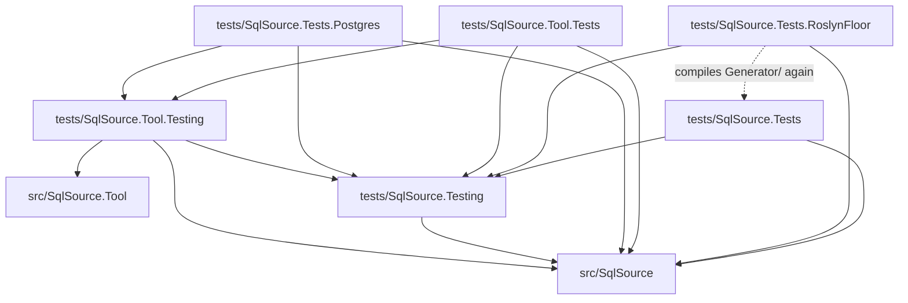

# Tests

SqlSource has four test projects and two libraries that they share.  `dotnet test --solution SqlSource.slnx` runs every test project, and [`CONTRIBUTING.md`](../CONTRIBUTING.md) has the commands to build and test.  `tests/SqlSource.Tests.Postgres` needs Docker running.

## The projects

The test projects:

| Project | Roslyn | Docker | Runs |
|----|----|----|----|
| `tests/SqlSource.Tests` | A current version | No | Every test of the generator |
| `tests/SqlSource.Tests.RoslynFloor` | 4.8.0, the oldest supported | No | The generator driver tests: the files of `tests/SqlSource.Tests/Generator/`, compiled a second time |
| `tests/SqlSource.Tool.Tests` | A current version | No | The tests of the tool, which run the whole command in process with their own output, working directory and environment |
| `tests/SqlSource.Tests.Postgres` | A current version | Yes | The PostgreSQL describer and the `describe` command against a real server, which Testcontainers starts |

`TerminationTests` of `tests/SqlSource.Tool.Tests` alone starts the tool that was built in a process of its own: to send it a signal, where the system has signals, and to close its console on Windows, which only `nightly.yml` runs.  `tests/SqlSource.Tests.Postgres` is the one project that `nightly.yml` leaves out, since the runners cannot start its container.  Its procedures are in [`SqlSource.Tests.Postgres/README.md`](SqlSource.Tests.Postgres/README.md): Docker and the image, the describer's fixtures and the realistic corpus.

A test in `tests/SqlSource.Tests/Generator/` must compile and pass in both of those projects; [`SqlSource.Tests/Generator/AGENTS.md`](SqlSource.Tests/Generator/AGENTS.md) says what that asks of it, and why that folder is the only code a test project compiles of another.

The libraries are never run as tests, hold no tests and are never packed:

| Project | Roslyn | Holds |
|----|----|----|
| `tests/SqlSource.Testing` | 4.8.0, since RoslynFloor references it | The harness of the generator's driver tests (`Generator/`, with `Sidecars`, which hands the generator a sidecar, `StepOutputs`, which reads what a step gave, and `NpgsqlReferences`, the drivers the probe of Npgsql is tested against), `TestSidecars` (`Snapshot/`) and `RepositoryRoot`.  It downloads Npgsql 8.0.3, 9.0.3 and 10.0.3 with `PackageDownload`, and `NpgsqlReferences` reads their metadata from the NuGet folder, `NuGetPackageRoot`, without loading them, so a restore needs to reach the package source or find them in the NuGet cache |
| `tests/SqlSource.Tool.Testing` | A current version, the tool's | The helpers that the tool's tests and the PostgreSQL tests share |

`tests/SqlSource.Tool.Testing` holds:

- the harness of a whole command: `CliRun`, `CliResult`, `Hosts` and `Plans`;
- the fakes of a process and a project: `FakeProcessRunner`, `FakeProject` and `TestProject`;
- the start of the built tool, `Programs`;
- `LogReader`, `Secrets`, `SidecarFiles` and `TempFolder`;
- `PasswordFiles`, which skips a test of a password file;
- the named answers of a column's nullability, `NullabilityAnswers`, and PostgreSQL's type modifiers, `Typmods`;
- the harness of a describer's fixtures, in `Fixtures/`: its case writer `FixtureCaseFiles` and `FixtureProjects`.

The two libraries are apart because the tool raises Roslyn to a current version, which would reach RoslynFloor through one library.  Their types stay `internal`: `src/SqlSource` and `src/SqlSource.Tool` grant them `InternalsVisibleTo`, and each library grants it to the projects that reference it.

Where a test goes is a rule of [`AGENTS.md`](AGENTS.md): the tests mirror the source folders.  `tests/SqlSource.Tool.Tests/Commands/` holds the tests that run a whole command line, and `tests/SqlSource.Tool.Tests/Fixtures/` the tests of the fixtures' harness, which is in `tests/SqlSource.Tool.Testing/Fixtures/`.  The helpers of the tests of `Describing/Postgres/` are these files of `tests/SqlSource.Tool.Tests`:

- `PostgresScript.cs`, `PostgresRows.cs`, `PostgresTables.cs`, `PostgresPlans.cs`, `PostgresRequests.cs` and `FakePostgresServer.cs` are the helpers;
- `PostgresSessionCases.cs`, `PostgresEventCases.cs` and `PostgresWalkColumns.cs` hold what the classes split from one share, those named `PostgresSession*`, `PostgresEvents*` and `NullabilityWalk*`.

`CaptureInputs.cs` of the same project is for the tests that record and replay a capture, in `Describing/Capture/` and in `Describing/Describers/`.

## How they reference each other

This graph is read from the `ProjectReference` items of each `.csproj`.  A solid arrow is a project reference.  The dotted arrow is the one file glob that crosses a project: RoslynFloor has `<Compile Include="../SqlSource.Tests/Generator/**/*.cs" LinkBase="Generator" />`.

What each test project takes from the libraries:

- `tests/SqlSource.Tests` references `tests/SqlSource.Testing` for the harness of the generator's driver tests, and `tests/SqlSource.Tests.RoslynFloor` references it for the same.
- `tests/SqlSource.Tool.Tests` references `tests/SqlSource.Testing` for the harness of the generator's driver tests, which `GeneratorParityTests` runs with the tool over the same sources, and `tests/SqlSource.Tool.Testing` for the helpers it shares with `tests/SqlSource.Tests.Postgres`.
- `tests/SqlSource.Tests.Postgres` references `tests/SqlSource.Testing` for `RepositoryRoot`, and `tests/SqlSource.Tool.Testing` for the fixture harness, the command harness of the tool's tests, `CliRun` and what it needs, `Programs` and `FixtureProjects`.

`tests/SqlSource.Tests` also uses the generator the way a consumer does.  The types in `EndToEnd/` are compiled with the generator loaded, and the project imports `src/SqlSource/build/SqlSource.props` and `SqlSource.targets`, the MSBuild files the package ships.  It gets them by path and the generator through a project reference.  [`tools/check-package-install.sh`](../tools/README.md#check-package-installsh) is what installs the packed package.

## Fixture projects

`tests/SqlSource.Tool.Tests/Fixtures/Projects/` holds small projects that are no part of the solution.  `ManifestTargetTests` and `FixtureProjectTests` copy one to a temporary folder outside the repository, with the package's two MSBuild files and `global.json` beside it, and run `dotnet msbuild` on it for real, the second through the tool's own code.  So these tests need the SDK that `global.json` pins, and take a second or two each.

MSBuild reads the environment for its properties, and the workflow has a variable named `CONFIGURATION`, so in CI a fixture is evaluated as `Release`.  A test of a fixture expects no `Debug`, in a constant or in a path.

A fixture project is no part of the solution, so nothing builds or restores it, and a test leaves nothing in the repository.  A file under that folder is copied to the test project's output as it is.  `FixtureProjects` of `tests/SqlSource.Tool.Testing` copies a fixture out of the repository for a test; [the PostgreSQL tests' readme](SqlSource.Tests.Postgres/README.md#running) says how that project gets `Single`.

To add a fixture project, add a folder to `tests/SqlSource.Tool.Tests/Fixtures/Projects/` with an `App.csproj` that imports `../build/SqlSource.props` and `../build/SqlSource.targets`.
