# Tests

SqlSource has nine test projects, four libraries that they share and a stand-in of the tool: four test projects under `tests/`, and the five that run against a real database under [`tests/DatabaseTests/`](DatabaseTests/README.md), which need Docker running.  `dotnet test --solution SqlSource.slnx` runs every test project but `tests/DatabaseTests/QueryMethodAllocation`, which only the nightly runs, and [`CONTRIBUTING.md`](../CONTRIBUTING.md) has the commands to build and test.

## The projects

The test projects:

| Project | Roslyn | Docker | Runs |
|----|----|----|----|
| `tests/SqlSource.Tests` | A current version | No | Every test of the generator |
| `tests/SqlSource.Tests.RoslynFloor` | 4.14.0, the oldest supported | No | The generator driver tests: the files of `tests/SqlSource.Tests/Generator/`, compiled a second time |
| `tests/SqlSource.Repository.Tests` | A current version | No | The checks of the repository's own files: the links, anchors and SQL samples of the user docs, the sections of `docs/manual/diagnostics.md`, the limits of every `AGENTS.md`, the root `sqlsource.json`, the VS Code recipe of `docs/manual/recipes.md`, `tools/test-scopes.txt`, how the test projects reference and include each other, the hand-written row buffer of `tests/DatabaseTests/QueryMethodAllocation` and the plan keys that the PostgreSQL describer's `PlanNode.cs` spells, and the tests of `tests/SqlSource.Repository` |
| `tests/SqlSource.Tool.Tests` | A current version | No | The tests of the tool, which run the whole command in process with their own output, working directory and environment |

The five projects that run against a real server are in [`tests/DatabaseTests/`](DatabaseTests/README.md), whose readme has their table.

`TerminationTests` is the one test of `tests/SqlSource.Tool.Tests` that starts the tool that was built in a process of its own: to send it a signal, where the system has signals, and to close its console on Windows, which only `nightly.yml` runs.  `Describer/ToolProcessTests.cs` is the one of each container project, and `EndToEnd/OnlineBuildTests.cs` has a build start it.  `tests/DatabaseTests/Postgres`, `tests/DatabaseTests/Postgres.Npgsql8`, `tests/DatabaseTests/SqlServer`, `tests/DatabaseTests/SqlServer.SqlClient61` and `tests/DatabaseTests/QueryMethodAllocation` are the projects that the Windows and macOS job of `nightly.yml` leaves out, since its runners cannot start their containers; its Linux jobs run the first and the third on the supported majors that CI does not, and the allocation tests of `tests/DatabaseTests/QueryMethodAllocation` on each engine's default image.  The procedures of the first are in [`DatabaseTests/Postgres/README.md`](DatabaseTests/Postgres/README.md): Docker and the image, the describer's fixtures, the realistic corpus and the end-to-end project.  Those of the third are in [`DatabaseTests/SqlServer/README.md`](DatabaseTests/SqlServer/README.md): Docker, the emulation of its images on Apple silicon, the images and their builds, the fixture schema, the describer's fixtures, the realistic corpus, the renaming's tests and the end-to-end project.

A test in `tests/SqlSource.Tests/Generator/` must compile and pass in both `tests/SqlSource.Tests` and `tests/SqlSource.Tests.RoslynFloor`; [`SqlSource.Tests/Generator/AGENTS.md`](SqlSource.Tests/Generator/AGENTS.md) says what that asks of it, and why that folder is the only code a test project compiles of another.

The libraries are never run as tests, hold no tests and are never packed:

| Project | Roslyn | Holds |
|----|----|----|
| `tests/SqlSource.Repository` | None: it references nothing | `RepositoryRoot`, which gives the path of every file of the repository that a test reads ([how it is checked](#reading-the-repository)), `RepositoryWorkingFolder`, the root as the folder to start a process in, which `RepositoryRoot.WorkingFolder` gives and which is no `string`, so that it cannot reach `Path.Combine`, `TestScopes`, which reads `tools/test-scopes.txt` for the check, as the script does, and `ProjectIncludes`, which lists what a container project includes from outside its folder |
| `tests/SqlSource.Testing` | 4.14.0, since RoslynFloor references it | The harness of the generator's driver tests (`Generator/`, with `GeneratorHarness`, which writes a run's project settings file, `/sqlsource.json`, from the output, dialect, generator parameters and `settings` the test gives, with `"memberLocation": "class"` for a run at `Sql` or `Models`, so that its members are on the type, unless the `settings` replace it, as `InNestedClass` and `RunInNestedClass` do, and whose `UsersPath` and `UsersNormalizedPath` are the path most tests give a `.sql` file, `UsersFile` the file of one query, `GetUser`, at that path, `SampleSource` the source of the type `Sample` that claims it, `SampleSourceFile` that source at its path, `RunSample` a run of it, and `SampleFile` the name of the file of its queries, with `GeneratorRun.ShouldBeClean`, a run without a diagnostic, an error or a warning in generated code, `GeneratorRun.Problems`, what a run reported once its generated code has neither, and `GeneratedFile`, the lines that start a generated file of queries and of models, with `Joined`, which joins each line of an expected text that ends in `↩` to the next, beside it, `LevelSettings`, which places a setting at each of its levels, the project's settings file, a folder's, a header marker and a query's marker, `Sidecars`, which hands the generator a sidecar and fails a test whose current entry does not list its query's parameters as the tool writes them, `StepOutputs`, which reads what a step gave and the column types of a query, `ModelRuns`, the harness of the model tests, `MethodRuns`, the harness of the method tests, `ConverterCases`, what the classes of the converter tests share, `InMemoryAdditionalText`, an additional file held in memory, `GoldenFiles`, which renders a run to the text of a golden file of [the golden corpus](#the-golden-corpus-of-query-methods), compares it with the file and writes the file under `SQLSOURCE_UPDATE_GOLDEN=1`, `CorpusEngine`, an engine of the corpus with what its scenarios need to write entries and run them for it, `QueryMethodCorpus`, the corpus's scenarios and cases, these three in `Generator/Corpus/`, `CachingScene`, the fixture of the caching tests, whose runs read the project's settings file, with the files of its types' methods, `StepReasons`, which reads why each step of a run ran and checks that every reason of a step is one, `TestAnalyzerConfigOptions`, the options MSBuild gives a run or a file, `TestOptionsProvider`, which hands the generator the properties MSBuild tells it, of which the generator reads `SqlSourceBuildFolders`, `SqlSourceTransitivePackageAssemblies` and `SqlSourcePublicExceptions` alone, `NpgsqlReferences`, the drivers the probe of Npgsql is tested against, `SqlClientReferences`, those of the probe of Microsoft.Data.SqlClient, and `LibraryReferences`, those of the probe of the libraries, with .NET 8's reference assemblies, `Net8Framework`, which a run compiles against in place of the runtime's), `DiagnosticMessages`, a descriptor's message with its arguments, as a diagnostic gives it, `SqlTexts`, the `.sql` texts that many tests of the generator and of the tool put in a project, `CultureScope`, which runs a test under another current culture and puts back the one it found, `Eventually`, how every wait of the tests waits, with `Patience` as its one limit, which every caller of `Programs.RunAsync` uses too, and the PostGIS build lock's longer patience of its own, and `TestSidecars` (`Snapshot/`).  It downloads Npgsql 8.0.3, 9.0.3 and 10.0.3 and Microsoft.Data.SqlClient 6.0.5, 6.1.7 and 7.1.1, NodaTime 3.1.9 and 3.3.7, Npgsql.NodaTime 8.0.3 and 10.0.3 and .NET 8's reference assemblies, Microsoft.NETCore.App.Ref 8.0.31, with `PackageDownload`, and `NpgsqlReferences`, `SqlClientReferences` and `LibraryReferences` read their metadata from the NuGet folder, `NuGetPackageRoot`, without loading them, so a restore needs to reach the package source or find them in the NuGet cache |
| `tests/DatabaseTests/TestHarness` | 4.14.0, through `tests/SqlSource.Testing`; it brings no Roslyn package of its own | The images and the containers of the database tests, which bring no database driver, no Dapper and nothing of the tool: `DefaultImages`, the default image of each engine, `EngineImage`, each engine's image of a run, which its variable can change, with its recorded majors, the gates that skip a test on a server whose version it does not suit and the start of its containers, `SqlServerStart` with `IStartingContainer`, which starts a SQL Server container of the tests and starts a new one, once, when the first crashed at its start, through Testcontainers' SQL Server module, `DescriberFixtures`, the folder and the `schema.sql` of each engine's describer fixtures, which its describer project reads and records in the repository, `EndToEndEngine`, each engine's folder of end-to-end databases and how its files split into commands, whole for PostgreSQL and at each line of `GO` alone for SQL Server, `EndToEndFiles`, the paths of the schema and seed of each end-to-end database and the building of a test database from files, over a `DbDataSource` so that it needs no driver, the two abstract containers, `PostgresContainer` and `SqlServerContainer`, which a project subclasses with its driver's `DbProviderFactory`, its image and its databases, each a name and the scripts to run in order, `PostgisContainer`, a `PostgresContainer` on the PostGIS image that it builds from `Postgis/Dockerfile` on the postgres image the subclass names and keeps for later runs, and `TestDatabases`, the steps that the two share, and in `EndToEnd/`, `AllTypesRows`, the expectations of the rows of `all_types` for both PostgreSQL projects, which compares the values of `NpgsqlTypes` without a reference to Npgsql, since the two run different versions of it, `SqlServerAllTypesRows`, those of `all_types` and `new_types` for both SQL Server projects, with the properties of `AllTypesDto` that both compare their model with, which compares a `SqlVector<float>` without a reference to Microsoft.Data.SqlClient, for the same reason, `ModelReflection`, how the end-to-end projects read a generated model by reflection, with only the framework: its public properties in the order they are declared, each with its type and whether it can be null, its shape, and the column of a property, `CommittedEntries`, which counts the entries of the committed sidecars for each database for both end-to-end `CheckTests`, `RowBufferReads`, the body of both end-to-end `RowBufferQueryTests`, which reads each of the eight collection types of the pooled row buffer through the engine's generated methods at counts on each side of the buffer's sizes, `Level`, an enum over `byte` that a SQL Server query reads and sends from a `tinyint` by a type override, for the end-to-end project and the SqlClient 6.1 project that both compile that query, and `WrappingConnection`, a connection that wraps another with only the framework, whose reader overrides only what `DbDataReader` requires, which both SQL Server projects read a `geography` through |
| `tests/SqlSource.Tool.Testing` | A current version, the tool's | The helpers that the tool's tests and the tests of both container projects share |

`tests/SqlSource.Tool.StandIn` is no library and holds no tests either: it is a console program that stands in for the `sqlsource` tool in a real build of a fixture project, which `tests/SqlSource.Tool.Tests` references so that it is built into that project's output, and never calls.  A test gives it a build as `SqlSourceToolCommand` through `StandIn.CommandSwitch` of `tests/SqlSource.Tool.Tests`, tells it what a run prints, writes, deletes and exits with through `StandIn.Tell`, which writes `stand-in.json` in the project's folder, and reads the arguments and the manifest of each run through `StandIn.RunsIn`, from the `stand-in.log` it appends to there.  It references nothing and loads nothing of the tool.

`tests/SqlSource.Tool.Testing` holds:

- the harness of a whole command: `CliRun`, which fakes MSBuild and the environment or, as `CliRun.Real`, runs the real `dotnet msbuild` and the test process's environment, and whose `Start` gives a `RunningCli`, a run that goes on while the test reads what it has written through `SharedWriter`s, `CliResult`, `Hosts`, whose hosts read a text file, such as a `.env`, only under the system's temporary folder, so that a test makes its `.env` there and never reads a developer's own, and `Plans`, whose `Postgres` is a project with the dialect in its settings file;
- the fakes of a process and a project: `FakeProcessRunner`, `FakeProject` and `TestProject`, whose `Settings` is the project's `sqlsource.json` and `BuildFolders` the `SqlSourceBuildFolders` line of its manifest, which holds no setting;
- `Programs`, which starts the built tool and runs a program with a limit, its tree killed and the tool's `dotnet`, and names the program that waits (`Waiter`), with `Patience` of `Eventually`, in `tests/SqlSource.Testing`, as the limit of every caller of `Programs.RunAsync`;
- `TestClock`, a clock that stands still until a test moves it, which a run, a host and a session of the tests stand on unless a test brings a clock, and whose timers fire, on the thread that moves it, only when it reaches their time;
- `LogReader`, `Secrets`, `SidecarFiles` and `TempFolder`;
- the fakes and the reads of a describer's tests: `RecordingLog`, a log that keeps what it is given from any thread and finds a member by its name, `HookedExchange`, an exchange that runs a test's hook before and after a call, which moves a clock (`Clocked` moves it by the same time before each call) or acts on the server, and `Failures`, the texts and the message of a `DescribeFailure`;
- `Describers`, which opens a describer's session as a run does, and `DescribeRequests`, which builds the `DescribeRequest` of a test;
- `PasswordFiles`, which skips a test of a password file, and `Environments`, an environment of a test's own for what is handed `ToolHost.GetEnvironmentVariable`;
- the named answers of a column's nullability, `NullabilityAnswers`, and PostgreSQL's type modifiers, `Typmods`;
- in `Fixtures/`, the harness of a describer's fixtures, `FixtureCase`, `FixtureCases`, `FixtureReplay`, the case writer `FixtureCaseFiles` and `FixtureCaseRuns`, which describes a case against a server and compares it with its `expected.json` or records it, and `FixtureProjects`, which copies a fixture project and runs `dotnet msbuild` or, through `BuildAsync`, `dotnet build` on it;
- in `Bundles/`, what the renaming's tests of each engine share: `RawBundles`, which makes the raw bundle of a describer's fixture, of a capture, or of a case it captures through a capturing exchange as a bundle captures one; `BundleLeaks`, which finds a name or a literal of a schema or a query left in a renamed bundle without asking the renaming, by two searches, `Of`, PostgreSQL's, in every string of every file, and `Find`, SQL Server's, by the engine's word rule in every string the renaming renames, and gives the names of the rows that are the engine's; and `Provenance`, the lines of an entry that a renaming must not change;
- `ToolProcess`, which runs the built tool's `describe` in a process of its own on a copy of a fixture project and checks its output and its sidecar, and `ErrorPaths`, which runs the error paths of `--check` and of a refused query on a copy of the fixture project `ErrorPaths`, with an `ErrorPathEngine` for the statements and describers of an engine, and `OnlineBuilds`, which builds a copy of `ErrorPaths` online against the engine's server with the tool and the generator built beside the tests;
- in `Realistic/`, what a realistic corpus of any engine shares: `RealisticCorpus`, each engine's corpus, its files, its settings files (`ProjectSettingsFile` and `CasesSettingsFile`) and its cases, `RealisticEngine`, `RealisticCase`, `RealisticCaseReader`, `RealisticSampleChecks`, `RealisticSample`, which builds a sample as the reader builds one, for the tests of both engines, `RealisticDescriptions`, `RealisticNoise`, `RealisticClaims`, which reads the claims of a corpus's `RealisticMethods.cs`, `RealisticModels`, which finds a case's models and its method in an engine's assembly, `RealisticGeneration`, which runs the generator in process on a case's query at `Models`, for the SQL of its run through Dapper and for the refusal of its models, `RealisticCalls`, which checks and calls a case's method, `RealisticInputs`, which builds the input model of a sample and the arguments Dapper is given from it, for which the library references Dapper, and `RealisticDescribe`, which describes a case on an engine's database `realistic`, and the bodies of the checks both engines' realistic tests run, `RealisticFolderChecks`, `RealisticClaimChecks`, `RealisticDescriptionChecks`, `RealisticNullabilityChecks`, which takes the engine's oracle as a delegate and whose answer is `NullabilityRun`, and `RealisticRefusalChecks`.  Each engine's project binds them in its `Realistic/RealisticCases.cs`.

The four libraries are apart because each is referenced by a project that cannot take what the others bring.  `tests/SqlSource.Repository` references nothing, so every test project and library can take it, and it holds every helper about reading the repository, `ProjectIncludes` too, though only `tests/SqlSource.Repository.Tests` uses it.  `tests/SqlSource.Testing` is referenced by RoslynFloor, so it stays on the pinned Roslyn and references nothing of the tool, since the tool raises Roslyn to a current version.  `tests/DatabaseTests/TestHarness` is referenced by the driver-floor projects, so it brings no database driver, no Dapper and nothing of the tool.  `tests/SqlSource.Tool.Testing` references the tool.  Their types stay `internal`, but those of `tests/SqlSource.Repository`, which the projects and libraries that read the repository and its own tests call from their own assemblies, `SettingLevel` of `tests/SqlSource.Testing` and the harness's two containers, which a project's public fixture subclasses: `src/SqlSource` and `src/SqlSource.Tool` grant them `InternalsVisibleTo`, and each other library grants it to the projects that reference it.  `tests/SqlSource.Repository` grants it to its own tests alone, for the members that only they may call.

Where a test goes is a rule of [`AGENTS.md`](AGENTS.md): the tests mirror the source folders.  `tests/SqlSource.Tool.Tests/Commands/` holds the tests that run a whole command line, `tests/SqlSource.Tool.Tests/Fixtures/` the tests of the fixtures' harness, which is in `tests/SqlSource.Tool.Testing/Fixtures/`, and `tests/SqlSource.Tool.Tests/Realistic/` those of `tests/SqlSource.Tool.Testing/Realistic/`, which build on `RealisticTestCases` at the project's root.  The helpers of the tests of `Describing/Postgres/` are these files of `tests/SqlSource.Tool.Tests`:

- `PostgresScript.cs`, `PostgresRows.cs`, `PostgresTables.cs`, `PostgresPlans.cs` and `FakePostgresServer.cs` are the helpers;
- `PostgresSessionCases.cs`, `PostgresEventCases.cs` and `PostgresWalkColumns.cs` hold what the classes split from one share, those named `PostgresSession*`, `PostgresEvents*` and `NullabilityWalk*`.

The helpers of the tests of `Describing/SqlServer/` are `SqlServerScript.cs`, which answers a `SqlServerSession` from a capture that the test writes, and holds the type, the error and the column rows that both families of classes build their answers from, and `SqlServerSessionCases.cs` and `SqlServerEventCases.cs`, which hold what the classes split from one share, those named `SqlServerSession*` and `SqlServerEvents*`.

`DatabaseRunsScene.cs` holds what the classes split from `DatabaseRunsTests` share, those named `DatabaseRuns*` in `Describing/`: the folder, the project, the describer behind a capturing exchange, the environment, the writer of errors and the run of step 3.

`CaptureInputs.cs` of the same project is for the tests that record and replay a capture, in `Describing/Capture/` and in `Describing/Describers/`, and `FileModes.cs` says whether a file mode can keep a file's owner out of it, for a test that skips when it cannot.

## How they reference each other

```mermaid
graph TD
    Generator["src/SqlSource"]
    Tool["src/SqlSource.Tool"]
    Tests["tests/SqlSource.Tests"]
    Floor["tests/SqlSource.Tests.RoslynFloor"]
    ToolTests["tests/SqlSource.Tool.Tests"]
    Postgres["tests/DatabaseTests/Postgres"]
    Npgsql8["tests/DatabaseTests/Postgres.Npgsql8"]
    SqlServer["tests/DatabaseTests/SqlServer"]
    SqlClient61["tests/DatabaseTests/SqlServer.SqlClient61"]
    Allocation["tests/DatabaseTests/QueryMethodAllocation"]
    Testing["tests/SqlSource.Testing"]
    Repository["tests/SqlSource.Repository"]
    RepositoryTests["tests/SqlSource.Repository.Tests"]
    StandIn["tests/SqlSource.Tool.StandIn"]
    Harness["tests/DatabaseTests/TestHarness"]
    ToolTesting["tests/SqlSource.Tool.Testing"]

    Tests --> Generator
    Tests --> Testing
    Tests --> Repository
    Tests --> Harness
    Floor --> Generator
    Floor --> Testing
    Floor -.->|compiles Generator/ again| Tests
    ToolTests --> Generator
    ToolTests --> Testing
    ToolTests --> Repository
    ToolTests --> Harness
    ToolTests --> ToolTesting
    ToolTests --> StandIn
    Postgres --> Generator
    Postgres --> Testing
    Postgres --> Repository
    Postgres --> Harness
    Postgres --> ToolTesting
    Npgsql8 --> Generator
    Npgsql8 --> Repository
    Npgsql8 --> Harness
    SqlServer --> Generator
    SqlServer --> Testing
    SqlServer --> Repository
    SqlServer --> Harness
    SqlServer --> ToolTesting
    SqlClient61 --> Generator
    SqlClient61 --> Repository
    SqlClient61 --> Harness
    Allocation --> Generator
    Allocation --> Harness
    Harness --> Generator
    Harness --> Testing
    Harness --> Repository
    Testing --> Generator
    Testing --> Repository
    ToolTesting --> Generator
    ToolTesting --> Tool
    ToolTesting --> Testing
    ToolTesting --> Repository
    ToolTesting --> Harness
    RepositoryTests --> Generator
    RepositoryTests --> Tool
    RepositoryTests --> Repository
```

This graph is read from the `ProjectReference` items of each `.csproj`.  A solid arrow is a project reference.  The dotted arrow is the one file glob that crosses a project: RoslynFloor has `<Compile Include="../SqlSource.Tests/Generator/**/*.cs" LinkBase="Generator" />`.



What each test project takes from the libraries:

- `tests/SqlSource.Repository.Tests` references `tests/SqlSource.Repository`, whose tests it holds, and nothing of the other libraries.  It references `src/SqlSource` and `src/SqlSource.Tool`, which grant it `InternalsVisibleTo`, for what its checks hold a file to: the descriptors, the parser and the settings file reader of the generator, and the watch's markers, the error format and `PlanKeys` of the tool.  Its `RowBufferByHandTests` reads `RowBufferByHand.cs` of `tests/DatabaseTests/QueryMethodAllocation` as text.
- `tests/SqlSource.Tests` references `tests/SqlSource.Testing` for the harness of the generator's driver tests, `TestSidecars`, `DiagnosticMessages`, `CultureScope` and `Eventually`, and `tests/SqlSource.Repository` for `RepositoryRoot`, and `tests/SqlSource.Tests.RoslynFloor` references it for the harness.  It references `tests/DatabaseTests/TestHarness` for the tests of the harness in `TestHarness/`, which need no Docker.
- `tests/SqlSource.Tool.Tests` references `tests/SqlSource.Testing` for the harness of the generator's driver tests, which `GeneratorParityTests` runs with the tool over the same sources, and for `SqlTexts`, `TestSidecars`, `DiagnosticMessages` and `Eventually`, references `tests/SqlSource.Repository` for `RepositoryRoot`, references `tests/DatabaseTests/TestHarness` for `EngineImage`, references `tests/SqlSource.Tool.Testing` for the helpers it shares with `tests/DatabaseTests/Postgres` and `tests/DatabaseTests/SqlServer`, and references `tests/SqlSource.Tool.StandIn` for its build output alone.
- `tests/SqlSource.Tool.Testing` references `tests/SqlSource.Repository` for `RepositoryRoot` and `RepositoryWorkingFolder`, `tests/SqlSource.Testing` for `Eventually` and `DiagnosticMessages`, and for `GeneratorHarness` and `Sidecars` of the generator's harness, which `RealisticGeneration` of its `Realistic/` runs the generator through, and `tests/DatabaseTests/TestHarness` for `EngineImage` and `ModelReflection`, which its `Realistic/` reads.
- `tests/DatabaseTests/Postgres` references `tests/SqlSource.Repository` for `RepositoryRoot`, `tests/SqlSource.Testing` for `TestSidecars` and `Eventually`, `tests/DatabaseTests/TestHarness` for `DefaultImages`, `EngineImage`, `DescriberFixtures`, `PostgresContainer` and `PostgisContainer`, which its two fixtures subclass, `EndToEndFiles` and `EndToEndEngine`, `AllTypesRows`, `ModelReflection`, `CommittedEntries` and `RowBufferReads`, and `tests/SqlSource.Tool.Testing` for the fixture harness, the command harness of the tool's tests, `CliRun` and what it needs, `Programs`, `FixtureProjects`, `FixtureCaseRuns`, `ToolProcess`, `ErrorPaths`, `Describers` and `DescribeRequests`, which open its sessions and build its requests, `HookedExchange` and `Failures`, which its session tests act and read through, and the shared parts of its realistic corpus in `Realistic/`.
- `tests/DatabaseTests/Postgres.Npgsql8` references `tests/SqlSource.Repository` for `RepositoryRoot` and `tests/DatabaseTests/TestHarness` for `DefaultImages`, `EngineImage`, `PostgresContainer` and `PostgisContainer`, which its two fixtures subclass, `EndToEndFiles` and `EndToEndEngine`, `AllTypesRows` and `ModelReflection`, and nothing that brings Npgsql 10.
- `tests/DatabaseTests/SqlServer` references `tests/SqlSource.Repository` for `RepositoryRoot`, `tests/SqlSource.Testing` for `Eventually`, and `SqlClientReferences` of the generator's harness, which its realistic corpus's refusal of models hands the generator, `tests/DatabaseTests/TestHarness` for `DefaultImages`, `EngineImage`, which starts its container through `SqlServerStart`, `DescriberFixtures`, `SqlServerContainer`, which its fixture subclasses, `EndToEndFiles` and `EndToEndEngine`, which build its databases, `SqlServerAllTypesRows`, `ModelReflection`, `CommittedEntries`, `RowBufferReads` and `WrappingConnection`, and `tests/SqlSource.Tool.Testing`: the tests of the SQL Server describer open their sessions and build their requests through it, its fixture harness describes the cases, as the PostgreSQL tests do, its command and process tests and its end-to-end `CheckTests` and `ErrorPathTests` run the tool through `CliRun`, `Programs`, `FixtureProjects`, `ToolProcess` and `ErrorPaths`, and its driver tests keep their log in `RecordingLog` and act around a call with `HookedExchange`, its session tests read a failure through `Failures`, its realistic corpus reads and checks its cases through `Realistic/`, and its renaming's tests make and search bundles through `Bundles/`.
- `tests/DatabaseTests/SqlServer.SqlClient61` references `tests/SqlSource.Repository` for `RepositoryRoot` and `tests/DatabaseTests/TestHarness` for `EngineImage`, which starts its container through `SqlServerStart`, `SqlServerContainer`, which its fixture subclasses, `EndToEndFiles` and `EndToEndEngine`, `SqlServerAllTypesRows`, `Level`, `ModelReflection` and `WrappingConnection`, and nothing that brings Microsoft.Data.SqlClient 7.
- `tests/DatabaseTests/QueryMethodAllocation` references `tests/DatabaseTests/TestHarness` for `EngineImage`, `PostgresContainer` and `SqlServerContainer`, which its two fixtures subclass, `EndToEndFiles` and `EndToEndEngine`, and nothing of `tests/SqlSource.Testing` or the tool; `CallAllocations` and `RowBufferByHand`, which only its tests compile, are its own.

`tests/SqlSource.Tests`, `tests/DatabaseTests/Postgres`, `tests/DatabaseTests/Postgres.Npgsql8`, `tests/DatabaseTests/SqlServer`, `tests/DatabaseTests/SqlServer.SqlClient61` and `tests/DatabaseTests/QueryMethodAllocation` also use the generator the way a consumer does.  Their attributed types, in the `EndToEnd/` of the first, the second and the fourth, in `Realistic/Generation/RealisticMethods.cs` of the second and the fourth and at the root of the third and the fifth and in `Postgres/` and `SqlServer/` of the sixth, are compiled with the generator loaded, and each project imports `src/SqlSource/build/SqlSource.props` and `SqlSource.targets`, the MSBuild files the package ships, and the props have the SDK import the third, `SqlSource.AfterSdk.targets`.  Each gets them by path and the generator through a project reference.  [`tools/check-package-install.sh`](../tools/README.md#check-package-installsh) is what installs the packed package.

## Reading the repository

A test that reads a file of the repository, rather than its own output, gets the path from `RepositoryRoot.Path("tests", "SqlSource.Tool.Tests", "Fixtures", "Describers", "postgres")` in `tests/SqlSource.Repository`, and the folder it starts a process in from `RepositoryRoot.WorkingFolder`.

`pre-commit-validation.sh` skips the pair of container test projects that the uncommitted change cannot reach, which `tools/test-scopes.txt` decides for each path ([the file](../tools/README.md#test-scopes)).  A skipped project would pass on a change that breaks it if it read a file that the table says it does not depend on, so the table is checked in two ways.

- **At run time**, `RepositoryRoot.Path` throws in a container project when the path, or any file below a folder, falls in a scope that would let a change to it skip that project.  The message names the project, the path and its scope.  A read that has never run is not caught, so a new read fails the first time its test runs, in the change that adds it.  It throws in whichever container project reads the file; `RepositoryRootTests` in `tests/SqlSource.Repository.Tests`, which every run includes, tests the check itself.  The check knows a project by the name of its assembly, so `RunningProjectTests` in each container project, which needs no container, fails when that name is not a project of `tools/test-scopes.txt`.
- **At build time**, `ContainerProjectInputsTests` in `tests/SqlSource.Repository.Tests`, which every run includes, takes every file that a container project includes from outside its own folder, a linked file, a referenced project or an import, through its `.csproj`, a `Directory.Build.props` or `Directory.Build.targets` from its folder up to the root, or a project under `tests/` that it references, directly or not, with the `Directory.Build` files above that project, and every file under `tests/` that an import of any of those names, `tests/Fixtures.props` among them, and fails on one whose scope would skip that project.

When `RepositoryRoot.Path` throws, there are two causes:

1. The read reaches the other engine's files or a file of `none`.  A PostgreSQL test that reads a SQL Server fixture, or a shared folder where it needs its engine's own subfolder, is wrong: read the narrower path.
2. The file is the project's own, and `tools/test-scopes.txt` misses a line for it: add the line, with the project's engine, before any broader line that would decide the path first.  Then run `pre-commit-validation.sh --plan <path>` to see the effect, and the tests in `tests/SqlSource.Repository.Tests/Validation/` check that the line matches a file.

A `.csproj` that the check refuses is fixed the same way: stop linking the file, or give it a scope that runs the project.

## The golden corpus of query methods

The golden corpus holds what the generator writes for a set of `.sql` files, sidecars and sources, so that a change to the code that writes query methods is seen to leave that output byte for byte the same.  The refactor of query methods' emission relies on it, PR by PR, and so does any later change to what the generator writes: an unintended change fails a test, and an intended one shows as a diff of a golden file.

- **The files** are in `tests/SqlSource.Tests/Generator/Golden/`, one `<engine>/<scenario>.txt` for each case, at LF in every checkout.  `QueryMethodCorpusTests` of `tests/SqlSource.Tests/Generator/` checks them, so RoslynFloor checks them too, against Roslyn 4.14.0.
- **A file holds** a line that says what it is, then the generator's diagnostics, the compiler's errors and the compiler's warnings in generated code, each `(none)` when empty, and then every file the generator wrote, by its hint name in ordinal order, as written.  A file that does not end in a newline is followed by `\ No newline at end of file`.
- **A case is named** `<engine>/<scenario>`.  An engine is a row of `CorpusEngine` in `tests/SqlSource.Testing/Generator/Corpus/`, which runs every shared scenario of `QueryMethodCorpus` and then its own, so a new engine is new rows and new files.

To run the corpus:

```bash
dotnet test --project tests/SqlSource.Tests -- --filter-class "SqlSource.Tests.Generator.QueryMethodCorpusTests"
```

Each case carries the trait `engine`, so `--filter-trait "engine=postgres"` in place of `--filter-class` runs one engine's cases.

A change that is meant to change what the generator writes updates the corpus:

1. Run the corpus with `SQLSOURCE_UPDATE_GOLDEN=1` on `tests/SqlSource.Tests` alone, never on the solution, since RoslynFloor would write the same files at the same time.  It writes the file of each case whose output changed, and deletes the file of a case that was removed or renamed.
2. Run it again without the variable, which only compares, and see it pass.
3. Read the diff of every changed file and see that it shows the change meant, and nothing else.  A PR that changes a golden file says in its description why.

## The database projects

The four projects of [`tests/DatabaseTests/`](DatabaseTests/README.md) run against a real server, and reference [the harness](DatabaseTests/README.md#the-harness) in `tests/DatabaseTests/TestHarness`; its readme has their table, how to run one on another image, and [the Npgsql 8 project](DatabaseTests/README.md#the-npgsql-8-project) and [the SqlClient 6.1 project](DatabaseTests/README.md#the-sqlclient-61-project), the two that pin the oldest supported driver.

## Bundle fixtures

`tests/SqlSource.Tool.Tests/Fixtures/Bundles/<engine>/<case>/` holds the bundles of bug reports that `sqlsource replay` is tested on, a folder for each case under the folder of its engine, `postgres` or `mssql`.  A case holds the files of a bundle as they unzip: `bundle.json`, `query.sql`, `capture.json`, and `expected.json` when the query was described.  `bundle.json` says what describing it gave: an entry, which `expected.json` holds, or a failure, with its id and its step.  A case keeps the report's `bundle.json` whole, so `replay` can name the version and the machine that made it; the committed cases, two copied from the describers' recorded fixtures and one built by hand, have `fixture` in place of a tool version, a runtime and a system, since no user's run made them.

The tool's tests replay the cases, without a database: `BundleCases.cs`, at the root of `tests/SqlSource.Tool.Tests`, finds them, and `BundleCasesTests` checks that each gives what its folder expects.  `tools/check-package-install.sh` also replays `postgres/select-left-join` with the packed tool, so moving, renaming or changing that case changes the script in the same commit.  No container test describes one, and `tools/record-fixtures.sh` never records one again.  When the capture's form moves past a case, it is deleted, and the case it showed is tested again by hand.  The folder is `text eol=lf` in `.gitattributes`, as the describers' fixtures are.

To make a case of a bug report's bundle:

1. Unzip it into `tests/SqlSource.Tool.Tests/Fixtures/Bundles/<engine>/<case>/`, naming the case for what it shows.
2. Keep its `bundle.json`, and never add the `.mapping.json` file of a renamed bundle: a case is replayed from the files alone.  Never commit a raw bundle, one sent privately, whose `bundle.json` says `"renamed": false`: rename it first with `dotnet sqlsource diagnose --scrub <bundle> --out <zip>`, and make the case of the zip it writes; one that `--scrub` refuses cannot become a case.
3. Run `dotnet test --project tests/SqlSource.Tool.Tests -- --filter-class "*BundleCasesTests"`.  The case must give what its `bundle.json` and `expected.json` say.

## Fixture projects

`tests/SqlSource.Tool.Tests/Fixtures/Projects/` holds small projects that are no part of the solution.  `ManifestTargetTests`, `FixtureProjectTests`, `TerminationTests`, `SettingsFileSearchTests` and `TransitivePackageAssembliesTargetTests` copy one to a temporary folder outside the repository, with the package's MSBuild files of `build/` and `buildMultiTargeting/` and `global.json` beside it, and run `dotnet msbuild` on it for real, the second through the tool's own code, the third through the tool started as a process, and the fourth as a design-time build of an IDE, which restores the copy first, and as a `dotnet build` with the generator beside the tests, through a symbolic link, which it skips on Windows.  `OnlineBuildTests` and `OnlineMultiTargetTests`, the tests of the online build, run `dotnet build` on a copy through `FixtureProjects.BuildAsync`, which restores it, clears the variables that would take the build online, keep it offline as in CI or log a secret, and sets `DOTNET_CLI_UI_LANGUAGE` to `en`, since some tests read MSBuild's own lines, with the stand-in of the tool as the build's command, or the real `dotnet sqlsource` for a tool that cannot start.  So these tests need the SDK that `global.json` pins, and take a second or two each; a build of `OnlineMulti` restores the reference pack of .NET 8 from the package source the first time.

MSBuild reads the environment for its properties, and the workflow has a variable named `CONFIGURATION`, so in CI a fixture is evaluated as `Release`.  A test of a fixture expects no `Debug`, in a constant or in a path.

A fixture project is no part of the solution, so nothing builds or restores it, and a test leaves nothing in the repository.  A file under that folder is copied to the test project's output as it is.  The package's MSBuild files, of `build/` and `buildMultiTargeting/`, and `global.json` come beside the copied fixtures from `tests/Fixtures.props`, which the tool's tests and the two describer projects import.  `FixtureProjects` of `tests/SqlSource.Tool.Testing` copies a fixture out of the repository for a test; [the PostgreSQL tests' readme](DatabaseTests/Postgres/README.md#running) says how that project gets `Single`, and `ErrorPaths`, a fixture of its own in `tests/DatabaseTests/Postgres/EndToEnd/ErrorPaths/`, which it copies to the same place in its output, and [the SQL Server tests' readme](DatabaseTests/SqlServer/README.md#running) how that project gets `SqlServer`, and its own `ErrorPaths`, in `tests/DatabaseTests/SqlServer/EndToEnd/ErrorPaths/`.

`Online` is one framework with one `.sql` file and its sidecar, `OnlineMulti` two frameworks with one `.sql` file and no sidecar, which also imports `../buildMultiTargeting/SqlSource.targets` into its outer build, as NuGet does, and `OnlineReference` a project of one framework, with nothing of SqlSource, that references `OnlineMulti`.  The `Directory.Build.targets` of the first two writes the `AdditionalFiles` items each framework's compiler was given to `obj/compiled.<framework>.txt`, since no generator is loaded to show them, and that of `OnlineMulti` has its inner builds wait for each other after `CoreCompile` under `OnlineMultiMeet`, so that a build passes only when they run at once, adds `../Late/Late.sql`, which a test writes beside the copy, from a hook of `CoreCompile` under `OnlineMultiLate`, and lists its `.sql` files and no sidecar under `OnlineMultiOwnItems`, which a test sets with `SqlSourceIncludeFiles` `false`.

To add a fixture project, add a folder to `tests/SqlSource.Tool.Tests/Fixtures/Projects/` with an `App.csproj` that imports `../build/SqlSource.props` and `../build/SqlSource.targets`.  `SettingsFiles` and `Linked` have their projects in `App/`, a folder below, so that they have settings files above the project; they import `../../build/`.  A fixture that needs a setting has a `sqlsource.json` of its own, with `"root": true`, so that no settings file above its copy in the temporary directory applies, as `Single` and `SqlServer` have.  A `sqlsource.json` of a fixture never sits above a project that the solution builds.
