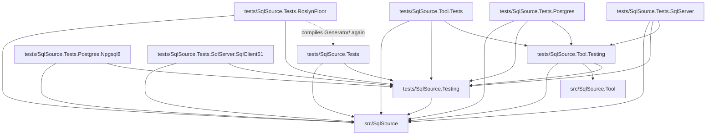

# Tests

SqlSource has seven test projects and two libraries that they share.  `dotnet test --solution SqlSource.slnx` runs every test project, and [`CONTRIBUTING.md`](../CONTRIBUTING.md) has the commands to build and test.  `tests/SqlSource.Tests.Postgres`, `tests/SqlSource.Tests.Postgres.Npgsql8`, `tests/SqlSource.Tests.SqlServer` and `tests/SqlSource.Tests.SqlServer.SqlClient61` need Docker running.

## The projects

The test projects:

| Project | Roslyn | Docker | Runs |
|----|----|----|----|
| `tests/SqlSource.Tests` | A current version | No | Every test of the generator |
| `tests/SqlSource.Tests.RoslynFloor` | 4.8.0, the oldest supported | No | The generator driver tests: the files of `tests/SqlSource.Tests/Generator/`, compiled a second time |
| `tests/SqlSource.Tool.Tests` | A current version | No | The tests of the tool, which run the whole command in process with their own output, working directory and environment |
| `tests/SqlSource.Tests.Postgres` | A current version | Yes | The PostgreSQL describer and the `describe` command against a real server, which Testcontainers starts, and the end-to-end project: the generator over its own queries, `--check`, and every query read into its models, through Dapper but for one read by ordinal |
| `tests/SqlSource.Tests.Postgres.Npgsql8` | 4.8.0, from `tests/SqlSource.Testing` | Yes | The read of `all_types` through Dapper on Npgsql 8.0.9, the oldest supported driver |
| `tests/SqlSource.Tests.SqlServer` | A current version | Yes | The SQL Server describer against a real server, which Testcontainers starts on an image pinned to its update and its build, with the fixture schema applied through `EndToEndFiles`: its sessions, its parameters and its fixture cases; its realistic corpus, on a database `realistic` of its own, where the describer's nullability is checked against a truth and against each query run over a seed; and SQL Server's end-to-end project: the generator over its own queries, `--check`, and every query read into its models, through Dapper but for one read by ordinal |
| `tests/SqlSource.Tests.SqlServer.SqlClient61` | 4.8.0, from `tests/SqlSource.Testing` | Yes | The read of `all_types` and `new_types` through Dapper on Microsoft.Data.SqlClient 6.1.7, the oldest supported driver |

`TerminationTests` of `tests/SqlSource.Tool.Tests` alone starts the tool that was built in a process of its own: to send it a signal, where the system has signals, and to close its console on Windows, which only `nightly.yml` runs.  `tests/SqlSource.Tests.Postgres`, `tests/SqlSource.Tests.Postgres.Npgsql8`, `tests/SqlSource.Tests.SqlServer` and `tests/SqlSource.Tests.SqlServer.SqlClient61` are the projects that `nightly.yml` leaves out, since the runners cannot start their containers.  The procedures of the first are in [`SqlSource.Tests.Postgres/README.md`](SqlSource.Tests.Postgres/README.md): Docker and the image, the describer's fixtures, the realistic corpus and the end-to-end project.  Those of the third are in [`SqlSource.Tests.SqlServer/README.md`](SqlSource.Tests.SqlServer/README.md): Docker, the emulation of its images on Apple silicon, the images and their builds, the fixture schema, the describer's fixtures, the realistic corpus and the end-to-end project.

A test in `tests/SqlSource.Tests/Generator/` must compile and pass in both `tests/SqlSource.Tests` and `tests/SqlSource.Tests.RoslynFloor`; [`SqlSource.Tests/Generator/AGENTS.md`](SqlSource.Tests/Generator/AGENTS.md) says what that asks of it, and why that folder is the only code a test project compiles of another.

The libraries are never run as tests, hold no tests and are never packed:

| Project | Roslyn | Holds |
|----|----|----|
| `tests/SqlSource.Testing` | 4.8.0, since RoslynFloor references it | The harness of the generator's driver tests (`Generator/`, with `GeneratorHarness`, whose `UsersPath` and `UsersNormalizedPath` are the path most tests give a `.sql` file, `Sidecars`, which hands the generator a sidecar, `StepOutputs`, which reads what a step gave, `ModelRuns`, the harness of the model tests, `CachingScene`, the fixture of the caching tests, `StepReasons`, which reads why each step of a run ran, `NpgsqlReferences`, the drivers the probe of Npgsql is tested against, and `SqlClientReferences`, those of the probe of Microsoft.Data.SqlClient), `TestSidecars` (`Snapshot/`), `RepositoryRoot`, `DefaultImages`, the default image of each engine, `EndToEndEngine`, each engine's folder of end-to-end databases and how its files split into commands, whole for PostgreSQL and at each line of `GO` alone for SQL Server, and `EndToEndFiles`, the paths of the schema and seed of each end-to-end database and the building of a test database from files, over a `DbDataSource` so that it needs no driver, at the library's root, and in `EndToEnd/`, `AllTypesRows`, the expectations of the rows of `all_types` for both PostgreSQL projects, which compares the values of `NpgsqlTypes` without a reference to Npgsql, since the two run different versions of it, `SqlServerAllTypesRows`, those of `all_types` and `new_types` for both SQL Server projects, which compares a `SqlVector<float>` without a reference to Microsoft.Data.SqlClient, for the same reason, and `CommittedEntries`, which counts the entries of the committed sidecars for each database for both end-to-end `CheckTests`.  It downloads Npgsql 8.0.3, 9.0.3 and 10.0.3 and Microsoft.Data.SqlClient 6.0.5, 6.1.7 and 7.1.1 with `PackageDownload`, and `NpgsqlReferences` and `SqlClientReferences` read their metadata from the NuGet folder, `NuGetPackageRoot`, without loading them, so a restore needs to reach the package source or find them in the NuGet cache |
| `tests/SqlSource.Tool.Testing` | A current version, the tool's | The helpers that the tool's tests and the tests of both container projects share |

`tests/SqlSource.Tool.Testing` holds:

- the harness of a whole command: `CliRun`, which fakes MSBuild and the environment or, as `CliRun.Real`, runs the real `dotnet msbuild` and the test process's environment, `CliResult`, `Hosts` and `Plans`;
- the fakes of a process and a project: `FakeProcessRunner`, `FakeProject` and `TestProject`;
- `Programs`, which starts the built tool and runs a program with a limit, its tree killed and the tool's `dotnet`, and `Eventually`, how every wait of the tests waits, with `Patience` as its one limit, which every caller of `Programs.RunAsync` uses too;
- `TestClock`, a clock that stands still until a test moves it, which a run, a host and a session of the tests stand on unless a test brings a clock;
- `LogReader`, `Secrets`, `SidecarFiles` and `TempFolder`;
- `Describers`, which opens a describer's session as a run does, and `DescribeRequests`, which builds the `DescribeRequest` of a test;
- `PasswordFiles`, which skips a test of a password file;
- the named answers of a column's nullability, `NullabilityAnswers`, and PostgreSQL's type modifiers, `Typmods`;
- in `Fixtures/`, the harness of a describer's fixtures, `FixtureCase`, `FixtureCases`, `FixtureReplay` and the case writer `FixtureCaseFiles`, and `FixtureProjects`, which copies a fixture project;
- in `Realistic/`, what a realistic corpus of any engine shares: `RealisticEngine`, `RealisticCase`, `RealisticCaseReader`, `RealisticSampleChecks`, `RealisticDescriptions` and `RealisticNoise`.

The two libraries are apart because the tool raises Roslyn to a current version, which would reach RoslynFloor through one library.  Their types stay `internal`: `src/SqlSource` and `src/SqlSource.Tool` grant them `InternalsVisibleTo`, and each library grants it to the projects that reference it.

Where a test goes is a rule of [`AGENTS.md`](AGENTS.md): the tests mirror the source folders.  `tests/SqlSource.Tool.Tests/Commands/` holds the tests that run a whole command line, `tests/SqlSource.Tool.Tests/Fixtures/` the tests of the fixtures' harness, which is in `tests/SqlSource.Tool.Testing/Fixtures/`, and `tests/SqlSource.Tool.Tests/Realistic/` those of `tests/SqlSource.Tool.Testing/Realistic/`, which build on `RealisticTestCases` at the project's root.  The helpers of the tests of `Describing/Postgres/` are these files of `tests/SqlSource.Tool.Tests`:

- `PostgresScript.cs`, `PostgresRows.cs`, `PostgresTables.cs`, `PostgresPlans.cs` and `FakePostgresServer.cs` are the helpers;
- `PostgresSessionCases.cs`, `PostgresEventCases.cs` and `PostgresWalkColumns.cs` hold what the classes split from one share, those named `PostgresSession*`, `PostgresEvents*` and `NullabilityWalk*`.

The helper of the tests of `Describing/SqlServer/` is `SqlServerScript.cs`, which answers a `SqlServerSession` from a capture that the test writes.

`CaptureInputs.cs` of the same project is for the tests that record and replay a capture, in `Describing/Capture/` and in `Describing/Describers/`, and `FileModes.cs` says whether a file mode can keep a file's owner out of it, for a test that skips when it cannot.

## How they reference each other

This graph is read from the `ProjectReference` items of each `.csproj`.  A solid arrow is a project reference.  The dotted arrow is the one file glob that crosses a project: RoslynFloor has `<Compile Include="../SqlSource.Tests/Generator/**/*.cs" LinkBase="Generator" />`.

What each test project takes from the libraries:

- `tests/SqlSource.Tests` references `tests/SqlSource.Testing` for the harness of the generator's driver tests, `TestSidecars` and `RepositoryRoot`, and `tests/SqlSource.Tests.RoslynFloor` references it for the harness.
- `tests/SqlSource.Tool.Tests` references `tests/SqlSource.Testing` for the harness of the generator's driver tests, which `GeneratorParityTests` runs with the tool over the same sources, and `tests/SqlSource.Tool.Testing` for the helpers it shares with `tests/SqlSource.Tests.Postgres` and `tests/SqlSource.Tests.SqlServer`.
- `tests/SqlSource.Tests.Postgres` references `tests/SqlSource.Testing` for `RepositoryRoot`, `DefaultImages`, `EndToEndFiles` and `EndToEndEngine`, `AllTypesRows`, `CommittedEntries`, `TestSidecars`, and `GeneratorHarness` and `Sidecars` of the harness, and `tests/SqlSource.Tool.Testing` for the fixture harness, the command harness of the tool's tests, `CliRun` and what it needs, `Programs`, `Eventually`, `FixtureProjects`, `Describers` and `DescribeRequests`, which open its sessions and build its requests, and the shared parts of its realistic corpus in `Realistic/`.
- `tests/SqlSource.Tests.Postgres.Npgsql8` references `tests/SqlSource.Testing` for `RepositoryRoot`, `DefaultImages`, `EndToEndFiles` and `EndToEndEngine`, and `AllTypesRows`, and nothing that brings Npgsql 10.
- `tests/SqlSource.Tests.SqlServer` references `tests/SqlSource.Testing` for `RepositoryRoot`, `DefaultImages`, `EndToEndFiles` and `EndToEndEngine`, which build its databases, `SqlServerAllTypesRows` and `CommittedEntries`, and `tests/SqlSource.Tool.Testing`: the tests of the SQL Server describer open their sessions and build their requests through it, its fixture harness describes the cases, as the PostgreSQL tests do, its command and process tests and its end-to-end `CheckTests` and `ErrorPathTests` run the tool through `CliRun`, `Programs`, `Eventually` and `FixtureProjects`, and its realistic corpus reads and checks its cases through `Realistic/`.
- `tests/SqlSource.Tests.SqlServer.SqlClient61` references `tests/SqlSource.Testing` for `DefaultImages`, `EndToEndFiles` and `EndToEndEngine`, and `SqlServerAllTypesRows`, and nothing that brings Microsoft.Data.SqlClient 7.

`tests/SqlSource.Tests`, `tests/SqlSource.Tests.Postgres`, `tests/SqlSource.Tests.Postgres.Npgsql8`, `tests/SqlSource.Tests.SqlServer` and `tests/SqlSource.Tests.SqlServer.SqlClient61` also use the generator the way a consumer does.  Their attributed types, in the `EndToEnd/` of the first, the second and the fourth, in `Realistic/Generation/RealisticQueries.cs` of the second and at the root of the third and the fifth, are compiled with the generator loaded, and each project imports `src/SqlSource/build/SqlSource.props` and `SqlSource.targets`, the MSBuild files the package ships.  Each gets them by path and the generator through a project reference.  [`tools/check-package-install.sh`](../tools/README.md#check-package-installsh) is what installs the packed package.

## The Npgsql 8 project

`tests/SqlSource.Tests.Postgres.Npgsql8` runs the read of `all_types` on Npgsql 8, the oldest driver that is supported, since the type map gives other C# types under it.  It is a project of its own because `tests/SqlSource.Tests.Postgres` cannot run on Npgsql 8: that project references the tool, which brings Npgsql 10, and a reference to 8 under it is a package downgrade.  So this one references the generator and `tests/SqlSource.Testing` alone, and pins Npgsql to 8.0.9 with `VersionOverride`.  It links `AllTypes.sql` and its sidecar from `tests/SqlSource.Tests.Postgres/EndToEnd/Queries/`, so the generator builds the models that it gives under Npgsql 8, and reads both rows of `all_types` into them through Dapper, with the expectations of `AllTypesRows`.  Its container, `AppContainer`, applies the schema and the seed of `app` on `DefaultImages.Postgres`, the default image, and ignores `SQLSOURCE_TESTS_POSTGRES_IMAGE`.  It has no `--check`: the end-to-end project checks the sidecar it reads.

## The SqlClient 6.1 project

`tests/SqlSource.Tests.SqlServer.SqlClient61` runs the read of `all_types` and `new_types` on Microsoft.Data.SqlClient 6.1, the oldest driver that is supported, the Npgsql 8 project's counterpart for SQL Server.  It is a project of its own because `tests/SqlSource.Tests.SqlServer` cannot run on 6.1: that project references the tool, which brings Microsoft.Data.SqlClient 7, and a reference to 6.1 under it is a package downgrade.  So this one references the generator and `tests/SqlSource.Testing` alone, and pins Microsoft.Data.SqlClient to 6.1.7 with `VersionOverride`.  It links `AllTypes.sql`, `NewTypes.sql` and their sidecars from `tests/SqlSource.Tests.SqlServer/EndToEnd/Queries/`, so the generator builds the models that it gives under 6.1.  It checks that their properties have the types that the end-to-end project's have under 7, and reads both rows of each table into them through Dapper, with the expectations of `SqlServerAllTypesRows`.  Its container, `AppContainer`, builds `app` alone, with its schema, its seed and `new-types.sql`, on `DefaultImages.SqlServer`, the default image, and ignores `SQLSOURCE_TESTS_SQLSERVER_IMAGE`.  It has no `--check`: the end-to-end project checks the sidecars it reads.

## Fixture projects

`tests/SqlSource.Tool.Tests/Fixtures/Projects/` holds small projects that are no part of the solution.  `ManifestTargetTests`, `FixtureProjectTests` and `TerminationTests` copy one to a temporary folder outside the repository, with the package's two MSBuild files and `global.json` beside it, and run `dotnet msbuild` on it for real, the second through the tool's own code and the third through the tool started as a process.  So these tests need the SDK that `global.json` pins, and take a second or two each.

MSBuild reads the environment for its properties, and the workflow has a variable named `CONFIGURATION`, so in CI a fixture is evaluated as `Release`.  A test of a fixture expects no `Debug`, in a constant or in a path.

A fixture project is no part of the solution, so nothing builds or restores it, and a test leaves nothing in the repository.  A file under that folder is copied to the test project's output as it is.  `FixtureProjects` of `tests/SqlSource.Tool.Testing` copies a fixture out of the repository for a test; [the PostgreSQL tests' readme](SqlSource.Tests.Postgres/README.md#running) says how that project gets `Single`, and `ErrorPaths`, a fixture of its own in `tests/SqlSource.Tests.Postgres/EndToEnd/ErrorPaths/`, which it copies to the same place in its output, and [the SQL Server tests' readme](SqlSource.Tests.SqlServer/README.md#running) how that project gets `SqlServer`, and its own `ErrorPaths`, in `tests/SqlSource.Tests.SqlServer/EndToEnd/ErrorPaths/`.

To add a fixture project, add a folder to `tests/SqlSource.Tool.Tests/Fixtures/Projects/` with an `App.csproj` that imports `../build/SqlSource.props` and `../build/SqlSource.targets`.
