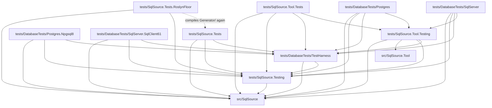

# Tests

SqlSource has seven test projects and three libraries that they share: three test projects under `tests/`, and the four that run against a real database under [`tests/DatabaseTests/`](DatabaseTests/README.md), which need Docker running.  `dotnet test --solution SqlSource.slnx` runs every test project, and [`CONTRIBUTING.md`](../CONTRIBUTING.md) has the commands to build and test.

## The projects

The test projects:

| Project | Roslyn | Docker | Runs |
|----|----|----|----|
| `tests/SqlSource.Tests` | A current version | No | Every test of the generator |
| `tests/SqlSource.Tests.RoslynFloor` | 4.8.0, the oldest supported | No | The generator driver tests: the files of `tests/SqlSource.Tests/Generator/`, compiled a second time |
| `tests/SqlSource.Tool.Tests` | A current version | No | The tests of the tool, which run the whole command in process with their own output, working directory and environment |

The four projects that run against a real server are in [`tests/DatabaseTests/`](DatabaseTests/README.md), whose readme has their table.

`TerminationTests` is the one test of `tests/SqlSource.Tool.Tests` that starts the tool that was built in a process of its own: to send it a signal, where the system has signals, and to close its console on Windows, which only `nightly.yml` runs.  `Describer/ToolProcessTests.cs` is the one of each container project.  `tests/DatabaseTests/Postgres`, `tests/DatabaseTests/Postgres.Npgsql8`, `tests/DatabaseTests/SqlServer` and `tests/DatabaseTests/SqlServer.SqlClient61` are the projects that the Windows and macOS job of `nightly.yml` leaves out, since its runners cannot start their containers; its Linux jobs run the first and the third on the supported majors that CI does not.  The procedures of the first are in [`DatabaseTests/Postgres/README.md`](DatabaseTests/Postgres/README.md): Docker and the image, the describer's fixtures, the realistic corpus and the end-to-end project.  Those of the third are in [`DatabaseTests/SqlServer/README.md`](DatabaseTests/SqlServer/README.md): Docker, the emulation of its images on Apple silicon, the images and their builds, the fixture schema, the describer's fixtures, the realistic corpus and the end-to-end project.

A test in `tests/SqlSource.Tests/Generator/` must compile and pass in both `tests/SqlSource.Tests` and `tests/SqlSource.Tests.RoslynFloor`; [`SqlSource.Tests/Generator/AGENTS.md`](SqlSource.Tests/Generator/AGENTS.md) says what that asks of it, and why that folder is the only code a test project compiles of another.

The libraries are never run as tests, hold no tests and are never packed:

| Project | Roslyn | Holds |
|----|----|----|
| `tests/SqlSource.Testing` | 4.8.0, since RoslynFloor references it | The harness of the generator's driver tests (`Generator/`, with `GeneratorHarness`, which writes a run's project settings file, `/sqlsource.json`, from the output, dialect, generator parameters and `settings` the test gives, and whose `UsersPath` and `UsersNormalizedPath` are the path most tests give a `.sql` file, `UsersFile` the file of one query, `GetUser`, at that path, and `SampleSource` the source of the type `Sample` that claims it, with `GeneratorRun.ShouldBeClean`, a run without a diagnostic, an error or a warning in generated code, and `GeneratedFile`, the lines that start a generated file of queries and of models, beside it, `LevelSettings`, which places a setting at each of its levels, the project's settings file, a folder's, the attribute, a header marker and a query's marker, `Sidecars`, which hands the generator a sidecar, `StepOutputs`, which reads what a step gave, `ModelRuns`, the harness of the model tests, `MethodRuns`, the harness of the method tests, `InMemoryAdditionalText`, an additional file held in memory, `CachingScene`, the fixture of the caching tests, whose runs read the project's settings file, `StepReasons`, which reads why each step of a run ran, `TestOptionsProvider`, which hands the generator the properties MSBuild tells it, of which the generator reads `SqlSourceBuildFolders` alone, `NpgsqlReferences`, the drivers the probe of Npgsql is tested against, and `SqlClientReferences`, those of the probe of Microsoft.Data.SqlClient), `SqlTexts`, the `.sql` texts that many tests of the generator and of the tool put in a project, `CultureScope`, which runs a test under another current culture and puts back the one it found, `TestSidecars` (`Snapshot/`), `RepositoryRoot`, which gives the path of every file of the repository that a test reads ([how it is checked](#reading-the-repository)), `RepositoryWorkingFolder`, the root as the folder to start a process in, which `RepositoryRoot.WorkingFolder` gives and which is no `string`, so that it cannot reach `Path.Combine`, `TestScopes`, which reads `tools/test-scopes.txt` for the check, as the script does, `ProjectIncludes`, which lists what a container project includes from outside its folder.  It downloads Npgsql 8.0.3, 9.0.3 and 10.0.3 and Microsoft.Data.SqlClient 6.0.5, 6.1.7 and 7.1.1 with `PackageDownload`, and `NpgsqlReferences` and `SqlClientReferences` read their metadata from the NuGet folder, `NuGetPackageRoot`, without loading them, so a restore needs to reach the package source or find them in the NuGet cache |
| `tests/DatabaseTests/TestHarness` | 4.8.0, through `tests/SqlSource.Testing`; it brings no Roslyn package of its own | The images and the containers of the database tests, which bring no database driver, no Dapper and nothing of the tool: `DefaultImages`, the default image of each engine, `EngineImage`, each engine's image of a run, which its variable can change, with its recorded majors, the gates that skip a test on a server whose version it does not suit and the start of its containers, `SqlServerStart` with `IStartingContainer`, which starts a SQL Server container of the tests and starts a new one, once, when the first crashed at its start, through Testcontainers' SQL Server module, `DescriberFixtures`, the folder and the `schema.sql` of each engine's describer fixtures, which its describer project reads and records in the repository, `EndToEndEngine`, each engine's folder of end-to-end databases and how its files split into commands, whole for PostgreSQL and at each line of `GO` alone for SQL Server, `EndToEndFiles`, the paths of the schema and seed of each end-to-end database and the building of a test database from files, over a `DbDataSource` so that it needs no driver, the two abstract containers, `PostgresContainer` and `SqlServerContainer`, which a project subclasses with its driver's `DbProviderFactory`, its image and its databases, each a name and the scripts to run in order, and `TestDatabases`, the steps that the two share, and in `EndToEnd/`, `AllTypesRows`, the expectations of the rows of `all_types` for both PostgreSQL projects, which compares the values of `NpgsqlTypes` without a reference to Npgsql, since the two run different versions of it, `SqlServerAllTypesRows`, those of `all_types` and `new_types` for both SQL Server projects, with the properties of `AllTypesDto` that both compare their model with, which compares a `SqlVector<float>` without a reference to Microsoft.Data.SqlClient, for the same reason, `ModelReflection`, how the end-to-end projects read a generated model by reflection, with only the framework: its public properties in the order they are declared, each with its type and whether it can be null, its shape, and the column of a property, `CommittedEntries`, which counts the entries of the committed sidecars for each database for both end-to-end `CheckTests`, `CallAllocations`, which measures the bytes of a generated method's calls against a hand-written method's for both end-to-end `AllocationTests`, `RowBufferByHand`, the generated pooled row buffer by hand, with its `ToArray`, `ToList` and `ToImmutableArray`, which their hand-written methods of every collection type that reads through the pool read their rows into and `Generation/Emitting/RowBufferTests.cs` of `tests/SqlSource.Tests` holds to the generated text, and `Level`, an enum over `byte` that a SQL Server query reads and sends from a `tinyint` by a type override, for the end-to-end project and the SqlClient 6.1 project that both compile that query |
| `tests/SqlSource.Tool.Testing` | A current version, the tool's | The helpers that the tool's tests and the tests of both container projects share |

`tests/SqlSource.Tool.Testing` holds:

- the harness of a whole command: `CliRun`, which fakes MSBuild and the environment or, as `CliRun.Real`, runs the real `dotnet msbuild` and the test process's environment, `CliResult`, `Hosts` and `Plans`, whose `Postgres` is a project with the dialect in its settings file;
- the fakes of a process and a project: `FakeProcessRunner`, `FakeProject` and `TestProject`, whose `Settings` is the project's `sqlsource.json` and `BuildFolders` the `SqlSourceBuildFolders` line of its manifest, which holds no setting;
- `Programs`, which starts the built tool and runs a program with a limit, its tree killed and the tool's `dotnet`, and names the program that waits (`Waiter`), and `Eventually`, how every wait of the tests waits, with `Patience` as its one limit, which every caller of `Programs.RunAsync` uses too;
- `TestClock`, a clock that stands still until a test moves it, which a run, a host and a session of the tests stand on unless a test brings a clock;
- `LogReader`, `Secrets`, `SidecarFiles` and `TempFolder`;
- the fakes and the reads of a describer's tests: `RecordingLog`, a log that keeps what it is given from any thread and finds a member by its name, `HookedExchange`, an exchange that runs a test's hook before and after a call, which moves a clock (`Clocked` moves it by the same time before each call) or acts on the server, and `Failures`, the texts and the message of a `DescribeFailure`;
- `Describers`, which opens a describer's session as a run does, and `DescribeRequests`, which builds the `DescribeRequest` of a test;
- `PasswordFiles`, which skips a test of a password file, and `Environments`, an environment of a test's own for what is handed `ToolHost.GetEnvironmentVariable`;
- the named answers of a column's nullability, `NullabilityAnswers`, and PostgreSQL's type modifiers, `Typmods`;
- in `Fixtures/`, the harness of a describer's fixtures, `FixtureCase`, `FixtureCases`, `FixtureReplay`, the case writer `FixtureCaseFiles` and `FixtureCaseRuns`, which describes a case against a server and compares it with its `expected.json` or records it, and `FixtureProjects`, which copies a fixture project;
- `ToolProcess`, which runs the built tool's `describe` in a process of its own on a copy of a fixture project and checks its output and its sidecar, and `ErrorPaths`, which runs the error paths of `--check` and of a refused query on a copy of the fixture project `ErrorPaths`, with an `ErrorPathEngine` for the statements and describers of an engine;
- in `Realistic/`, what a realistic corpus of any engine shares: `RealisticCorpus`, each engine's corpus, its files, its settings files (`ProjectSettingsFile` and `CasesSettingsFile`) and its cases, `RealisticEngine`, `RealisticCase`, `RealisticCaseReader`, `RealisticSampleChecks`, `RealisticSample`, which builds a sample as the reader builds one, for the tests of both engines, `RealisticDescriptions`, `RealisticNoise`, `RealisticClaims`, which reads the claims of a corpus's `RealisticQueries.cs` and `RealisticMethods.cs`, `RealisticModels`, which finds a case's models, its SQL and its method in an engine's assembly, `RealisticCalls`, which checks and calls a case's method, `RealisticInputs`, which builds the input model of a sample and the arguments Dapper is given from it, for which the library references Dapper, and `RealisticDescribe`, which describes a case on an engine's database `realistic`.  Each engine's project binds them in its `Realistic/RealisticCases.cs`.

The three libraries are apart because each is referenced by a project that cannot take what the others bring.  `tests/SqlSource.Testing` is referenced by RoslynFloor, so it stays on the pinned Roslyn and references nothing of the tool, since the tool raises Roslyn to a current version.  `tests/DatabaseTests/TestHarness` is referenced by the driver-floor projects, so it brings no database driver, no Dapper and nothing of the tool.  `tests/SqlSource.Tool.Testing` references the tool.  Their types stay `internal`, but `SettingLevel` of `tests/SqlSource.Testing` and the harness's two containers, which a project's public fixture subclasses: `src/SqlSource` and `src/SqlSource.Tool` grant them `InternalsVisibleTo`, and each library grants it to the projects that reference it.

Where a test goes is a rule of [`AGENTS.md`](AGENTS.md): the tests mirror the source folders.  `tests/SqlSource.Tool.Tests/Commands/` holds the tests that run a whole command line, `tests/SqlSource.Tool.Tests/Fixtures/` the tests of the fixtures' harness, which is in `tests/SqlSource.Tool.Testing/Fixtures/`, and `tests/SqlSource.Tool.Tests/Realistic/` those of `tests/SqlSource.Tool.Testing/Realistic/`, which build on `RealisticTestCases` at the project's root.  The helpers of the tests of `Describing/Postgres/` are these files of `tests/SqlSource.Tool.Tests`:

- `PostgresScript.cs`, `PostgresRows.cs`, `PostgresTables.cs`, `PostgresPlans.cs` and `FakePostgresServer.cs` are the helpers;
- `PostgresSessionCases.cs`, `PostgresEventCases.cs` and `PostgresWalkColumns.cs` hold what the classes split from one share, those named `PostgresSession*`, `PostgresEvents*` and `NullabilityWalk*`.

The helpers of the tests of `Describing/SqlServer/` are `SqlServerScript.cs`, which answers a `SqlServerSession` from a capture that the test writes, and holds the type, the error and the column rows that both families of classes build their answers from, and `SqlServerSessionCases.cs` and `SqlServerEventCases.cs`, which hold what the classes split from one share, those named `SqlServerSession*` and `SqlServerEvents*`.

`DatabaseRunsScene.cs` holds what the classes split from `DatabaseRunsTests` share, those named `DatabaseRuns*` in `Describing/`: the folder, the project, the describer behind a capturing exchange, the environment, the writer of errors and the run of step 3.

`CaptureInputs.cs` of the same project is for the tests that record and replay a capture, in `Describing/Capture/` and in `Describing/Describers/`, and `FileModes.cs` says whether a file mode can keep a file's owner out of it, for a test that skips when it cannot.

## How they reference each other

This graph is read from the `ProjectReference` items of each `.csproj`.  A solid arrow is a project reference.  The dotted arrow is the one file glob that crosses a project: RoslynFloor has `<Compile Include="../SqlSource.Tests/Generator/**/*.cs" LinkBase="Generator" />`.

What each test project takes from the libraries:

- `tests/SqlSource.Tests` references `tests/SqlSource.Testing` for the harness of the generator's driver tests, `TestSidecars`, `CultureScope`, `RepositoryRoot`, and `TestScopes` and `ProjectIncludes` for `Validation/`, and `tests/SqlSource.Tests.RoslynFloor` references it for the harness.  It references `tests/DatabaseTests/TestHarness` for the tests of the harness in `TestHarness/`, which need no Docker, and for `RowBufferByHand`.
- `tests/SqlSource.Tool.Tests` references `tests/SqlSource.Testing` for the harness of the generator's driver tests, which `GeneratorParityTests` runs with the tool over the same sources, and for `SqlTexts`, references `tests/DatabaseTests/TestHarness` for `EngineImage`, and references `tests/SqlSource.Tool.Testing` for the helpers it shares with `tests/DatabaseTests/Postgres` and `tests/DatabaseTests/SqlServer`.
- `tests/SqlSource.Tool.Testing` references `tests/DatabaseTests/TestHarness` for `EngineImage` and `ModelReflection`, which its `Realistic/` reads.
- `tests/DatabaseTests/Postgres` references `tests/SqlSource.Testing` for `RepositoryRoot`, `TestSidecars`, and `GeneratorHarness` and `Sidecars` of the generator's harness, `tests/DatabaseTests/TestHarness` for `DefaultImages`, `EngineImage`, `DescriberFixtures`, `PostgresContainer`, which its fixture subclasses, `EndToEndFiles` and `EndToEndEngine`, `AllTypesRows`, `ModelReflection`, `CommittedEntries`, `CallAllocations` and `RowBufferByHand`, and `tests/SqlSource.Tool.Testing` for the fixture harness, the command harness of the tool's tests, `CliRun` and what it needs, `Programs`, `Eventually`, `FixtureProjects`, `FixtureCaseRuns`, `ToolProcess`, `ErrorPaths`, `Describers` and `DescribeRequests`, which open its sessions and build its requests, `HookedExchange` and `Failures`, which its session tests act and read through, and the shared parts of its realistic corpus in `Realistic/`.
- `tests/DatabaseTests/Postgres.Npgsql8` references `tests/SqlSource.Testing` for `RepositoryRoot` and `tests/DatabaseTests/TestHarness` for `DefaultImages`, `EngineImage`, `PostgresContainer`, which its fixture subclasses, `EndToEndFiles` and `EndToEndEngine`, `AllTypesRows` and `ModelReflection`, and nothing that brings Npgsql 10.
- `tests/DatabaseTests/SqlServer` references `tests/SqlSource.Testing` for `RepositoryRoot`, and `GeneratorHarness`, `Sidecars` and `SqlClientReferences` of the generator's harness, which its realistic corpus's refusal of models runs the generator through, `tests/DatabaseTests/TestHarness` for `DefaultImages`, `EngineImage`, which starts its container through `SqlServerStart`, `DescriberFixtures`, `SqlServerContainer`, which its fixture subclasses, `EndToEndFiles` and `EndToEndEngine`, which build its databases, `SqlServerAllTypesRows`, `ModelReflection`, `CommittedEntries`, `CallAllocations` and `RowBufferByHand`, and `tests/SqlSource.Tool.Testing`: the tests of the SQL Server describer open their sessions and build their requests through it, its fixture harness describes the cases, as the PostgreSQL tests do, its command and process tests and its end-to-end `CheckTests` and `ErrorPathTests` run the tool through `CliRun`, `Programs`, `Eventually`, `FixtureProjects`, `ToolProcess` and `ErrorPaths`, and its driver tests keep their log in `RecordingLog` and act around a call with `HookedExchange`, its session tests read a failure through `Failures`, and its realistic corpus reads and checks its cases through `Realistic/`.
- `tests/DatabaseTests/SqlServer.SqlClient61` references `tests/DatabaseTests/TestHarness` for `EngineImage`, which starts its container through `SqlServerStart`, `SqlServerContainer`, which its fixture subclasses, `EndToEndFiles` and `EndToEndEngine`, `SqlServerAllTypesRows`, `Level` and `ModelReflection`, and nothing that brings Microsoft.Data.SqlClient 7.

`tests/SqlSource.Tests`, `tests/DatabaseTests/Postgres`, `tests/DatabaseTests/Postgres.Npgsql8`, `tests/DatabaseTests/SqlServer` and `tests/DatabaseTests/SqlServer.SqlClient61` also use the generator the way a consumer does.  Their attributed types, in the `EndToEnd/` of the first, the second and the fourth, in `Realistic/Generation/RealisticQueries.cs` and `Realistic/Generation/RealisticMethods.cs` of the second and the fourth and at the root of the third and the fifth, are compiled with the generator loaded, and each project imports `src/SqlSource/build/SqlSource.props` and `SqlSource.targets`, the MSBuild files the package ships, and the props have the SDK import the third, `SqlSource.AfterSdk.targets`.  Each gets them by path and the generator through a project reference.  [`tools/check-package-install.sh`](../tools/README.md#check-package-installsh) is what installs the packed package.

## Reading the repository

A test that reads a file of the repository, rather than its own output, gets the path from `RepositoryRoot.Path("tests", "SqlSource.Tool.Tests", "Fixtures", "Describers", "postgres")` in `tests/SqlSource.Testing`, and the folder it starts a process in from `RepositoryRoot.WorkingFolder`.

`pre-commit-validation.sh` skips the pair of container test projects that the uncommitted change cannot reach, which `tools/test-scopes.txt` decides for each path ([the file](../tools/README.md#test-scopes)).  A skipped project would pass on a change that breaks it if it read a file that the table says it does not depend on, so the table is checked in two ways.

- **At run time**, `RepositoryRoot.Path` throws in a container project when the path, or any file below a folder, falls in a scope that would let a change to it skip that project.  The message names the project, the path and its scope.  A read that has never run is not caught, so a new read fails the first time its test runs, in the change that adds it.  It throws in whichever container project reads the file; `RepositoryRootTests` in `tests/SqlSource.Tests`, which every run includes, tests the check itself.  The check knows a project by the name of its assembly, so `RunningProjectTests` in each container project, which needs no container, fails when that name is not a project of `tools/test-scopes.txt`.
- **At build time**, `ContainerProjectInputsTests` in `tests/SqlSource.Tests`, which every run includes, takes every file that a container project includes from outside its own folder, a linked file, a referenced project or an import, through its `.csproj`, a `Directory.Build.props` or `Directory.Build.targets` from its folder up to the root, or a project under `tests/` that it references, directly or not, with the `Directory.Build` files above that project, and every file under `tests/` that an import of any of those names, `tests/Fixtures.props` among them, and fails on one whose scope would skip that project.

When `RepositoryRoot.Path` throws, there are two causes:

1. The read reaches the other engine's files or a file of `none`.  A PostgreSQL test that reads a SQL Server fixture, or a shared folder where it needs its engine's own subfolder, is wrong: read the narrower path.
2. The file is the project's own, and `tools/test-scopes.txt` misses a line for it: add the line, with the project's engine, before any broader line that would decide the path first.  Then run `pre-commit-validation.sh --plan <path>` to see the effect, and the tests in `tests/SqlSource.Tests/Validation/` check that the line matches a file.

A `.csproj` that the check refuses is fixed the same way: stop linking the file, or give it a scope that runs the project.

## The database projects

The four projects of [`tests/DatabaseTests/`](DatabaseTests/README.md) run against a real server, and reference [the harness](DatabaseTests/README.md#the-harness) in `tests/DatabaseTests/TestHarness`; its readme has their table, how to run one on another image, and [the Npgsql 8 project](DatabaseTests/README.md#the-npgsql-8-project) and [the SqlClient 6.1 project](DatabaseTests/README.md#the-sqlclient-61-project), the two that pin the oldest supported driver.

## Fixture projects

`tests/SqlSource.Tool.Tests/Fixtures/Projects/` holds small projects that are no part of the solution.  `ManifestTargetTests`, `FixtureProjectTests`, `TerminationTests` and `SettingsFileSearchTests` copy one to a temporary folder outside the repository, with the package's three MSBuild files and `global.json` beside it, and run `dotnet msbuild` on it for real, the second through the tool's own code, the third through the tool started as a process, and the fourth as a design-time build of an IDE, which restores the copy first.  So these tests need the SDK that `global.json` pins, and take a second or two each.

MSBuild reads the environment for its properties, and the workflow has a variable named `CONFIGURATION`, so in CI a fixture is evaluated as `Release`.  A test of a fixture expects no `Debug`, in a constant or in a path.

A fixture project is no part of the solution, so nothing builds or restores it, and a test leaves nothing in the repository.  A file under that folder is copied to the test project's output as it is.  The package's three MSBuild files and `global.json` come beside the copied fixtures from `tests/Fixtures.props`, which the tool's tests and the two describer projects import.  `FixtureProjects` of `tests/SqlSource.Tool.Testing` copies a fixture out of the repository for a test; [the PostgreSQL tests' readme](DatabaseTests/Postgres/README.md#running) says how that project gets `Single`, and `ErrorPaths`, a fixture of its own in `tests/DatabaseTests/Postgres/EndToEnd/ErrorPaths/`, which it copies to the same place in its output, and [the SQL Server tests' readme](DatabaseTests/SqlServer/README.md#running) how that project gets `SqlServer`, and its own `ErrorPaths`, in `tests/DatabaseTests/SqlServer/EndToEnd/ErrorPaths/`.

To add a fixture project, add a folder to `tests/SqlSource.Tool.Tests/Fixtures/Projects/` with an `App.csproj` that imports `../build/SqlSource.props` and `../build/SqlSource.targets`.  `SettingsFiles` has its project in `App/`, a folder below, so that it has settings files above the project; it imports `../../build/`.  A fixture that needs a setting has a `sqlsource.json` of its own, with `"root": true`, so that no settings file above its copy in the temporary directory applies, as `Single` and `SqlServer` have.  A `sqlsource.json` of a fixture never sits above a project that the solution builds.
